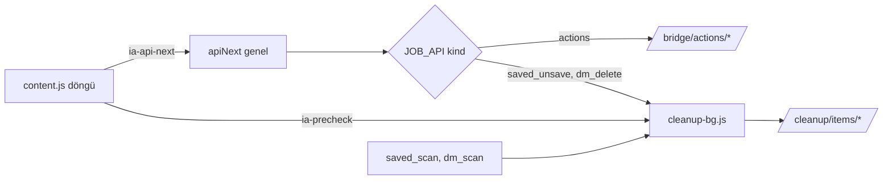

# Mimari görüş: SPEC-001 Kaydedilenleri temizleme ve DM silme

Mimari görüş: `docs/specs/SPEC-001-kaydedilen-ve-dm-temizleme.md` | Tarih: 2026-11-08 | Karar: **KOŞULLU ONAY**

> Bu bir görüştür; spec değiştirilmedi. Koşullar spec sahibi (business-analyst) tarafından spec'e işlenir, imzadan önce kurul tekrar bakar.
> Kayıt yeri notu: görüş `docs/specs/SPEC-001-kurul-gorusu.md` olarak istendi; kurulun yazma alanı yalnız `docs/architecture/` olduğu için buraya yazıldı.

## Özet

Altı yeni tablo kararı (§6.2 B) aşırı mühendislik **değil**: her tablo en az bir kabul kriterini taşıyor ve daha az tabloya indirmenin her yolu ya bir sınırı bulanıklaştırıyor ya da takip kuyruğuna dokunuyor (aşağıda tablo tablo). Yeni teknoloji veya bağımlılık yok. Asıl riskler tablo sayısında değil, ayrıntıda: (1) §6.2 mevcut `gate()`'in yeniden kullanılacağını söylüyor ama `gate()` takip anahtarına (`allow_actions`) bağlı; (2) "tüm FK'ler cascade" kuralı yeniden taramada etkin partiyi siler; (3) `plan_hash`'in dayandığı "whitelist sürümü" şemada yok; (4) eklentinin ölü döngü eşiği (60 sn) DM gecikmesine (30-60 sn + 3 istek) dayanmıyor. Dokuz koşul aşağıda.

## Kararlar ve değerlendirme

| # | Karar (spec) | Gerekçe var mı? | Alternatif | Risk | Sonuç |
|---|---|---|---|---|---|
| K1 | Veri modeli B: 6 yeni tablo, `bridge_actions` değişmez (§6.2) | Var, iki seçenekli tablo | A: `bridge_actions` genelleştir; B−: 5 tablo (envanterleri birleştir) | Kod tekrarı (~300 satır) | **Onay** (koşul 1, 2, 3, 4) |
| K2 | `sessions`'a 8 kolon (§7.2) | Kısmen (mevcut `allow_actions`/`actions_enabled_at` deseni) | Ayrı 1:1 ayar tablosu | Düşük | **Onay**: mevcut desene uyuyor, 7. tablo gereksiz |
| K3 | Tür başına bütçe, `RiskProfile`'a `ActionBudget` (§6.4) | Var | Takip bütçesini paylaşmak (spec reddediyor, doğru) | Isınma kuralı mevcutla farklı biçimde | **Onay** (koşul 1) |
| K4 | `paused_until` tüm türlerde ortak (REQ-10) | Var (kısıtlama hesap düzeyinde) | Tür başına duraklatma | Yok | **Onay** |
| K5 | `action_log.ig_user_id` nullable + `target_ref`/`target_label` (§7.2) | Var | Ayrı `cleanup_log` tablosu | Paylaşılan tabloda anlam değişimi; downgrade asimetrisi | **Onay**: tek denetim kaydı doğru; asimetri spec'te yazılı |
| K6 | Tek migration `o5e7a9c1d3f5`, `down_revision='n4d6f8b0c2e4'` (§7.3) | Kısmen | Faz başına iki migration | Faz 2 no-go olursa ölü DM şeması kalır | **Koşullu** (koşul 5) |
| K7 | Eklentide 4 yeni iş türü, mevcut `runApiJob`/`ia-api-next` döngüsü (§6.6) | Kısmen | Tür adaptörü + ayrı dosya | Takip yolunda sessiz regresyon; ölü döngü eşiği | **Koşullu** (koşul 6, 7) |
| K8 | Tembel saklama temizliği "her cleanup uç noktası çağrısında" (§7.2 Saklama) | Yok | Celery beat (mevcut) ya da yalnız okuma uçları | `precheck`/`next` sıcak yolda gecikme ve kilit | **Koşullu** (koşul 8) |
| K9 | Yeni bağımlılık yok (§2, §11) | Var | — | — | **Doğrulandı** (aşağıda) |

### K1 ayrıntı: altı tablo gerekli mi, daha azıyla olur mu?

| Tablo | Hangi kriter onu istiyor | Kaldırılırsa / birleştirilirse |
|---|---|---|
| `cleanup_scans` | AC-S1 (atomik yer değiştirme), AC-D14 (`scan_stale`), `scan_running`, `scan_too_soon` (saatte 2) | Durum `sessions`'a en az 6 kolon daha olarak taşınır; atomik değiştirme için yine bir "tarama kimliği" gerekir. `sync_jobs` yeniden kullanılabilir ama onun durum kümesi ve UI listesi farklı; tarama satırları senkron geçmişine karışır. Kazanç yok. |
| `saved_targets` | REQ-19, AC-S2, AC-S5 | — |
| `dm_targets` | REQ-23, AC-D1, AC-D2 (şemada metin kolonu yok), 7 günlük saklama | `saved_targets` ile tek `cleanup_targets` (B−) yapılabilir: ~8 seyrek nullable kolon, tür başına CHECK, farklı saklama süresi WHERE ile. Bir tablo eksilir, AC-D2'nin "tipli kolon" güvencesi zayıflar (jsonb `meta`'ya kayma eğilimi). **Önerilmez.** |
| `cleanup_batches` | AC-C5 (taslak öğe üretmez), AC-C6..C9, `plan_hash`, 30 dk TTL, REQ-7 | Taslak partide öğe olmadığı için (AC-C5) taslağın tutulacağı başka yer yok. Zorunlu. |
| `cleanup_items` | REQ-9, REQ-14, REQ-15, AC-C15, AC-C19, AC-D13 (bilet) | Bu, A seçeneğindeki `bridge_actions` genişletmesinin karşılığı. Doğrulandı: `enqueue` `Relationship.we_follow`'a bağlı (`bridge_actions.py:86`), `report` ilişkiyi günceller (`:167-174`), `_done_since` tür filtresi olmadan sayar (`:40-42`), `ig_user_id` FK `ig_users`'a (`models/bridge_action.py:16`). A, takip yolunun her fonksiyonuna tür dalı ekler. |
| `dm_whitelist` | REQ-24..28, AC-D3, AC-D4, AC-D10 | — |

Sonuç: altı tablo bu kriter kümesi için en küçük temiz çözüm. Gerçek tasarruf noktası tablo sayısı değil, Faz 2'ye ait iki tablonun ve DM kolonlarının Faz 1 migration'ına girmemesi (koşul 5).

### K7 ayrıntı: eklentide iş türü ayrımı

Doğrulanan durum:
- `background.js` 1019 satır, klasik service worker (`manifest.json:16-18`, `"type": "module"` yok), tek iş modeli: durum `chrome.storage.session`'da tek `job` (`background.js:318-330`); aynı anda tek iş (`:435-443`).
- Takip yolu türe sabit kodlu: `pullNewItems` `/bridge/actions/next`'e gider ve yalnız `follow|unfollow` kabul eder (`:680-688`), `recordActionResult` `/bridge/actions/{id}/result`'a yazar (`:709-714`), `apiNext` `KIND_LABEL.actions` kullanır (`:776`), `ia-job-tick` `job.kind !== 'actions'` ile çıkar (`:901`).
- Ölü döngü eşiği `API_DEAD_AFTER_MS = 60 * 1000` (`:13`), yorumu "3-5 sn bekleme" varsayıyor. DM safe gecikmesi 30-60 sn + taze meta GET + precheck + silme POST + doğrulama GET bunu aşar; kullanıcı bu sırada başka bir iş başlatırsa canlı iş "yanıt vermiyor" diye durdurulur (`:438-439`).
- `content.js` tek IIFE (`content.js:10`); yardımcılar (`igFetch`, `shape`, `blockedResponse`) kapanış içinde.
- Testler kaynakları ham metin olarak `new Function(...)` ile çalıştırıyor (`extension-update.test.ts:49`, `extension-api.test.ts:48`).

Öneri (koşul 6): `background.js` içinde türden bağımsız bir adaptör tablosu (`JOB_API = { actions: {...}, saved_unsave: {...}, dm_delete: {...} }`: next/result URL'si, öğe doğrulayıcı, etiket, gecikme); yeni türlerin kodu ayrı `cleanup-bg.js` dosyasında, `background.js` başında `importScripts('cleanup-bg.js')` ile (klasik service worker'da çalışır, paketleyici ve bağımlılık gerekmez). Test düzeni iki ham kaynağı birleştirip `importScripts`'i boş saplamayla çalıştırır. `content.js` bu spec'te bölünmez (IIFE'yi bölmek ortak bir isim alanı gerektirir, maliyeti faydasından büyük); yeni kod tek bölümde, alan beyaz listesi kurucuları saf fonksiyon olarak.

### Eklenti iş türleri nasıl ayrılır?

Açıklama: içerik betiği tek döngüyü sürdürür, arka plandaki genel `apiNext` iş türüne göre adaptör seçer; takip işleri mevcut `/bridge/actions` uçlarına, ek işler yeni dosyadaki kodla `/cleanup` uçlarına gider. Metin eşdeğeri:

| Kaynak | Mesaj / seçim | Hedef |
|---|---|---|
| content.js | `ia-api-next` | genel `apiNext` |
| `apiNext` | `kind = actions` | `/api/sessions/{id}/bridge/actions/*` (değişmez) |
| `apiNext` | `kind = saved_unsave \| dm_delete` | `cleanup-bg.js` → `/api/sessions/{id}/cleanup/items/*` |
| content.js | `ia-precheck` | `cleanup-bg.js` → `POST .../precheck` |
| tarama işleri | `saved_scan`, `dm_scan` (sayfalı okuma döngüsü) | `cleanup-bg.js` → `.../scan/*` |

### K9 ayrıntı: yeni bağımlılık

Yok. `frontend/package.json` bağımlılıklarına spec bir şey eklemiyor (`zod` zaten var). Backend tarafında `plan_hash` ve bilet için `hashlib`/`secrets` standart kütüphane. Yeni servis, kuyruk ya da veritabanı yok. Gerekçe tablosu gerekmiyor; CEO'ya "yeni teknoloji" rotası açılmıyor.

## Gereksiz bulunanlar (kriteri olmayan)

- Yok (katman/teknoloji düzeyinde). Tek aday K8: saklama temizliğinin yürütme uçlarına gömülmesi hiçbir kriterden gelmiyor (koşul 8).

## Geri alması pahalı kararlar

| Karar | Neden pahalı | ADR gerekli mi |
|---|---|---|
| Yıkıcı işlerin takip kuyruğundan ayrı şemada tutulması (K1) | Veri modeli; sonradan birleştirmek iki kuyruğun geçmişini taşımayı gerektirir | **Evet** |
| `action_log.ig_user_id` nullable (K5) | Paylaşılan denetim tablosu; downgrade NOT NULL'ı geri koyamaz (spec §7.3 kabul ediyor) | Evet (aynı ADR'de) |
| Eklenti ↔ backend sözleşmesi (`/cleanup/*`, `precheck` bileti, eklenti 2.9.0 alt sınırı) | Eklenti kullanıcının tarayıcısında; backend revert'i eklentiyi geri almaz, sürüm uyumsuzluğu yıkıcı işte fail-closed olmalı | Evet (aynı ADR'de, sürüm uyumluluğu kuralıyla) |

## Koşullar

1. **`gate()` yeniden kullanılmaz.** `bridge_actions.gate()` önce `session.allow_actions`'a bakar (`bridge_actions.py:45-51`); ek işlerde kullanılırsa takip işlemlerini kapatmak ek işleri de "off" yapar ve REQ-3'ün tür başına anlamı bozulur. Spec §6.2'deki "ortak kapılar (`gate`, …) yeniden kullanılır" ifadesi düzeltilir: ek işler kendi tür anahtarına (`allow_unsave` / `allow_dm_delete`) + ortak `paused_until` + `in_quiet_hours`'a bakar. `bridge_actions.py` değiştirilmez (§13 ile tutarlı); ortak sabitler (`BLOCK_PAUSE`, `QUIET_HOURS`) içe aktarılır. Isınma: mevcut `effective_action_limits` mutlak tavan kullanır (`RAMP_UP = ((3, 20), (7, 40))`, `risk_profiles.py:96`), spec oran istiyor (1/3, 2/3); bu yüzden yeni bir `effective_budget(kind, …)` yazılır, mevcut fonksiyon ve testleri değişmez.
2. **`cleanup_batches.scan_id` cascade olmaz.** Spec "tüm FK'ler `ON DELETE CASCADE`" diyor (§7.1) ve "envanter yeni tarama bitince eski tarama ile birlikte silinir" (§7.2). Birlikte okununca: onaylı bir parti çalışırken yeniden tarama biterse eski tarama silinir, cascade partiyi ve öğelerini (geçmiş dahil) siler. Spec şunu yazar: `cleanup_batches.scan_id` nullable + `ON DELETE SET NULL` (yalnız `session_id` FK'leri cascade); `scan_id IS NULL` olan taslağın `confirm`'ü 409 `plan_changed`. Bir AC + test eklenir ("etkin parti varken yeniden tarama partiyi ve öğeleri silmez").
3. **"Whitelist sürümü" tanımlanır.** `plan_hash` = sha256(refs + whitelist sürümü + kural değerleri) (§7.2) ama şemada sürüm alanı yok. Seçenekler: `sessions.dm_whitelist_rev integer not null default 0` (her ekleme/silmede +1) ya da `confirm` anında sıralı whitelist satırlarının özeti. Kurul önerisi: sayaç kolonu (ucuz, deterministik). Ayrıca spec, `confirm`'ün kümeyi envanterden ve güncel `relationships`'ten **yeniden hesaplayıp** hash'i karşılaştırdığını açıkça yazar (R3/R4 ilişki verisine bağlı, AC-C7 bunu kapsamalı).
4. **Öğe durumları sonuçlarla eşlenir.** `cleanup_items.status` kümesi `pending|done|skipped|failed|protected|cancelled`, sonuçlar ise `done|already|not_found|failed|blocked|protected`; arayüz özeti "yapıldı / zaten / bulunamadı / başarısız" ayrımını istiyor (§4, AC-U10). Ya `already` ve `not_found` ayrı durum olur ya da eşleme tablosu yazılır (ör. `already→skipped`, `not_found→skipped` + `note`). Kurul önerisi: ayrı durumlar (`varchar(10)`'a sığar), çünkü bütçe yalnız `done` sayar ve geçmiş filtresi durumla çalışır; sonradan bölmek veri göçü ister.
5. **Migration faz başına bölünür.** Zincir doğrulandı: tek kök `8ef28bafe420`, doğrusal, head `n4d6f8b0c2e4`; `o5e7a9c1d3f5` adlandırma desenine uyuyor. Ama Faz 2 spike'a bağlı ("no-go" olabilir), bu yüzden: `o5e7a9c1d3f5` = ortak + kaydedilenler (`cleanup_scans`, `saved_targets`, `cleanup_batches`, `cleanup_items`, `allow_unsave`, `unsave_enabled_at`, `action_log` değişiklikleri); ayrı `p…` revizyonu = `dm_targets`, `dm_whitelist`, `dm_*` kolonları, Faz 2 "go" ile. Ek olarak: kısmi benzersiz indeksler hem migration'da hem modelde `postgresql_where` ile tanımlanır (autogenerate kayması olmasın); CHECK kısıtları adlandırılır; `upgrade → downgrade → upgrade` test veritabanında (`instaanalytic_pytest`) koşturulup çıktı kanıt olarak gösterilir.
6. **Eklentide tür ayrımı adaptörle ve ayrı dosyayla yapılır.** Yukarıdaki K7 önerisi: `JOB_API` adaptör tablosu, yeni kod `frontend/extension/cleanup-bg.js` (`importScripts`), takip yolundaki `recordActionResult`, `pullNewItems`, `actionStepDone`, `ia-job-tick` davranışı değişmez; mevcut eklenti testleri (`extension-actions.test.ts`, `extension-api.test.ts`, `extension-update.test.ts`) **değiştirilmeden** yeşil kalır, bu regresyon kanıtıdır. Spec ayrıca şunu yazar: eklenti aynı anda tek iş çalıştırır, takip ve ek işler sırayla çalışır; AC-C10'daki "ayrı bütçe" backend sayımıdır, eşzamanlılık değildir.
7. **Ölü döngü eşiği işe göre hesaplanır.** `API_DEAD_AFTER_MS` sabit 60 sn yerine iş başına (ör. `2 × gecikme üst sınırı + 60 sn`) ya da bekleme sırasında kalp atışı (`beat`) güncellenir. Eklenti testi: DM safe gecikmesinde (60 sn) çalışan iş, ikinci bir `startJob` ile yanlışlıkla durdurulmaz.
8. **Saklama temizliği sıcak yoldan çıkar.** `next`, `precheck`, `result` içinde silme sorgusu çalışmaz (precheck zaman aşımı fail-closed'a, yani gereksiz `failed`'a döner). Mevcut Celery beat'e günlük bir görev ya da yalnız okuma uçlarında (`status`, `inventory`, `history`) tembel temizlik. Yeni bileşen gerekmez.
9. **ADR yazılır.** `docs/architecture/adr/ADR-0001-ek-isler-ayri-kuyruk.md`: (a) yıkıcı işlerin ayrı şeması ve A'nın reddi, (b) `action_log.ig_user_id` nullable ve downgrade asimetrisi, (c) eklenti ↔ backend sözleşmesi ve sürüm kuralı (backend, `ext_version < 2.9.0` ile gelen `cleanup` çağrısını reddeder; fail-closed). ADR'yi spec sahibi yazar (kurul kendi önerisini onaylamaz), kurul inceler. T-1 başlamadan önce.

## STACK.md değişikliği

Kayıt yoktu; `docs/architecture/STACK.md` mevcut yığınla açıldı (kaynak: `CLAUDE.md`, `frontend/package.json`, `frontend/extension/manifest.json`). Bu spec yeni teknoloji eklemiyor, durum değişikliği yok.

## Cevaplanmamış sorular (CEO'ya, öneriyle)

1. **Hesap düzeyinde toplam yazma tavanı olsun mu?** Bütçeler ayrı olduğu için aggressive profilde aynı saatte sırayla takip 15 + unsave 80 + DM 50 = 145 yazma mümkün (`risk_profiles.py:90` + spec §6.4). Kısıtlama hesap düzeyinde (spec §6.4'ün kendi gerekçesi). **Öneri:** türlerin üstünde ortak bir saatlik sert tavan (ör. 80/sa); sayı Soru 4 ile birlikte karara bağlansın.
2. **Bütçe dolunca iş nasıl sürer?** Saatlik tavan dolunca `next` `limit` döner ve iş biter; REQ-16 kendiliğinden başlatmayı yasaklıyor. Safe profilde 500 öğelik unsave partisi (40/sa, 200/gün) ~3 gün ve ~13 "Başlat" basışı ister. **Öneri:** bu bilinçli kabul edilsin ve önizlemedeki tahmini süre "kaç kez başlatman gerekecek" bilgisini de göstersin; otomatik devam ayrı bir karar.
3. **Takip anahtarı (`allow_actions`) kapalıyken ek işler çalışsın mı?** Koşul 1 sonrası bağımsızlar. **Öneri:** bağımsız kalsın (REQ-3), ortak olan yalnız engel duraklatması.

## Kayda geçen gözlemler (koşul değil)

- `bridge_actions.py:25-26`'da `API_DELAY` iki kez tanımlı (zararsız tekrar, ayrı iş).
- `manifest.json:6` açıklaması "Instagram'a kendisi hiçbir istek göndermez" diyor; DM silme ile bu daha da yanlış olur (IA D-01). Kullanıcı onayı açısından tech-comms ve AppSec'e yönlendirilir.
- Sunucu tarafı Celery yolu (`tasks/action_tasks.py:185-190`) da `paused_until`'a bakıyor; ortak duraklatma (K4) bu yolu da durdurur, tutarlı.
- `sync_jobs.job_type` `String(50)` (`models/sync_job.py:14`); `bridge_dm_delete` gibi yeni `JobReport` türleri sığar.
- §6.5'teki Instagram uç noktalarının hiçbiri doğrulanmadı (spec bunu kendisi söylüyor); kurul bunları değerlendirmedi, T-0 kapısı yeterli.
