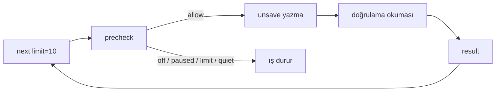

# Mimari görüş (yeniden inceleme): SPEC-001 v1.1 ve ADR-0001

Mimari görüş: `docs/specs/SPEC-001-kaydedilen-ve-dm-temizleme.md` v1.1 | Tarih: 2026-11-08 | Karar: **KOŞULLU ONAY** (3 yeni koşul) · ADR-0001: **DÜZELTME İSTENDİ** (Proposed kalır)

> Bu bir görüştür; spec ve ADR değiştirilmedi. Önceki görüş: `docs/architecture/gorus-SPEC-001-2026-11-08.md` (9 koşul).

## Özet

Dokuz koşulun dokuzu da spec'e işlenmiş; sekizi kurulun istediği biçimde karşılanıyor. Koşul 6'nın kanıt kuralı (AC-C31, "mevcut testler değiştirilmeden yeşil") tasarımla çelişiyor: `background.js` başına korumasız `importScripts` eklenirse mevcut `extension-update.test.ts` kırılır. Bu kurulun kendi önerisindeki bir eksik; düzeltmesi tek satır (Y-1). Ayrıca AC-C31 ile T-6 arasında bir dosya çelişkisi var (Y-2). ADR-0001 doğru ama eksik: regresyon kanıtını bozan `importScripts` kuralı, ortak duraklatma kararı ve (b)/(c) için alternatifler yok (Y-3).

Orantılılık: v1.1'in karmaşıklığının çoğu, geri alınamaz işlem ve hesap kısıtlama riskiyle orantılı. Ama Faz 1'in yaklaşık %10-15'i, Faz 1'de olmayan tehditler için kurulmuş: DM'e ya da çok aktörlü kullanıma ait mekanizmalar (bilet, lease, `plan_hash` yeniden hesabı, takip yolunu saran adaptör). Bunlar çıkarılabilir. Asıl kazanç süreçte: henüz doğrulanmamış uç noktalara dayanan Faz 2 tasarımını bugün imzalatmamak.

## 1. Önceki dokuz koşulun doğrulaması

| # | Koşul | Spec'teki karşılığı | Doğrulama | Sonuç |
|---|---|---|---|---|
| 1 | `gate()` yeniden kullanılmaz; `effective_budget` yeni | §6.2 `cleanup_gate(session, kind, now)` ve sıralı 4 sebep; §6.4 `effective_budget`; AC-C24, AC-C31 | `gate()`'in `allow_actions` bağı yerinde (`bridge_actions.py:49` civarı, `paused_until` okuması). Spec, `bridge_actions.py`'nin değişmeyeceğini yazıyor. Hesap toplamı `bridge_actions`'ı yalnız okuyor (§6.4). | **Karşılandı** |
| 2 | `cleanup_batches.scan_id` SET NULL + AC | §7.1 FK tablosu, §7.2, AC-C22 | `cleanup_items` partiye bağlı, envantere değil (§7.1 son satır). Bu, cascade zincirini gerçekten kesiyor. | **Karşılandı** |
| 3 | Whitelist sürümü; onayda yeniden hesap | `sessions.dm_whitelist_rev` (§7.2), §7.6 adım 3-4, AC-C7 | Kurulun sayaç önerisi alınmış. İlişki değişimi hash'e girmiyor ama yeniden hesaplanan ref listesinin karşılaştırılmasıyla yakalanıyor. Bu yeterli. | **Karşılandı** |
| 4 | Öğe durumları sonuçlarla eşlenir | §6.8 durum kümesi `pending\|done\|already\|not_found\|failed\|protected\|cancelled` | `varchar(10)`'a sığıyor; bütçe yalnız `done` sayıyor (§6.4). | **Karşılandı** |
| 5 | Migration faz başına; `postgresql_where`; adlandırılmış CHECK; up/down/up | §7.7 `o5e7a9c1d3f5` ve `p6f8b0d2e4a6`; §7.2 giriş; AC-C36 | Revizyon kimlikleri mevcut adlandırma desenine uyuyor. Downgrade asimetrisi yazılı. | **Karşılandı** |
| 6 | `JOB_API` + `cleanup-bg.js` (`importScripts`); mevcut testler değişmez | §6.6, AC-C31 | `extension-update.test.ts:49` `background.js`'i `new Function('chrome', 'fetch', backgroundSrc)` ile, `// @vitest-environment node` ortamında çalıştırıyor (`:1`). Bu ortamda `importScripts` tanımsız. `background.js` başındaki korumasız `importScripts('cleanup-bg.js')` `ReferenceError` atar ve dosyadaki bütün testler kırılır. AC-C31 o hâliyle karşılanamaz. Ayrıca `JOB_API`'nin `actions` satırı takip yolunu bir tabloya sarmayı gerektiriyor; bu, "takip yolu değişmez" ile gerilim yaratıyor (bkz. A-04). | **Kısmen**: Y-1 ve A-04 |
| 7 | Ölü döngü eşiği işe göre + kalp atışı | §6.6 `deadAfterMs = 2 × delay_max × 1000 + 60000`, `running.deadAfterMs \|\| API_DEAD_AFTER_MS`; AC-C30 | Değişecek yer doğru (`background.js:13`, `:437-438`). DM safe için eşik 180 sn; 15 sn kalp atışıyla birlikte yeterli. | **Karşılandı** |
| 8 | Saklama sıcak yoldan çıkar | §7.4 `cleanup_retention` (Celery beat), AC-C32 "`next`/`precheck`/`result` silme yapmaz" | Beat düzeni mevcut (`celery_app.py:22-24`, iki görev). Yeni görev bu desene ekleniyor. | **Karşılandı** |
| 9 | ADR-0001 | `docs/architecture/adr/ADR-0001-ek-isler-ayri-kuyruk.md`, AC-C37 | ADR yazılmış, Proposed. İnceleme §3'te. | **Karşılandı** (ADR'ye düzeltme istendi) |

Önceki üç CEO sorusu CK-11, CK-8 ve CK-12 olarak spec'e işlenmiş. Kurulun gözlemleri de Kayıt ya da CK-10 olarak işlenmiş. **Doğrulandı.**

Yan doğrulama: `paused_until`'ı temizleyen üç yol (`sessions.py:278`, `action_tasks.py:429`, `bridge.py:421`) ve onu yazan iki yol (`bridge_actions.py:160`, `action_tasks.py:148`) spec §6.2'nin söylediğiyle aynı. Okuma anında kopyalama (copy-on-read) iki yazanı da kapsıyor. Kalan dar yarış penceresini kurul de kabul edilebilir buluyor.

## 2. Kararlar ve değerlendirme (v1.1'de yeni ya da değişen)

| # | Karar | Gerekçe var mı? | Alternatif | Risk | Sonuç |
|---|---|---|---|---|---|
| K10 | Ayrı `cleanup_paused_until` + kopyalama (§6.2) | Var (üç temizleme yolu) | Üç temizleme yolunu değiştirmek (§13'e aykırı); `bridge_actions.py:160`'a tek satır ekleme (`action_tasks.py:148`'i kaçırır) | Dar yarış penceresi (kabul edildi) | **Onay**, ADR'ye girmeli (Y-3) |
| K11 | Bilet (128 bit, sha256, 120 sn) + lease (15 dk) + profil satırı kilidi (§7.2, AC-C23, AC-C26) | Kısmen. §14.4 biletin güvenlik değil denetim aracı olduğunu kabul ediyor. | `prechecked_at` damgası + `FOR UPDATE`; lease yok | Faz 1'de karşılığı olmayan karmaşıklık | **Faz 1'de gereksiz** (A-01) |
| K12 | `plan_hash` + onayda yeniden hesap, Kaydedilenlerde de (§7.6) | DM için var. Kaydedilenlerde `whitelist_rev` ve `rules` `null`. | Faz 1'de `plan_refs` + TTL + `scan_id` denetimi | Faz 1'de etkisiz kod | **Faz 1'de gereksiz** (A-02) |
| K13 | CK-8 sayfa güdümlü kendiliğinden devam (`auto_continue`, `halted_reason`, `resume`, `halt`) | Var (13 elle başlatma) | Elle "Başlat" + önizlemede "kaç kez başlatman gerekecek" | Ek durum alanları ve uçlar | **CEO kararı**; kurul ertelenmesini öneriyor (A-03) |
| K14 | `JOB_API` tablosuna `actions` satırı dahil (§6.6) | Kurulun koşul 6 önerisi | Takip yoluna dokunmadan, yalnız yeni türler için dallanma | Takip yolunun yeniden düzenlenmesi | **Kurul kendi önerisini daraltıyor** (A-04) |
| K15 | JSON zorunluluğu / 415 (AC-C38), `ext_version` kapısı (AC-C37), `session_id`+`batch_id` komutu (AC-C33) | Var (AppSec) | — | Düşük, ucuz | **Onay** |
| K16 | Yeni bağımlılık yok | Var | — | — | **Doğrulandı**. §6.6 yeni eklenti izni de eklemiyor (`alarms` bilerek reddedildi, §14.4). |

## 3. ADR-0001 incelemesi: DÜZELTME İSTENDİ

İçerik doğru ve koda dayalı. (a) A'nın reddi gerekçeli; (b) asimetri açık; (c) fail-closed sürüm kuralı doğru. Şu dört eksik kapanınca kurul ADR'yi yeniden tam inceleme yapmadan `Accepted` yapar:

1. **(c)'ye `importScripts` koruması:** `if (typeof importScripts === 'function') importScripts('cleanup-bg.js');` ve `background.js`'in yeni türler için yalnız `self.iaCleanup` gibi tek bir isim alanına başvurması. ADR şu an regresyon kanıtını "mevcut testlerin değiştirilmeden yeşil kalması"na bağlıyor (ADR (c) 3. madde). Koruma olmadan bu kanıt imkânsız.
2. **Yeni karar (d): ortak engel duraklatması.** `cleanup_paused_until` ayrı kolon, `max(cleanup_paused_until, paused_until)` ve okuma anında kopyalama; kabul edilen yarış penceresi; ek iş engelinin `paused_until`'ı da doldurması (AC-C13). Bu, paylaşılan `sessions` durumunun anlamını değiştiren bir karar ve geri alması üç mevcut yolu yeniden düşünmeyi gerektirir.
3. **(b) ve (c) için reddedilen seçenekler:** (b): ayrı `cleanup_log` tablosu (neden reddedildi: Aksiyon Geçmişi tek kaynaktan okunmalı). (c): sürüm kapısı yok / yalnız eklenti tarafında kontrol (neden reddedildi: eski eklenti yeni sözleşmeyi bilmez, fail-closed sunucuda olmalı). Tek seçenekli gerekçe kurul kuralına göre eksiktir.
4. **(c)'de kapsam notu:** `result`, `halt` ve `scan/finish` `ext_version` denetiminden bilerek muaftır, çünkü yürütülmekte olan öğenin sonucu kaybolmamalı (§7.5 ile tutarlı). ADR bunu yazmıyor; bir uygulayıcı "tüm cleanup çağrıları" diye okuyabilir.

Faz 1 sadeleştirmeleri (§5) kabul edilirse ADR'nin Sonuçlar bölümüne bir satır eklenir: "Bilet ve lease Faz 2'de AppSec kararıyla gelir".

## 4. Yeni koşullar (imzadan önce)

- **Y-1 [Çelişki] `importScripts` korumalı yüklenir.** §6.6 ve ADR (c) şunu yazar: `background.js` `cleanup-bg.js`'i `typeof importScripts === 'function'` korumasıyla yükler; yeni tür kodu yoksa (test ortamı) takip yolu aynen çalışır. Yeni eklenti testi iki kaynağı birleştirir. Böylece AC-C31'in "değiştirilmeden" kuralı gerçekten sağlanabilir hâle gelir. Kanıt: `extension-update.test.ts`, `extension-api.test.ts`, `extension-actions.test.ts` için `git diff` boş + yeşil çıktı.
- **Y-2 [Çelişki] AC-C11 testi yeni dosyaya.** AC-C31 `test_risk_profiles.py`'nin değiştirilmemesini (§9: "git diff boş") istiyor. T-6 ve §9 AC-C11 satırı ise aynı dosyaya yeni test ekliyor. Test `tests/test_cleanup_budget.py`'ye taşınır ya da AC-C31'den bu dosya çıkarılır. Kurul taşınmasını öneriyor.
- **Y-3 ADR-0001 §3'teki dört düzeltmeyle güncellenir**, T-1'den önce `Accepted` olur.

## 5. Orantılılık: 83 AC, 31,8 g tek kullanıcılı yerel uygulama için uygun mu?

Rakamlar spec'ten: AC sayısı C 39 + S 8 + D 18 + U 18 = 83 (§14.4). Süre: Faz 0 3,0 g, Faz 1 17,1 g, Faz 2 11,7 g (§12.4). Kurul satır toplamlarını yeniden topladı ve tuttuğunu gördü (13,0 g ve 8,5 g).

**Orantılı olanlar (çıkarılmamalı):** önizleme, sayıyı yazarak onay, öğe başında kapı (kill switch, AC-C14), tür bütçeleri ve hesap tavanı, engelde 24 saat duraklatma, devre kesici, eklenti sürüm kapısı, serbest metin yasağı, DM'de taze meta ve fail-closed koruma. Hepsinin dayanağı aynı: işlem geri alınamaz ve hesap riski kullanıcıda. Tek kullanıcılı olmak bu riskleri azaltmaz. 18 AC-U'nun çoğu ekran durumları kuralının (boş ekran yasağı, fallback UI) doğrudan karşılığıdır.

**Orantısız olanlar:** tehdit modeli §8 sınır 1'de "API'ye erişen yerel saldırgan onayı da yapabilir" diyerek yerel çok aktörlü saldırıyı zaten kabul edilmiş risk sayıyor. Buna karşın Faz 1, o sınırın içinde yalnız çok aktörlü senaryoda anlamlı olan mekanizmalar taşıyor. Eklenti aynı anda tek iş çalıştırıyor (`background.js:435-443`, AC-C10). Kaydedilenlerde whitelist ve kural yok.

### Faz 1 sadeleştirme önerileri (somut)

| # | Öneri | Çıkan / değişen | Neden güvenli | Kurul tahmini kazanç (yapım) |
|---|---|---|---|---|
| A-01 | **Bilet ve lease Faz 1'den çıkar.** `precheck` kalır (kapı + kill switch). Bilet yerine öğeye `prechecked_at` damgası konur; bütçe `done` + son 120 sn'de precheck'ten geçmiş öğeleri sayar; profil satırı `FOR UPDATE` kalır. `cancelled` öğeye gelen `done` her zaman `done` sayılır ve loglanır (precheck iptal edilmiş öğeye izin vermediği için bu yalnız yürütülmekte olan öğe olabilir). | `lease_job`, `leased_until`, `ticket_hash`, `ticket_expires_at`; AC-C26 sadeleşir; AC-C23'ün bilet dalı; `reason=leased`; `ticket_missing/expired` kodları | Tek iş, tek eklenti. Bütçe yarışı damga + kilitle kapanır. Biletin denetim değeri, kabul edilmiş yerel saldırgan riskine karşı hiçbir şey eklemiyor (§14.4 de bunu kabul ediyor). DM için AppSec Faz 2'de yeniden karar verir. | ~0,5 g |
| A-02 | **Kaydedilenlerde `plan_hash` ve yeniden hesap yok.** `confirm` = parti bu profilin + `draft` + süresi dolmamış + `scan_id` dolu + `confirm_count == item_count` → `plan_refs`'ten öğe. | §7.6 adım 3-4 (Faz 1 için), istemcinin `plan_hash` göndermesi; AC-C7 Faz 1'de TTL + `scan_id` sınamasına iner | Faz 1'de önizleme ile onay arasında kümeyi değiştirebilecek tek olay yeniden tarama (`scan_id` null olur, AC-C22). Etkin parti varken önizleme zaten kapalı (AC-U17, REQ-7). Yeniden hesap her zaman aynı sonucu verir. Kolon Faz 2 migration'ında eklenir. | ~0,25 g |
| A-03 | **CK-8'i Faz 1'de ertele (CEO kararı).** Elle "Başlat"; önizleme tahmini `{days, starts}` döner ("yaklaşık 13 kez başlatman gerekecek"). | REQ-16a, AC-C34, `auto_continue`, `halted_reason`, `resume`/`halt` uçları; devre kesici yalnız eklenti tarafında durur ve iş raporuna yazar | Sınırdan sonra hiçbir şey kendiliğinden başlamaz; bu en sade ve en güvenli varsayılan. Kullanım verisi ihtiyacı gösterirse ayrı küçük spec. | ~0,75 g |
| A-04 | **Adaptör yalnız yeni türler için.** `background.js`'te takip yolu tabloya sarılmaz. `startJob`, `apiNext` ve mesaj yönlendiricisinde tek bir `if (CLEANUP_KINDS.includes(kind)) return self.iaCleanup.…` dalı olur, kodun tamamı `cleanup-bg.js`'te kalır. (Kurul koşul 6'yı daraltıyor.) | `JOB_API.actions` satırı | Takip yolu satır satır aynı kalır, AC-C31 kanıtı güçlenir. | ~0,25 g |
| A-05 | **Isınma (AC-C11) isteğe bağlı (CEO risk kararı).** Spec sayıların tahmin olduğunu söylüyor (§6.4). Isınma kalırsa formül değişmez; çıkarsa `effective_budget` düz tablo okur. | 4 sınır testi, `*_enabled_at` mantığı | Kurul burada öneri vermiyor; mimari değil, risk kararı. | ~0,25 g (çıkarılırsa) |

Toplam (A-01..A-04): yapımda kabaca 1,75 g, %20 düzeltme payıyla ~2,1 g. Faz 1 17,1 g'den ~15 g'ye iner. A-05 de alınırsa ~14,7 g. **Bu rakamlar kurulun satır tahminlerinden yaptığı kaba tahmindir, ölçülmedi.** Faz 1'de etkin AC sayısı 64'ten (C 39 + S 8 + U 17) ~60'a iner: C26 ve C34 düşer, C7 ve C23 küçülür.

Değerlendirilip **önerilmeyen** sadeleştirme: taslaksız (stateless) önizleme, yani onayda seçimi yeniden hesaplayıp doğrudan kuyruğa alma. Daha az durum demek ama AppSec S-01'in (sunucuda saklanan plan) çözümünü geri alır ve Faz 2'de ikinci bir onay yolu doğurur. Reddedildi.

### Süreç önerisi (en büyük kaldıraç)

Faz 2'nin bütün tasarımı (§6.3, §7.2 DM tabloları, AC-D1..D18) T-0b'de "yüksek risk" diye işaretlenmiş, doğrulanmamış uç noktalara dayanıyor (§6.5). Alan şekli farklı çıkarsa v1.2 zaten planlı. **Öneri:** CEO şimdi yalnız Faz 0+1'i (21 g tavan) imzalasın. Faz 2, T-0b sonucuyla v1.2 / ayrı imza olarak gelsin. Spec zaten Faz 2 tavanını T-0b sonrası yeniden onaya bağlıyor (§12.4); öneri bunu tasarım imzasına da uygular. Bugün incelenen kapsam yaklaşık 64 AC'ye iner ve no-go ya da DOM-only senaryosunda boşa imzalanmış tasarım kalmaz. Karar BA ve CEO'nundur. Kurul bunu koşul değil, öneri olarak yazar.

### Sadeleştirilmiş Faz 1'de bir öğe yazılmadan önce hangi kontrollerden geçer?

Açıklama: A-01 ile her öğe yine yazmadan önce sunucu kapısından geçer. Değişen tek şey, izin kararının bilet yerine öğedeki `prechecked_at` damgası ve profil kilidiyle kaydedilmesi. Metin eşdeğeri:

| Adım | Sunucu tarafı | Faz 1 (öneri) | v1.1 |
|---|---|---|---|
| next | kapı + öğe listesi | lease yok | 15 dk lease |
| precheck | `cleanup_gate` + `pending` mi | `prechecked_at` + `FOR UPDATE` | bilet + lease + `FOR UPDATE` |
| result | durum makinesi | `cancelled`→`done` kabul + log | bilet ve süre denetimi |

## Gereksiz bulunanlar (Faz 1'de karşılığı olan tehdit yok)

- A-01 bilet ve lease; A-02 Kaydedilenlerde `plan_hash` yeniden hesabı; A-04 `JOB_API.actions` sarmalı. Katman ya da teknoloji düzeyinde gereksiz bulunan bir şey yok.

## Geri alması pahalı kararlar

| Karar | ADR | Durum |
|---|---|---|
| Ayrı şema; `bridge_actions` genelleştirilmez | ADR-0001 (a) | Var |
| `action_log.ig_user_id` nullable, downgrade asimetrisi | ADR-0001 (b) | Var; alternatif eklenecek |
| Eklenti ↔ backend sözleşmesi, `ext_version` kapısı | ADR-0001 (c) | Var; `importScripts` koruması ve muafiyet notu eklenecek |
| Ortak engel duraklatması (`cleanup_paused_until` + kopyalama) | ADR-0001 (d) | **Eksik**: Y-3 |

## STACK.md değişikliği

Yeni teknoloji yok, durum değişikliği yok. Eklenti satırındaki ADR notu "ADR-0001 (Proposed, düzeltme istendi 2026-11-08)" olarak güncellendi. CEO'ya "yeni teknoloji" rotası açılmıyor.

## Cevaplanmamış sorular (CEO'ya, öneriyle)

1. **Faz 2 imzası ayrı mı?** Öneri: evet. Şimdi Faz 0+1, Faz 2 T-0b sonrası.
2. **CK-8 Faz 1'de olsun mu?** Öneri: hayır, elle Başlat + "kaç kez" tahmini (A-03).
3. **Unsave için ısınma kalsın mı?** Kurulun önerisi yok, risk kararı (A-05).

## Kayda geçen gözlemler (koşul değil)

- ADR şablonu (`templates/ADR.md`) bu repoda bulunamadı. ADR-0001'in biçimi şablona göre denetlenemedi (doğrulanmadı).
- AC-D13 ("biletsiz `done` kaydedilir") ile AC-C23 ("`pending` olmayan öğeye biletsiz `done` durumu değiştirmez") birlikte tutarlı, ama yalnız `pending`/`pending değil` ayrımıyla. A-01 alınırsa ikisi Faz 2'de AppSec ile yeniden yazılır.
