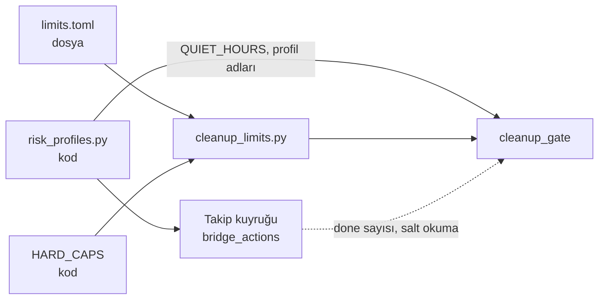

# Mimari görüş (kısa bakış): SPEC-001 v1.2 ve ADR-0001 rev. 2

Mimari görüş: `docs/specs/SPEC-001-kaydedilen-ve-dm-temizleme.md` v1.2 (imza kapsamı Faz 0+1; Ek A incelenmedi) | Tarih: 2026-11-08 | Karar: **KOŞULLU ONAY** (2 küçük koşul, K-1 ve K-2) · ADR-0001: **Accepted**

> Bu bir görüştür; spec değiştirilmedi. Önceki görüşler: `gorus-SPEC-001-2026-11-08.md` (9 koşul), `gorus-SPEC-001-v1.1-2026-11-08.md` (Y-1..Y-3, A-01..A-05).

## Özet

- Y-1, Y-2 ve Y-3 karşılandı. ADR-0001 rev. 2 kurulun istediği dört eki taşıyor. Kurul ADR'yi `Accepted` yaptı.
- A-01, A-02 ve A-04 doğru uygulanmış. A-02'nin bıraktığı tek boşluk K-1'de: aynı anda birden çok `draft` olabiliyor.
- `limits.toml` mimari olarak uygun. Yeni bağımlılık yok: `tomllib` standart kütüphanede ve imaj Python 3.12. Hiçbir değer iki yerde tanımlı değil. Kavram düzeyinde iki sınır kaynağı var ama bu bilinçli ve sınırlı: takip sınırları kodda, ek iş sınırları dosyada. Ayrıntısı §3'te.
- Yeni bulgu (K-2): dosya gecikmeleri 900 sn'ye kadar açıyor. Sabit kalan 10 dakikalık "takılı parti" eşiği ise meşru bir bekleme sırasında partiyi `stale` diye durdurabiliyor.

## 1. Y koşullarının doğrulaması

| # | Koşul | Spec / ADR'deki karşılığı | Doğrulama | Sonuç |
|---|---|---|---|---|
| Y-1 | `importScripts` korumalı yüklenir | §6.6 "Yükleme"; ADR (c) kod parçası; AC-C31 son cümlesi; §9 "yeni test iki kaynağı birleştirir, `importScripts`'i saplar" | `manifest.json:16-17`: klasik service worker, `"type":"module"` yok. Bu yüzden `importScripts` üretimde var. `extension-update.test.ts:1` ve `:49` node ortamında `new Function` ile çalışıyor; korumayla bu testte yükleme atlanıyor. `background.js` bugün `self` kullanmıyor. | **Karşılandı** (uygulama notu N-1) |
| Y-2 | AC-C11 testi yeni dosyada | AC-C11 → `tests/test_cleanup_budget.py`; §9 satırı; T-6 dosya listesi; AC-C31 `test_risk_profiles.py`'yi değişmeyenler arasında tutuyor | T-6'da `test_risk_profiles.py` yok; çelişki kapandı. | **Karşılandı** |
| Y-3 | ADR-0001'e dört ek | (1) (c)'de koruma + tek isim alanı `self.iaCleanup`; (2) yeni (d) ortak duraklatma, kalan risk ve geri alma maliyeti; (3) (b)'de `cleanup_log`, (c)'de "sürüm kapısı yok" ve "yalnız eklentide" reddedilmiş; (4) (c) kapsam notu `result`/`stop`/`scan/finish` muaf (CK-8 reddiyle `halt` → `stop` doğru güncellenmiş, AC-C37 ile tutarlı); Sonuçlar'da Faz 1 sadeleştirme satırı | Dört ek de var ve spec §6.2, §6.6, §7.5, AC-C13, C24, C37 ile tutarlı. | **Karşılandı** → ADR `Accepted` |

## 2. A-01 / A-02 / A-04 uygulaması

| # | Öneri | Spec'teki uygulama | Değerlendirme | Sonuç |
|---|---|---|---|---|
| A-01 | Bilet ve lease yok; `prechecked_at` + `FOR UPDATE` | §6.3; §6.8 öğe tablosu (allow'da `prechecked_at=now`, yeniden denenebilir hata ve `blocked`'da `null`); §7.2 `cleanup_items.prechecked_at`; AC-C23, AC-C26 ("Lease ve bilet yoktur"); §6.4 sayım | Çift sayım yok: `done` durumla, uçuştaki öğe `pending` + `prechecked_at > now-120 sn` ile sayılıyor. Sonucu hiç gelmeyen bir öğe 120 sn sonra sayımdan düşer. Eksik sayım en fazla 1 öğedir, çünkü eklenti tek iş çalıştırır. Kabul edilebilir. §1-§14'te bilet ya da lease kalıntısı yok; kalanlar yalnız Ek A'da. | **Doğru** |
| A-02 | Faz 1'de `plan_hash` ve yeniden hesap yok | §7.6 yedi adım, AC-C7, §6.3, §7.6 son satırı | Yeniden tarama (`scan_id` SET NULL), saklama görevi (`cleanup_scans` silinir, SET NULL) ve süre (30 dk) doğru yakalanıyor. **Boşluk:** `draft` etkin parti sayılmıyor. Bu yüzden aynı anda iki taslak olabilir. Senaryo: B onaylanır, çalışır ve 30 dk içinde biter. Ardından A onaylanırsa A, B'nin bitirdiği ref'leri yeniden kuyruğa alır. AC-C39'un dışlaması yalnız önizleme anında uygulandığı için devreye girmez. Zararı düşük: AC-S3 önce okur, `already` döner, Instagram'a yazma yapılmaz. Ama gereksiz okuma ve yanlış sayı oluşur. Eski tasarımda onaydaki yeniden hesap bunu kapatıyordu; kurulun A-02 önerisi bu durumu atlamıştı. | **Doğru, K-1 ile** |
| A-04 | Adaptör yalnız yeni türler için | §6.6 "Dallanma": `startJob`, `apiNext` ve mesaj yönlendiricisinde tek dal; `recordActionResult`, `pullNewItems`, `actionStepDone`, `ia-job-tick` değişmez; `JOB_API.actions` yok (§6.3) | Takip yolu satır satır aynı kalıyor; AC-C31 kanıtı güçlü. | **Doğru** |

A-03 (CEO kararı) ve A-05 (dosyaya bırakıldı) de tutarlı işlenmiş. AC-C43 örneği §6.4 formülüyle yeniden hesaplandı: `min(40, floor(3600/37,5)=96) = 40`; günde 200; 3 gün; 5+5+3 = 13. Tutuyor.

## 3. `limits.toml`: mimari değerlendirme

### 3.1 Gerekçe tablosu (yeni teknoloji: TOML yapılandırma dosyası, `tomllib`)

Spec §6.5 üç seçeneği karşılaştırıyor: `.env`, TOML, DB + arayüz. Eksik boyutları kurul kendi doğrulamasıyla tamamladı:

| Boyut | Değerlendirme | Kaynak |
|---|---|---|
| İhtiyaç | REQ-15, REQ-16, AC-L1..L7. CEO'nun "ayarlar dosyasından" isteği. Profil × tür hiyerarşisi `.env`'de onlarca düz değişken olurdu. | Spec §1, §6.5 |
| Alternatifler | A `.env` / `pydantic-settings` (yeniden başlatma ister, düz yapı); C DB + arayüz (CEO "dosya" dedi, arayüzden hız yükseltme yeni bir saldırı yüzeyi). "Hiçbir şey ekleme" (kodda sabit) CEO isteğiyle reddedilmiş. YAML ve JSON yazılmamış. YAML yeni bir bağımlılık (PyYAML) ister; JSON yorum satırı taşıyamaz. Bu yüzden TOML'un seçilmesi doğru. | Spec §6.5; kurul |
| Bakım | `tomllib` Python 3.11'den beri standart kütüphanede (PEP 680). İmaj `python:3.12-slim` (`backend/Dockerfile:1`). Ayrı bakım riski yok. | Dockerfile; PEP 680 (çevrimiçi doğrulanmadı, bilinen standart kütüphane modülü) |
| Lisans | Python standart kütüphanesi (PSF-2.0). Yeni üçüncü taraf lisansı yok. | §11 son madde |
| Güvenlik | `tomllib` yalnız ayrıştırır; kod çalıştırmaz. Dosya yerel. Etki sert tavanlarla sınırlı (§8 sınır 6, AC-L2, L5). | Spec §8 |
| Çıkış maliyeti | Düşük. Tek modül (`services/cleanup_limits.py`) ve tek dosya. Kodda `DEFAULTS` olduğu için dosya kaldırılsa bile davranış aynı kalır. | §6.5 |
| İşletim | `./backend:/app` volume (`docker-compose.yml:39`, `:53`) dosyayı konteynere taşıyor. Ek servis yok. `uvicorn --reload` (`:45`) varsayılan olarak yalnız `*.py` izler; `.toml` değişikliği yeniden başlatma tetiklemez, beklenen de bu. | docker-compose.yml |

Repoda bugün başka `.toml` dosyası yok (Glob `**/*.toml`: 0 sonuç). Bu, TOML'un bu repodaki ilk kullanımı. STACK.md'ye `trial` olarak girdi.

### 3.2 Tasarım: uygun

- **`HARD_CAPS` kodda, dosyadan okunmuyor (AC-L5):** doğru. Güvenlik sınırı ile işletme ayarı ayrılmış.
- **Bozuk dosyada son geçerli değer yerine güvenli varsayılanlar:** doğru. Davranış dosyanın geçmişine bağlı olmuyor. `DEFAULTS` örnek dosyayla birebir aynı olduğundan (AC-L7) "dosya yok" ile "örnek dosya" aynı davranır.
- **30 sn yeniden okuma:** tek uvicorn süreci (`--reload`, worker yok) için yeterli. Celery'deki saklama görevi sınır okumuyor. Süreç başına önbellek, birden çok süreçte en fazla 30 sn tutarsızlık demek; kabul edilebilir. Uygulama notu N-2: `mtime`+boyut yerine dosyayı 30 sn'de bir koşulsuz yeniden okumak (dosya < 2 KB) daha basit ve aynı saniyede eşit boyutlu düzenleme kaçmaz. İkisi de AC-L1'i karşılar.
- **`.gitignore` + örnek + `init_env.py` kopyası:** tek dal kuralıyla uyumlu. `init_env.py` bugün yalnız `.env` üretiyor (`scripts/init_env.py:3`); T-2b'nin kopyalama adımını eklemesi gerekiyor. Spec bunu zaten yazıyor.
- **Şema tür adlarıyla ayrılmış (`profiles.
.unsave`):** takip sınırları ileride dosyaya taşınırsa `profiles.
.follow` eklenir; `version` artmaz. Geri alması ucuz bir karar; ADR gerekmez.

### 3.3 `risk_profiles.py` ile ikili kaynak oluşuyor mu?

**Değer düzeyinde hayır, kavram düzeyinde evet. Sınırlı ve kabul edilebilir.**

### Bir sınır değeri nereden gelir?

Açıklama: takip sınırlarının tek kaynağı kod, ek iş sınırlarının tek kaynağı dosya ile kodda sabit tavanlardır. Ek iş kapısı takip tarafından yalnız sessiz saati ve `done` sayısını okur; hiçbir değer iki yerde tanımlı değil. Kesikli çizgi salt okumadır. Metin eşdeğeri:

| Kalem | Kaynak | Diğer tarafta kopya var mı? |
|---|---|---|
| Takip saatlik / günlük / gecikme, `ACTION_HARD_*`, `RAMP_UP` | `risk_profiles.py:43-109` | Hayır |
| Unsave saatlik / günlük / gecikme, ısınma, parti, tarama | `limits.toml` + `HARD_CAPS` | Hayır |
| Hesap toplamı (takip + unsave) | `limits.toml` `[account]` | Hayır; takip kuyruğu bu tavana uymuyor (AC-C25, en kötü 95/sa, 460/gün; kabul edilmiş) |
| Sessiz saat | `risk_profiles.py:93-115` | Hayır; §6.4 bilerek dosyaya koymuyor ve `in_quiet_hours`'ı yeniden kullanıyor |
| Profil adları (`safe` / `balanced` / `aggressive`) | `risk_profiles.PROFILES` | **Örtük kopya**: `limits.toml` `[profiles.*]` aynı adları yazıyor |

Kavram düzeyindeki ikilikler:
1. **İki ısınma modeli.** Takipte gün eşiği ve mutlak tavan var (`RAMP_UP = ((3, 20), (7, 40))`). Unsave'de saat eşiği ve oran var (72 / 168 sa; 1/3, 2/3). Eşikler aynı süreye denk geliyor (3 g = 72 sa, 7 g = 168 sa), biçim farklı. Bu ikisi farklı türlerin bütçeleri olduğundan hata değil; ama belgelenmeli (T-13a, `docs/09`).
2. **İki sert tavan yeri** (`ACTION_HARD_*` ve `HARD_CAPS`). Tür sahipliği açık olduğu için kabul edilebilir.
3. **Profil adları.** `cleanup_limits` geçerli profil adlarını `risk_profiles.PROFILES.keys()`'ten almalı; kendi listesini tutmamalı. Bir profilin dosyada bölümü yoksa varsayılanı kullanılmalı (uygulama notu N-3).
4. **Kullanıcı algısı.** CEO "bu saatlik sınırlar" dedi. Panel başlığı "Ek iş sınırları" olsa da kullanıcı takip sınırlarının da bu dosyada olduğunu düşünebilir. Öneri: §4.5 paneline tek satır eklenmeli: "Takip işlemlerinin sınırları bu dosyadan yönetilmez." Kapsamın teyidi zaten §14.4 madde 2'de CEO'ya soruluyor. Kurul BA'nın önerisine katılıyor: takip sınırları kodda kalsın, taşıma ayrı küçük iş olsun. Gerekçe: ADR-0001 (a) ve AC-C31.

## 4. Kararlar ve değerlendirme (v1.2'de yeni ya da değişen)

| # | Karar | Gerekçe var mı? | Alternatif | Risk | Sonuç |
|---|---|---|---|---|---|
| K17 | Sınırlar `limits.toml`'dan, `tomllib` ile | Var (§6.5; kurul §3.1'de tamamladı) | `.env`; DB + arayüz; kodda sabit | Düşük; sert tavanlar kodda | **Onay** |
| K18 | `HARD_CAPS` kodda; kırpma, uyarı, salt okunur panel | Var | Dosyada tavan (reddedilmeli) | — | **Onay** |
| K19 | Bozuk dosyada güvenli varsayılanlar | Var (§6.5, §14.5) | Son geçerli değer | Öngörülebilir | **Onay** |
| K20 | Parti durumları `running` / `stopped`, sunucuya ulaşan Durdur (CK-8 reddi) | Var | Kendiliğinden devam (CEO reddetti) | Düşük | **Onay** |
| K21 | Seçim modları `refs` / `filter` + `exclude_refs ≤ 5000` | Var (§4.4) | Yalnız tek tek seçim | Gövde boyutu sınırlı | **Onay** |
| K22 | Zaman eşikleri sabit (10 dk takılı parti, 2 dk tarama uyarısı); gecikmeler dosyadan (≤ 900 sn, ≤ 120 sn) | **Yok**: iki değer birbirinden bağımsız seçilmiş | Eşikleri sınırlardan türetmek ya da tavanları düşürmek | Meşru beklemede yanlış `stale` | **Düzeltme: K-2** |
| K23 | Aynı anda birden çok `draft` | Yazılmamış | Yeni önizleme eski taslakları kapatır | Düşük | **Düzeltme: K-1** |

## 5. Koşullar (imzadan önce, BA spec'e işler)

- **K-1 [Low, A-02'nin boşluğu] Tek taslak.** Yeni `preview`, aynı profil ve türdeki önceki `draft` partileri `cancelled` (ya da `expired`) yapar. Eski taslağın `confirm`'ü 409 `not_draft` alır. Gereken: AC-C5'e bir alt madde ve §6.8 parti tablosuna bir satır. Alternatif: `confirm` adım 7'de AC-C39 dışlamasını yeniden uygulamak. Kurul ilkini öneriyor, çünkü onay yolunu basit tutuyor.
- **K-2 [Medium, ayar dosyasıyla doğan çelişki] Zaman eşikleri sınırlardan türetilir.** AC-C40 "takılı parti" eşiği 10 dk sabit. `delay_max` sert tavanı ise 900 sn (§6.5). Kalp atışı (`ia-job-beat`) eklenti içinde kalıyor; sunucudaki `last_seen_at`'i yalnız `next` ve `precheck` güncelliyor (§7.8). İki `precheck` arası süre yaklaşık "yazma + doğrulama + sonuç + gecikme"dir. Bu yüzden `delay_max` 600 sn'ye yaklaştığında (kabaca ≥ 590 sn) meşru bir bekleme sırasında parti `stale` olur ve sonraki `precheck` `reason=stopped` döner. Öneri (biri seçilir):
  - (a) Sunucudaki takılı eşiği `max(10 dk, dead_after_ms + 60 sn)` olsun. `dead_after_ms` zaten `next` yanıtında dönüyor; iki taraf aynı formülü kullanır.
  - (b) `delay_max` sert tavanı 300 sn'ye, `delay_min` tavanı 240 sn'ye insin.

  Kurul (a)'yı öneriyor; CEO'nun "dosyadan yönet" isteğini daraltmıyor. Aynı ilke iki yere daha uygulanır. Tarama "yanıt vermiyor" uyarısı (AC-U22, 2 dk) `page_delay_max + 60 sn` olmalı, çünkü `page_delay_max` tavanı 120 sn. Eklentideki `running.deadAfterMs` de her `next` yanıtıyla güncellenmeli; yoksa iş sürerken dosyada artırılan gecikme ikinci `startJob`'u yanlış tetikleyebilir.

Bu iki koşul ADR-0001'in içeriğine dokunmuyor. ADR'nin `Accepted` olmasını engellemiyorlar.

## 6. Uygulama notları (koşul değil; T-2b / T-9 uygulayıcısına)

- **N-1 (T-9):** "İsim alanı yoksa desteklenmiyor" denetimi `self.iaCleanup` yerine `globalThis.iaCleanup` ile yazılsın. Node'da `self` global'i tanımlı değil; bu ortamda koşturulup doğrulanmadı, bilinen Node davranışı. Bugünkü testler yeni türleri çağırmadığı için regresyon yok. Ama yeni test ya da gelecekteki bir test, node ortamında bu dala girerse `ReferenceError` alır. Service worker'da `globalThis === self`; davranış değişmez.
- **N-2 (T-2b):** önbellek değişmez (immutable) bir nesne olarak atomik değiştirilsin; yeniden okuma koşulsuz olabilir (§3.2).
- **N-3 (T-2b):** profil adları `risk_profiles.PROFILES`'tan alınsın; `QUIET_HOURS` ve `in_quiet_hours` kopyalanmadan import edilsin.

## Gereksiz bulunanlar

Yok. v1.2 yeni katman, servis ya da bağımlılık eklemiyor. Ayar dosyası yükleyicisi bir CEO isteğine (REQ-15) bağlı ve tek modül.

## Geri alması pahalı kararlar

| Karar | ADR | Durum |
|---|---|---|
| Ayrı şema (a), `action_log.ig_user_id` nullable (b), sözleşme + sürüm kapısı + `importScripts` koruması (c), ortak engel duraklatması (d) | ADR-0001 | **Accepted** (2026-11-08) |
| `limits.toml` biçimi ve yeri | — | ADR gerekmez: tek modül, kodda varsayılan, şema türe göre ayrılmış; çıkış maliyeti düşük |
| Parti durum makinesi (`running`/`stopped`) | — | ADR gerekmez: tablo içi, migration'la değişebilir |

## STACK.md değişikliği

- Yeni satır: "Yapılandırma dosyası: TOML (`tomllib`, Python standart kütüphanesi)" | `trial` | SPEC-001 v1.2. İlk kullanım; Faz 1 teslimiyle `adopt`'a aday.
- Eklenti satırının ADR notu "ADR-0001 (Accepted 2026-11-08)" oldu.
- Yeni üçüncü taraf bağımlılık yok. CEO'ya "yeni bağımlılık" onay rotası açılmıyor. TOML kullanımı bilgi olarak bu görüşle CEO'ya gösterilir; zaten CEO'nun kendi isteği.

## Cevaplanmamış sorular

1. **(CEO, §14.4 madde 2)** Takip sınırları da dosyaya taşınsın mı? Kurulun önerisi: şimdi hayır, ayrı küçük spec. Şema buna hazır.
2. **(AppSec)** Güven sınırı 6 (ayar dosyası) ve A-01/A-02 teyidi AppSec'te bekliyor. Kurul bu konuda görüş vermez.

## Kayda geçen gözlemler

- ADR şablonu (`templates/ADR.md`) hâlâ repoda bulunmuyor; biçim şablona göre denetlenemedi (doğrulanmadı).
- Ek A'daki Faz 2 tablo adları ADR-0001 (a)'da yönelim olarak duruyor. `Accepted`, Faz 2'nin şemasını onaylamaz; Faz 2 spec'i ADR'yi gerekirse günceller.
- Bu görüşte hiçbir test koşturulmadı (kurulun Bash yetkisi yok). Satır numaralı kod atıfları 2026-11-08 itibarıyla okunarak doğrulandı.
