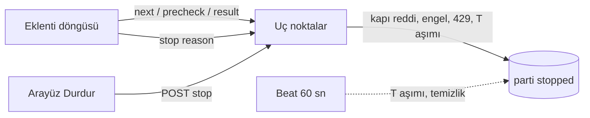

# Mimari görüş (kısa doğrulama): SPEC-001 v1.3

Mimari görüş: `docs/specs/SPEC-001-kaydedilen-ve-dm-temizleme.md` v1.3 (imza kapsamı Faz 0+1; Ek A incelenmedi) | Tarih: 2026-11-08 | Karar: **KOŞULLU ONAY** (2 küçük koşul: K-3 ve K-4)

> Bu bir görüştür; spec değiştirilmedi. Önceki görüş: `gorus-SPEC-001-v1.2-2026-11-08.md` (K-1, K-2, panel notu, PROFILES, ısınma modelleri, N-1..N-3).

## Özet

- v1.2'deki iki koşul (K-1, K-2) ve dört öneri karşılandı.
- v1.3'ün yeni mekanizmaları mimari olarak uygun. Dakikalık beat'in yükü önemsiz. Asıl koruma uç noktalarda (özellikle `precheck`'te) olduğu için beat gecikse de güvenlik etkilenmez.
- İki yeni bulgu var. İkisi de koşul olarak yazıldı ve her biri birkaç satırla kapanır:
  - **K-3:** `run_seq` yalnız `precheck` ve `result`'ı çitliyor; `stop` ve `next`'i çitlemiyor. Uykudan dönüşte basılan Başlat, eklentinin kendi `stop(stale)` çağrısıyla hemen durabilir.
  - **K-4:** Spec'e göre beat yeni görevleri `docker compose up -d` ile alır. Bu yanlış: worker yeniden başlamaz ve görev modülü Celery'nin `include` listesinde yok.

## 1. v1.2 koşul ve önerilerinin doğrulaması

| # | İstenen | v1.3'teki karşılığı | Sonuç |
|---|---|---|---|
| K-1 | Yeni önizleme önceki taslakları kapatır | REQ-8; AC-C5 (aynı işlemde `cancelled`, eski taslağın `confirm`'ü 409 `not_draft`); §6.8 parti tablosunun ilk satırı ve diyagramdaki `draft → cancelled: yeni preview`; §7.2'de `status='draft'` için ikinci kısmi benzersiz indeks; §4.2'de `not_draft` iletisi | **Karşılandı.** İndeks istenenden güçlü, çünkü kuralı veritabanında da zorluyor (uygulama notu N-6). |
| K-2 | Takılı eşik `delay_max`'tan türetilir | §6.6 `T = max(600 sn, 2 × delay_max + 120 sn)`; AC-C30; `next` yanıtında `stale_after_ms` (§7.7 satır `next`); eklentide `running.deadAfterMs` her `next`'te güncellenir, takip yolu `API_DEAD_AFTER_MS` (`background.js:13`, `:438`) ile aynı kalır; tarama uyarısı `page_delay_max + 60 sn` (AC-U22), tarama takılma eşiği `max(600, 2 × page_delay_max + 120)` | **Karşılandı.** Hesap: `delay_max=900` için T = 1920 sn. Meşru en uzun sessizlik ≤ 960 sn olduğundan yaklaşık 2 kat pay kalıyor. Gizli sekmede Chrome zamanlayıcıları kısarsa gerçek bekleme `delay_max`'ı yaklaşık 60 sn aşabilir; formül bunu da kapsıyor (bilinen Chrome davranışı, burada koşturulmadı). |
| §3.3/4 | Panelde "Takip sınırları bu dosyadan yönetilmez" | §4.5 başlık altı; AC-L6; örnek dosyanın 2. satırı; `GET /cleanup/limits` → `follow_limits_managed_here:false` | **Karşılandı** |
| N-3 | Profil adları `risk_profiles.PROFILES`'tan | AC-L13; §4.5 tablosu; §6.5 "Dosya düzeyi" | **Karşılandı** |
| §3.3/1 | İki ısınma modeli belgelenir | §6.4 tablosu (`RAMP_UP` mutlak, `[ramp]` oran); T-13a ve §11'de `docs/09` | **Karşılandı** |
| N-1 | `globalThis.iaCleanup` | §6.6 "Yükleme" ve "Dallanma"; T-9 | **Karşılandı.** Spec, ADR-0001'deki `self.iaCleanup` ile aynı nesne olduğunu açıklıyor; ADR'nin değişmesi gerekmiyor. |

## 2. v1.3'ün yeni mekanizmaları

### Bir parti hangi yollardan durur?

Açıklama: partiyi durduran asıl karar uç noktalarda ve profil kilidi altında verilir. Beat yalnız kimsenin uç noktaya gelmediği durumda kaydı düzeltir (kesikli çizgi). Metin eşdeğeri:

| Yol | Nerede | Güvenlik için gerekli mi? |
|---|---|---|
| Kapı reddi (`off`, `limit`, `quiet_hours`, `paused`) | `next` / `precheck` aynı işlemde | Evet |
| Engel, 429, iş durduran sonuç | `result` aynı işlemde | Evet |
| `T` aşımı | `status`, `start`, `preview`, `cancel`, `next`, `precheck` | Evet (`precheck` T'yi kendisi denetler, AC-C44) |
| `T` aşımı | dakikalık `cleanup_stale` | Hayır: yalnız kayıt düzeltir ve arayüz için |
| Kullanıcı Durdur | `POST stop` (arayüzden) | Evet |
| Eklenti `stop(reason)` | tüm bitiş yolları | Hayır: sunucu çoğunu zaten kendisi yapıyor; kalanı neden kaydı |

| # | Mekanizma | Değerlendirme | Sonuç |
|---|---|---|---|
| M-1 | **Dakikalık beat** (`cleanup_stale`) | **Yük:** `status='running'` kısmi benzersiz indeksi sayesinde profil × tür başına en fazla bir parti ve bir tarama taranır. Sorgu küçük tablo üzerinde tek indeks taramasıdır; yükü önemsiz. **Mevcut düzen:** `celery_app.py:22-25`'te bugün iki görev var (15 dk, 24 sa). Beat `worker -B --concurrency=2` içinde gömülü çalışıyor (`docker-compose.yml:59`). Uzun görevler (`check_ghosts` dilimleri `sleep(pacer.delay())` ile bekliyor, `ghost_tasks.py:133`; `sync_*`) iki slotu doldurursa `cleanup_stale` mesajları Redis'te birikir ve slot boşalınca art arda çalışır. Görev idempotent olduğu için bu yalnız gecikmedir; güvenliği etkilemez, çünkü `precheck` T'yi kendisi denetler. **T profile bağlı:** `delay_max` profilden profile değiştiği için sorgu sabit bir eşik kullanamaz. Önce 600 sn alt sınırıyla SQL'de ön süzme, sonra parti başına Python'da T hesabı yeterli (N-5). **Yeni bir sınır tüketicisi:** worker süreci artık `cleanup_limits`'i okuyor. v1.2 görüşündeki "Celery sınır okumuyor" tespiti bu yüzden artık geçerli değil. Süreç başına 30 sn'lik önbellek farkı kabul edilebilir; I-1'deki salt okunur bağlama seçilirse `worker` servisine de uygulanmalı (N-7). | **Onay** (N-5, N-7 ile; dağıtım için K-4) |
| M-2 | **`run_seq`** | Doğru fikir: bir çitleme belirteci (fencing token). Ama yalnız `precheck` ve `result` taşıyor. `next` (`{batch_id, viewer_id, ext_version, limit}`) ve eklentiden gelen `stop` taşımıyor. Bu iki boşluk K-3'te. | **Düzeltme: K-3** |
| M-3 | **`too_soon`** (`last_allow_at` + `delay_min`, kilit altında) | Durum partide tutuluyor. Profil × tür başına tek etkin parti olduğundan bu, profil düzeyinde tutmakla eşdeğer. Normal akışta tetiklenmez, çünkü gecikme ≥ `delay_min`. Dosyada `delay_min` artırılırsa en fazla bir kez tetiklenir. `retry_after ≤ delay_min ≤ 600 sn < T` olduğundan bekleme `stale`'e yol açmaz; `precheck` zaten `last_seen_at`'i güncelliyor. Ardışık `too_soon` sayısına bir üst sınır yok; bir saat hatasında döngü sunucuyu `retry_after` aralığıyla yoklamaya devam eder. Zararsız ama sınırlanabilir (N-8). | **Onay** |
| M-4 | **Sunucunun partiyi kendisi durdurması** | Doğru yön: durdurma kararı eklentinin `stop` çağrısına bağlı kalmıyor (R3 High 1). Aynı işlemde ve AC-C47'deki profil kilidi altında yapılıyor; yeni tablo ya da servis gerekmiyor. `GET status`'un yazma yapması AC-C38'de bilinçli, idempotent ve sınırlı bir istisna olarak yazılmış. | **Onay** |
| M-5 | Çalışan partide tek işlemde iptal (AC-C45) | Tek işlem ve kilit; durum makinesiyle tutarlı. | **Onay** |

## 3. Koşullar (imzadan önce, BA spec'e işler)

- **K-3 [Low-Medium] `run_seq` eklentiden gelen her yürütme çağrısını çitler.**
  - **Senaryo:** Parti çalışırken bilgisayar uyur. Service worker kapanır, `chrome.storage`'daki `running` kaydı `state='running'` olarak kalır. Sunucu T sonra partiyi `stopped(stale)` yapar. Kullanıcı döner ve Başlat'a basar: `start` → `running`, `run_seq+1`, ardından `ia-run`. Eklentinin `startJob`'u eski kaydı ölü sayar (`background.js:435-439` deseni). §6.6 bitiş tablosuna göre "eski partiye" `stop(stale)` çağırır. Ama eski parti ile yeni parti aynı `batch_id`'dir. Sunucu yeni çalıştırmayı durdurur ve kullanıcı Başlat'tan hemen sonra "Eklentiden haber gelmedi" görür. Güvenli yönde başarısız oluyor; ama bu sık görülebilecek bir yol ve kafa karıştırıcı.
  - **İkinci boşluk:** `next` `run_seq` taşımıyor, yalnız döndürüyor. Durdur'dan hemen sonra Başlat'a basıldığında, ölmemiş eski bir döngü (ikinci tarayıcı ya da kaybolmuş `ia-stop`) bir sonraki `next`'te yeni `run_seq`'i alıp benimseyebilir. Aynı eklentide `startJob` kilidi bunu engelliyor; iki tarayıcıda ise `too_soon` ve kapı hızı sınırlıyor. Yine de AC-C49'un "eski işin izin almasına yol açmaz" iddiası `next` için doğru değil.
  - **Gereken:**
    1. `start` yanıtındaki `run_seq`, `ia-run` komutuna eklenir: `{kind, session_id, batch_id, run_seq}`, `cleanCmd` doğrular.
    2. `next`, `precheck`, `result` ve eklentiden gelen `stop` bu `run_seq`'i taşır.
    3. `next` ve `precheck`'te uyuşmazlık → `reason=stopped`.
    4. Eklentinin `stop`'unda uyuşmazlık → 200, değişiklik yok, `cleanup_anomaly` notu. Arayüzden gelen `user_stop` `run_seq` taşımaz ve her zaman geçerlidir.
  - **Etkilenenler:** AC-C49'a bir alt madde, AC-C50'ye bir satır, §7.7'de iki gövde. Maliyet yaklaşık 0,1 g; mevcut T-4b, T-4c ve T-9 içinde kalır.
- **K-4 [Low] Beat görevlerinin gerçekten kaydedilmesi ve yüklenmesi.**
  - (a) `celery_app.py:8` `include=[...]` listesine `app.tasks.cleanup_tasks` eklenir. Eklenmezse beat mesaj gönderir ama worker görevi tanımaz (`unregistered task`). Sonuç: REQ-31'deki saklama hiç çalışmaz. T-4a'nın dosya listesinde `celery_app.py` var, ama `include` adımı yazılı değil.
  - (b) §10'daki "Celery beat yeni görevleri `docker compose up -d` ile alır" cümlesi şöyle değişmeli: "`docker compose restart worker`". Gerekçe: kod `./backend:/app` volume'üyle geliyor (`docker-compose.yml:53`) ve worker'da `--reload` yok (`:59`). Compose yapılandırması ve imaj değişmediği sürece `up -d` çalışan konteyneri yeniden oluşturmaz; worker eski kodla çalışmaya devam eder. Bu bilinen Compose davranışı; burada koşturulmadı. §10 diyagramına bir adım eklenir.
  - (c) AC-C32 testine şu kanıt eklenir: `celery_app.conf.beat_schedule` iki yeni girdiyi içerir ve iki görev adı `celery_app.tasks` içinde kayıtlıdır.

## 4. Uygulama notları (koşul değil)

- **N-4 (T-4c):** Sunucu T'yi okuma anındaki `delay_max` ile hesaplıyor. Eklenti ise son `next`'teki gecikmeyle bekliyor. Bekleme sürerken dosyada `delay_max` düşürülürse (örneğin 900 → 45) sunucu eşiği 600 sn'ye iner ve meşru bekleme `stale` olabilir. Bu güvenli yönde bir hata; kullanıcı Başlat'a basar. Kapatmak isterseniz: `next` verdiği T'yi partiye yazar (`stale_after_s`), sunucu da `max(T_güncel, stale_after_s)` kullanır.
- **N-5 (T-4a):** `cleanup_stale` sorgusu `last_seen_at < now − 600 sn` ile ön süzme yapar, sonra her parti için T'yi profilin etkin `delay_max`'ından hesaplar. Beat girdisine `options={"expires": 55}` verilsin; dolu slotlarda biriken eski mesajlar atılır.
- **N-6 (T-4b):** Taslak kısmi benzersiz indeksi nedeniyle `preview`, önce eski taslağı `cancelled` yapıp sonra yenisini eklemeli; ikisi aynı işlemde ve profil kilidi altında olmalı. Eşzamanlı iki önizlemede ortaya çıkan `UniqueViolation` 500 değil 409 `batch_active` (ya da yeniden deneme) olmalı.
- **N-7 (T-pre, I-1):** Salt okunur `config` bağlaması seçilirse `backend` ve `worker` servislerinin ikisine de uygulanır.
- **N-8 (T-9):** Aynı öğe için ardışık `too_soon` sayısı sınırlansın (örneğin 5), aşılınca `stop(circuit_breaker)` çağrılsın.
- **Gözlem:** Eklenti tarafındaki ölü döngü eşiği artık T'ye (≥ 600 sn) bağlı. Bu yüzden gerçekten ölmüş bir ek iş, eklentide yeni bir işi (takip işleri dahil) en fazla T boyunca "meşgul" gösterebilir; bugün bu süre 60 sn. Bekleme sırasında 15 sn'lik kalp atışı var. Ama gizli sekmede zamanlayıcılar kısıldığında atışların seyrekleşebileceği düşünülürse, T'ye bağlamak daha sağlam seçim. Kullanıcının çıkış yolu Durdur (`ia-stop` → `stopJob`). Değişiklik önerilmiyor.

## Kararlar ve değerlendirme (v1.3'te yeni ya da değişen)

| # | Karar | Gerekçe var mı? | Alternatif | Risk | Sonuç |
|---|---|---|---|---|---|
| K24 | Tek eşik `T = max(600, 2×delay_max+120)` + `stale_after_ms` | Var (§6.6) | Sabit eşik; tavanı düşürmek | Dosya değişikliğinde yanlış `stale` (N-4) | **Onay** |
| K25 | Dakikalık `cleanup_stale` beat görevi | Var (R3 High 1, S-16, REQ-31) | Yalnız uç noktalarda tespit | Dolu slotlarda gecikme; güvenliği etkilemez | **Onay** (K-4) |
| K26 | `run_seq` çitleme belirteci | Var (I-5) | Zaman damgası karşılaştırması | `next` ve `stop` çitsiz | **Düzeltme: K-3** |
| K27 | Sunucuda `delay_min` aralığı (`too_soon`) | Var (S-18) | Yalnız eklentide gecikme | Sınırsız yeniden sorma (N-8) | **Onay** |
| K28 | Sunucunun partiyi durdurması (kapı, engel, 429) | Var (R3 High 1) | Yalnız eklentinin `stop`'u | — | **Onay** |
| K29 | Taslak için kısmi benzersiz indeks | Var (K-1) | Yalnız uygulama kuralı | Eşzamanlı önizlemede 500 (N-6) | **Onay** |

## Gereksiz bulunanlar

Yok. v1.3 yeni katman, servis ya da bağımlılık eklemiyor. Beat görevleri mevcut Celery beat'e (STACK.md: adopt) iki girdi olarak ekleniyor. Ayrı bir zamanlayıcı servisi, ikinci bir kuyruk ya da lease tablosu yok.

## Geri alması pahalı kararlar

| Karar | ADR | Durum |
|---|---|---|
| ADR-0001 (a)-(d) | ADR-0001 | Accepted; v1.3 içeriğini değiştirmiyor (`globalThis` aynı nesne) |
| `run_seq`, `last_allow_at`, `last_seen_at` kolonları; taslak indeksi | — | ADR gerekmez: tablo içi, migration `o5e7a9c1d3f5` henüz uygulanmadı, geri alma ucuz |
| `ia-run` komutuna `run_seq` eklenmesi (K-3) | — | ADR gerekmez: eklenti ile sunucu aynı repoda ve aynı sürümde (2.9.0) çıkıyor; sürüm kapısı AC-C37 |

## STACK.md değişikliği

Yok. Yeni teknoloji ya da durum değişikliği yok; kayda tek satırlık not düşüldü. CEO'ya yeni bağımlılık rotası açılmıyor.

## Cevaplanmamış sorular

1. **(CEO, CK-16)** Bütçe tavanı (22 g) ile tahmin (25,5 g) uyuşmuyor. Kurul konusu değil; ama K-3 ve K-4 yaklaşık 0,1 g ekliyor. "Daraltılmış alternatif" `run_seq`'i ertelerse K-3 de düşer; kurul bu ertelemeyi önermiyor.
2. **(AppSec)** S-16..S-18 ve I-5'in teyidi AppSec'te. K-3, I-5'in kapsamını genişletiyor; bilgi olarak AppSec'e iletilmeli.

## Kayda geçen gözlemler

- Bu görüşte hiçbir test ya da komut koşturulmadı (kurulun Bash yetkisi yok). Kod atıfları 2026-11-08 itibarıyla okunarak doğrulandı: `celery_app.py:8`, `:22-25`; `docker-compose.yml:53`, `:59`; `ghost_tasks.py:133`; `background.js:13`, `:431-443`.
- Compose `up -d` ve Chrome zamanlayıcı kısma davranışları bilinen davranışlar; burada doğrulanmadı.
