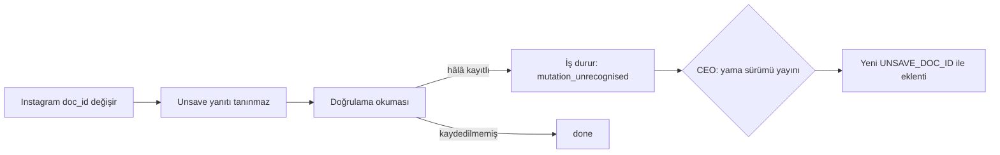

# Mimari görüş (kısa bakış): SPEC-001 v1.6

Mimari görüş: `docs/specs/SPEC-001-kaydedilen-ve-dm-temizleme.md` v1.6 (imza kapsamı Faz 0+1; Ek A incelenmedi) | Tarih: 2026-11-08 | Karar: **KOŞULLU ONAY** (K-5..K-8) → ikinci tur: **ONAY** (koşullar karşılandı, aşağıda)

> Bu bir görüştür; spec değiştirilmedi. Önceki görüşler: `gorus-SPEC-001-2026-11-08.md`, `-v1.1-`, `-v1.2-`, `-v1.3-`, `-v1.4-` (v1.4: tam onay). ADR-0001 geçerli. Hiçbir komut ya da test koşturulmadı (kurulun Bash yetkisi yok). Kod referansları 2026-11-08'de okunarak doğrulandı.

## 1. Kararlar ve değerlendirme

| # | Karar (v1.6) | Gerekçe var mı? | Alternatif | Risk | Sonuç |
|---|---|---|---|---|---|
| 1 | Unsave `POST /api/graphql` (`usePolarisSaveMediaUnsaveMutation`), `graphqlUnfollow` kalıbıyla (§6.6, AC-S17) | Var: T-0a gözlemi (§6.9), REST adayı denenmedi | (a) REST `/api/v1/web/save/{pk}/unsave/`: doğrulanmamış yazma yolu. (b) GraphQL başarısızsa REST'e otomatik düşme: öğe başına iki yazma denemesi, test edilmemiş yol. İkisi de reddedilmeli | Orta (dış, belgelenmemiş sözleşme); §7.9.4 B satır 6 ile ilk öğede durur | **Onay** |
| 2 | `UNSAVE_DOC_ID` kodda sabit; değişince `mutation_unrecognised`, yeni eklenti yama sürümü (AC-S17, imza riski 6) | Var | (a) Backend'den / ayar dosyasından gelen `doc_id`: yayınsız güncelleme sağlar ama `doc_id` işlemin kendisini belirler; yerel bir süreç (§8 sınır 1) eklentiye başka bir mutasyon yaptırabilir. **Ret.** (b) Çalışma anında Instagram JS paketlerinden keşif: kırılgan, sayfa betiklerini okuma yüzeyini büyütür (AC-C55'e ters). **Ret.** (c) Sabit + fail-closed tespit (seçilen) | Orta: değişim sıklığı **doğrulanmadı** (ağ erişimim yok); etkisi "temizlik yapılamaz", zarar değil | **Onay** (K-8 değişmezi ile) |
| 3 | `saved_collections` tablosu, profil başına, varsayılan `protected=true` (§7.2, §6.10 seçenek B) | Var: üç seçenekli tablo (§6.10) | A ayar dosyası, C eklenti depolaması; ikisinin reddi doğru (sunucu kapısı ve REQ-30) | Düşük; ekleyici şema, migration uygulanmadı | **Onay** (K-6 açıklığıyla) |
| 4 | `cleanup_scans.collections_mode` (`whitelist` \| `all_protected`, varsayılan `all_protected`) ve `precheck`'te "parti taraması güncel değilse F" | Var | Mod profil düzeyinde tek kolon: tarama başına düşüşü (F'ye) ifade edemez. Tarama başına doğru seçim | Düşük | **Onay** |
| 5 | §6.10 iki katmanlı mod: kod düzeyi (T-0c) + çalışma anı (tarama başına), her "hayır" F'ye | Var (K-17) | Tek katman (yalnız çalışma anı): T-0c başarısızken ölü W kodu taşır | **Orta: kod düzeyi bayrağın tek kaynağı tanımsız** (aşağıda K-5) | **Koşullu** |
| 6 | Koruma kuralı tek fonksiyon `is_protected(...)`, dört yerde (AC-S21, S23) | Var | — | Orta: Python fonksiyonu ile SQL filtresi (sayfalama, `protected_total`) ve eklentinin `allow_collections` denetimi ayrı ifadeler olur | **Onay**, N-9 önerisiyle |
| 7 | W'de ikinci GraphQL isteği (`PolarisSavedCollectionPickerQuery`, `COLLECTIONS_DOC_ID`), tarama başına bir kez | Var (K-17, AC-S20) | Listesiz W yok; F'de istek yok | Düşük: değişirse F'ye düşer, yazmaya yol açmaz | **Onay** |
| 8 | Yeni bağımlılık | — | — | — | **Yok.** Yeni npm/pip paketi, yeni servis, yeni eklenti izni yok. GraphQL bir kütüphane değil, düz `fetch` (`content.js:355`). İstek aynı köke gider (`www.instagram.com`); mevcut host izni yeter |

### 1.1 Kalıp uyumu (odak 1)

Spec'in istediği `graphqlUnsave(pk, tokens)` mevcut kalıbın birebir karşılığı:
- Sabitler: `IG_APP_ID`, `ASBD_ID`, `UNFOLLOW_DOC_ID`, `UNFOLLOW_NAME` (`content.js:273-276`).
- Token okuma: `csrfToken()`, `viewerCookie()` (`:277-278`), `pageTokens()` (`:297-308`).
- Gövde, başlıklar ve `for (;;);` önekinin atılması (`:347-363`).

Doğru bulunan farklar:
- Kaydedilenler yolu `shape()`'i (`:341-345`) kullanmaz (AC-C54).
- Beklenen yol, engel desenlerinden önce denetlenir (§7.9.4 B). `blockedResponse`'un (`:311-315`) 600 karakterlik metin taraması başarılı bir yanıtı yanlışlıkla engel saymaz.
- Sonuç, takipten çıkmadaki gibi gerçek durum okumasına bağlıdır (`currentState` deseni, `:328-338`).

ADR-0001 (c) gereği `graphqlUnfollow` değişmemeli; bu doğru.

### 1.2 Sabit `doc_id`'nin sürdürülebilirliği (odak 2)

Sabit `doc_id`, mevcut takipten çıkmanın taşıdığı riskin aynısıdır; yeni bir risk sınıfı açmaz. Sürdürülebilir olmasının üç dayanağı:
1. Tespit: §7.9.4 B satır 6, `doc_id` değişince ilk öğede durdurur. Doğrulama okuması yapılmış bir yazmanın kaybolmasını önler.
2. Etki: başarısızlık yönü "yazma yok"tur, yanlış yazma değil. Beklenen yol `data.xig_media_unsave.media.id === <pk>` olmadıkça `done` doğrulamasız verilmez.
3. Onarım: yeni `doc_id` + eklenti yama sürümü (CEO onayıyla, §10). Değer, K-20'deki yoldan alınır.

Kalan zayıflık: onarım adımları bir runbook'ta yazılı değil (N-11).

Açıklama: `doc_id` değişince sistem ilk öğede durur, onarım bir eklenti sürümüdür. Eşkenar dörtgen (F) CEO kapısıdır. Metin eşdeğeri:

| Adım | Ne olur | Instagram'a yazma |
|---|---|---|
| 1 | `doc_id` değişir, yanıt tanınmaz (satır 6) | 1 (ilk öğe) |
| 2 | Doğrulama okuması | yok |
| 3a | Hâlâ kayıtlı → parti `stopped(mutation_unrecognised)`, öğe `pending` | yok |
| 3b | Kaydedilmemiş → `done` | yok |
| 4 | CEO yama sürümünü onaylar; yeni sabitle iş yeniden başlatılır | — |

### 1.3 `saved_collections` ve `collections_mode` (odak 3)

Doğru bulunanlar:
- Koruma ayarı tarama başına değil profil başına tutuluyor. Taramalar arasında korunur; tarama silinince `first_seen_scan_id` ve `last_seen_scan_id` `SET NULL` olur.
- Varsayılan değerler fail-closed: `protected=true` ve `collections_mode='all_protected'`.
- Purge cascade ile siliniyor.

Küçük tutarsızlıklar (engelleyici değil, BA düzeltsin):
- §7.2 "Satır başına en fazla 200 koleksiyon": bir satır bir koleksiyondur. "Profil başına" ya da "çağrı başına" olmalı. Ayrıca tablo, görülmeyen koleksiyonları sakladığı için zamanla 200'ü aşabilir. Sınır çağrıya mı, tabloya mı uygulanıyor, yazılmalı.
- §7.8 `GET saved/collections` `first_seen_at` döner, tabloda bu kolon yok. `created_at`'e eşlendiği yazılmalı.
- Adlandırma (öneri): kalıcı enum değeri `whitelist`, korunan koleksiyonların listesini anlatıyor. Davranış ise "kullanıcı koleksiyon başına seçer". Ayar alanı `collection_whitelist` de "kod düzeyinde W var mı" anlamında. Migration uygulanmadan ad değiştirmek bedavadır, sonra değiştirmek bir enum göçüdür. Öneri: `per_collection` | `all_protected` ve `collection_choice_available`. Karar spec sahibinin.

### 1.4 §6.10 mod seçimi (odak 4)

İki katman ve "her hayır F'ye" kuralı doğru. Tek açık, kod düzeyi bayrağın **iki yerde** yaşaması:
- backend: `settings.saved.collection_whitelist`;
- eklenti: AC-S20 son madde, "kod düzeyinde F ise eklenti listeyi hiç istemez".

İki yer ayrışırsa olacaklar:

| Backend | Eklenti | Sonuç | Spec'te tanımlı mı? |
|---|---|---|---|
| W | F (sabit yok) | Çağrı gelmez → tarama F (fail-closed). Arayüz W varyantını gösterir; W metni düşüşü anlatıyor | Evet |
| F | W | Eklenti `scan/collections` çağırır. Backend'in tavrı **tanımsız**; kabul ederse kod düzeyinde F olan kurulumda tarama `whitelist` olur | **Hayır** → K-5 |

Sıra konusunda kurul, BA'nın önerisine katılıyor (§14.3): T-0c (0,25 g, salt okuma) v1.6 imzasından önce yapılsın. F çıkarsa 3,5 g'lik dal ve CK-22 düşer, imza tek yollu bir spec'e atılır.

## 2. Gereksiz bulunanlar

Yok. W ekleri yalnız T-0c = W ise uygulanıyor (§12.2.1). F yolunda yeni katman ya da servis yok. Bir "kriter yok" adayı var: F yapımında `collections_mode` kolonu (K-6).

## 3. Geri alması pahalı kararlar

- `saved_collections` ve `collections_mode` ekleyici şema; migration uygulanmadı. Geri almak, kullanıcının koruma seçimlerini siler ve F'ye döner; bu güvenli yöndür. **Yeni ADR gerekmez.** ADR-0001 revizyonu gerekir (K-8).
- `doc_id`'nin eklentide sabit olması ve uygulamadan hiç alınmaması bir güven sınırı kararıdır. Sonradan "uzaktan güncellenebilir `doc_id`" istenirse bu sınır bozulur. **ADR-0001 (c)'ye değişmez olarak yazılmalı** (K-8).

## 4. Koşullar

- **K-5 (kod düzeyi mod, tek kaynak).** Kod düzeyindeki mod yalnız backend'de tanımlansın:
  - `scan/start` yanıtı `collections: bool` taşısın. Eklenti listeyi yalnız `collections===true` ise ve kendisinde `COLLECTIONS_DOC_ID` varsa istesin.
  - Kod düzeyinde F olan backend, `scan/{id}/collections` çağrısını 409 `collections_unavailable` ile reddetsin. Tarama `all_protected` kalsın.
  - AC-S20'ye bir test eklensin: kod düzeyinde F iken gelen `collections` çağrısı → 409, mod `all_protected`.
- **K-6 (F yapımının içeriği açık olsun).** §7.2 `collections_mode`'u koşulsuz listeliyor, T-1 [W] ise onu yalnız W'de ekliyor. Spec ikisinden birini açıkça seçsin.
  - Kurulun önerisi: F yapımında `saved_collections` ve `collections_mode` eklenmez. `is_protected`'e mod sabit F verilir. API'deki `collections_mode` sabit `all_protected` döner.
  - Gerekçe: F'de bu kolonu isteyen bir AC yok. W gelirse ayrı migration ucuzdur.
- **K-7 (tek seferlik çağrının anlamı).** AC-S20 "bir kez kabul eder" diyor ve 422'den sonra eklentinin `available:false` ile yeniden denemesini istiyor. 422 ile reddedilen çağrının hakkı tüketmediği yazılsın; yoksa yeniden deneme 409 `collections_closed` alır. Hakkı yalnız başarıyla işlenen çağrı kapatsın. Bunu sınayan bir test eklensin.
- **K-8 (ADR-0001 rev. 3, yazan BA, kabul eden kurul).**
  - (a) W ise Faz 1 tablo listesine `saved_collections` eklensin.
  - (c) Değişmez yazılsın: Instagram işlem kimlikleri (`doc_id`, friendly name) eklentide sabittir. Backend, ayar dosyası, `chrome.storage` ve mesajlar bunları sağlayamaz. `cleanCmd` ve `next` yanıtı işlenirken bu alanlar kabul edilmez.
  - Bunu sınayan bir eklenti testi eklensin: `ia-run`/`next` yükündeki fazladan bir `doc_id` alanı yok sayılır ve istekte kullanılmaz.

## 5. Uygulama notları (bağlayıcı değil, T-4a/T-8a girdisi)

- **N-9 (tek kural, tek küme).** Koruma kuralı tek bir küme üzerinden ifade edilebilir: W'de "bilinen ve korunmayan kimlikler", F'de boş küme (`allow`). Kural: `korunur ⇔ collection_ids boş değil ∧ collection_ids ⊄ allow` (null ise envanterde `available`).
  - Bu tanım AC-S21 tablosunun yedi satırını da verir.
  - Aynı küme `next.allow_collections` (AC-S23) olarak eklentiye gider.
  - SQL'de `jsonb_array_length(collection_ids) > 0 AND NOT (collection_ids <@ :allow)` ile envanter sayfalaması ve `protected_total` doğru hesaplanır.
  - Böylece Python, SQL ve eklenti aynı tanımı kullanır. AC-S21 tablosu üçüne karşı koşturulur. Spec'in öz eleştirisindeki "dört yerde tutarsızlık" riskini kapatır.
  - Ölçek küçük: envanter ≤ 100 sayfa × 21 ≈ 2.100 satır; GIN indeksi gerekmez.
- **N-10 (yardımcı fonksiyon).** Unsave ve W'deki koleksiyon sorgusu aynı gövdeyi kurar. Kaydedilenler kodunda tek bir yardımcı (`igGraphql(name, docId, variables, tokens)`) iki tekrarı önler. `graphqlUnfollow`'a dokunulmaz (ADR-0001 c). Üçünü birleştirmek, takip testleriyle ayrı küçük bir iştir.
- **N-11 (runbook).** T-13a `docs/09`'a "`doc_id` değişti" runbook'u yazılsın:
  - belirti (`mutation_unrecognised`);
  - K-20'deki alma yolu (önce yazmasız yol);
  - sabitin yeri;
  - yama sürümü ve CEO onayı.

  Sabitlerin yanına, `UNFOLLOW_DOC_ID` yorumundaki gibi, kaynak ve alınma tarihi yazılsın.

## 6. STACK.md değişikliği

Satır değişmedi; günlüğe tek satır eklendi. Yeni teknoloji yok, CEO'ya yeni bağımlılık rotası açılmıyor. Instagram'ın iç uçları (REST `/api/v1`, GraphQL `doc_id`) bir teknoloji seçimi değil, dış bir sözleşmedir. Riski spec'in imza bloğundadır (madde 6).

## 7. Cevaplanmamış sorular

1. **(CEO, CK-22)** W tavanı aşıyor. Kurul konusu değil. A (tek zincir) ile B (aşamalı) arasında mimari bir tercih yok: W ekleyici olduğu için B'de de temiz bir ikinci migration olur. K-5..K-8 iki seçenekte de geçerli.
2. **(Doğrulanmadı)** Instagram'ın `doc_id`'leri hangi sıklıkla değiştiği. Kurulun ağ erişimi yok. Gerekirse Scout'a tek soru: "Instagram web GraphQL `doc_id` ömrü, kamuya açık gözlem". İmza için şart değil; tasarım sıklıktan bağımsız olarak fail-closed.

## İkinci tur: koşullar karşılandı (2026-11-08)

Karar: **ONAY** (K-5..K-8 karşılandı). ADR-0001 rev. 3 `Accepted`. Spec değiştirilmedi; hiçbir komut koşturulmadı.

| Koşul | Spec'teki karşılığı | Sonuç |
|---|---|---|
| K-5 tek kaynak | AC-S20 ilk madde; §6.10 "Kod düzeyi mod" (`COLLECTION_CHOICE_AVAILABLE`); §7.8 `scan/start` yanıtında `collection_choice: bool`; `scan/{id}/collections` 409 `collections_unavailable`; test `test_collections_refused_when_code_level_f`; T-4a, T-5, T-8a, T-9 bağımlılığı | Karşılandı |
| K-6 F yapımının içeriği | §6.10 yapım tablosu: F'de `collections_mode` ve `saved_collections` yok, API sabit `all_protected`. Faz 1 W yapımı (T-0c = W, K-21); §7.2 kolonu "W yapımı" diye işaretli, T-1 [W] ile tutarlı | Karşılandı |
| K-7 tek hak | AC-S20: hakkı yalnız 2xx tüketir, 422 tüketmez, ilk sayfadan sonra 409 `collections_closed`; eklentide tek yeniden deneme (T-9); test `test_422_does_not_consume_collections_call` | Karşılandı |
| K-8 ADR + değişmez + test | ADR-0001 rev. 3 (a) ve (c); AC-C56 `extension-cleanup.test.ts::doc_id, friendly name and variables in ia-run or next payload are ignored`; T-ADR3 | Karşılandı |
| Adlandırma önerisi | `per_collection`, `collection_choice_available` (§4.3, §7.2, §7.8) | Kabul edilmiş |

Engelleyici olmayan not: ADR-0001 (c)'deki `variables` cümlesi koleksiyon sorgusunun `after` imlecini (Instagram yanıtından, §7.2.1 istek 4) saymıyor. Değişmezin özü bozulmuyor; düzeltme BA'nın (ADR'deki rev. 3 karar notu).

STACK.md: değişiklik yok (yeni teknoloji yok; ADR-0001 zaten kayıtlı).

## Kayda geçen gözlemler

- Okunan kod: `frontend/extension/content.js:268-363`, `:365-401`; `frontend/extension/listener.js:25-26`, `:65`.
- `listener.js:26` `NEVER` desenine eklenecek `savemedia|savedcollection` büyük/küçük harf duyarsız olarak `usePolarisSaveMediaUnsaveMutation` ve `PolarisSavedCollectionPickerQuery` adlarını yakalar. `iris`, `Polaris` önekiyle eşleşmez.
