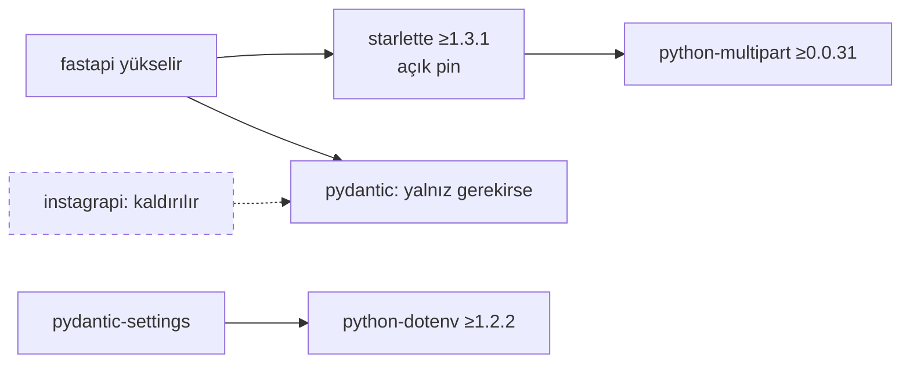

# Mimari görüş (kısa): SPEC-002

Mimari görüş: `docs/specs/SPEC-002-bagimlilik-guvenlik-yukseltmesi.md` v0.1 (Draft) | Tarih: 2026-11-09 | Karar: **KOŞULLU ONAY** (K-1..K-4)

> Bu bir görüştür; spec değiştirilmedi. Hiçbir komut, kurulum ya da test koşturulmadı (kurulun Bash ve ağ yetkisi yok). Kod referansları 2026-11-09'da okunarak doğrulandı. Sürüm numaraları, PYSEC/GHSA kayıtları ve Starlette 1.x'in kırıcı değişiklik listesi **doğrulanmadı** (ağ yok); spec'teki değerler esas alındı.

## 1. Kararlar ve değerlendirme

| # | Karar | Gerekçe var mı? | Alternatif | Risk | Sonuç |
|---|---|---|---|---|---|
| 1 | FastAPI'yi starlette ≥ 1.3.1'e izin veren sürüme yükselt (§3.2 A) | Var: 7 kayıt, FastAPI 0.111 starlette'i 0.37.x'e kilitliyor | B (en yüksek izinli starlette + süreli istisna), C (fork/vendor). B yedek olarak doğru, C'nin reddi doğru | Orta: major atlama. Kullanılan yüzey dar (aşağıda 1.1) | **Onay** |
| 2 | Starlette `requirements.txt`'e `==` açık pin | Var: geçişli bırakılırsa taban garanti değil | (a) Pin yok, FastAPI aralığına güven: tabanı garanti etmez. (b) `>=1.3.1` taban: tekrarlanabilirliği bozar, mevcut `==` düzenine aykırı. (c) Ayrı `constraints.txt` (`-c`): doğru ayrım ama Dockerfile, `test.sh` ve CI'a dokunur; kilit dosyası işinin konusu | Düşük: FastAPI ileride yükseltilirken pin çatışırsa `pip` yüksek sesle kırılır (fail-loud, iyi). Sessiz risk: biri pini "geçişli, gereksiz" diye siler | **Koşullu** (K-2, K-3) |
| 3 | pydantic / pydantic-settings yalnız çözümleyici isterse, en düşük uyumlu 2.x | Var | "Son 2.x'e çık": güvenlik işinin kapsamını büyütür, SPEC-001 T-5'in hata metinlerini oynatır | Düşük–orta (R-5) | **Onay**. Not: pydantic 2.7.1 eski; tazeleme ayrı iş |
| 4 | cryptography, python-multipart, python-dotenv `==` yükseltme | Var (§2.1, alt sınırlar) | Durmak / istisna; reddi doğru | R-6 (Fernet) PB-1 + PB-7 ile ölçülüyor; R-7 (wheel) T-3'te build ile ölçülüyor | **Onay** |
| 5 | instagrapi kaldırılır, ölü kod silinir (§3.1 A) | Var, kanıtlı (§2.2); kurul doğruladı (1.2) | B 2.6.9'a yükselt, C istisna; reddi doğru | Düşük; çıkış maliyeti sıfır (revert) | **Koşullu** (K-1) |
| 6 | Kilit dosyası ayrı işe (§3.3 B, Soru 4) | Var | Bu işe katmak: Dockerfile, `scripts/test.sh`, CI ve geliştirici akışı değişir; tavanı (2,5 g) zorlar | R-8: audit edilen küme (CI'da `pip-audit -r` kendi çözümlemesi) ile imajdaki küme ayrışabilir. T-3'te imaj içi `pip-audit` bu işin anında kapatır, zamanla değil | **Koşullu** (K-4) |
| 7 | Sıralama: T-4b commit → SPEC-002 → T-4c / T-5 (Soru 3) | Var (§8) | Paralel; T-5'ten sonra | — | **Onay.** Mimari olarak doğru: T-5'in hata zarfı ve 415 davranışı yeni FastAPI/Starlette üzerine yazılmalı |
| 8 | Yeni teknoloji / bağımlılık | — | — | — | **Yok.** Bir bağımlılık kalkıyor, yenisi gelmiyor. CEO'ya yeni teknoloji rotası açılmıyor; instagrapi kararı zaten Soru 1 ile CEO'da |

### 1.1 FastAPI / Starlette yüzeyi (odak 1)

Kurulun grep'i (`backend/`) spec R-1 ile tutarlı:
- `from starlette`, `on_event`, `lifespan`, `BaseHTTPMiddleware`, `TestClient`, `from multipart` yok.
- Tek middleware `CORSMiddleware`, FastAPI üzerinden (`app/main.py:2, 8-9`).

Starlette'e doğrudan bağımlılık sıfır. Atlamanın etkisi FastAPI'nin soyutlamasından geçer. Karakterizasyon testleri (PB-4, PB-5) önce yazılıyor, yükseltmeden sonra değişmeden koşuyor. Bu, major atlama için doğru korumadır.

### Bağımlılık zinciri nasıl değişiyor?

Açıklama: FastAPI yükselince starlette ve multipart birlikte gelir. instagrapi'nin pydantic üzerindeki kısıtı (kesik çizgi, "kaldırılır" etiketi) kalkar. Metin karşılığı:

| Paket | Çeken | Bu işte |
|---|---|---|
| starlette | fastapi | açık `==` pin, ≥ 1.3.1 |
| python-multipart | doğrudan (`requirements.txt:18`); starlette form ayrıştırma | `==` ≥ 0.0.31 |
| pydantic | doğrudan; fastapi; instagrapi | yalnız çözümleyici isterse |
| python-dotenv | doğrudan; pydantic-settings | `==` ≥ 1.2.2 |
| instagrapi | doğrudan | kaldırılır |

### 1.2 instagrapi kaldırma (odak 3)

Kurulun grep'i (repo geneli, `docs/specs/` hariç):
- `PLAN_B_EXCEPTIONS`, `login_by_sessionid`, `build_client`: tanım dışında tek eşleşme `docs/06-instagram-api-strategy.md:22`. Bu bir doküman örneği, çağıran değil; T-4 kapsamında.
- Çalışma yolunda kullanım yok. §2.2 doğru.

Bulunan tutarsızlık (K-1): `instagram.py:69` yorumu "instagrapi client kullanımı için" diyor. Bu satır T-2'nin silme listesinde yok. Bu yüzden CB-2'nin `grep -rn "instagrapi" backend/app` beklentisi ("yalnız `sync_tasks.py`") tutmaz. Altındaki `_WEB_HEADERS` ve `_MOBILE_HEADERS` (`:70-71`) repo genelinde tüketicisiz. Bunlar import anında rastgele UA seçen ölü aliaslardır.

## 2. Gereksiz bulunanlar

- **A-01 [Kriter yok, öneri].** `Pillow>=10.0.0` (`requirements.txt:13`): `backend/app` ve `backend/` içinde `PIL` importu yok (grep). instagrapi gidince bilinen tek tüketicisi de kalkar. Ayrıca repodaki tek sabitlenmemiş doğrudan bağımlılık bu; tedarik zinciri açısından kayan bir taban. Öneri: SPEC-002'ye tek satır olarak eklenmesi (T-3'teki `pip check` ve tam takım doğrular) ya da SPEC-003'e yazılması. Karar spec sahibinin ve CEO'nun; koşul değil.
- Yeni katman veya servis yok.

## 3. Geri alması pahalı kararlar

Yok.
- Veri yeniden şifrelenmiyor. Fernet sürüm baytı geri dönüşü koruyor (PB-1 c).
- Şema ve API sözleşmesi değişmiyor.
- instagrapi tek satırla geri gelir.

**ADR gerekmez.** instagrapi'nin çıkışı (eski "Plan A" stratejisinin sonu) STACK.md'de `retire` satırı ve Karar Kaydı (T-4) ile izlenir.

## 4. Koşullar

- **K-1 (CB-2 tutarlılığı).** T-2'nin silme listesine `instagram.py:69-71` eklensin: yorum ve kullanılmayan `_WEB_HEADERS`, `_MOBILE_HEADERS` aliasları. Alternatif: CB-2'nin grep beklentisi bu satırı kapsayacak biçimde yeniden yazılsın. Kurulun önerisi silmek.
- **K-2 (açık pin, kendini anlatsın).** Starlette satırı `requirements.txt`'te tek satırlık bir yorumla gelsin. Yorum üç şeyi söylemeli:
  - geçişli bir paket olduğunu ve neden pinlendiğini (güvenlik tabanı, PYSEC-2026-249);
  - FastAPI yükseltilirken birlikte ele alınacağını;
  - kilit dosyası gelene kadar kalacağını.

  Pin `==` olsun, `>=` olmasın.
- **K-3 (bir sonraki yükseltme için iz).** T-2'nin §11 uygulama notu iki şey kaydetsin:
  - seçilen FastAPI sürümünün `Requires-Dist` aralıklarını (starlette, pydantic);
  - Starlette 1.x sürüm notlarından kodu etkileyen maddelerin özetini (§15 bunu zaten istiyor).

  Gerekçe: açık pin, FastAPI'nin aralığından bağımsız yaşıyor. Aralık bilinmezse sonraki yükseltmede pin körlemesine taşınır.
- **K-4 (kilit dosyası süreli ertelensin).** R-8'in kabulü süreli olsun. Soru 4 = "ayrı iş" ise SPEC-003 adayı CB-3 kapanmadan Plane'de (`IA`) görev olarak açılsın. O spec'te araç seçimi (pip-tools `--generate-hashes`, uv, pip `--require-hashes` ile elle kilit; "hiçbir şey ekleme" dahil) gerekçe tablosuyla kurula gelsin. Kurul hiçbir aracı şimdiden onaylamıyor.

## 5. STACK.md değişikliği

- Yeni satır: `instagrapi | retire`. Kesinleşmesi Soru 1 = A'ya bağlı.
- Yeni satır: `Python kilit dosyası (araç seçilmedi) | assess`. SPEC-003 adayı.
- Günlüğe tek satır eklendi. Mevcut satırlarda durum değişikliği yok. Sürümler kayıtta tutulmaz.

## 6. Cevaplanmamış sorular ve CEO'ya bilgi

1. **(Doğrulanmadı)** Starlette ≥ 1.3.1'e izin veren bir FastAPI sürümünün varlığı (R-9) ve Starlette 1.x kırıcı değişiklikleri. Kurulun ağı yok. Spec'in yolu doğru: T-2'de `pip install --dry-run` ile çözülür, çözülmezse Soru 2'ye gidilir.
2. **(CEO, ayrı bulgu; kurul spec'in §10 gözlemini destekliyor)** instagrapi gitse de backend Instagram'a doğrudan istek atmaya devam ediyor:
   - `instagram.py:_fetch_current_user`, `_fetch_user_info_by_id`: `i.instagram.com` mobil API'si, sahte Android Instagram UA'sı (`:27-31`, `:58-66`);
   - `playwright_instagram.py` (Dockerfile'da "Plan B" Chromium kurulumu, `backend/Dockerfile:16-24`).

   Bu, CLAUDE.md'deki "uygulama Instagram'a kendisi istek göndermez" ilkesiyle çelişiyor ve D-01'in kapsamında değil. Ayrı kayıt (D-xx) ve appsec değerlendirmesi önerilir. Bu spec'in kapsamına alınmamalı; davranış değiştirir.
3. **(Bilgi, kapsam dışı)** CI'da `pip-audit` sabitlenmemiş kuruluyor (`ci.yml:30`). Taban imaj `python:3.12-slim` digest ile sabit değil (`Dockerfile:1`). İkisi de kilit dosyası işinin (SPEC-003) doğal konusu.
