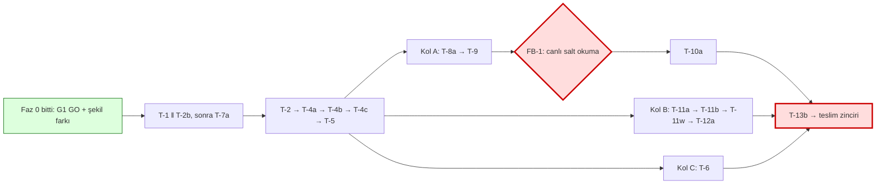

# SPEC-001 uygulama planı (Faz 0 + Faz 1: kaydedilenleri temizleme)

- Plan sürümü: **2.0** (2026-11-08). v1.0, spec v1.5 içindi; bu sürüm spec v1.6'ya göre yeniden yazıldı.
- Spec: `docs/specs/SPEC-001-kaydedilen-ve-dm-temizleme.md`, **v1.6, W modu**, CEO imzası 2026-11-08 (K-25, commit `bebad20`). Kapsam yalnız Faz 0+1; Ek A (DM) kapsam dışı.
- Spec dosyasının imza anındaki sha256 (değişiklik tespiti): `8b9ac63f26a6bc513ccdd2648dd6354853f8888ad12598616083f4623f2789b4`. Bu planı yazarken dosyadan yeniden hesaplandı: **eşleşti**. Özet değişirse iş durur (anayasa kural 1), CEO'ya dönülür.
- İmza doğrulaması: bu projede `harness/` ve `approvals/` yok; imza spec'teki "Signature record" bloğunda (v1.6: "Approved by / on: CEO … sohbette 'İmzalıyorum' … K-25") ve sohbette. Otomatik doğrulama yapılamadı; kayıt bloğu elle okundu.
- **Bütçe tavanı: 37 ajan iş günü** (K-24). **İmzalı tahmin: 36,0 g**, tampon 1,0 g (%97). T-0s iptal edildiği için **çalışma tahmini 35,7 g**, tampon 1,3 g (bkz. §1). W ekleri ayrıca izlenir: **alt sınır 4,5 g**, kontrol noktaları KN-W1 ve KN-W2.
- Dal düzeni: proje kuralı gereği tek dal `main`; feature/integration dalı yok (CLAUDE.md, hafıza notu). Görevler yerelde `main` üstüne commit olur (commit'i main session atar). **Her push CEO onayı ister** (ayrı ayrı). Playbook'taki `integration/…` düzeni bu projede uygulanmaz.
- Git durumu (plan yazılırken): `main`, `origin/main`'in **3 commit önünde** (`2409727`, `1010360`, `bebad20`); hiçbiri push'lanmadı. Çalışma ağacı temiz.
- `STATE.md` (ilerleme defteri) yok. Bu plan dışında dosya açılmadı; açılması main session'ın ya da CEO'nun kararıdır (öneri: §7'deki görev kapanış kayıtları için açılsın).

### v1.0 → v2.0: ne değişti?

| Konu | v1.0 (spec v1.5) | v2.0 (spec v1.6) |
|---|---|---|
| Tavan / tahmin | 28 g / 27,0 g | **37 g / 36,0 g** (çalışma 35,7 g); W alt sınırı 4,5 g |
| Faz 0 | T-pre, T-0a bekliyor | Faz 0 bitti (aşağıda); G1 = GO + şekil farkı (K-15) |
| Yeni görevler | — | T-ADR3, T-0c (yapıldı), **T-11w**, **FB-1**, W ekleri (T-1, T-4a, T-4b, T-5, T-6, T-8a, T-9, T-10a, T-12a) |
| Yeni dosyalar | — | `saved_collections`, `cleanup_write_grants`, `backend/tests/fixtures/is_protected_cases.json`, `listener.js` sertleştirmesi (AC-C55, T-8a), `components/cleanup/{CollectionsPanel,UnprotectDialog}.tsx` |
| Kritik yol | ≈ 14,5 g | kalan **≈ 17,25 g** takvim (pay hariç) |
| Eşikler | %50/75/90 of 28 | %25/50/75/90/100 of 37 + W için KN-W1/KN-W2 |

## 0. Başlamadan önce

1. **G0 (CEO):** 3 yerel `docs:` commit'i (spec v1.6 + kapı raporları + spike + bu plan) push'lanmadı. Push CEO onayı ister. Push'lanana kadar imzalı sürüm yalnız bu makinededir (yedek yok, bkz. R12).
2. İlk iki görev **T-1 ‖ T-2b**; ayrıntılı başlangıç paketi §5'te. Başlamadan önce iki bağımlılık satırı da kapalıdır: T-pre, T-0a, T-0c yapıldı; CK-23, K-24 ile kapandı (tavan 37 g).
3. İki ayrı `polyglot-engineer` örneği gerekir (R4). İki ayrı `react-engineer` örneği de T-5'ten sonra gerekir.

## 1. Faz 0 durumu ve bütçe zemini

| Kod | Durum | Kanıt | Tahmin | Gerçekleşen |
|---|---|---|---|---|
| T-pre | **yapıldı** | commit `c852523` (test ortamı), `98e0240` (CI Redis ve kilit dosyası) | 1,0 g | **bilinmiyor** |
| T-ADR | **yapıldı** (Accepted) | ADR-0001 rev. 2 | 0,25 g | **bilinmiyor** |
| T-ADR3 | **yapıldı** (Accepted) | ADR-0001 rev. 3 | 0,25 g | **bilinmiyor** |
| T-0a | **yapıldı**, G1 = **GO + şekil farkı** (K-15) | `docs/specs/SPEC-001-spike.md`, commit `2409727` | 0,5 g | **bilinmiyor** |
| T-0c | **yapıldı**, sonuç **W** (salt okuma) | aynı rapor, "T-0c" bölümü; `doc_id`'ler orada | 0,25 g | **bilinmiyor** |
| T-0s | **iptal** (CEO atladı) | — | 0,25 g (düşüldü) | — |

Gerçekleşen süreler `STATE.md`'ye ya da scorecard'a yazılmadı; uydurulmuyor. Bütçe izleme için **varsayım**: Faz 0 yapımı tahmin değeriyle (2,25 g) harcanmış sayılır; gerçekleşenler gelince bu satırlar ve 0,45 g'lik Faz 0 payı gerçekleşenle değiştirilir. İlk scorecard Faz 0 satırlarını "bilinmiyor" diye taşır.

### Toplam (spec §12.3 ile birebir; T-0s düşüldü)

| Kalem | Faz 0 | Faz 1 çekirdek | W ekleri | Toplam (imzalı) | T-0s düşülmüş (çalışma) |
|---|---|---|---|---|---|
| Yapım (satır toplamı) | 2,5 | 22,25 | 3,75 | 28,5 | **28,25** |
| Teslim zinciri (qa 0,5 · appsec 0,5 · audit 0,25 · quality 0,25) | — | 1,5 | — | 1,5 | 1,5 |
| Teslim zinciri payı (%20) | — | 0,3 | — | 0,3 | 0,3 |
| Düzeltme payı (%20 × yapım) | 0,5 | 4,45 | 0,75 | 5,7 | **5,65** |
| **Toplam** | 3,0 | 28,5 | 4,5 (alt sınır) | **36,0** | **35,7** |

Spec §12.3'ün "T-0s yapılmadıysa toplamdan 0,3 g düşer (35,4 g)" cümlesinde aritmetik tutarsızlık var: 36,0 − 0,3 = **35,7**, 35,4 değil. Plan 35,7 kullanır. Spec'e dokunulmaz (imzalı); düzeltme sonraki sürümde yapılabilir.

Birim yükü (yapım, Faz 1): polyglot-engineer çekirdek 12,0 + W 1,5 = **13,5 g**; react-engineer çekirdek 9,25 + W 2,25 = **11,5 g**; tech-comms + qa 0,9 g; main session + CEO (FB-1) 0,1 g. Toplam 26,0 g (Faz 0 hariç).

## 2. Bağımlılık grafiği ve kritik yol

### Hangi sırayla, neyin yanında yürüyoruz?

Açıklama: Faz 0 bitti. Backend zinciri tek hat; T-5'ten sonra üç kol paralel yürür. Eklenti kolu T-9'dan sonra FB-1'de CEO'nun hesabıyla canlı salt okuma yapar; T-10a bunun sonucuna bakar. Kırmızı kalın çerçeveler CEO kapısıdır (H: FB-1, J: teslim). Yeşil: tamamlandı. Metin eşdeğeri aşağıdaki tablodadır.

| Aşama | Görevler | Paralel mi? | Ön koşul |
|---|---|---|---|
| 1 | T-1 ‖ T-2b | evet (iki polyglot örneği) | Faz 0 (tamam) |
| 2 | T-7a (T-1 bitince) ‖ T-2 (T-1 ve T-2b bitince); T-7b, boştaki react örneğinde T-7a'dan sonra | evet | T-1; T-2: T-1 ve T-2b |
| 3 | T-4a [+W] → T-4b [+W] → T-4c → T-5 [+W] | hayır, zincir | T-2 (T-4a [W]: T-1 [W]) |
| 4 | **Kol A** (react #1): T-8a [W] → T-9 [W] → FB-1 → T-10a [W]; **Kol B** (react #2): T-11a → T-11b → T-11w → T-12a [W]; **Kol C** (polyglot): T-6 [W] | evet, üç kol | T-5 (T-8a: ayrıca T-0a, T-0c) |
| 5 | T-13a (tech-comms) ‖ T-13b (qa-engineer + CEO) | evet | T-13a: T-12a; T-13b: T-10a, T-12a, FB-1 |
| 6 | D-1 qa → D-2 appsec → D-3 internal-auditor → D-4 quality-office | hayır, zincir (maker ≠ verifier) | T-13b |

Notlar:
- T-11w'nin spec bağımlılığı T-11b'dir; T-12a'nın W kısmı T-11w'ye bağlıdır. Aynı react örneğinde seri yürür (sahiplik tek elde, §3).
- FB-1, T-10a'nın **yumuşak kapısıdır**: şekil farkı ya da gönderi bloğu kaybı çıkarsa T-10a başlamadan yeniden tahmin yapılır (spec §12.2). FB-1 sonucu gelmeden T-10a başlatılmaz.

### Kritik yol (kalan iş, ideal paralellik, ajan günü)

| Adım | g | Toplam |
|---|---|---|
| T-2b (T-1 ile eşit, ikisi 1,0) | 1,0 | 1,0 |
| T-2 | 1,25 | 2,25 |
| T-4a (+W) | 1,75 | 4,0 |
| T-4b (+W) | 1,75 | 5,75 |
| T-4c | 2,5 | 8,25 |
| T-5 (+W) | 1,25 | 9,5 |
| Eklenti kolu: T-8a 2,25 + T-9 1,75 + FB-1 0,1 + T-10a 1,75 | 5,85 | 15,35 |
| T-13b | 0,4 | 15,75 |
| Teslim zinciri D-1..D-4 | 1,5 | **≈ 17,25** |

Spec §12.3'ün 18,25 g'si T-pre'yi (1,0 g) içerir; T-pre bitti, kalan yol **≈ 17,25 g takvim**, düzeltme payı hariç. Arayüz kolu (T-11a 1,5 + T-11b 1,5 + T-11w 1,0 + T-12a 1,5 = 5,5 g) eklenti kolundan 0,35 g kısadır; kritik olan **backend zinciri + eklenti kolu + FB-1'in CEO zamanı**. Kol C (T-6, 2,75 g) payı bol. T-1 ve T-2b ikisi de 1,0 g olduğu için T-2'yi ikisi birden bekletir: biri uzarsa kritik yol onunla uzar.

**Takvim uyarısı:** toplam iş yükü 35,7 g'dir (pay dahil); takvim ancak iki polyglot ve iki react örneği gerçekten paralel koşarsa ≈ 17,25 g + payın kritik yola düşen kısmı olur. Tek örnekle her şey seri koşarsa takvim ≈ 30 g'ye çıkar. React örnekleri T-5'e kadar (≈ 9,5 g) boştadır (T-7b hariç); bu bir kapasite fırsatıdır ama T-11a/T-8a bağımlılıklarını gevşetmek imzalı spec'i değiştirir, onaysız uygulanmaz (öneri olarak R17).

## 3. Aynı dosyaya aynı anda iki görev dokunmaz: kontrol

Paralel çalışan görev çiftleri ve ortak dosya taraması (spec §12 "Dosyalar" sütunları + §12.2.1):

| Paralel çift | Ortak dosya | Sonuç |
|---|---|---|
| T-1 ‖ T-2b | yok. T-1: `alembic/versions/o5e7…py`, `models/{cleanup,session,action_log,__init__}.py`. T-2b: `services/cleanup_limits.py`, `backend/config/*`, `.gitignore`, `scripts/init_env.py`, `core/config.py`, `tests/test_cleanup_limits.py`, (varsayılan) `docker-compose.yml` | temiz |
| T-7a ‖ T-2 / T-4a | yok (`routers/actions.py`, `schemas/actions.py` yalnız T-7a'da) | temiz |
| T-7b (react #2) ‖ backend | yok (`pages/ActionLogPage.tsx` yalnız T-7b'de) | temiz |
| Kol A ‖ Kol B | Kol A: `extension/{content,listener,background,cleanup-bg,app-bridge}.js`, `extension/manifest.json`, `src/test/extension-cleanup.test.ts`. Kol B: `src/api/cleanup.ts`, `src/pages/{ExtrasPage,SettingsPage}.tsx`, `src/App.tsx`, nav, `src/components/cleanup/*` (T-11w'nin iki yeni dosyası dahil), `src/i18n/{tr,en}.ts`, `src/lib/{extensionBridge,extension}.ts`, `src/test/{extras,action-log,extension-recover,i18n}.test.*`. Kesişim yok | temiz |
| Kol C (T-6) ‖ Kol A/B | T-6 yalnız `backend/tests/*` | temiz |
| T-13a ‖ T-13b | T-13b dosya yazmaz | temiz |
| FB-1 ‖ başka görev | FB-1 yalnız `docs/specs/SPEC-001-spike.md` ("FB-1" bölümü) yazar; kimse dokunmaz | temiz |

**Aynı koldaki ardışık dokunuşlar (çakışma değil, sıra kuralı):**
- `models/cleanup.py`: yalnız T-1 yazar; T-2, T-4a/b/c okur.
- `models/session.py`, `models/action_log.py`: yalnız T-1. `routers/bridge.py`: yalnız T-5 (`JobReport`).
- `src/api/cleanup.ts`, `src/i18n/{tr,en}.ts`, `EnableDialog.tsx`, `ConfirmDialog.tsx`: T-11a → T-11b → T-11w sırasıyla, aynı react örneği (spec §12.2.1: "T-11a ve T-11b bittikten sonra ardışık").
- `extension/content.js`: T-8a (tarama, unsave, `igGraphql`, `forward()`/`scanEmbedded` bekçisi, W liste sorgusu); `extension/listener.js`: **yalnız T-8a** (AC-C55 `NEVER` sertleştirmesi). T-9 `background.js`, `cleanup-bg.js`, `app-bridge.js`, `manifest.json`'a dokunur, `content.js`/`listener.js`'e dokunmaz. T-8a → T-9 → T-10a seri.
- `backend/tests/test_cleanup*.py`: T-2b `test_cleanup_limits.py`'yi açar, T-6 genişletir (ardışık). Diğer görevler kendi AC testlerini ilgili dosyada bırakır, T-6 boşlukları kapatır ve bütünü doğrular (aşağıdaki varsayım A1).

**Yeni paylaşılan dosyalar:**

| Dosya | Yazan | Okuyan | Kural |
|---|---|---|---|
| `backend/tests/fixtures/is_protected_cases.json` (tablonun 8 satırı, AC-S21, R7 L4) | **T-4b** (korunma kuralı ve `test_cleanup_state.py` onda) | T-6 (`test_is_protected_table`, `…_sql_matches_table`), T-10a (`extension-cleanup.test.ts::allow_collections rule matches shared fixture`, `?raw` ile) | Tek yazar. Sonradan değişirse hem backend hem eklenti testleri aynı değişiklikte güncellenir. Spec bu dosyayı hiçbir görevin listesine yazmamış; sahibi plan atar (A2). |
| `saved_collections`, `cleanup_write_grants` tabloları (model + migration) | **T-1** | T-2 (`cleanup_write_grants` sayımı, R7 M5), T-4a [W] (`saved_collections`), T-4c (izin yazımı) | Şema yalnız T-1'de; sonrakiler şemayı değiştirmez, gerek çıkarsa dur ve sor. |

**Paylaşılan kaynak çakışması (dosya değil, veritabanı adı):**
- `backend/tests/conftest.py` test veritabanı adını sabit `instaanalytic_pytest` olarak tanımlar ve oturum bitişinde `DROP DATABASE … WITH (FORCE)` yapar; `scripts/migrate-check.sh` sabit `instaanalytic_migcheck` kullanır. **İki örnek aynı anda `scripts/test.sh backend` (DB'li) koşarsa birbirinin veritabanını düşürür.**
- **Kural:** aynı anda yalnız bir DB'li pytest/migrate-check koşar. Paralel dönemde (T-1 ‖ T-2b; ve sonra Kol C ‖ backend zinciri) DB'siz birim testleri (`test_cleanup_limits.py`) serbesttir; DB'li tam paket sırayla, "ben koşuyorum" duyurusuyla (main session sıralar) çalıştırılır. Kalıcı çözüm `conftest.py`'de DB adını çalıştırmaya göre türetmektir; `conftest.py` hiçbir görevin dosya listesinde yok, spec değişikliği olmadan açılmaz. Önerim: T-2b ya da T-6 kapsamında küçük bir istisna için main session karar versin (R16).

Dolaylı bağlar (davranış bağı; plana işlendi):
- `src/lib/extension.ts`, `LATEST_EXTENSION_VERSION`'ı `manifest.json`'dan okur (`?raw`). T-9 sürümü 2.8.6 → 2.9.0 yapınca `extension-update.test.ts` ve `cleanup.test.tsx` etkilenir. **T-9 çıkış kriteri bunları çalıştırır** (AC-C31); T-11a'da `extension.ts` için ek kod gerekmeyebilir, gerekirse T-9 bittikten sonra yapılır.
- `src/test/cleanup.test.tsx` (mevcut `/cleanup`) ile yeni `extras.test.tsx` ayrı dosyalardır.
- T-12a'nın `action-log.test.tsx` testi T-7b'ye bağlıdır (spec'te yalnız T-11b; T-7b çok önce biter).
- `extension-cleanup.test.ts` fixture'ı `?raw` ile **frontend kökünün dışından** (`backend/tests/fixtures/`) okur. Vite/vitest `server.fs.allow` bunu engelleyebilir; `vitest.config.*` T-10a'nın dosya listesinde yok. Önlem: T-10a başlarken ilk iş bu okumayı yoklar; engel varsa **dur ve sor** (config değişikliği ya da fixture'ın frontend'e kopyası spec dışı karardır; R18).

## 4. Görev planı

Ortak çıkış kuralları (her görev için):
- Mevcut testler değişmeden yeşil: `extension-actions.test.ts`, `extension-api.test.ts`, `extension-update.test.ts`, `test_bridge.py`, `test_risk_profiles.py` ve `git diff --stat` bu dosyalarda boş (AC-C31).
- Backend: `scripts/test.sh backend [pytest argümanları]` (tek kullanımlık konteyner, izole `instaanalytic_pytest`). Migration: `scripts/migrate-check.sh`.
- Frontend: `scripts/test.sh frontend` (tsc + vitest + build; Node 22, `.nvmrc`); tek dosya için `cd frontend && npx tsc --noEmit && npx vitest run <dosya> && npm run build`.
- Yapan birim denetlemez; "bitti" için taze çıktı gösterilir; commit mesajına görev kodu yazılır (`feat(T-4a): …`). Commit'i main session atar.
- Canlı Instagram oturumu gerektiren her adım §6'daki yöntem kuralına bağlıdır.
- Aynı CI/test hatası 3 kez tekrarlarsa durulur, kök neden istenir.

### Faz 0 (özet, §1'de ayrıntı)

Hepsi tamam; T-0s iptal. Ek çıktı: `docs/specs/SPEC-001-spike.md` (T-0a, T-0c bölümleri).

### Faz 1 çekirdek + W ekleri

Tahmin sütunu "çekirdek + W" biçimindedir; W kısmı §7'deki W izlemesine girer. Ayrıntılı kapsam ve AC listesi spec §12.2 ve §12.2.1'dedir; burada tekrarlanmaz, yalnız plan alanları verilir.

| ID | Sahip | Dosyalar | AC (özet) | Bağımlı | Çıkış kriteri (kanıt) | Çek. + W = Toplam |
|---|---|---|---|---|---|---|
| T-1 | polyglot #A | `alembic/versions/o5e7a9c1d3f5_cleanup_saved.py`, `models/{cleanup,session,action_log,__init__}.py` | C1, C20, C22, C36, S20, S22 | Faz 0 ✓ | **§5.1** | 0,75 + 0,25 = **1,0** |
| T-2b | polyglot #B | `services/cleanup_limits.py`, `backend/config/limits.example.toml`, `.gitignore`, `scripts/init_env.py`, `core/config.py`, `tests/test_cleanup_limits.py`, (varsayılan) `docker-compose.yml` | L1..L4, L7..L13 | Faz 0 ✓ | **§5.2** | **1,0** |
| T-2 | polyglot | `services/cleanup_gate.py` | C10..C13, C24..C26, C42, C43, L9 | T-1, T-2b | `test_cleanup_budget.py` yeşil: sert tavan/ısınma sınırları (71:59, 72:00, 167:59, 168:00), "hazır" kuralı a-f, tahmin 500 → 3 gün / 13 başlatma; sayım `cleanup_write_grants` üzerinden (R7 M5) | **1,25** |
| T-4a | polyglot | `services/cleanup_scan.py`, `tasks/cleanup_tasks.py`, `tasks/celery_app.py` | S1, S2, S5, S8, S13..S16, S18, S19, C22, C32; [W] S20..S22 | T-2 (W: T-1 [W]) | `test_cleanup_retention.py`, `test_celery_registration.py` yeşil (`include`, `beat_schedule`, `expires=55`); tarama/envanter/filtre testleri; [W] `scan/collections` alımı, 200 sınırı | 1,25 + 0,5 = **1,75** |
| T-4b | polyglot | `services/cleanup_batch.py`, **`backend/tests/fixtures/is_protected_cases.json`** | C5..C9, C22, C23, C39, C40, C44, C45, C49, C50, S5, S9..S11, S16; [W] S21, U7 | T-4a | `test_cleanup_state.py` (+ önizleme/onay/start/stop/`run_seq`; eşzamanlı preview 409) yeşil; `test_is_protected_table` fixture'la yeşil | 1,5 + 0,25 = **1,75** |
| T-4c | polyglot | `services/cleanup_exec.py` | C2, C13..C19, C23, C26, C28, C29, C35, C44, C46..C50, C52, C53, C57, S16, S17, S21, S23 | T-4b | next/precheck/result/hata sınıfları/429/okuma bütçesi testleri yeşil; eşzamanlı precheck son yeri bir kez verir (C26); `protected` sonucu; `allow_collections`/yeniden denetim F ve W'de | **2,5** |
| T-5 | polyglot | `routers/cleanup.py`, `schemas/cleanup.py`, `main.py`, `routers/bridge.py` (yalnız `JobReport`) | C2..C4, C27, C37, C38, C41, L5; [W] S20, S22 | T-4c | Uç nokta testleri yeşil (IDOR 404, 415, 409 `extension_outdated`, hata zarfı, 3 yeni W ucu); `test_bridge.py` değişmeden; `docker compose up -d` + `/api/health` | 1,0 + 0,25 = **1,25** |
| T-6 | polyglot (Kol C) | `tests/test_cleanup*.py`, `tests/test_migrations.py`, `tests/test_celery_registration.py`, `tests/test_privacy_insights.py` (yalnız yeni test) | §9 backend satırları (~8 kapı turu testi dahil; W ~14 test) | T-5 | Tam `scripts/test.sh backend` yeşil; §9'daki her backend AC'sinin testi adıyla var (izlenebilirlik tablosu); `test_o5e7_upgrade_downgrade_upgrade` (AC-C36) | 2,5 + 0,25 = **2,75** |
| T-7a | polyglot | `routers/actions.py`, `schemas/actions.py` | C17 | T-1 | `ig_user_id=null` kayıtlar hatasız listelenir (API testi) | **0,25** |
| T-7b | react #2 | `pages/ActionLogPage.tsx` | C17 | T-7a | null kimlikli satır çizilir; `tsc` yeşil | **0,25** |
| T-8a | react #1 | `extension/content.js`, `extension/listener.js` (yalnız `NEVER` deseni) | S1..S4, S6, S16..S18, C15, C18, C28, C46, C48, C52, C54..C56; [W] S20 | T-0a ✓, T-0c ✓, T-5 | `extension-cleanup.test.ts` içindeki content.js testleri yeşil (tarama, GraphQL unsave, B yanıt tablosu, doğrulama kuralı, gövde bekçisi, token sınırı, 429 ≠ blocked); `doc_id`'ler yalnız koddan (C56); **KN-W1 raporu** | 1,75 + 0,5 = **2,25** |
| T-9 | react #1 | `extension/{background,cleanup-bg,app-bridge}.js`, `extension/manifest.json` | C4, C13, C14, C16, C29..C31, C33, C40, C48, C49, C51; [W] S20 | T-8a | Eklenti testleri yeşil (bitiş tablosu, devre kesici 5/5, `stale_after_ms`, `run_seq`); **mevcut `extension-actions/api/update` testleri değişmeden yeşil** (manifest 2.9.0 sonrası, `git diff --stat` boş) | 1,5 + 0,25 = **1,75** |
| **FB-1** | main session + CEO | rapor: `docs/specs/SPEC-001-spike.md` ("FB-1") | S18, S20 | T-9, T-5 | **§6.2** | **0,1** |
| T-10a | react #1 | `src/test/extension-cleanup.test.ts` | §9 eklenti satırları, C31, C52, C54..C56, S16..S18 | T-9, **FB-1 sonucu** | Tam eklenti vitest yeşil; AC-C31 regresyon çıktısı; fixture `?raw` yoklaması (§3) | 1,5 + 0,25 = **1,75** |
| T-11a | react #2 | `src/api/cleanup.ts`, `pages/{ExtrasPage,SettingsPage}.tsx`, `components/cleanup/{ConfirmDialog,ProgressPanel,EnableDialog,LimitsPanel}.tsx`, `App.tsx`, nav, `i18n/{tr,en}.ts`, `lib/{extensionBridge,extension}.ts` | C3, C6, C21, C40, C57, L6, U1, U2, U7..U10, U12, U13, U15..U18, U20, U21, U23..U26 | T-5 | `tsc` + build yeşil; açılışta/yenilemede otomatik `ia-run` yok (C21); TR/EN kod ↔ metin tablosu eksiksiz | **1,5** |
| T-11b | react #2 | `components/cleanup/{SavedTab,SelectionBar}.tsx` | S5, S7, S12, S15, S16, S19, U3..U6, U14, U19, U22 | T-11a | `tsc` + build yeşil; iki seçim modu ve geçiş tabloları (§4.4); F rozeti, Sponsorlu rozeti, `ad` filtresi | **1,5** |
| **T-11w** | react #2 | `components/cleanup/{CollectionsPanel,UnprotectDialog}.tsx`; ardışık: `api/cleanup.ts`, `i18n/{tr,en}.ts`, `EnableDialog.tsx`, `ConfirmDialog.tsx` | U6, U7, U27, U28, S22 | T-11b | `tsc` + build yeşil; panel durumları (§4.6), K-23 metinleri, önizlemede satır başına koleksiyon adı ve "K gönderi korumasız koleksiyonlarda" özeti (K-22); **KN-W2 raporu** | **1,0** (tamamı W) |
| T-12a | react #2 | `src/test/{extras,action-log,extension-recover,i18n}.test.*` (son ikisi yalnız yeni test) | §9 arayüz satırları; [W] U7, U27, U28 | T-11w, T-7b | Tam `scripts/test.sh frontend` yeşil; her AC-U için AC kimliğiyle başlayan test | 1,25 + 0,25 = **1,5** |
| T-13a | tech-comms | `docs/09-…`, `docs/04-…`, `docs/05-…`, `src/guide/content.ts` | §11 | T-12a | İki ısınma modeli, ayar dosyası, sert tavanlar, 429, ortak engel duraklatması, **"`doc_id` değişti" runbook'u** (belirti, K-20 alma yolu, sabitin yeri, yama sürümü ve CEO onayı, N-11) yazılı; `guide.test.tsx` yeşil; BookStack senkronu main session'da (`bs_sync_ia.py`) | **0,5** |
| T-13b | qa-engineer + CEO | — (dosya yazmaz) | S3, S4, S16, S17, C13, C40, L1 | T-10a, T-12a, FB-1 | **§6.3** | **0,4** |

Çekirdek toplam 22,25 g (T-ADR/T-0 satırları Faz 0'da), W 3,75 g; Faz 1 toplam 26,0 g.

### Teslim zinciri (spec §12.3, 1,5 g + %20 pay 0,3 g)

| Kod | Sahip | Girdi | Çıkış | Tahmin |
|---|---|---|---|---|
| D-1 | qa-engineer | tüm testler, T-13b | Taze tam pytest + vitest + build çıktısı, AC ↔ test izlenebilirlik tablosu | 0,5 |
| D-2 | appsec (durak B) | kod, §8 tehdit modeli | Bulgu listesi (özellikle S-28 gövde bekçisi, C54..C56, `doc_id` sabitlerinin yeri, `cleanup_write_grants`); güvenlik bulgusu varsa dur, CEO'ya | 0,5 |
| D-3 | internal-auditor | D-1, D-2 çıktısı | Bağımsız denetim: CLEAN / bulgu | 0,25 |
| D-4 | quality-office | hepsi | Teslim kararı raporu | 0,25 |

### Dağıtım adımları (spec §10; CEO onay noktaları işaretli)

1. `pg_dump` yedeği (öneri) → 2. `alembic upgrade head` (gerçek veritabanı, **CEO onayı**) → 3. `docker compose restart worker`, ardından `celery -A app.tasks.celery_app inspect registered` çıktısında `cleanup_stale` ve `cleanup_retention` görünmeli (K-4) → 4. `config/limits.toml` yoksa örnekten kopyala (`init_env.py`) → 5. Eklentiyi 2.9.0 olarak yeniden yükle (**yayın CEO onayı**) → 6. CEO özelliği açar (diyalog §4.3, W varyantı).

## 5. İlk iki görev: T-1 ‖ T-2b başlangıç paketi

İki görev **aynı anda** başlar, iki ayrı `polyglot-engineer` örneğinde. Baz: `main` HEAD (`bebad20` ve sonrası). Dosya kümeleri ayrıktır (§3). Kapsam ve kolon/alan listesinin tek kaynağı spec'tir; paket onu kopyalamaz, yerini gösterir. Spec'te olmayan bir şey gerekirse **dur ve sor**.

**İki örnek için ortak kurallar**
- Aynı anda yalnız bir DB'li çalıştırma: **T-1 sahibi** `scripts/migrate-check.sh` ve DB'li `scripts/test.sh backend` koşar. **T-2b** paralel dönemde yalnız DB'siz `scripts/test.sh backend tests/test_cleanup_limits.py` koşar; DB'li tam paketi T-1 bittikten sonra (ya da main session sıra verince) çalıştırır (§3, R16).
- Her biri kendi dosyalarını yazar; öbürünün dosyasında ihtiyaç görürse dur ve sor.
- Kod yazmayan birimler (ben dahil) commit atmaz; commit'i main session atar: `feat(T-1): …`, `feat(T-2b): …`.
- Önce şunları okur: spec §1, §3 (ilgili REQ'ler), §5 (ilgili AC'ler), §6, §7, §9 satırları; `docs/architecture/adr/ADR-0001-ek-isler-ayri-kuyruk.md` (rev. 3); `docs/specs/SPEC-001-spike.md`.

### 5.1 T-1: Migration `o5e7…` + modeller

| Alan | İçerik |
|---|---|
| Sahip / tahmin | polyglot-engineer #A · 0,75 g çekirdek + 0,25 g W = **1,0 g** |
| Bağımlılıklar | T-pre ✓, T-0a ✓, T-0c ✓ (W), CK-23 ✓ (K-24). Hepsi kapalı |
| Spec yeri | §7.2 (tablolar ve kolonlar), §7.7 (migration), §6.2, §6.10 W yapımı tablosu, §12.2 T-1 satırı, §12.2.1 T-1 [W], ADR-0001 rev. 3 (a, c) |
| Yazacağı dosyalar | `backend/alembic/versions/o5e7a9c1d3f5_cleanup_saved.py` (yeni), `backend/app/models/cleanup.py` (yeni), `backend/app/models/session.py`, `backend/app/models/action_log.py`, `backend/app/models/__init__.py` |
| Dokunmayacağı | `core/config.py`, `services/*`, `routers/*`, `docker-compose.yml`, `.gitignore`, mevcut test dosyaları (T-2b ve diğer görevlerin alanı) |
| Kapsam (özet) | `revision='o5e7a9c1d3f5'`, `down_revision='n4d6f8b0c2e4'` (mevcut tek head). `sessions` yeni kolonları; `cleanup_scans` (`collections_mode`: `per_collection` \| `all_protected`, varsayılan `all_protected`); `saved_targets` (v1.6: `is_ad`, `media_id`/`ref` CHECK `^\d{1,25}$`, `collections_unreadable`, öğe durumu `protected`); `saved_collections` (W); `cleanup_batches` (`stopped_ext_version`); `cleanup_items`; **`cleanup_write_grants`** (R7 M5); `last_stop_reason varchar(30)`; kod kolonlarının genişlik denetimi; `action_log.action_type` genişliği ve `ig_user_id` nullable (+ `collection_protection` türü). İki kısmi benzersiz indeks hem migration'da hem modelde `postgresql_where` ile. Adlandırılmış CHECK'ler `ck_<tablo>_<kolon>`. Profil silme (`purge`) tüm yeni tablolara cascade eder |
| `downgrade` | Yeni tablo ve kolonlar düşer; `action_log.ig_user_id` nullable kalır (ADR-0001 b) |
| AC | C1 (varsayılanlar: `allow_unsave=false`, `saved.enabled=false` zeminini sağlar), C20 (cascade; `saved_collections` ve `cleanup_write_grants` dahil), C22 (yeniden tarama için indeks/FK zemini), C36 (up/down/up); [W] S20, S22 (tablo düzeyi) |
| Çıkış kanıtı (taze çıktıyla) | 1. `scripts/migrate-check.sh` → `upgrade head`, `current`, `downgrade -1`, `current`, `upgrade head`, `current` adımları hatasız; son `current` = `o5e7a9c1d3f5`; çıkış kodu 0 (AC-C36 elle kanıtı; pytest biçimi T-6'da). 2. `docker compose run --rm --no-deps -T backend alembic heads` → tek head `o5e7a9c1d3f5`. 3. `docker compose run --rm --no-deps -T backend python -c "import app.models"` hatasız. 4. `scripts/test.sh backend` → mevcut tam paket yeşil (geçen test sayısı rapora yazılır). 5. `git diff --stat -- backend/tests/test_bridge.py backend/tests/test_risk_profiles.py` boş (AC-C31). 6. `git diff --stat` yalnız yukarıdaki 5 dosyayı gösterir. 7. Her yeni tablonun `ondelete='CASCADE'` satırları rapora `dosya:satır` olarak yazılır |
| Not | AC-C36'nın ana kanıtı `test_migrations.py::test_o5e7_upgrade_downgrade_upgrade` (`instaanalytic_pytest`, T-6). T-1 çıkışı `migrate-check.sh` (`instaanalytic_migcheck`) ile kanıtlanır; bu, T-pre'nin kurduğu araçtır, fark bilinçlidir (A3) |

### 5.2 T-2b: Ayar dosyası yükleyici (`limits.toml`)

| Alan | İçerik |
|---|---|
| Sahip / tahmin | polyglot-engineer #B · **1,0 g** |
| Bağımlılıklar | T-pre ✓. T-0a/T-0c bu görevi etkilemez |
| Spec yeri | §6.5 (tüm bölüm: çift tablosu, `DEFAULTS`, `HARD_CAPS`, log güvenliği), §5.3 (AC-L1..L13), §9 (L satırları), §12.2 T-2b |
| Yazacağı dosyalar | `backend/app/services/cleanup_limits.py` (yeni), `backend/config/limits.example.toml` (yeni klasör ve dosya), `.gitignore`, `scripts/init_env.py`, `backend/app/core/config.py`, **`backend/tests/test_cleanup_limits.py`** (yeni; A1), (varsayılan) `docker-compose.yml` |
| Dokunmayacağı | `models/*`, `alembic/*` (T-1), `risk_profiles.py` (yalnız içe aktarır: `PROFILES`, `QUIET_HOURS`, `in_quiet_hours`; değişmez, AC-L13), `routers/*` |
| Kapsam (özet) | `DEFAULTS`, `HARD_CAPS` (kodda sabit, dosyadan okunmaz); doğrulama sırası **tip → kırp → çift tutarlılığı** (daha kısıtlayıcı çözüm); NaN/±inf/bool/negatif/çok büyük sayı; koşulsuz 30 sn okuma + içerik sha256 (aynı boyut ve `mtime` değişimi de yakalanır); değişmez önbellek atomik yer değiştirme; yalnız bilinen anahtar adı ve sonlu sayı loglanır (`^[a-z_][a-z0-9_.]{0,63}$`, aksi `<invalid>`); yol çözümü `CLEANUP_LIMITS_FILE` (mutlak olduğu gibi, göreli `/app`'e göre, yoksa `<backend>/config/limits.toml`); profil adları `risk_profiles.PROFILES`'tan; `limits.toml` `.gitignore`'da; `init_env.py`, `limits.toml` yoksa örnekten kopyalar (varsa dokunmaz, mevcut `.env` davranışı değişmez). Python 3.12, `tomllib` standart kütüphane (yeni bağımlılık yok) |
| AC | L1, L2, L3, L4, L7, L8, L9 (yükleyici kısmı), L10, L11, L12, L13. (L5 → T-5, L6 → T-11a, L9'un kapı kısmı → T-2) |
| Çıkış kanıtı (taze çıktıyla) | 1. `scripts/test.sh backend tests/test_cleanup_limits.py` → §9'daki tüm adlandırılmış testler yeşil (L1, L2, L3, L4 iki test, L7 iki test, L8, L9, L10, L11 üç test, L12, L13). 30 sn bekleyen testler **sahte saat/enjekte edilebilir zamanla** yazılır; gerçek bekleme yok. 2. `test_example_file_equals_defaults`: `limits.example.toml` ayrıştırılınca `DEFAULTS`'a birebir eşit (AC-L7). 3. `git check-ignore -v backend/config/limits.toml` → `.gitignore` kuralını gösterir. 4. `init_env.py` kopyalama davranışı test içinde geçici dizinle gösterilir (gerçek `.env`/`CREDENTIALS.md` değiştirilmez); `git diff scripts/init_env.py` yalnız limits kopyalamayı ekler. 5. Mount seçeneği açık bırakılırsa: `docker compose config \| grep -n 'backend/config'` → **iki** satır (hem `backend` hem `worker`, N-7). 6. T-1 bittikten sonra `scripts/test.sh backend` tam paket yeşil; `git diff --stat` yalnız yukarıdaki dosyaları gösterir. 7. Yükleyici henüz hiçbir yere bağlanmaz (T-2 kapıyla bağlar) |
| Not | `docker-compose.yml`'daki `./backend/config:/app/config:ro` satırı T-pre'de bilinçli olarak yorum satırı bırakıldı ("T-2b `backend/config/` klasörünü oluşturunca açılacak"). Spec T-2b dosya listesinde `docker-compose.yml` yok; `./backend:/app` volume'ü dosyayı zaten gösterir. Varsayılan: T-pre notuna uyulur, satır **hem `backend` hem `worker`'da** açılır ve `docker-compose.yml` T-2b'nin dosya listesine eklenir (başka hiçbir paralel görev dosyaya dokunmaz). CEO ya da main session "açma" derse 5. kanıt düşer (A4) |

## 6. Canlı oturum yöntem kuralı ve teknik not: T-0a özeti

### 6.1 T-0a: yapıldı (özet)

Spike 2026-11-08'de **yapıldı**: main session, CEO'nun hesabıyla yürüttü (K-13, CK-1'den onaylı sapma); karar G1 = **GO + şekil farkı** (K-15); rapor `docs/specs/SPEC-001-spike.md`, commit `2409727`. v1.0'daki adım adım CEO talimatı (Network sekmesi, "Copy as cURL" yasağı, 30 sn bekleme vb.) bu yüzden bu sürümde kaldırıldı. Sonuçlar spec §6.9'da bağlayıcıdır: listeleme REST `GET /api/v1/feed/saved/posts/` (21 öğe, `max_id` ← `next_max_id`); unsave **GraphQL** (`usePolarisSaveMediaUnsaveMutation`); doğrulama `GET /api/v1/media/{pk}/info/` (`has_viewer_saved` yok ya da `true` değil = kaydedilmemiş); koleksiyon listesi GraphQL (T-0c); engel/429 **gözlenmedi**; "zaten kaydedilmemiş" unsave **doğrulanamadı** (AC-C52). Spike'ın sonucu yeniden tahmini tetikledi (§1'deki tavan 37 g).

Açık kalan, plan dışı CEO kararı: ajan oturum kaydındaki DM meta verisi satırı (spec §14.3, S-30). **Kalıcı silme CEO onayı ister**; imzayı engellemez, takip edilir.

### 6.2 §6.10 yöntem kuralı (AppSec S-30/S-32, imza koşulu): hangi görevler bağlı?

Kural özeti (ayrıntı spec §6.10): yalnız hedef sorgu adı/yolu ile süzülmüş isteklerin gövdesi açılır; yanıttan yalnız alan adları, yollar, sayılar ve `doc_id` alınır; araç çıktısına ham gövde, ekran görüntüsü, sayfa metni, kullanıcı adı, koleksiyon adı, kimlik listesi, token girmez; `/direct/` ve DM bildirimi görünen yüzeyde ekran görüntüsü ve sayfa metni okuması yok; hedef dışı gövde görülürse işlem durur, CEO'ya bildirilir.

| Görev / olay | Bağ | Teslim koşulu |
|---|---|---|
| **FB-1** (T-9 sonrası, CEO'nun hesabında bir tarama: listeleme + koleksiyon listesi, **yazma yok**) | Her adım yöntem kuralı altında | Rapor (`SPEC-001-spike.md` "FB-1") şunları içerir; **eksikse FB-1 kabul edilmez, T-10a başlamaz**: (a) sayfa boyutu, eşleme, `collection_choice` akışı, mod sonucu (W/F); (b) yalnız sayı: `scanEmbedded` ve `ia-observed` iletim sayısı, bekçiye takılan blok sayısı, bunlardan `"username"`/`"taken_at"` da içerenlerin sayısı (pasif analiz kaybının ölçüsü, AppSec I-20, R7 M4); (c) **"Yöntem kuralına uyuldu" satırı** (S-32). Şekil farkı ya da gönderi bloğu kaybı çıkarsa T-10a başlamadan yeniden tahmin yapılıp CEO'ya gidilir |
| **T-13b** (elle duman testi, hesap K-19) | Canlı yazma içerir (≤ 5 öğe, koleksiyonsuz gönderiler) | Rapora yalnız alan adları ve sayılar; **"yöntem kuralına uyuldu" satırı** zorunlu. Yazma işlemi toplu/hızlı yapılmaz; 429 ya da engel görülürse durulur, provoke edilmez |
| `doc_id` yenilemesi (K-20; Instagram sürümü değişirse) | Aynı kural | Ayrı rapor satırı; yeni sabit yalnız koddan (C56); yama sürümü ve yayın CEO onayı. Runbook T-13a'da |
| T-8a/T-9/T-10a/T-11* (kod görevleri) | Canlı oturum **kullanmaz**; sahte Chrome ve sahte Instagram ile testler | Mühendis hiçbir koşulda CEO'nun hesabında canlı istek yapmaz; canlı doğrulama yalnız FB-1 ve T-13b'dedir |

Kuralın ihlali (örneğin araç çıktısında hedef dışı bir gövde) güvenlik olayıdır: iş durur, CEO'ya bildirilir (anayasa: güvenlik bulgusu → dur).

### 6.3 T-13b çıkış kanıtı

Test hesabında (K-19) elle: tarama, seçim (korunan gönderilerin `protected` göründüğü ve seçilemediği), önizleme, sayı onayı, Başlat/Durdur (≤ 5 öğe, koleksiyonsuz), `limits.toml` değişikliğinin ≤ 30 sn'de uygulanması, 429 (varsa). Rapora yalnız alan adları ve sayılar + yöntem kuralı satırı.

## 7. Kilometre taşları ve CEO onay noktaları

| Taş | Ne zaman | Çıkış kanıtı | CEO onayı |
|---|---|---|---|
| M0 | Spec v1.6 imzalı, Faz 0 bitti | Commit `bebad20`; G1 = GO + şekil farkı | **G0: `docs:` push'u** (3 yerel commit + bu plan) |
| M1 | T-1, T-2b, T-2 (+ T-7a) bitti | `migrate-check.sh` up/down/up, limits ve bütçe testleri yeşil | yok (yerel commit) |
| M2 | T-5 [W] bitti (backend API tam) | Uç nokta testleri yeşil, API ayakta, `test_bridge.py` değişmedi | **G2: ara push** (öneri; kapalı özellik, bkz. aşağı) |
| KN-W1 | T-8a [W] bitti | W harcanan/kalan raporu | yok; "harcanan + kalan > 4,5 g" ise W kalanı durur, CEO'ya |
| M3 | T-9 bitti | Eklenti testleri yeşil, manifest 2.9.0, AC-C31 diff boş | yok |
| **FB-1** | M3'ten sonra, T-10a'dan önce | Canlı salt okuma raporu (§6.2) | **CEO'nun hesabı, CEO zamanı**; şekil farkı/blok kaybı çıkarsa CEO kararı |
| KN-W2 | T-11w bitti | W harcanan/kalan raporu | yok; aşım varsa W kalanı durur, CEO'ya |
| M4 | T-6 + T-10a + T-12a bitti | Tam pytest + vitest + build yeşil | **G3: push** |
| M5 | T-13a/b bitti | Elle duman testi raporu (yöntem kuralı satırı dahil) | CEO test hesabında yürütür |
| M6 | Teslim zinciri D-1..D-4 | qa/appsec/audit/quality çıktıları | **G4: teslim onayı**; gerçek veride migration; eklenti 2.9.0 yayını; özelliği açma |

Push politikası (tek dal, main): görevler yerelde commit olur. Öneri: dört push, yani G0 (docs), G2 (M2, backend), G3 (M4) ve G4 (M6, çalışır teslim). Ara push'lar kapalı özellik (varsayılan `enabled=false`) taşıdığı için kullanıcıya etkisi yoktur. **Her push ayrı CEO onayıdır;** ben ve ekip push/merge/tag yapmaz.

Diğer CEO kapıları: FB-1 şekil farkı; W kontrol noktası aşımı (KN-W1/KN-W2); tavan eşikleri (%90 uyarı, %100 durma); güvenlik bulgusu; `doc_id` yenileme yaması; gerçek veritabanında migration; eklenti 2.9.0 yayını; özelliği açma; ajan oturum kaydındaki satırın silinmesi (spec §14.3); dış mesaj yok.

## 8. Tavan izleme ve riskler

### Tavan izleme (tavan 37 g; çalışma tahmini 35,7 g)

Projeksiyon P = harcanan (gerçekleşen; Faz 0 için varsayım 2,25 g) + kalan görev satırları (güncel tahmin) + henüz kullanılmamış düzeltme payı. Başlangıç P = **35,7 g**; imzalı değer 36,0 g. Eşikler **harcanana** uygulanır:

| Eşik | Ajan günü (37 g üzerinden) | Eylem |
|---|---|---|
| %25 | 9,25 | Durum raporu: tahmin / gerçekleşen, hangi görev saptı; ilk gerçekleşen/tahmin oranı kapasite birimine (spec erken geri bildirim) |
| %50 | 18,5 | Rapor; W harcananı ayrıca; Faz 0 gerçekleşenleri hâlâ bilinmiyorsa bunu raporda açıkça belirt |
| %75 | 27,75 | Rapor + kalan işin yeniden tahmini; P > 37 ise CEO'ya |
| %90 | 33,3 | Kapsam dondurulur, yalnız düzeltme; CEO'ya uyarı |
| %100 | 37,0 | **İş durur**, main session'a ve CEO'ya dönülür |

Kurallar:
- Her görev kapanışında gerçekleşen süre `STATE.md`'ye (açılırsa) ve scorecard'a (T-satırı ve faz bazında tahmin / gerçekleşen) yazılır; ilk scorecard'ı bu iş başlatır.
- P > 37 g ise yeni görev başlatılmaz (durur).
- Tek görev tahmininin %30'unu aşarsa o gün raporlanır. T-4c (2,5 g) en ağır görevdir: gün sonu ara rapor.
- Düzeltme payı (çekirdek 4,45 g) görev satırlarında değil, ayrıca izlenir: payın %50'si (2,2 g) T-1..T-5 aşamasında erirse uyarı. Pay bitince tampon (1,3 g) yenir.
- Kota: abonelik kotasının en fazla %30'u (CK-13); main session aşımı yaklaşırken bildirir.

### W izlemesi (alt sınır 4,5 g = 3,75 yapım + 0,75 pay; K-21)

| W satırı | Tahmin | Kapandığı nokta |
|---|---|---|
| T-1 [W] | 0,25 | M1 |
| T-4a [W] | 0,5 | M1/M2 aşaması |
| T-4b [W] | 0,25 | M2 aşaması |
| T-5 [W] | 0,25 | M2 |
| T-8a [W] | 0,5 | **KN-W1** |
| T-9 [W] | 0,25 | M3 |
| T-6 [W] | 0,25 | M4 |
| T-10a [W] | 0,25 | M4 |
| T-11w | 1,0 | **KN-W2** |
| T-12a [W] | 0,25 | M4 |
| Toplam | 3,75 (+ pay 0,75 = 4,5) | |

- KN-W1 (T-8a [W] biter) ve KN-W2 (T-11w biter) raporlarında W için **harcanan + kalan** yazılır.
- Herhangi birinde harcanan + kalan > 4,5 g ise W'nin kalan işi **durur** ve CEO'ya dönülür; çekirdeğin (F) payı W aşımı için tüketilmez. Durdurulan W'nin yerine çekirdekteki F davranışı çalışır (§6.10 tablosu, F sütunu).
- W satırlarının gerçekleşen süresi görev kapanışında W/çekirdek ayrılarak yazılır; ayrılamıyorsa görev sahibi tahmini oranla böler ve bunu rapora yazar.

### Risk tablosu

| # | Risk | Etki | Önlem / sahip |
|---|---|---|---|
| R1 | Tampon dar: 1,0 g imzalı (%97), 1,3 g çalışma | Küçük sapma tavanı aşar | Eşikler; kapsam dondurma; payı ayrı izle; T-0s zaten düşüldü |
| R2 | FB-1 şekil farkı ya da gönderi bloğu kaybı bulursa | T-10a ve belki T-8a/T-9 yeniden tahmin; tavan | FB-1, T-10a'nın yumuşak kapısı; P > 37 ise başlamadan CEO |
| R3 | W kontrol noktası aşımı (KN-W1/KN-W2) | W durur, F'ye düşülür | Ayrı izleme; çekirdek payı kullanılmaz |
| R4 | Paralellik için aynı birimden birden çok örnek gerekir | Tek örnekle takvim ≈ 30 g | Main session iki polyglot ve iki react örneği başlatır; §3 |
| R5 | CEO erişilebilirliği (FB-1, T-13b CEO'nun zamanı ve hesabı) | Kritik yolda bekleme | FB-1 ve T-13b gününü önceden ayarla; hesap/tarayıcı hazır |
| R6 | T-4c en ağır görev (2,5 g, çok AC) | Sapma | Gün sonu ara rapor; kapanışta C-ID ↔ test tablosu |
| R7 | Manifest 2.9.0, "değişmeyecek" testleri etkiler (`LATEST_EXTENSION_VERSION` manifest'ten) | AC-C31 bozulur | T-9 çıkışında bu testler çalıştırılır; kırılırsa dur ve sor, testi değiştirme |
| R8 | `docker compose restart worker` unutulur (worker `--reload`'suz) | Beat görevleri çalışmaz | Dağıtım adımı 3 ve `inspect registered` kanıtı; `test_celery_registration.py` |
| R9 | Canlı oturumda hassas veri sızması (S-30 tekrarı) | Güvenlik bulgusu | §6.2 yöntem kuralı, FB-1/T-13b raporunda satır; sızarsa dur, CEO'ya bildir |
| R10 | Instagram hesap kısıtlama (FB-1 salt okuma, T-13b yazma) | CEO hesabı etkilenir | FB-1 yazmasız; T-13b ≤ 5 öğe, elle, yavaş; provoke yok; engel görülürse dur |
| R11 | `doc_id` Instagram sürümüyle değişir | Unsave `mutation_unrecognised` ile durur | Sabitler yalnız koddan (C56); runbook T-13a; yama sürümü CEO onaylı |
| R12 | Push'lanmamış yerel commit'ler | Kayıp riski (3 commit şimdiden) | G0 ve M2'de ara push önerisi (CEO onayı) |
| R13 | Maker ≠ verifier: testleri yazan polyglot/react kodu da yazıyor | Bağımsız doğrulama eksikliği | Teslim zincirinde qa-engineer, appsec, internal-auditor farklı birimler |
| R14 | Mevcut dosyalar: `extension-recover.test.tsx`, `i18n.test.ts`, `test_privacy_insights.py` | Eski testleri bozmak | "Yalnız yeni test" kuralı; `git diff` incelemesi |
| R15 | DM'e kayma | Kapsam sızması | Ek A'ya dokunan görev yok; Mesajlar sekmesi gösterilmez |
| R16 | Test veritabanı adı sabit (`instaanalytic_pytest`, `instaanalytic_migcheck`); iki örnek aynı anda DB'li koşarsa birbirini düşürür | Sahte kırmızılar, kayıp zaman | §3 sıra kuralı; kalıcı çözüm (`conftest.py` DB adı) spec dışı, main session kararı |
| R17 | React örnekleri T-5'e kadar (≈ 9,5 g) boşta | Kapasite kaybı | T-7b'yi bu aralığa koy. T-11a/T-8a bağımlılıklarını gevşetmek (§7.8 sözleşmesi imzalı) imzalı spec'i değiştirir: yalnız öneri, onaysız uygulanmaz |
| R18 | `extension-cleanup.test.ts`, backend fixture'ını `?raw` ile frontend kökü dışından okur; `fs.allow` engelleyebilir | T-10a'da beklenmedik config işi | T-10a'nın ilk işi yoklama; engel varsa dur ve sor (config/kopya spec dışı karar) |
| R19 | Faz 0 gerçekleşenleri bilinmiyor; %20 payın tutarlılığı doğrulanamadı | Pay oranı veriyle ayarlanamaz | Faz 0 satırları "bilinmiyor" yazılır; ilk gerçek veri T-1/T-2b'den gelir |
| R20 | Spec §12.3'te T-0s düşümü 35,4 g yazılmış, doğrusu 35,7 g | Karışıklık | Plan 35,7 kullanır; imzalı spec değişmez, sonraki sürümde düzeltilir |

### Plan varsayımları (CEO'dan karar gerektirmeyen, main session teyidine açık)

- **A1:** Backend testleri: `test_cleanup_limits.py`'yi T-2b açar (çıkış kanıtı için gerekli), diğer görevler kendi AC'sinin testini ilgili dosyada bırakır, T-6 boşlukları kapatır. Dosyalara ardışık dokunulur; tahmin içinde.
- **A2:** `backend/tests/fixtures/is_protected_cases.json`'ın sahibi T-4b (spec hiçbir görevin listesine yazmamış).
- **A3:** T-1 çıkışı `migrate-check.sh` ile; AC-C36'nın pytest biçimi T-6'dadır.
- **A4:** `./backend/config:/app/config:ro` bağlaması T-2b'de açılır (T-pre notu), `backend` ve `worker`'a.
- **A5:** Faz 0 harcanan tutarı, gerçekleşen bilinmediği için tahmin değeriyle (2,25 g) sayılır.

## 9. Plane görev listesi (main session yazacak)

Proje: InstaAnalytic (`IA`). Tahminler ajan günü; "Tahmin" = çekirdek + W. Etiketler: `spec-001`, faz (`faz0`/`faz1`/`teslim`), birim (`devops`/`backend`/`frontend`/`extension`/`docs`/`qa`), W satırları için `w-modu`.

| Kod | Başlık | Sahip | Bağımlı | Durum | Tahmin (g) |
|---|---|---|---|---|---|
| T-pre | Test ortamı: Node 22, pytest profili, tek komut, migration up/down/up | devops-sre | — | **Done** | 1,0 (gerçekleşen bilinmiyor) |
| T-ADR | ADR-0001 rev. 2 | business-analyst | — | **Done** | 0,25 (bilinmiyor) |
| T-ADR3 | ADR-0001 rev. 3 | business-analyst | — | **Done** | 0,25 (bilinmiyor) |
| T-0s | Scout: hazır çözüm var mı | scout | — | **Cancelled** | 0 (0,25 düşüldü) |
| T-0a | Kaydedilenler spike'ı, G1 = GO + şekil farkı | main session + CEO | — | **Done** | 0,5 (bilinmiyor) |
| T-0c | Koleksiyon listesi doğrulaması, W (salt okuma) | main session + CEO | — | **Done** | 0,25 (bilinmiyor) |
| T-1 | Migration `o5e7…` + modeller (+ `saved_collections`, `cleanup_write_grants`) | polyglot-engineer | — | Todo (§5.1) | 0,75 + 0,25 |
| T-2b | Ayar dosyası yükleyici (`limits.toml`) | polyglot-engineer | — | Todo (§5.2) | 1,0 |
| T-2 | `cleanup_gate`, bütçe, "hazır" kuralı, tahmin | polyglot-engineer | T-1, T-2b | Backlog | 1,25 |
| T-4a | Tarama alımı, envanter, filtre, beat görevleri, `scan/collections` | polyglot-engineer | T-2 | Backlog | 1,25 + 0,5 |
| T-4b | Önizleme, onay, parti durum makinesi, `run_seq`; korunma fixture'ı | polyglot-engineer | T-4a | Backlog | 1,5 + 0,25 |
| T-4c | next/precheck/result, hata sınıfları, 429, `protected`, okuma bütçesi | polyglot-engineer | T-4b | Backlog | 2,5 |
| T-5 | Router, şemalar, hata zarfı, IDOR, `/cleanup/limits`, W uçları | polyglot-engineer | T-4c | Backlog | 1,0 + 0,25 |
| T-6 | Backend testleri | polyglot-engineer | T-5 | Backlog | 2,5 + 0,25 |
| T-7a | Aksiyon Geçmişi API (null kimlik) | polyglot-engineer | T-1 | Backlog | 0,25 |
| T-7b | Aksiyon Geçmişi sayfası | react-engineer | T-7a | Backlog | 0,25 |
| T-8a | content.js: tarama, GraphQL unsave, doğrulama, bekçi, `listener.js` NEVER, W liste | react-engineer | T-5 | Backlog | 1,75 + 0,5 |
| T-9 | `cleanup-bg.js`, bitiş tablosu, devre kesici, manifest 2.9.0 | react-engineer | T-8a | Backlog | 1,5 + 0,25 |
| FB-1 | Erken canlı geri bildirim: salt okuma tarama (yöntem kuralı) | main session + CEO | T-9, T-5 | Backlog | 0,1 |
| T-10a | Eklenti testleri + regresyon kanıtı | react-engineer | T-9, FB-1 | Backlog | 1,5 + 0,25 |
| T-11a | Arayüz ortak: API istemcisi, Ayarlar anahtarı, paneller, Başlat/Durdur | react-engineer | T-5 | Backlog | 1,5 |
| T-11b | Kaydedilenler sekmesi: envanter, seçim modları, F/Sponsorlu rozetleri | react-engineer | T-11a | Backlog | 1,5 |
| T-11w | Korunan koleksiyonlar paneli, korumayı kaldırma diyaloğu, önizleme özeti | react-engineer | T-11b | Backlog | 1,0 |
| T-12a | Arayüz testleri | react-engineer | T-11w, T-7b | Backlog | 1,25 + 0,25 |
| T-13a | Doküman: docs/09, 04, 05, kılavuz, `doc_id` runbook'u | tech-comms | T-12a | Backlog | 0,5 |
| T-13b | Elle duman testi (hesap K-19, yöntem kuralı) | qa-engineer + CEO | T-10a, T-12a, FB-1 | Backlog | 0,4 |
| D-1 | Teslim: QA (taze tam test çıktısı, AC izlenebilirliği) | qa-engineer | T-13b | Backlog | 0,5 |
| D-2 | Teslim: AppSec durak B | appsec | D-1 | Backlog | 0,5 |
| D-3 | Teslim: bağımsız denetim | internal-auditor | D-2 | Backlog | 0,25 |
| D-4 | Teslim: kalite ofisi kararı | quality-office | D-3 | Backlog | 0,25 |
| TP | Teslim zinciri payı (%20 × 1,5; ayrı izlenir) | — | — | — | 0,3 |
| BUF | Düzeltme payı (%20; ayrı izlenir, görev değil) | — | — | — | 5,65 (çekirdek 4,45 + W 0,75 + Faz 0 0,45) |
| **Toplam** | | | | | **35,7** çalışma (36,0 imzalı); tavan 37 |

Tahmin doğrulaması (satır toplamı): Faz 0 yapımı 2,25 (T-0s düşülmüş) + Faz 1 çekirdek 22,25 + W 3,75 = 28,25; teslim 1,5; teslim payı 0,3; pay 5,65; toplam **35,7**.
