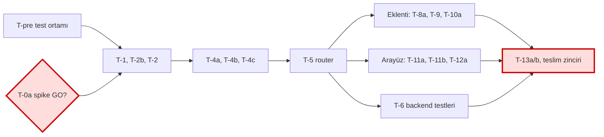

# SPEC-001 uygulama planı (Faz 0 + Faz 1: kaydedilenleri temizleme)

- Spec: `docs/specs/SPEC-001-kaydedilen-ve-dm-temizleme.md`, v1.5, CEO imzası 2026-11-08 (K-12). Kapsam yalnız Faz 0+1; Ek A (DM) kapsam dışı.
- Spec dosyasının imza anındaki sha256 (değişiklik tespiti): `c3ed9abd48af6dfc4b0c98d2d0eaca542b323fc30cf5afa1946743f96154ac83`. Bu özet değişirse iş durur (anayasa kural 1), CEO'ya dönülür.
- İmza doğrulaması: bu projede `harness/` ve `approvals/` yok; imza spec'teki "Signature record" bloğunda ve sohbette (routing kuralı: harness dışı projede onay sohbette alınır). Otomatik doğrulama yapılamadı; kayıt bloğu elle okundu: "Approved by / on: CEO, 2026-11-08, Faz 0 + Faz 1, v1.5".
- Bütçe tavanı: **28 agent iş günü**. Tahmin: **27,0 g** (yapım 21,25 + teslim zinciri 1,5 + düzeltme payı %20 = 4,25). Tampon: 1,0 g.
- Dal düzeni: proje kuralı gereği tek dal `main`, feature/integration dalı yok (CLAUDE.md, hafıza notu). Görevler yerelde `main` üstüne commit olur (commit'i main session atar); **her push CEO onayı ister**. Playbook'taki `integration/…` düzeni bu projede uygulanmaz.
- Plan sürümü: 1.0 (2026-11-08).

## 0. Başlamadan önce (main session)

1. Çalışma ağacında kayıtsız spec dosyaları var (SPEC-001 v1.5, ADR-0001, STACK.md, kapı görüşleri, `docs/talent/…`). Bunlar tek bir `docs:` commit'iyle kaydedilmeli; böylece imzalanan sürüm geçmişte sabitlenir. Push için CEO onayı gerekir (G0).
2. `docs/plan/` bu planla yeni açıldı; aynı commit'e girer.

## 1. Bağımlılık grafiği ve kritik yol

### Hangi sırayla, neyin yanında yürüyoruz?

Açıklama: T-pre ve T-0a aynı anda başlar; T-0a "GO" vermeden hiçbir Faz 1 kodu yazılmaz. T-5'ten sonra üç kol paralel yürür. Kırmızı kalın çerçeveli kutular CEO kapısıdır (B: go/no-go, J: teslim). Metin eşdeğeri aşağıdaki tablodadır.

| Aşama | Görevler | Paralel mi? | Ön koşul |
|---|---|---|---|
| 0 | T-pre ‖ T-0a hazırlık + CEO yürütme ‖ (isteğe bağlı) T-0s | evet, üçü birlikte | imza |
| Kapı G1 | T-0a go/no-go (CEO) | — | T-0a raporu |
| 1 | T-1 ‖ T-2b (+ T-7a, T-1 bitince) | evet (iki polyglot örneği) | G1 GO + T-pre |
| 2 | T-2 (+ T-7a ‖ T-7b) | T-7a/T-7b yan kolda | T-1 ve T-2b |
| 3 | T-4a → T-4b → T-4c → T-5 | hayır, zincir | T-2 |
| 4 | Kol A: T-8a → T-9 → T-10a (react-engineer) ‖ Kol B: T-11a → T-11b → T-12a (react-engineer, ikinci örnek) ‖ Kol C: T-6 (polyglot-engineer) | evet, üç kol | T-5 (T-8a ayrıca T-0a) |
| 5 | T-13a (tech-comms) ‖ T-13b (qa-engineer + CEO) | evet | T-13a: T-12a; T-13b: T-10a ve T-12a |
| 6 | qa → appsec (durak B) → internal-auditor → quality-office | hayır, zincir (maker ≠ verifier) | T-13b |

**Kritik yol** (ideal paralellikte, ajan günü):
T-pre 1,0 → T-2b 1,0 (T-1'den 0,25 g uzun) → T-2 1,0 → T-4a 1,0 → T-4b 1,5 → T-4c 1,75 → T-5 1,0 = **8,25 g**; sonra **arayüz kolu** T-11a 1,5 + T-11b 1,5 + T-12a 1,25 = 4,25 g → **12,5 g**; T-13b 0,5 → **13,0 g**; teslim zinciri 1,5 → **≈14,5 g takvim** (düzeltme payı hariç).

Spec §12.3 kritik yolu eklenti koludur (≈12,5 g, T-13b dahil). İki fark: (1) T-2b (1 g) T-1'den (0,75 g) uzundur, T-2'yi o bekletir; (2) T-5 sonrası arayüz kolu (4,25 g) eklenti kolundan (3,5 g) uzundur. Bu yüzden asıl darboğaz arayüz kolu, eklenti kolunun 0,75 g payı var. **Toplam iş yükü 27,0 g'dir; takvim süresi ancak üç kol gerçekten paralel koşarsa ≈14,5 g + düzeltme payının kritik yola düşen kısmı olur.** Paralellik, aynı birimden birden çok örnek demektir (aşağıda). Tek örnekle her şey seri koşarsa takvim ≈ 27 g olur.

Birim yükü (yapım): polyglot-engineer 10,25 g (+ T-0a hazırlık 0,5 g, Faz 0 satırında); react-engineer 8,0 g; devops-sre 1,0 g; tech-comms 0,5 g; qa-engineer + CEO 0,5 g.

## 2. Aynı dosyaya aynı anda iki görev dokunmaz: kontrol

Paralel çalışan görev çiftleri ve ortak dosya taraması (§12 "Dosyalar" sütunundan):

| Paralel çift | Ortak dosya | Sonuç |
|---|---|---|
| T-pre ‖ T-0a ‖ T-0s | yok (T-pre: `.nvmrc`, `package.json`, vitest config, `requirements-dev.txt`, `docker-compose.yml`, `CONTRIBUTING.md`; T-0a: `docs/specs/SPEC-001-spike.md`) | temiz |
| T-1 ‖ T-2b | yok (T-1: `models/*`, alembic; T-2b: `services/cleanup_limits.py`, `limits.example.toml`, `.gitignore`, `scripts/init_env.py`, `core/config.py`) | temiz |
| T-7a ‖ T-2 / T-4a | yok (`routers/actions.py`, `schemas/actions.py` yalnız T-7a'da) | temiz |
| T-7b ‖ backend görevleri | yok | temiz |
| Kol A (T-8a/T-9/T-10a) ‖ Kol B (T-11a/b/T-12a) | Kol A: `frontend/extension/{content,background,cleanup-bg,app-bridge}.js`, `manifest.json`, `src/test/extension-cleanup.test.ts`. Kol B: `src/api`, `src/pages`, `src/components/cleanup`, `src/i18n`, `src/lib/extensionBridge.ts`, `src/lib/extension.ts`, `src/test/{extras,action-log,extension-recover,i18n}.test.*`. Kesişim yok. | temiz |
| Kol C (T-6) ‖ Kol A/B | T-6 yalnız `backend/tests/*` | temiz |
| T-13a ‖ T-13b | T-13b dosya yazmaz | temiz |

Dolaylı bağlar (dosya çakışması değil, davranış bağı; plana işlendi):
- `src/lib/extension.ts` `LATEST_EXTENSION_VERSION`'ı `manifest.json`'dan okur (`?raw`, satır 1-6). T-9 sürümü 2.8.6 → 2.9.0 yapınca değişmeden kalacak `extension-update.test.ts` ve `cleanup.test.tsx` etkilenir. **T-9 çıkış kriteri bunları çalıştırır** (AC-C31); T-11a'da `extension.ts` için ek kod gerekmeyebilir, gerekirse T-9 bittikten sonra yapılır.
- `src/test/cleanup.test.tsx` (mevcut `/cleanup` sayfası) ile yeni `extras.test.tsx` ayrı dosyalardır; ad karışmasın.
- T-12a'nın `action-log.test.tsx` testi T-7b'ye bağlıdır (spec'te yalnız T-11b yazılı; T-7b çok önce biter, sorun yok).
- `routers/bridge.py` yalnız T-5'te (`JobReport`); `models/session.py` yalnız T-1'de. Tek dokunuş.
- Test dosyaları: spec T-6/T-12a/T-10a'ya veriyor. **Öneri (spec değişikliği değil, tahmin içinde):** her backend görevi kendi AC'sinin testini yazıp ilgili dosyada bırakır, T-6 boşlukları kapatır ve bütünü doğrular. Dosyalara ardışık dokunulduğu için çakışma yok. Onay için main session'a soruluyor; varsayılan spec'e uygun (testler T-6'da).

## 3. Görev planı

Ortak çıkış kuralları (her görev için):
- Mevcut testler değişmeden yeşil: `extension-actions.test.ts`, `extension-api.test.ts`, `extension-update.test.ts`, `test_bridge.py`, `test_risk_profiles.py` ve `git diff --stat` bu dosyalarda boş (AC-C31).
- Backend komutu: `docker exec instaanalytic-backend-1 sh -c 'pip install -q -r requirements-dev.txt && python -m pytest -q <dosya>'` (T-pre sonrası tek komut).
- Frontend komutu: `cd frontend && NODE_OPTIONS=--no-experimental-webstorage npx tsc --noEmit && npx vitest run <dosya> && npm run build` (CI Node 20; T-pre sonrası Node 22).
- Yapan birim denetlemez; "bitti" için taze çıktı gösterilir ve commit mesajına görev kodu yazılır (`feat(T-4a): …`).

### Faz 0

| ID | Sahip | Dosyalar | AC | Çıkış kriteri (kanıt) | Tahmin |
|---|---|---|---|---|---|
| T-pre | devops-sre | `.nvmrc`, `frontend/package.json`, `frontend/vitest.config.*`, `backend/requirements-dev.txt`, `docker-compose.yml`, `CONTRIBUTING.md` | C31, C36 (koşturulabilirlik) | Tek komutla: pytest (pytest'li profil) + vitest + tsc + build yeşil çıktısı; migration up/down/up komutu mevcut head üzerinde çalışır; Node 22 sürümü gösterilir. **Tavan 1 g; aşılırsa durur, raporlar.** `./backend/config:/app/config:ro` bağlaması seçilirse hem `backend` hem `worker` servisinde, `docker compose config` çıktısı gösterilir (N-7) | 1,0 |
| T-ADR | business-analyst | ADR-0001 | — | Yapıldı, Accepted | 0 (harcandı 0,25) |
| T-0s | scout | — | §6.9 | İsteğe bağlı; tek soru ("hazır çözüm var mı"). Yapılmazsa atlanır, kritik yolda değil | 0,25 |
| T-0a | polyglot-engineer hazırlar, **CEO yürütür** | `docs/specs/SPEC-001-spike.md` | §6.9 | Spike raporu: her aday uç nokta için yöntem, yol, alan adları, HTTP durumu, sayfa boyutu, sıra, tür kodları, engel/429 gözlemi. Hassas veri yok. Sonuç: GO / NO-GO / GO + şekil farkı (bkz. §4) | 0,5 |

### Faz 1

| ID | Sahip | Dosyalar | AC | Bağımlı | Çıkış kriteri (kanıt) | Tahmin |
|---|---|---|---|---|---|---|
| T-1 | polyglot-engineer | `alembic/versions/o5e7…py`, `models/cleanup.py`, `models/session.py`, `models/action_log.py`, `models/__init__.py` | C1, C20, C22, C36 | T-pre, G1 GO | `alembic upgrade → downgrade → upgrade` hatasız (test veritabanı `instaanalytic_pytest`, çıktı gösterilir); down_revision `n4d6f8b0c2e4`; modeller içe aktarılır; mevcut testler yeşil | 0,75 |
| T-2b | polyglot-engineer | `services/cleanup_limits.py`, `backend/config/limits.example.toml`, `.gitignore`, `scripts/init_env.py`, `core/config.py` | L1..L13 | T-pre, G1 GO | `test_cleanup_limits.py` yeşil (L1..L4, L7..L13); `limits.toml` `.gitignore`'da; örnek dosya = varsayılanlar | 1,0 |
| T-2 | polyglot-engineer | `services/cleanup_gate.py` | C10..C13, C24..C26, C42, C43, L9 | T-1, T-2b | `test_cleanup_budget.py` yeşil: sert tavan/ısınma sınırları (71:59, 72:00, 167:59, 168:00), "hazır" kuralı a-f, tahmin 500 → 3 gün / 13 başlatma | 1,0 |
| T-4a | polyglot-engineer | `services/cleanup_scan.py`, `tasks/cleanup_tasks.py`, `tasks/celery_app.py` | S1, S2, S8, S13..S15, C22, C32 | T-2 | `test_cleanup_retention.py` ve `test_celery_registration.py` yeşil (`include`, `beat_schedule`, `expires=55`); tarama/envanter/filtre testleri yeşil | 1,0 |
| T-4b | polyglot-engineer | `services/cleanup_batch.py` | C5..C9, C22, C23, C39, C40, C44, C45, C49, C50, S5, S9..S11 | T-4a | `test_cleanup_state.py` + önizleme/onay/start/stop/`run_seq` testleri yeşil (eşzamanlı preview 409 dahil) | 1,5 |
| T-4c | polyglot-engineer | `services/cleanup_exec.py` | C2, C13..C19, C23, C26, C28, C29, C35, C44, C46..C50, C52, C53 | T-4b | next/precheck/result/hata sınıfları/429/okuma bütçesi testleri yeşil; eşzamanlı precheck son yeri bir kez verir (C26) | 1,75 |
| T-5 | polyglot-engineer | `routers/cleanup.py`, `schemas/cleanup.py`, `main.py`, `routers/bridge.py` (yalnız `JobReport`) | C2..C4, C27, C37, C38, C41, L5 | T-4c | Uç nokta testleri yeşil (IDOR 404, 415, 409 `extension_outdated`, hata zarfı); `test_bridge.py` değişmeden yeşil; API açılışta hatasız (`docker compose up -d` + `/api/health`) | 1,0 |
| T-6 | polyglot-engineer | `tests/test_cleanup*.py`, `tests/test_migrations.py`, `tests/test_celery_registration.py`, `tests/test_privacy_insights.py` (yalnız yeni test) | §9 backend satırları | T-5 | Tam backend `pytest -q` çıktısı yeşil; §9'daki her backend AC'sinin testi adıyla var (izlenebilirlik tablosu) | 2,0 |
| T-7a | polyglot-engineer | `routers/actions.py`, `schemas/actions.py` | C17 | T-1 | `ig_user_id=null` kayıtlar hatasız listelenir (API testi) | 0,25 |
| T-7b | react-engineer | `pages/ActionLogPage.tsx` | C17 | T-7a | `action-log.test.tsx` (T-12a'da tamamlanır) ya da elle: null kimlikli satır çizilir; `tsc` yeşil | 0,25 |
| T-8a | react-engineer | `frontend/extension/content.js` | S1..S4, S6, C15, C18, C28, C46, C48 | T-0a, T-5 | `extension-cleanup.test.ts` içindeki content.js testleri yeşil (tarama sayfa/gecikme/tavan, yalnız izinli alanlar, unsave already/done/failed/404, 429 ≠ blocked, `/saved/` gözlem dışı) | 1,0 |
| T-9 | react-engineer | `frontend/extension/{background,cleanup-bg,app-bridge}.js`, `manifest.json` | C4, C13, C14, C16, C29..C31, C33, C40, C48, C49, C51 | T-8a | Eklenti testleri yeşil (bitiş tablosu, devre kesici 5 hata/5 `too_soon`, `stale_after_ms`, `run_seq` komut doğrulama); **mevcut `extension-actions/api/update` testleri değişmeden yeşil** (manifest 2.9.0 sonrası, `git diff --stat` boş) | 1,5 |
| T-10a | react-engineer | `src/test/extension-cleanup.test.ts` | §9 eklenti satırları, C31 | T-9 | Tam eklenti vitest çıktısı yeşil; AC-C31 regresyon çıktısı eklenir | 1,0 |
| T-11a | react-engineer | `src/api/cleanup.ts`, `pages/ExtrasPage.tsx`, `components/cleanup/{ConfirmDialog,ProgressPanel,EnableDialog,LimitsPanel}.tsx`, `pages/SettingsPage.tsx`, `App.tsx`, nav, `i18n/tr.ts`, `i18n/en.ts`, `lib/extensionBridge.ts`, `lib/extension.ts` | C3, C6, C21, C40, L6, U1, U2, U7..U10, U12, U13, U15..U18, U20, U21, U23..U26 | T-5 | `tsc --noEmit` + `npm run build` yeşil; sayfa açılışında/yenilemede otomatik `ia-run` yok (C21); TR/EN kod ↔ metin tablosu eksiksiz | 1,5 |
| T-11b | react-engineer | `components/cleanup/{SavedTab,SelectionBar}.tsx` | S7, S12, S15, U3..U6, U14, U19, U22 | T-11a | `tsc` + build yeşil; iki seçim modu ve geçiş tabloları (§4.4) çalışır | 1,5 |
| T-12a | react-engineer | `src/test/{extras,action-log,extension-recover,i18n}.test.*` (son ikisi yalnız yeni test) | §9 arayüz satırları | T-11b, T-7b | Tam `vitest run` + `tsc` + build yeşil; her AC-U için AC kimliğiyle başlayan test | 1,25 |
| T-13a | tech-comms | `docs/09-…`, `docs/04-…`, `docs/05-…`, `src/guide/content.ts` | §11 | T-12a | İki ısınma modeli, ayar dosyası, sert tavanlar, 429, ortak engel duraklatması yazılı; `guide.test.tsx` yeşil; BookStack senkronu main session'da (`bs_sync_ia.py`) | 0,5 |
| T-13b | qa-engineer + CEO | — (dosya yazmaz) | S3, S4, C13, C40, L1 | T-10a, T-12a | Test hesabında elle duman testi: tarama, seçim, önizleme, sayı onayı, Başlat/Durdur, `limits.toml` değişikliğinin ≤30 sn'de uygulanması, 429 (varsa). Rapora yalnız alan adları ve sayılar | 0,5 |

### Teslim zinciri (spec §12.3 "teslim zinciri", 1,5 g)

| Kod | Sahip | Girdi | Çıkış | Tahmin |
|---|---|---|---|---|
| D-1 | qa-engineer | tüm testler, T-13b | Taze tam pytest + vitest + build çıktısı, AC ↔ test izlenebilirlik tablosu | 0,5 |
| D-2 | appsec (durak B) | kod, §8 tehdit modeli | Bulgu listesi; güvenlik bulgusu varsa dur, CEO'ya | 0,5 |
| D-3 | internal-auditor | D-1, D-2 çıktısı | Bağımsız denetim: CLEAN / bulgu | 0,25 |
| D-4 | quality-office | hepsi | Teslim kararı raporu | 0,25 |

### Dağıtım adımları (spec §10; CEO onay noktaları işaretli)

1. `pg_dump` yedeği (öneri) → 2. `alembic upgrade head` (gerçek veritabanı, **CEO onayı**) → 3. `docker compose restart worker`, ardından `celery -A app.tasks.celery_app inspect registered` çıktısında `cleanup_stale` ve `cleanup_retention` görünmeli (K-4) → 4. `config/limits.toml` yoksa örnekten kopyala (`init_env.py`) → 5. Eklentiyi 2.9.0 olarak yeniden yükle (**yayın CEO onayı**) → 6. CEO özelliği açar (diyalog §4.3).

## 4. T-0a spike: CEO için adım adım talimat

Amaç: Instagram'ın kaydedilenler için gerçekte hangi uç noktaları kullandığını ve yanıt şeklini **kendi tarayıcında, bir test hesabıyla** görüp yalnız **alan adlarını ve sayıları** kaydetmek. Yaklaşık 30-40 dakika. Kod yazmıyoruz, eklenti gerekmiyor.

**Hazırlık (bir kez)**
1. Ayrı bir Chrome profili aç (yalnız test hesabı için). Gerçek hesabını bu profilde açma.
2. Test hesabında en az 30 gönderi kaydedilmiş olsun: en az 1 fotoğraf, 1 video/reel, 1 çok görselli (carousel). En az 2 koleksiyon olsun, birinde 2-3 gönderi bulunsun. Ayrıca bir gönderiyi "Kaydedilenler"e koleksiyonsuz kaydet.
3. Chrome'da Instagram sekmesini aç, F12 → **Network** sekmesi → "Fetch/XHR" filtresi. "Preserve log" işaretli olsun.

**Güvenlik kuralları (kesin)**
- "Copy as cURL", "Copy as fetch", "Save all as HAR" **kullanma**: çerez ve token içerirler. Hiçbirini sohbete, repoya ya da dosyaya yapıştırma.
- `csrftoken`, `sessionid`, `fb_dtsg`, `lsd`, `x-ig-www-claim`, çerez ve `Authorization` değerlerini **hiçbir yere yazma**, ekran görüntüsüne de alma. Yalnız **alan adlarını** (ör. `items[].media.pk`) ve sayıları yaz.
- Gönderi sahiplerinin kullanıcı adlarını raporlama.
- İşlemleri **elle ve tek tek yap**. Toplu ya da hızlı tıklama yok; her işlemden sonra en az 30 saniye bekle. Toplam yaklaşık 3-4 unsave yeterli.
- Engel/429 uyarısı çıkarsa **dur**, devam etme, sadece o ekranın metin türünü ve HTTP durumunu not et (provoke etme).

**A. Kaydedilenleri listeleme**
1. `instagram.com/<test_kullanıcı_adı>/saved/` sayfasını aç. Network'te sayfa açılırken giden istekleri incele; `saved` / `collections` içeren XHR'ı bul.
2. İsteğe tıkla → **Headers**: yalnız yöntemi (GET/POST) ve **yol kısmını** (`/api/v1/...` ya da `/graphql/query`) not et. Sorgu parametre **adlarını** yaz (ör. `max_id`), değerlerini yazma.
3. **Response/Preview** sekmesinde şunları işaretle (yalnız varlık ve tür): `items[].media.pk`, `id`, `code`, `media_type`, `user.username`, `image_versions2`, `more_available`, `next_max_id`. GraphQL ise `friendly_name`/sorgu adı ve yanıttaki alan yolları.
4. İlk yanıtta kaç öğe var (sayfa boyutu)? Sıra: en son kaydettiğin en üstte mi? Sayfayı aşağı kaydır, ikinci sayfa isteğini bul; ikinci sayfada hangi parametre değişiyor (adı)?
5. Üç türden birer gönderi için `media_type` sayısal kodunu not et (fotoğraf / video / carousel).

**B. Koleksiyonlar**
6. Kaydedilenler ekranında koleksiyon listesi yüklenirken `collections` içeren isteği bul. Yol, yöntem, alan adları (koleksiyon kimliği alanı, ad alanı). Bir koleksiyonu aç: gönderi listesi isteği nasıl değişiyor (yol/parametre adı)? Gönderi yanıtında koleksiyon kimliklerini veren bir alan var mı (alan adı)?

**C. Unsave (tek gönderi, test)**
7. Network'ü temizle. Test hesabındaki **bir** kaydedilen gönderiyi aç, kaydet simgesine basıp kaydı kaldır (unsave).
8. Giden POST isteğini bul: yöntem, **yol** (ör. `.../unsave/` içeren), gövdedeki **alan adları** (değerleri değil), yanıt HTTP durumu ve yanıtın alan adları (ör. `status`).
9. Aynı gönderiyi tekrar kaydet, 30 sn bekle, tekrar unsave yap; ikinci kez unsave'e yanıt farkı var mı (aynı yanıt mı)? Zaten kaydedilmemiş bir gönderiye unsave ("already" durumu) doğal yoldan mümkün değilse "doğrulanamadı" yaz; zorlama.
10. Silinmiş/erişilemeyen gönderi ("not_found") taklidi **yapma**; yalnız karşılaşırsan not et.

**D. Doğrulama (unsave sonrası durum)**
11. Aynı gönderi sayfasını yeniden yükle; ağda gönderi bilgisi isteği (`.../media/.../info/` benzeri) var mı? Yanıtta kullanıcının kaydedip kaydetmediğini gösteren bir alan var mı (alan adı, ör. `has_viewer_saved`)? Yoksa "yok" yaz.

**E. Engel ve 429 sinyalleri**
12. Bu adımlarda hiçbir uyarı/hata görmediysen "gözlenmedi" yaz. Görürsen: HTTP durumu, yanıttaki alan adları (ör. `message`, `feedback_*`, `spam`), ekrandaki uyarı türü. Bunları **kasıtlı olarak tetikleme**.

**Kayıt**
13. Sonuçları `docs/specs/SPEC-001-spike.md` içine tablo olarak yaz (aşağıdaki şablon) ya da bana/polyglot-engineer'a düz metin ver; ben dosyaya işlerim. Dosyada yalnız: yöntem, yol, parametre adı, alan adı, HTTP durumu, sayı.

Şablon (her satır bir iş; hepsi "doğrulandı / doğrulanmadı / farklı" ile bitmeli):

| İş | Yöntem + yol | İstek alan/parametre adları | Yanıt alan adları | HTTP | Not (sayfa boyutu, sıra, tür kodları) | Sonuç |
|---|---|---|---|---|---|---|
| Listeleme | | | | | | |
| Koleksiyon listesi | | | | | | |
| Koleksiyonlu liste | | | | | | |
| Unsave | | | | | | |
| Unsave doğrulama | | | | | | |
| Engel / 429 | | | | | | gözlenmedi / gözlendi |

**Karar (CEO, G1):**
- **GO:** listeleme ve unsave güvenilir doğrulandı, şekil §7.2 ile uyumlu. Faz 1 başlar.
- **GO + şekil farkı:** uç noktalar çalışıyor ama alan adları/sayfalama/GraphQL zorunluluğu farklı. T-4a, T-8a, T-9 yeniden tahminlenir; spec v1.6 gerekir; yeni toplam 28 g'yi aşıyorsa iş başlamadan CEO'ya gider (§6.9 tetikleyicisi).
- **NO-GO:** listeleme ya da unsave doğrulanamadı. Faz 1 başlamaz, karar CEO'ya gider.
- Koleksiyon listesi yoksa bu NO-GO değildir; koleksiyon filtresi `not_available` olur (AC-S5).

## 5. Kilometre taşları ve CEO onay noktaları

| Taş | Ne zaman | Çıkış kanıtı | CEO onayı |
|---|---|---|---|
| M0 | Başlangıç | Spec + plan commit'i (yerel) | G0: `docs:` push'u |
| M1 | T-pre ve T-0a bitti | Tek-komut test çıktısı yeşil; spike raporu | **G1: T-0a go/no-go** (zorunlu, kod başlamadan) |
| M2 | T-1, T-2b, T-2 (+ T-7a) | Migration up/down/up, limits ve bütçe testleri yeşil | yok (yerel commit) |
| M3 | T-5 bitti (backend API tam) | Uç nokta testleri yeşil, API ayakta | G2: ara push (öneri, bkz. aşağı) |
| M4 | T-6 + T-10a + T-12a bitti | Tam pytest + vitest + build yeşil | G3: push |
| M5 | T-13a/b bitti | Elle duman testi raporu | CEO test hesabında yürütür |
| M6 | Teslim zinciri D-1..D-4 | qa/appsec/audit/quality çıktıları | **G4: teslim onayı**; migration'ı gerçek veride uygulama; eklenti 2.9.0 yayını; özelliği açma |

Push politikası (tek dal, main): görevler yerelde commit olur. Öneri: üç push, yani G0 (docs), G2 (M3, backend) ve G3/G4 (M4+M6). Yalnız son push'ta çalışır teslim vardır; ara push'lar kapalı özellik (varsayılan `enabled=false`) taşıdığı için kullanıcıya etkisi yoktur. Her push ayrı CEO onayıdır; ben ve ekip push/merge yapmaz. Risk: push'lanmamış yerel commit'ler tek makinede durur (yedek yok); bu yüzden M3'te ara push önerilir.

Diğer CEO kapıları: T-0a şekil farkı çıkarsa yeniden tahmin; tavan aşımı; güvenlik bulgusu; T-pre tavanı (1 g) aşımı; gerçek veride migration; eklenti yayını; özelliği açma kararı.

## 6. Riskler ve tavan izleme

### Tavan izleme (28 g; tahmin 27,0 g)

| Eşik | Ajan günü | Eylem |
|---|---|---|
| %50 | 14,0 | Durum raporu: tahmin / gerçekleşen, hangi görev saptı |
| %75 | 21,0 | Rapor + kalan işin yeniden tahmini; kalan > (28 − harcanan) ise CEO'ya |
| %90 | 25,2 | Kapsam dondurulur, yalnız düzeltme; CEO'ya uyarı |
| %100 | 28,0 | **İş durur**, main session'a ve CEO'ya dönülür |

Kurallar:
- Her görev kapanışında gerçekleşen süre `STATE.md` ve scorecard'a (T-satırı ve faz bazında tahmin / gerçekleşen) yazılır; ilk scorecard'ı bu iş başlatır.
- "Harcanan + kalan satır tahmini" 28 g'yi aşıyorsa görev başlatılmaz (durur).
- Tek görev tahmininin %30'unu aşarsa o gün raporlanır. Aynı CI/test hatası 3 kez tekrarlarsa durulur, kök neden istenir.
- Düzeltme payı (4,25 g) görev satırlarında değil, ayrıca izlenir: payın %50'si ilk fazda (T-1..T-5) erirse uyarı.
- Kota: abonelik kotasının en fazla %30'u (CK-13); main session aşımı yaklaşırken bildirir.

### Risk tablosu

| # | Risk | Etki | Önlem / sahip |
|---|---|---|---|
| R1 | T-0a NO-GO | Faz 1 durur | G1 kapısı; Faz 0 dışında harcama yok (≈2,4 g) |
| R2 | Uç nokta şekil farkı (GraphQL, sayfalama) | T-4a/T-8a/T-9 yeniden tahmin; tavan | §6.9 tetikleyicisi; yeni toplam > 28 g ise başlamadan CEO |
| R3 | Tampon 1,0 g (tavanın %96'sı) | Küçük sapma tavanı aşar | Eşikler yukarıda; kapsam dondurma; düzeltme payını ayrı izle |
| R4 | Paralellik için aynı birimden birden çok örnek gerekir (T-1 ‖ T-2b; Kol A ‖ Kol B ‖ Kol C) | Tek örnekle takvim ≈ 27 g | Main session iki react-engineer ve iki polyglot-engineer örneği başlatır; çakışma tablosu §2 |
| R5 | CEO erişilebilirliği (T-0a ve T-13b CEO'nun zamanı) | Kritik yolda bekleme | T-0a'yı T-pre ile aynı anda başlat; talimat hazır (§4); T-13b için test hesabı ve gün önceden |
| R6 | T-4c en ağır görev (1,75 g, çok AC) | Sapma | Gün sonu ara rapor; kapanışta C-ID ↔ test tablosu |
| R7 | Test ortamı: pytest imajda yok (IA D-04), Node 25'te vitest bayrağı (IA D-02) | Her görevin çıkış kanıtı çalışmaz | T-pre ilk iş; tavan 1 g |
| R8 | Manifest 2.9.0, "değişmeyecek" testleri etkiler (`LATEST_EXTENSION_VERSION` manifest'ten okunuyor) | AC-C31 bozulur | T-9 çıkışında bu testler çalıştırılır; kırılırsa dur ve sor, testi değiştirme |
| R9 | `docker compose restart worker` unutulur (worker `--reload`'suz, `docker-compose.yml:59`) | Beat görevleri çalışmaz | Dağıtım adımı 3 ve `inspect registered` kanıtı; `test_celery_registration.py` |
| R10 | Spike'ta hassas veri sızması | Güvenlik bulgusu | §4 yasakları; sızarsa dur, CEO'ya bildir, rapordan sil |
| R11 | Instagram hesap kısıtlama (T-0a, T-13b) | Test hesabı kaybı | Yalnız test hesabı; elle, yavaş, az sayıda; provoke yok |
| R12 | Push'lanmamış yerel commit'ler | Kayıp riski | M3'te ara push önerisi (CEO onayı) |
| R13 | Maker ≠ verifier: testleri yazan polyglot/react, kodu da yazıyor | Bağımsız doğrulama eksikliği | Teslim zincirinde qa-engineer, appsec, internal-auditor farklı birimler; kendi kodunu denetlemezler |
| R14 | Aynı dosyalar: `src/test/extension-recover.test.tsx`, `i18n.test.ts`, `test_privacy_insights.py` mevcut dosyalar | Eski testleri bozmak | "Yalnız yeni test" kuralı; `git diff` incelemesi |
| R15 | DM'e kayma | Kapsam sızması | Ek A'ya dokunan hiçbir görev yok; Mesajlar sekmesi gösterilmez |

## 7. Plane görev listesi (main session yazacak)

Proje: InstaAnalytic (`IA`). Tahminler ajan günü. "Bağımlı" sütunu bloklayan görevleri gösterir. Etiketler önerisi: `spec-001`, faz (`faz0`/`faz1`/`teslim`), birim (`devops`/`backend`/`frontend`/`extension`/`docs`/`qa`).

| Kod | Başlık | Sahip | Bağımlı | Tahmin (g) |
|---|---|---|---|---|
| T-pre | Test ortamı: Node 22, pytest profili, tek komut, migration up/down/up | devops-sre | imza | 1,0 |
| T-ADR | ADR-0001 rev. 2 (yapıldı) | business-analyst | — | 0 (0,25 harcandı) |
| T-0s | Scout: hazır çözüm var mı (isteğe bağlı) | scout | imza | 0,25 |
| T-0a | Kaydedilenler spike'ı (CEO yürütür) + go/no-go | polyglot-engineer + CEO | imza | 0,5 |
| T-1 | Migration `o5e7…` + modeller | polyglot-engineer | T-pre, T-0a | 0,75 |
| T-2b | Ayar dosyası yükleyici (`limits.toml`) | polyglot-engineer | T-pre, T-0a | 1,0 |
| T-2 | `cleanup_gate`, bütçe, "hazır" kuralı, tahmin | polyglot-engineer | T-1, T-2b | 1,0 |
| T-4a | Tarama alımı, envanter, filtre, beat görevleri | polyglot-engineer | T-2 | 1,0 |
| T-4b | Önizleme, onay, parti durum makinesi, start/stop, `run_seq` | polyglot-engineer | T-4a | 1,5 |
| T-4c | next/precheck/result, hata sınıfları, 429, okuma bütçesi | polyglot-engineer | T-4b | 1,75 |
| T-5 | Router, şemalar, hata zarfı, IDOR, `/cleanup/limits` | polyglot-engineer | T-4c | 1,0 |
| T-6 | Backend testleri | polyglot-engineer | T-5 | 2,0 |
| T-7a | Aksiyon Geçmişi API (null kimlik) | polyglot-engineer | T-1 | 0,25 |
| T-7b | Aksiyon Geçmişi sayfası | react-engineer | T-7a | 0,25 |
| T-8a | content.js: tarama, unsave, precheck, 429 ayrımı | react-engineer | T-0a, T-5 | 1,0 |
| T-9 | `cleanup-bg.js`, bitiş tablosu, devre kesici, manifest 2.9.0 | react-engineer | T-8a | 1,5 |
| T-10a | Eklenti testleri + regresyon kanıtı | react-engineer | T-9 | 1,0 |
| T-11a | Arayüz ortak: API istemcisi, Ayarlar anahtarı, paneller, Başlat/Durdur | react-engineer | T-5 | 1,5 |
| T-11b | Kaydedilenler sekmesi: envanter, seçim modları | react-engineer | T-11a | 1,5 |
| T-12a | Arayüz testleri | react-engineer | T-11b, T-7b | 1,25 |
| T-13a | Doküman: docs/09, 04, 05, kılavuz | tech-comms | T-12a | 0,5 |
| T-13b | Elle duman testi (test hesabı) | qa-engineer + CEO | T-10a, T-12a | 0,5 |
| D-1 | Teslim: QA (taze tam test çıktısı, AC izlenebilirliği) | qa-engineer | T-13b | 0,5 |
| D-2 | Teslim: AppSec durak B | appsec | D-1 | 0,5 |
| D-3 | Teslim: bağımsız denetim | internal-auditor | D-2 | 0,25 |
| D-4 | Teslim: kalite ofisi kararı | quality-office | D-3 | 0,25 |
| BUF | Düzeltme payı (%20; ayrı izlenir, görev değil) | — | — | 4,25 |
| **Toplam** | | | | **27,0** (yapım 21,25 + teslim 1,5 + pay 4,25; T-ADR 0,25 yapım toplamına dahil) |

Not: spec §12.3 yapım toplamı (21,25 g) T-ADR'ın harcanan 0,25 g'sini içerir; tablodaki satır toplamı (T-ADR sıfır) 21,0 g'dir. Fark, tarihçesi olan bir iç hesap farkıdır, tavanı etkilemez.

Tahmin doğrulaması (satır toplamı): Faz 0 = 1,0 + 0,25 (T-0s) + 0,5 + 0,25 (T-ADR) = 2,0; Faz 1 yapımı = 19,25; teslim = 1,5; pay = 4,25; toplam 27,0.
