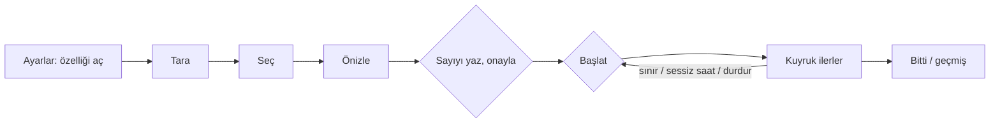
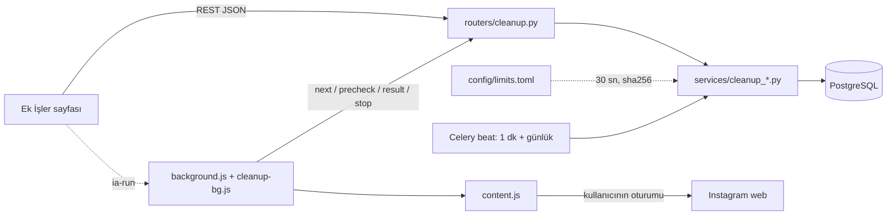
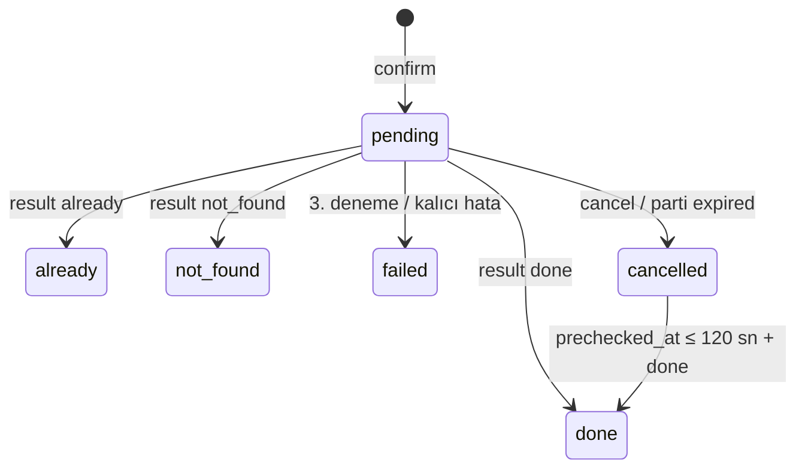
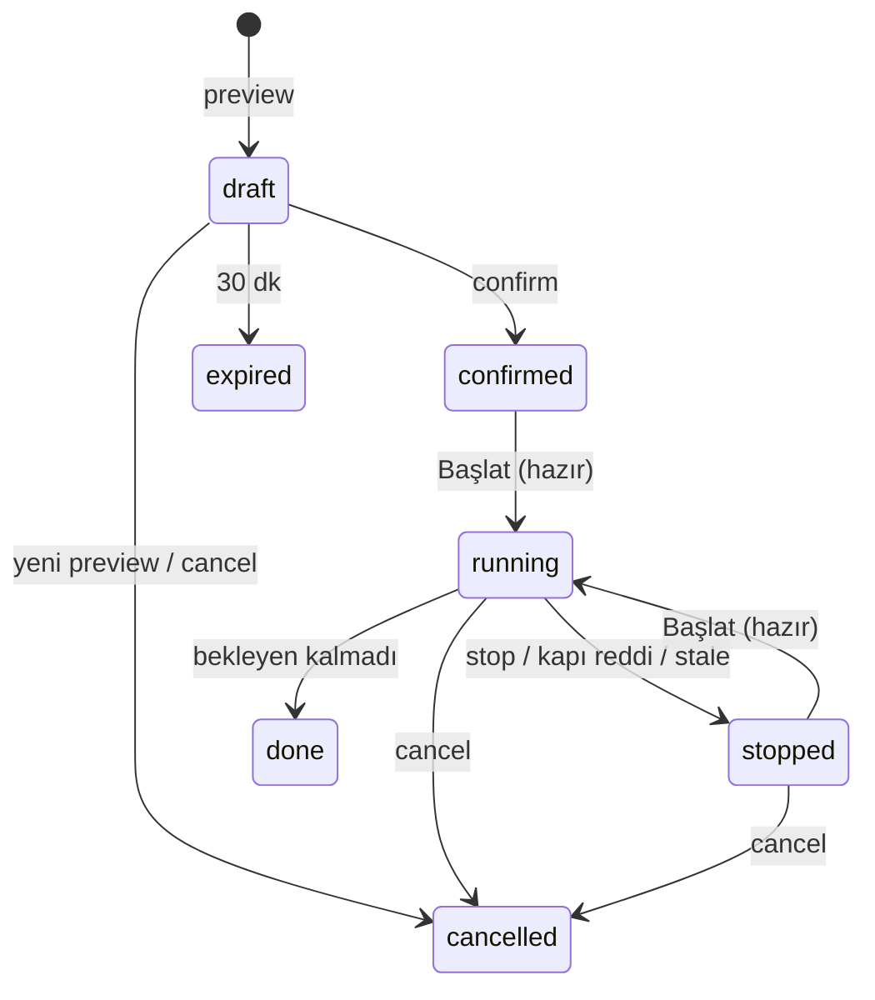
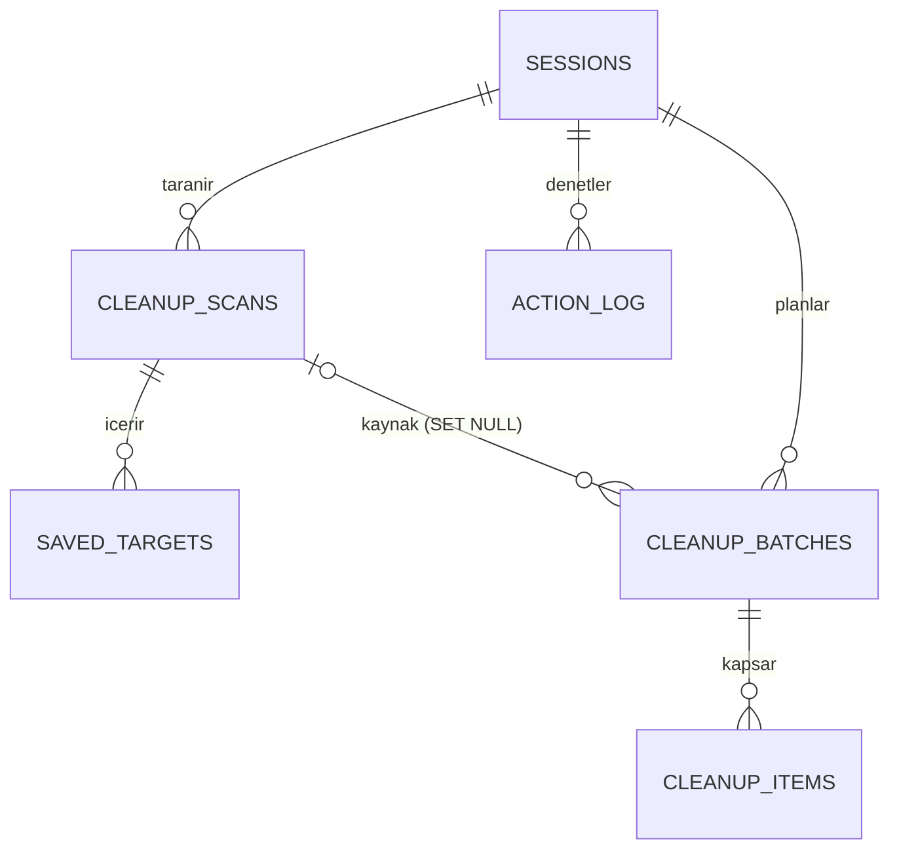
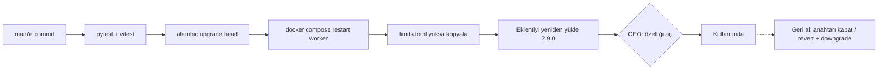

# Spec 001 — Kaydedilenleri temizleme (Faz 0 + Faz 1); DM silme taslağı (Ek A)

- Status: Approved (CEO, 2026-11-08)
- Version: v1.5 (2026-11-08)
- Tier: full
- Signature scope: **Faz 0 + Faz 1 (Kaydedilenleri temizleme).** Ek A (DM silme, Faz 2) bu imzanın kapsamı dışında. T-0b spike'ından sonra ayrı spec ve ayrı imzayla gelir.
- Previous spec: none
- Self-critique: done (§14.5)
- Budget ceiling: **28 agent iş günü** (Faz 0+1). CEO onaylandı: 2026-11-08, K-11 (CK-16, "28 devam"); K-10'daki 22 g'nin yerine geçer. v1.5 tahmini **27,0 g** (§12.3): tavanın %96'sı, tampon 1,0 g. Kota payı: abonelik kotasının en fazla %30'u (CK-13, kabul). Tavan aşılırsa iş durur, main session'a dönülür.
- Sensitive area: geri alınamaz işlem (kaydedilenlerden çıkarma), Instagram hesap oturumu (hesap kısıtlama riski), üçüncü kişi kullanıcı adları (gönderi sahipleri)

> Dil: içerik Türkçe, teknik terimler İngilizce. Başlık alanları ve `Status:` değerleri protokol gereği İngilizce.
> Kapsam: §1-§14 yalnız Faz 0 + Faz 1'i anlatır ve bağlayıcıdır. DM'e ait her şey **Ek A**'dadır, taslaktır ve bağlayıcı değildir.

### Sürüm notu

| Sürüm | Tarih | Değişiklik |
|---|---|---|
| v1.0 | 2026-11-08 | İlk taslak. |
| v1.1 | 2026-11-08 | Dört kapının (R1, AppSec, kurul, kapasite) bulguları işlendi. CEO kararları CK-1..CK-13 tablosunda toplandı. |
| v1.2 | 2026-11-08 | CEO kararları işlendi: yalnız Faz 0+1 imzaya gidiyor ("1-a"), DM Ek A'ya taşındı, CK-8 reddedildi (elle Başlat). CEO'nun iki yeni isteği eklendi: seçip toplu çıkarma ve ayar dosyası (`limits.toml`). Kurulun A-01, A-02 ve A-04 sadeleştirmeleri uygulandı. R2 bulguları işlendi. |
| v1.3 | 2026-11-08 | v1.2 kapılarının bulguları işlendi (izleme: §14.2). Ayrıntılar aşağıda. |
| v1.4 | 2026-11-08 | v1.3 kapılarının bulguları işlendi (izleme: §14.2). Kapsam genişlemedi. Ayrıntılar aşağıda. |
| v1.5 | 2026-11-08 | Son küçük tur: kurul v1.4'e tam onay verdi; R5 ve AppSec v1.4'ün istekleri işlendi. Ayrıntılar aşağıda. |

v1.5 değişiklikleri:
- **H-1 = S-26 (zorunlu):** arayüz iki `stop` gönderebilir: `{reason:'user_stop'}` ve `{reason:'start_failed', run_seq}`. `run_seq` yoksa yalnız `user_stop` kabul edilir; eskiyse `applied=false`. AC-C50, §7.8, AC-U21 ve §6.6 hizalandı.
- **M-a:**
  - Durmuş partiye ya da eski `run_seq`'e gelen `result` kaydedilir ve `stopped=true` döner; eklenti işi bitirir.
  - Ardışık `already`/`not_found` okumalarına saatlik üst sınır eklendi (`[reads]`, ayar dosyasında, HARD_CAP'li; AC-C53).
- **L-a..L-f:** `last_seen_at` listesine `start` eklendi; `not_found` sonrası gecikme ve precheck'siz bildirim tanımlandı; `run_seq` uyuşmazlığında sunucu partiye dokunmuyor; takılı `running` partiye `start` tanımlandı; eksik metinler eklendi; AC-C42 (f) ifadesi düzeltildi.
- **I-13..I-15:** eşzamanlı önizleme 409 için AC ve test; kapı alt sınırı testi; `start`'ta `stale_after_s = null`.
- **Tahmin:** +0,25 g yapım; toplam 27,0 g.
- **CK-16:** CEO "28 devam" dedi (2026-11-08, K-11). Tavan 28 g oldu ve K-10'daki 22 g'nin yerine geçti.
- **Durum:** açık CEO maddesi kalmadığı için Status `Awaiting approval` yapıldı. İmza bloğu CEO'nun doldurmasına hazır.

v1.4 değişiklikleri:
- **R4 C-1 ve AppSec S-22 (tek düzeltme):** `start`, aynı işlemde `last_seen_at = now` yazar. Takılma kuralı `now − coalesce(last_seen_at, started_at) > T` oldu. AC-C44'e iki sınama eklendi.
- **R4 M-1..M-4:**
  - "Hazır" kuralı, son 1 saatteki takip işlemlerini hesap payından düşer.
  - Boş filtre "filtre yok" sayılır.
  - Yeniden taramada seçimin ne olacağı tanımlandı.
  - `ia-run` başarısız ya da yanıtsız olursa `stop(start_failed)` çağrılır.
- **R4 L-1..L-7:**
  - `T` partiye yazılır; sunucu kayıtlı değer ile güncel değerin büyüğünü kullanır.
  - Filtre modunda sayfa değişimi tanımlandı.
  - `confirmed` partiye gelen `stop` için idempotans tanımlandı.
  - Kod ↔ metin tablosu tamamlandı.
  - Kalıcı hata tanımı tek yerde.
  - Durum okuması precheck'ten önce yapılır.
  - `stopped` davranışı iki tabloda aynı.
- **AppSec:**
  - S-23 ve kurul K-3 birleşti: `run_seq` artık `ia-run`, `next`, `precheck`, `result` ve eklentinin `stop`'unda taşınıyor.
  - S-25: `collection_id` doğrulaması.
  - S-24: 429 sonrası hemen yeniden Başlat mümkün; bu kabul edilmiş artık risk olarak §8'e ve imza bloğuna yazıldı.
  - I-6..I-12 işlendi.
- **Kurul K-4:**
  - `celery_app` `include` listesi güncellenir.
  - §10'a `docker compose restart worker` adımı eklendi.
  - Görev kaydı test ediliyor.
  - N-4..N-8 uygulama notu olarak eklendi.
- **Tahmin:** yeniden hesaplandı (+1,0 g yapım). CK-16 önerisi 27 g olarak kalıyor.

v1.3 değişiklikleri:
- **R3 High 1-4:**
  - Partiyi sunucu kendisi durdurur: kapı reddettiğinde, engel ya da 429 geldiğinde. Eklenti işi hangi yoldan biterse bitsin `stop(reason)` çağırır. Takılı parti her uç noktada ve 1 dakikalık beat'te yakalanır.
  - Çalışan partide iptal tek işlemde yapılır.
  - "Hazır" kuralı tanımlandı: boş yer ≥ `min(hourly_eff, kalan)`. Böylece "≈13 Başlat" korunur.
  - Ayar dosyası doğrulama sırası tanımlandı (tip → kırp → çift tutarlılığı). Çift ihlalinde değerler hiçbir zaman gevşemez.
- **R3 Medium/Low 5-19:** hepsi işlendi. Bulgu 13: Instagram 429 iş durduran sınıfta; parti `stopped(rate_limited)` olur, 24 saatlik duraklatma yoktur.
- **AppSec S-13..S-21 ve I-1..I-5:** hepsi işlendi (I-1 isteğe bağlı olarak T-pre'de).
- **Kurul:**
  - K-1: yeni önizleme önceki taslakları kapatır.
  - K-2: takılı-parti eşiği tek formüle bağlandı (R3 #6 ve S-16 ile birleşti).
  - Panelde "Takip sınırları bu dosyadan yönetilmez" satırı.
  - Profil adları `risk_profiles.PROFILES`'tan alınır.
  - İki ısınma modeli belgelendi.
  - N-1..N-3 uygulama notları eklendi.
- **Kapasite:**
  - Faz 0'a %20 pay eklendi.
  - Teslim zinciri dört birime bölündü.
  - T-0a şekil farkı için yeniden tahmin tetikleyicisi eklendi.
  - İlk scorecard notu eklendi.
- Tahmin yeniden hesaplandı.
- CEO kararları ("önerilerin ok", 2026-11-08) işlendi:
  - K-08: CK-11a, en kötü toplam 95/sa ve 460/gün kabul.
  - K-09: CK-15, takip sınırları kodda kalır.
  - K-10: CK-14, tavan 22 g.
- Onaylı tavan v1.3 tahminiyle çeliştiği için CK-16 açıldı.

---

## 1. Intent

**CEO'nun cümleleri (kelimesi kelimesine):**
- İlk istek: "ek iş olarak kaydedilen silme ve dm silme özelliği istiyorum. dm silme için whitelist olsun."
- v1.1 kararları: "1-a" ve "2- seçip toplu silme de olsun. bu saatlik sınırlar ayarlar dosyasından yönetilsin."

**Yorum (BA):**
- Bu imza yalnız **kaydedilenleri temizlemeyi (unsave)** kapsar. Kullanıcının Instagram'da kaydettiği gönderiler, eklentinin kullanıcının kendi Instagram sekmesinde insan hızında yaptığı bir kuyruk işiyle kaydedilenlerden çıkarılır. Gönderinin kendisi silinmez, sahibine hiçbir şey olmaz.
- "Seçip toplu silme": kullanıcı listeden tek tek, sayfa sayfa ya da bir filtreye uyanların tümünü seçerek toplu çıkarma yapabilir.
- "Saatlik sınırlar ayarlar dosyasından": ek işin hız ve sınır değerleri kodda sabit değildir; repodaki bir ayar dosyasından okunur. Kodda yalnız aşılamayan güvenlik tavanları kalır. Takip sınırları bu kapsamda değildir (varsayım, §14.3 madde 2).
- DM silme ve whitelist Ek A'da taslak olarak bekler.

**Başarı:**
- Kullanıcı neyin çıkarılacağını önceden tam liste olarak görür, sayıyı yazarak açıkça onaylar ve işi her seferinde kendisi başlatır.
- İş insan hızında, ayar dosyasındaki bütçe içinde ilerler.
- "Durdur" her an etkilidir; eklentiye ulaşılamasa bile hiçbir parti kendi başına çalışmaya devam etmez.

**Bilerek yapılmayanlar:** gönderi silme, zamanlanmış ya da kendiliğinden devam eden temizlik (CK-8 reddedildi), DM silme (Ek A).

## 2. Market summary (Product)

Product birimi çalıştırılmadı. Ağ erişimim yok, kaynak URL veremiyorum. "Unsave all" yapan tarayıcı eklentileri yaygın (doğrulanmadı).

Bizi ayıranlar: önizleme, sayıyı yazarak onay, öğe başında sunucu kapısı, ayar dosyasından yönetilen ve kodda sert tavanı olan bütçe.

Karar: **farklı yap**. Yeni bağımlılık yok: TOML, Python 3.12 standart kütüphanesindeki `tomllib` ile okunur (`backend/Dockerfile:1`; kurul K17 onayı). İsteğe bağlı T-0s: Scout'a tek soru.

## 3. Requirements (EARS)

Ortak ve yürütme
- REQ-1 — Sistem kaydedilenleri temizlemeyi her profil için (tarayıcı ve ZIP) varsayılan kapalı başlatacak.
- REQ-2 — Kullanıcı özelliği açtığında sistem önce §4.3'teki uyarı metnini gösterecek ve açık onay isteyecek.
- REQ-3 — Özellik kapalıyken sistem tarama, önizleme, onay ve başlatma yapmayacak; yürütme isteklerine "kapalı" yanıtı verecek. Okuma, iptal ve durdurma kapalıyken de mümkün olacak (§7.5).
- REQ-4 — Özelliğin açık ya da kapalı olması takip işlemleri anahtarından (`allow_actions`) bağımsız olacak.
- REQ-5 — Sistem Instagram'a yazma yapmadan önce çıkarılacak öğelerin tam listesini (önizleme, dry-run) sunucudaki listeden gösterecek.
- REQ-6 — Sistem, kullanıcı önizlemedeki öğe sayısını tam olarak yazmadan hiçbir öğeyi kuyruğa almayacak.
- REQ-7 — Onay yalnız sunucuda saklanan önizleme listesini kuyruğa alacak. Şu durumlarda onayı reddedecek: önizlemenin kaynağı profilin güncel envanteri değilse, önizlemenin süresi dolduysa ya da parti tavanı önizlemeden sonra düşürüldüyse.
- REQ-8 — Sistem aynı anda en fazla bir etkin (onaylı, bitmemiş) parti ve en fazla bir taslak tutacak. Yeni önizleme önceki taslağı kapatacak. Etkin parti varken önizleme yapılmayacak.
- REQ-9 — Bir partideki öğe sayısı ayar dosyasındaki parti tavanını ve kodda sabit sert tavanı (500) aşmayacak. Sistem kalanı bildirecek ve öğeleri §6.7'deki sırayla alacak.
- REQ-10 — Kullanıcı envanterde gönderileri tek tek, sayfa bazında ya da bir filtreye uyanların tümü olarak seçebilecek, seçimden tek tek çıkarabilecek ve seçimi önizlemeye gönderebilecek.
- REQ-11 — Sistem her yazmadan hemen önce şunları yeniden denetleyecek: özellik açık mı, profil duraklatılmış mı, sessiz saat mi, parti bu çalıştırmada çalışıyor mu, öğe bekliyor mu, tür bütçesi ve hesap toplam bütçesi uygun mu, önceki izinden bu yana en az asgari gecikme geçti mi.
- REQ-12 — Instagram bir engel ya da kısıtlama sinyali verdiğinde sistem işi durduracak ve profilin tüm yazma işlemlerini (takip işlemleri dahil) 24 saat duraklatacak. Ek işlerin duraklatması takip anahtarını değiştirmek dahil hiçbir yolla erken kaldırılamayacak.
- REQ-13 — Instagram "çok sık istek" (HTTP 429) yanıtı verdiğinde sistem işi durduracak ve partiyi durmuş sayacak. 24 saatlik duraklatma uygulamayacak.
- REQ-14 — Bir işte ardışık 5 öğe başarısız olduğunda sistem işi durduracak ve kullanıcıyı bilgilendirecek.
- REQ-15 — Kaydedilenler türü takip işlemlerinden ayrı saatlik ve günlük bütçe kullanacak. Tür sert tavanları ve hesap toplam tavanı hiçbir profil seçiminde ve hiçbir ayar dosyası değerinde aşılmayacak.
- REQ-16 — Sistem tür bütçelerini, gecikme aralıklarını, hesap toplam tavanını, ısınmayı, parti tavanını ve tarama sınırlarını ayar dosyasından okuyacak.
  - Değerleri sırasıyla tip, sert tavan ve tutarlılık açısından denetleyecek.
  - Bir tutarlılık ihlalinde etkin ayarı hiçbir zaman dosyadakinden ve varsayılandan daha gevşek yapmayacak.
  - Dosya yoksa ya da bozuksa güvenli varsayılanları kullanacak.
  - Dosya değişikliğini yeniden başlatma gerektirmeden en geç 30 saniye içinde uygulayacak.
- REQ-17 — Sistem etkin sınırları, kaynağını, son değişiklik zamanını ve uyarıları arayüzde salt okunur gösterecek. Takip sınırlarının bu dosyadan yönetilmediğini belirtecek.
- REQ-18 — Sistem ayar dosyasındaki her değişikliği, değişen anahtarlar ve içerik özetiyle kayda yazacak. Dosyadan gelen ham metni kayda ve arayüze yansıtmayacak.
- REQ-19 — Sistem, Instagram sekmesinde açık hesap profilin hesabı değilse hiçbir tarama ya da yazma yapmayacak ve hiçbir sonucu kabul etmeyecek.
- REQ-20 — Sistem her sonucu ve ek iş ayarındaki her değişikliği denetim kaydına yazacak.
- REQ-21 — Kullanıcı bekleyen öğeleri her an iptal edebilecek; çalışan bir parti de buna dahil. Yapılmış öğeler değişmeyecek. İptal anında yürütülmekte olan öğe bittiyse sonucu kaydedilecek.
- REQ-22 — Bir parti yalnız kullanıcının açık "Başlat" eylemiyle çalışmaya başlayacak. Parti hangi nedenle durursa dursun yeniden çalışması için tekrar "Başlat" gerekecek. Sayfa açılışı, sekme değişimi ve sayfa yenilemesi hiçbir zaman başlatmayacak.
- REQ-23 — Kullanıcı "Durdur"a bastığında sistem partiyi sunucuda durdurmuş sayacak. Eklentiye ulaşılamasa bile sıradaki hiçbir öğe yazılmayacak; o an yürütülmekte olan tek öğe bitecek ve sonucu kaydedilecek.
- REQ-24 — Eklentiden belirli bir süre haber gelmezse sistem çalışan partiyi kendisi durduracak. Bu süre gecikme ayarına bağlı tek bir eşik formülüyle belirlenir (§6.6).
- REQ-25 — Sistem önizlemede tahmini süreyi ve bütçe yüzünden kaç kez "Başlat" gerekeceğini gösterecek.
- REQ-26 — Sistem bir sonraki başlatmanın ne zaman tam bir saatlik payla çalışabileceğini gösterecek; sessiz saat, tür ve hesap bütçesi, ısınma ve duraklatma bu hesaba dahildir.
- REQ-27 — Sistem Instagram oturum anahtarlarını (csrftoken, LSD, DTSG, claim) uygulamaya ya da kayda hiçbir zaman göndermeyecek.
- REQ-28 — Sistem bir profilin öğesine, partisine ya da taramasına başka bir profilin adresiyle erişime izin vermeyecek.
- REQ-29 — Sistem yürütme sonuçlarında ve tarama notlarında serbest metin kabul etmeyecek; yalnız tanımlı kod, HTTP durumu ve alan adları kabul edecek.
- REQ-30 — Sistem iş raporlarında, bildirimlerde ve eklentinin kalıcı depolamasında kullanıcı adı ve kimlik saklamayacak; yalnız sayı saklayacak.
- REQ-31 — Sistem saklama sürelerini (§7.4) yürütme isteklerinden bağımsız zamanlanmış görevlerle uygulayacak.

Kaydedilenler
- REQ-32 — Sistem kullanıcının kaydedilen gönderilerini sayfa sayfa, insan hızında listeleyecek.
- REQ-33 — Sistem kaydedilen her gönderi için yalnız şunları saklayacak: gönderi kimliği, kısa kod, sahibinin kullanıcı adı, tür, küçük resim adresi, koleksiyon kimlikleri ve listedeki sırası. Açıklamayı ve yorumları saklamayacak.
- REQ-34 — Gönderi zaten kaydedilmemişse sistem yazma yapmadan "zaten" olarak işaretleyecek.
- REQ-35 — Sistem kullanıcının kendi Kaydedilenler sayfasındaki yanıtları pasif gözleme iletmeyecek.
- REQ-36 — Sistem envanterde, bu tarama başladıktan sonra işlenmiş gönderileri işaretleyecek ve seçilemez yapacak.

## 4. User experience

Yeni sayfa: **Ek İşler** (`/extras`, nav: "Ek İşler" / "Extra jobs"). Faz 1'de tek sekme var: **Kaydedilenler**. Mesajlar sekmesi Faz 2'de gelir (Ek A); Faz 1'de gösterilmez. Mevcut `/cleanup` yönlendirmesi (`frontend/src/App.tsx:30`) değişmez. Ayarlar sayfasına bir anahtar ve salt okunur bir "Ek iş sınırları" paneli eklenir. Yeni eklenti izni gerekmez. Metinlerdeki `{max}` parti tavanıdır (ayar dosyasından, varsayılan 500); arayüzde sabit 500 yazmaz (R3 #16).

### 4.1 Kullanıcı bir temizliği nasıl yapar?

Açıklama: kullanıcı özelliği açar, taratır, seçer, sunucunun hazırladığı tam listeyi görür ve sayıyı yazarak onaylar. İş her duruşta kullanıcının yeniden "Başlat"ıyla sürer. Eşkenar dörtgenler (E, F) kullanıcının kararıdır; F'ye geri dönen ok kendiliğinden devam olmadığını gösterir. Metin eşdeğeri:

| Adım | Ekran | Instagram'a yazma |
|---|---|---|
| 1 | Ayarlar: "Kaydedilen temizleme" anahtarı + uyarı diyaloğu (§4.3) | yok |
| 2 | Ek İşler > Kaydedilenler: "Kaydedilenleri tara" (eklenti listeyi okur) | yok (yalnız okuma) |
| 3 | Envanter + seçim (§4.4) | yok |
| 4 | Önizleme diyaloğu: sunucudaki listeden N öğe, tahmini süre, "yaklaşık K kez Başlat" | yok |
| 5 | "Onaylamak için N yaz"; sayı tam eşleşince "Onayla" etkin | yok |
| 6 | "Başlat" (her seferinde elle; yalnız "hazır" olunca etkin) | var |
| 7 | İlerleme paneli; Durdur / Kalanları iptal et. Sınır ya da sessiz saatte parti durur; Başlat yeniden hazır olunca kullanıcı basar | var |
| 8 | Özet + geçmiş | yok |

### 4.2 Ekran durumları (her biri bir kabul kriterine bağlı)

| Durum | Kaydedilenler sekmesi | AC |
|---|---|---|
| Kapalı (yetkisiz) | "Bu ek iş kapalı. Ayarlar'dan açabilirsin." + Ayarlar bağlantısı; Tara düğmesi yok | AC-U1 |
| Eklenti yok / eski | "Bu iş için eklenti 2.9.0 veya üstü gerekli." + kılavuz bağlantısı; Tara ve Başlat pasif | AC-U2 |
| Hesap uyuşmazlığı / kimlik bilinmiyor | "Instagram'da başka bir hesap açık; bu profil @y. Doğru hesaba geç." / "Bu profilin Instagram kimliği henüz bilinmiyor; eklenti açıkken Instagram'da kendi profilini bir kez aç." | AC-C4 |
| Hiç taranmadı (empty) | "Henüz taranmadı." + "Kaydedilenleri tara" | AC-U3 |
| Taranıyor (loading) | "Sayfa 3 · 63 gönderi görüldü" + Durdur; `aria-live="polite"` | AC-U4 |
| Tarama yanıt vermiyor | `page_delay_max + 60 sn` boyunca sayfa gelmezse "Tarama yanıt vermiyor; Instagram sekmesi kapanmış olabilir." + Durdur; tarama eşiği (§6.6) dolunca başarısız olur | AC-U22 |
| Tarama hatası | engel / 429 / oturum kapalı / ağ / tanınmayan yanıt / hesap uyuşmazlığı: her biri ayrı ileti (§7.9.5) + "Tekrar dene" | AC-U5 |
| Yarım tarama | Sarı şerit: "Tarama yarım kaldı: yalnız görülen 240 gönderi listelendi." | AC-U14 |
| Eski tarama | Tarama 24 saati geçmişse: "Tarama eski, önizlemeden önce yeniden tara"; Önizle pasif | AC-U14 |
| Envanter boş | "Kaydedilen gönderin yok." Seçim ve Önizle yok | AC-U3 |
| Envanter (success) | Satırda: onay kutusu, küçük resim (yüklenemezse gri yer tutucu + kısa kod), @sahip, tür, koleksiyon. İşlenmiş satırda "Çıkarıldı" / "Zaten yoktu" / "Bulunamadı" / "Sırada" rozeti, seçilemez. Filtreler; seçim çubuğu (§4.4) | AC-U6, AC-S7, AC-S15, AC-U19 |
| Seçim yok | "Seçilenleri önizle" pasif + "Önce en az bir gönderi seç." | AC-U19 |
| Seçim tavanda | Yeni satır işaretlenemez; ipucu: "Bir partide en fazla {max} gönderi." | AC-U19 |
| Aktif parti var | Seçim ve Önizle pasif + "Önce mevcut partiyi bitir ya da iptal et." | AC-U17 |
| Önizleme yükleniyor / hata | İskelet / "Önizleme hazırlanamadı" + Tekrar dene; `scan_mismatch`: "Envanter yenilendi, listeyi yeniden yükle" | AC-U13 |
| Önizleme boş | "Seçiminde çıkarılacak gönderi kalmadı (K tanesi bu taramada zaten işlendi)." Onay alanı yok | AC-U24 |
| Önizleme (dry-run) | "N gönderi kaydedilenlerden çıkarılacak. Gönderiler silinmez." + **sunucudaki listeden** sayfalı tam liste + "Tahmini süre: D gün; bütçe yüzünden yaklaşık K kez Başlat'a basman gerekecek." + "Bu işlem geri alınamaz." Kesildiyse: "Seçiminden ilk {max} alındı; kalan R gönderi bu partiye girmedi. Parti bitince yeniden önizleyebilirsin; tarama o zamana kadar 24 saati geçerse önce yeniden taraman gerekir." (R4 M-3) | AC-U7 |
| Onay | "Onaylamak için **N** yaz" alanı; eşleşmezse "Onayla" pasif | AC-C6 |
| Onay hatası | `plan_changed`: "Envanter ya da sınır değişti, yeniden önizle"; `expired`; `not_draft` ("Bu önizlemenin yerini yenisi aldı"); `batch_active`; `count_mismatch`; `feature_off` | AC-U13 |
| Onaylandı, başlatılmadı | "Parti hazır: N gönderi." + **Başlat** | AC-U20 |
| Henüz hazır değil | Başlat pasif + "Başlat şu saatten sonra etkin: 14:05 (saatlik sınır)" / "08:00 (sessiz saat)" / "yarın 14:05 (duraklatma)" | AC-U9 |
| Eklenti meşgul | Başlat pasif + "Eklentide başka bir iş çalışıyor (Takip işlemleri). Bitince Başlat'a bas." | AC-U21 |
| Kuyruk ilerleyişi | "120 / 500 · 3 zaten · 1 bulunamadı · 1 başarısız · sıradaki ~30 sn" + ilerleme çubuğu + Durdur + Kalanları iptal et + "Durdur, o an yapılan işlemi kesmez; o işlem biter, sonrakine geçilmez." | AC-U8, AC-U18 |
| Durduruluyor | "Durduruluyor: o anki işlem bitiyor." Parti sunucuda `stopped`, eklenti işi henüz bitmedi; Başlat pasif | AC-U20 |
| Durdurulamadı | `POST /stop` başarısızsa: "Durdurulamadı; uygulamaya ulaşılamıyor." + Tekrar dene. Eklentiye `ia-stop` yine gider | AC-U23 |
| Durdu | Neden metni (§7.9.5) + **Başlat** (hazır olunca etkin) | AC-U9, AC-U20, AC-U26 |
| Çok sık istek (429) | Sarı şerit: "Instagram çok sık istek yapıldığını söyledi. Bir süre bekleyip Başlat'a bas." | AC-U25 |
| Duraklatma | Kırmızı şerit: "Instagram işlemi engelledi; tüm işlemler 24 saat duraklatıldı (yarın 14:05'e kadar)." | AC-U9 |
| Bağlantı kaybı | Son bilinen durum + "Uygulamaya ulaşılamıyor; yeniden deneniyor." | AC-U15 |
| Bitti | Özet: yapıldı / zaten / bulunamadı / başarısız / iptal; geçmiş bağlantısı | AC-U10 |
| Geçmiş | Sayfalı liste, durum filtresi; boş: "Henüz geçmiş yok"; hata: "Geçmiş yüklenemedi" + Tekrar dene | AC-U16 |
| Ayarlar anahtarı | Kaydediliyor (anahtar pasif + dönen gösterge) / kaydedilemedi (anahtar eski konumuna döner + ileti) | AC-U12 |
| Sınırlar paneli (Ayarlar) | §4.5 | AC-L6 |

Erişilebilirlik:
- Onay alanı `<label>` ile bağlı; ilerleme `aria-live` bölgede.
- Seçim kutularının erişilebilir adı "@sahip, kısa kod seç".
- Durum yalnız renkle verilmez; tüm eylemler klavyeyle yapılabilir.

Hata iletisi sahipliği:
- Eklenti iletileri `background.js` / `cleanup-bg.js` tarafından üretilir (Türkçe, mevcut desen).
- Uygulama iletileri i18n TR/EN (`frontend/src/i18n/tr.ts`, `en.ts`) ile üretilir; kod ↔ metin tablosu §7.9.5'tedir.
- Sunucu yalnız **kod** döner.

Onay alanı doğrulaması:
- Alan `inputMode="numeric"`; değer kırpılır (trim) ve `String(N)` ile birebir eşit olmalıdır. `050`, `50.0`, `٥٠` ve boşluklu değerler eşleşmez. Yapıştırma serbesttir.
- Backend `confirm_count`'u katı tamsayı (`StrictInt`, 1..parti tavanı) olarak alır; `"50"` string olarak gelirse 422.

### 4.3 Açma diyaloğu metni (CK-10, CEO kabul etti)

TR
> **Kaydedilenleri temizlemeyi aç**
> Bu ek iş açıkken eklenti, senin onayladığın gönderileri Instagram'daki Kaydedilenler listenden çıkarır.
> - Gönderilerin kendisi silinmez; yalnız senin Kaydedilenler listenden ve tüm koleksiyonlarından çıkar.
> - Bu işlem geri alınamaz. Uygulama çıkarılan gönderileri listene geri ekleyemez.
> - Sen önizlemeyi görüp sayıyı yazarak onaylamadan hiçbir şey yapılmaz.
> - İşlemler senin Instagram oturumunla, insan hızında ve günlük sınırlarla yapılır. Yine de Instagram, kullanım koşullarında otomatik işlemleri yasaklar ve hesabına geçici kısıtlama ya da daha ağır bir yaptırım uygulayabilir. Hiçbir ayar bunun olmayacağını garanti etmez.
>
> ☐ Bu işlemin geri alınamayacağını ve hesabım için risk taşıdığını anlıyorum.
> [Vazgeç] [Aç]

EN
> **Turn on saved posts cleanup**
> While this extra job is on, the extension removes the posts you approve from your Saved list on Instagram.
> - The posts themselves are not deleted; they are only removed from your Saved list and all your collections.
> - This cannot be undone. The app cannot add removed posts back to your list.
> - Nothing happens until you see the preview and confirm by typing the number.
> - Actions run in your own Instagram session, at human pace and within daily limits. Even so, Instagram's terms prohibit automated actions, and Instagram may temporarily restrict your account or take stronger action. No setting can guarantee this will not happen.
>
> ☐ I understand this cannot be undone and carries a risk for my account.
> [Cancel] [Turn on]

Eklenti açıklaması (`manifest.json:6`), yeni metin (CK-10 kapsamında kabul edildi; DM Faz 2 imzalanınca "ve DM silme" eklenir):
- TR: "InstaAnalytic köprüsü: gönderi listeni, beğenenleri ve yorum yapanları kaydeder; senin onayladığın takip ve kaydedilen temizleme işlerini kendi Instagram oturumunda, insan hızında yapar."
- EN: "InstaAnalytic bridge: saves your post list, likers and commenters; runs the follow and saved-cleanup jobs you approve in your own Instagram session, at human pace."

### 4.4 Seçim ve toplu çıkarma (CEO isteği "seçip toplu silme")

Envanter 50 satırlık sayfalarla listelenir. Envanterin ve önizlemenin **aynı** sunucu filtre fonksiyonunu kullandığı filtreler (AC-S14):

| Filtre | Anlamı |
|---|---|
| `q` | Sahip kullanıcı adında büyük/küçük harf duyarsız alt dize. Girdi kırpılır, baştaki `@` atılır, küçük harfe çevrilir. **Sonuç boşsa (boş, yalnız boşluk ya da yalnız `@`) filtre yoktur** (R4 M-2). Doluysa `^[a-z0-9._]{1,30}$` olmalıdır, aksi 422. `ILIKE` için `\`, `%` ve `_` kaçışlanır (I-8). `owner_username` null olan satırlar `q` doluyken eşleşmez. |
| `media_type` | `image` \| `video` \| `carousel` (T-0a'nın doğruladığı Instagram tür kodlarından eşlenir). Tam eşleşme; türü null satırlar bu filtre doluyken eşleşmez. |
| `collection_id` | `collection_ids` içinde bulunma (T-0a doğrularsa; doğrulamazsa 422 `not_available`). Değer `^\d{1,25}$` olmalıdır, aksi 422 `invalid`. Sorgu parametreli kurulur; ham metin SQL'e girmez (S-25). |

`media_type` ve `collection_id` için boş string ya da alanın hiç gönderilmemesi "filtre yok" demektir (R4 M-2).

Seçim çubuğu (envanterin üstünde, yapışkan):
- "Seçili: N"
- "Bu sayfadakileri seç" (başlık onay kutusu da aynı işi yapar)
- "Filtreye uyan tümünü seç (M)"
- "Seçimi temizle"
- **"Seçilenleri önizle (N)"**

Aynı anda tek mod etkindir:

| Mod | Davranış | Önizlemeye giden |
|---|---|---|
| **Tek tek** (varsayılan) | Seçilen ref'ler istemcide bir kümede tutulur, sayfa ve filtre değişince korunur ("Seçili 12 (4'ü bu görünümde)"). Küme `{max}`'a ulaşınca yeni işaretleme pasif olur. İşlenmiş satırlar seçilemez. | `{scan_id, select:'refs', refs:[…≤max]}` |
| **Filtreye uyan tümü** | Filtreye uyan tüm seçilebilir satırlar seçili sayılır. İşareti kaldırılan satır hariç tutulanlara eklenir (≤ 5000; dolunca kaldırma pasif + ipucu). Hariç tutulan bir satır yeniden işaretlenince listeden çıkar. Başlık onay kutusu o sayfanın hariç tutulmalarını değiştirir. Sayaç: "Filtreye uyan 1.204 gönderinin tümü seçili (3 hariç)". | `{scan_id, select:'filter', filter:{q?,media_type?,collection_id?}, exclude_refs:[…≤5000]}` |

Mod geçişleri (R3 #9):

| Kimden | Eylem | Sonuç |
|---|---|---|
| Tek tek | "Filtreye uyan tümünü seç" | Mod değişir. Tek tek küme silinir, bildirim: "Tek tek seçimin yerini filtre seçimi aldı." |
| Filtreye uyan tümü | Filtre değişir | Seçim sıfırlanır, tek tek moda dönülür, bildirim: "Filtre değişti; seçim temizlendi." |
| Filtreye uyan tümü | "Seçimi temizle" | Tek tek moda, boş kümeyle dönülür. |
| Tek tek | Filtre ya da sayfa değişir | Küme korunur. |
| Filtreye uyan tümü | Sayfa değişir (filtre aynı) | Mod ve hariç tutulanlar korunur. Yeni sayfadaki satırlar, hariç tutulmadıkça seçili görünür (R4 L-2). |
| Her iki mod | Yeni tarama biter (`scan_id` değişir) | Seçim temizlenir, tek tek moda dönülür. Bildirim: "Envanter yenilendi; seçimin temizlendi." Eski ref'ler yeni taramada yer değiştirmiş ya da yok olabilir (R4 M-3). |
| Her iki mod | Önizleme açılır, sonra iptal edilir | Seçim korunur. |
| Her iki mod | Sayfa yenilenir | Seçim kaybolur (yalnız sayfa durumunda tutulur). |

Sunucu kuralları (AC-S9..S11, S14):
1. `scan_id` zorunludur. Profilin güncel envanter taramasından farklıysa → 409 `scan_mismatch`.
2. Modlar birbirini dışlar. Karışık gövde → 422 `invalid_selection`.
3. Aday küme:
   - `refs` modunda `refs ∩ envanter`; envanterde olmayanlar `unknown_refs` olarak sayılır.
   - `filter` modunda filtreye uyan envanter eksi `exclude_refs`.
4. Adaylardan §6.7 dışlamaları çıkarılır; bunlar `excluded` olarak sayılır.
5. Kalanlar `position` sırasıyla dizilir, ilk `{max}` alınır; `truncated` ve `remaining` döner.
6. Önizleme diyaloğu listeyi yalnız sunucudaki `plan_refs`'ten (`GET /batches/{id}/items`) çizer; istemcideki seçimden çizmez (S-14).

Parti bittiğinde tarama 24 saatten eski değilse kullanıcı **aynı oturumda** aynı seçimle yeniden önizleyebilir. Tamamlananlar §6.7 gereği dışlanır. Tarama eskiyse yeniden tarama istenir ve seçim temizlenir (R3 #10, R4 M-3). Safe profilde 500 öğelik bir parti yaklaşık 3 gün sürdüğü için büyük partilerde bu, pratikte "yeniden tara ve yeniden seç" demektir. İleti de bunu söyler (§4.2).

### 4.5 Ek iş sınırları paneli (Ayarlar, salt okunur; CEO isteği)

- **Başlık:** "Ek iş sınırları (ayar dosyasından)". Altında: "**Takip işlemlerinin sınırları bu dosyadan yönetilmez.**" (kurul §3.3/4).
- **Kaynak rozeti:** "Ayar dosyası: `config/limits.toml`" (göreli yol, I-4) ya da kırmızı "Güvenli varsayılanlar: ayar dosyası okunamadı / yok".
- **Tablo:** profil başına (`risk_profiles.PROFILES` adları) saatlik, günlük ve gecikme değerleri; seçili profil vurgulanır. Altında hesap toplamı, ısınma (açık/kapalı, eşikler, oranlar), parti tavanı ve tarama sınırları. Her değerin yanında sert tavanı küçük yazıyla gösterilir ("en fazla 80").
- **Hesap toplamı notu:** "Takip kuyruğu bu toplama uymaz; en kötü toplam saatte 95, günde 460 işlemdir." (AC-C25, CK-11).
- **Uyarılar:** yalnız bilinen anahtar adları ve sonlu sayılar gösterilir (S-20). Örnekler: "`profiles.safe.unsave.hourly` = 120 → sert tavan 80'e kırpıldı", "`ramp.enabled` = false: ısınma kapalı", "`profiles.safe.unsave` hourly/daily tutarsız: daha kısıtlayıcı değerler kullanılıyor", "bilinmeyen anahtar: 2 adet".
- **Bilgi satırı:** "Son okuma: 14:02:31 · Son değişiklik: 13:58:10 · İçerik özeti: `a3f9c2e1b7d0`. Değiştirmek için dosyayı düzenle; en geç 30 saniye içinde geçerli olur. Arayüzden değiştirilemez."
- Panelde hiçbir giriş alanı yoktur (AC-L6).

## 5. Acceptance criteria

Kimlikler v1.1'den beri kararlıdır. v1.3'te eklenen ya da değişenler işaretlidir. Kaldırılanlar ve Ek A'ya taşınanlar listede bırakıldı. Faz 1'in tamamı bu bölümdedir; DM'e değmez.

### 5.1 Ortak ve yürütme (C)
- [ ] AC-C1 — Yeni oluşturulan tarayıcı ve ZIP profilinde `GET /cleanup/settings` → `saved.enabled=false`, `dm=null`. `PUT` gövdesinde `dm_enabled` ya da `rules` → 422 `not_available`.
- [ ] AC-C2 — Özellik kapalıyken:
  - `scan/start`, `scan/{id}/page`, `preview`, `confirm` ve `batches/{id}/start` → 403 `feature_off`; kayıt oluşmaz.
  - `next` → 200 `reason=off`; `precheck` → 200 `allow=false, reason=off`.
  - `result`, `stop`, `scan/{id}/finish`, `cancel`, `settings`, `limits`, `status`, `inventory`, `history` ve `batches/{id}/items` çalışır (§7.5).
- [ ] AC-C3 — Açma isteği `ack_irreversible=true` olmadan → 422 `ack_required`. Diyalog §4.3 metnini gösterir; onay kutusu işaretlenmeden "Aç" pasiftir.
- [ ] AC-C4 — `viewer_id` profilin `ig_user_id`'sinden farklıysa `scan/start`, `scan/page`, `scan/finish`, `next`, `precheck` ve `result` → 409 `account_mismatch`. Profilin `ig_user_id ≤ 0` ise → 409 `viewer_unknown`. Sunucu çalışan partiyi `stopped(account_mismatch)` yapar. `result` reddedilirse öğe `pending` kalır ve `cleanup_anomaly` yazılır.
- [ ] AC-C5 (v1.3, K-1) — `preview` yalnız `draft` parti ve `plan_refs` oluşturur, hiçbir `cleanup_items` satırı oluşturmaz. Aynı profil ve türdeki önceki `draft` partiler aynı işlemde `cancelled` olur. Eski taslağın `confirm`'ü 409 `not_draft` döner. (v1.5, I-13) Aynı anda gelen iki `preview`'dan biri başarılı olur, diğeri 409 `batch_active` alır; 500 dönmez. Sebep, taslak kısmi benzersiz indeksinin doğurduğu `UniqueViolation`'dır (N-6).
- [ ] AC-C6 — `confirm_count` ≠ `item_count` (N−1 ve N+1 dahil) → 422 `count_mismatch`; öğe oluşmaz. String `"N"` → 422 `invalid`. Arayüzde §4.2 eşleşme kuralı geçerlidir.
- [ ] AC-C7 (v1.3, S-13, I-2) — `confirm` yalnız şu koşulların hepsi sağlanınca öğe oluşturur: parti bu profilin; `draft`; süresi dolmamış; `batch.scan_id` profilin **güncel envanter taraması** (son `ok`/`partial`); `item_count ≤ güncel batch.max_items`; `confirm_count == item_count`. Öğeler yalnız `plan_refs`'ten oluşur. Hatalar:
  - Süresi dolmuş → 410 `expired`.
  - Güncel envanter taraması değil, `scan_id=null` ya da parti tavanı düşürülmüş → 409 `plan_changed`.
  - `draft` değil → 409 `not_draft`.
  - Gövdede liste alanı → 422 `invalid`.
- [ ] AC-C8 — `confirmed`, `running` ya da `stopped` parti varken `preview` ve `confirm` → 409 `batch_active`.
- [ ] AC-C9 — Parti tavanı ayar dosyasından gelir (varsayılan 500, sert tavan 500). 1200 öğelik seçimde → `item_count=500`, `truncated=true`, `remaining=700`. `batch.max_items=100` iken → 100. 0 öğe → `batch_id=null`, `item_count=0` (bkz. AC-U24).
- [ ] AC-C10 — Bütçeler ayrıdır: 40 `unsave` yapılmışken takip `next`'i `limit` dönmez; takip bütçesi doluyken `unsave` `next`'i öğe verir; tür bütçesi dolunca `reason=limit`. Eklenti aynı anda tek iş çalıştırır.
- [ ] AC-C11 (v1.3, R3 #7, S-15) — Ayar dosyası ne olursa olsun tür sert tavanları (§6.5) aşılmaz. `cleanup_gate` son adımda değeri yeniden `min(değer, HARD_CAP)` ile sınırlar.
  - Isınma, dosyadaki tek kaynaktan hesaplanır (varsayılan `first_hours=72`, `first_fraction=0.333`, `second_hours=168`, `second_fraction=0.667`): `daily_eff = max(1, floor(daily × fraction))`, `hourly_eff = min(hourly, daily_eff)`.
  - Sınırlar: 71:59 / 72:00 ve 167:59 / 168:00. Örnek (safe): 66 / 133 / 200.
  - Test: `tests/test_cleanup_budget.py`.
- [ ] AC-C12 — Europe/Istanbul saatiyle 00:59:59'da `precheck` izin verir. 01:00:00, 04:00 ve 07:59:59'da `next` → `reason=quiet_hours`, `precheck` → `allow=false, reason=quiet_hours`. 08:00:00'da izin verir. Pencereler kayandır (son 60 dk, son 24 sa).
- [ ] AC-C13 — Öğede ya da taramada `blocked` olursa:
  - `cleanup_paused_until` ve `paused_until` → `now+24 sa`.
  - `paused_reason = "Ek iş: Instagram işlemi engelledi"` (`"Köprü:"` ile başlamaz).
  - Takip kuyruğu dahil tüm `next` çağrıları `reason=paused` döner.
  - `actions_blocked` bildirimi yazılır, öğe `pending` kalır.
  - Sunucu partiyi aynı işlemde `stopped(blocked)` yapar; eklentinin `stop` çağrısına bağlı değildir.
- [ ] AC-C14 (v1.3) — Çalışan işte özellik kapatılırsa sıradaki `precheck` → `allow=false, reason=off`. Eklenti Instagram'a yazmaz (POST sayısı 0). Sunucu partiyi `stopped(off)` yapar. `limit`, `quiet_hours` ve `paused` red nedenlerinde de sunucu partiyi kendisi `stopped(<neden>)` yapar (R3 High 1).
- [ ] AC-C15 — `cancel`, `pending` öğeleri `cancelled` yapar; `done` öğeler değişmez. İptal edilmiş öğenin `precheck`'i `allow=false, reason=not_pending` döner; eklenti beklemeden sıradakine geçer. Gecikme yalnız gerçek bir Instagram yazmasından sonra uygulanır.
- [ ] AC-C16 — Bir işte ardışık 5 `failed` → eklenti işi durdurur, `stop(circuit_breaker)` çağırır, parti `stopped(circuit_breaker)` olur, `job_stopped` bildirimi yazılır. Sayaç `failed` dışındaki her sonuçta ve her yeni işte sıfırlanır. Kapının reddettiği öğeler ve `too_soon` sayacı etkilemez.
- [ ] AC-C17 — Her sonuç (`done`, `already`, `not_found`, `failed`, `cancelled`) `action_log`'a `action_type=unsave`, `target_ref` ve `target_label` ile yazılır. Aksiyon Geçmişi `ig_user_id=null` kayıtlarını hatasız listeler.
- [ ] AC-C18 — Eklenti testlerinde uygulamaya giden hiçbir istekte `csrftoken`, LSD, DTSG ya da `www-claim` değeri bulunmaz.
- [ ] AC-C19 (v1.3) — Hata sınıfları §7.9.4'e göre uygulanır:
  - Yeniden denenebilir: deneme +1, en fazla 3.
  - İş durduran (`login_required`, `tokens_missing`, `account_mismatch`, `blocked`, `rate_limited`): deneme sayılmaz, öğe `pending` kalır, parti `stopped(<neden>)` olur.
  - Kalıcı: tekrar denenmez. HTTP kodu ↔ sınıf eşlemesinin **tek kaynağı** §7.9.4'tür (R4 L-5). Kısaca: 404/410 → `not_found`; 401 → `login_required` (iş durduran); 429 → `rate_limited` (iş durduran); diğer 4xx → kalıcı `failed`.
  - Aynı öğe için ikinci bildirim durumu değiştirmez (istisna: AC-C23).
- [ ] AC-C20 — `DELETE /sessions/{id}/purge` sonrası profile ait `cleanup_*` satırı kalmaz.
- [ ] AC-C21 — Sayfa açılışında, sekme değişiminde, yenilemede (`PENDING_KEY`, `extensionBridge.ts:85-91`) ya da onaydan sonra `saved_scan` ve `saved_unsave` için `ia-run` hiçbir zaman kendiliğinden gönderilmez; yalnız "Tara" ya da "Başlat" tıklanınca gönderilir.
- [ ] AC-C22 (v1.3, S-13) — Yeni bir tarama `ok`/`partial` bitince eski taramanın `saved_targets` satırları silinir; tarama satırı kalır (tür başına son 20). Etkin parti, öğeleri ve geçmişi değişmez. Eski taramaya bağlı taslağın `confirm`'ü → 409 `plan_changed` (AC-C7). Saklama görevi tarama satırını silerse partinin `scan_id`'si `null` olur.
- [ ] AC-C23 (v1.3, S-17) — Durum makineleri (§6.8) dışındaki geçişler reddedilir.
  - `cancelled` öğeye `done` gelirse ve `prechecked_at` **son 120 sn içindeyse** öğe `done` olur, `action_log`'a yazılır ve bütçeye sayılır. 120 sn'den eskiyse durum değişmez ve `cleanup_anomaly` (`note_code=late_result`) yazılır.
  - `prechecked_at`'i hiç dolmamış öğeye `done` gelirse öğe `done` olur ve `cleanup_anomaly` (`precheck_missing`) yazılır.
  - Diğer terminal durumlara gelen sonuç durumu değiştirmez.
  - `confirmed`, `running` ya da `stopped` parti `coalesce(last_progress_at, started_at, confirmed_at)` değerinden 7 gün sonra `expired` olur; bekleyen öğeleri `cancelled` olur (R3 #19).
- [ ] AC-C24 — `cleanup_gate` takip anahtarından bağımsızdır.
  - `allow_actions`'ı kapatıp açmak (`sessions.py:276-278`), `expire_stale_sessions` (`action_tasks.py:429`) ve köprü uyarı dönüşümü (`services/bridge.py:417-421`) `cleanup_paused_until`'ı temizlemez.
  - Takip yolunun yazdığı `paused_until`, ilk kapı okumasında `cleanup_paused_until`'a kopyalanır; `"Köprü:"` önekliler kopyalanmaz.
- [ ] AC-C25 — Hesap toplam tavanı ek iş tarafında uygulanır: son 60 dk / 24 sa içinde takip + unsave `done` toplamı `account.hourly` / `account.daily` değerine (varsayılan 80 / 400) ulaşınca ek iş `next` → `limit`, `precheck` → `allow=false, reason=limit`. Takip kuyruğu bu tavanla sınırlanmaz; en kötü toplam 95/sa, 460/gün. Bu, arayüzde (§4.5) ve §8'de yazılıdır. **CEO onaylandı (2026-11-08, K-08; CK-11a).**
- [ ] AC-C26 — İki eşzamanlı `precheck` son boş yeri paylaşamaz; biri `allow`, diğeri `limit` alır. Son 120 sn'de `allow` almış, sonucu gelmemiş öğeler bütçeye sayılır; profil satırı `FOR UPDATE` ile kilitlenir.
- [ ] AC-C27 — Başka profilin `item_id`, `batch_id` ya da `scan_id`'si ile yapılan her istek 404 döner; hiçbir satır değişmez.
- [ ] AC-C28 — `result`, `scan/page` ve `scan/finish` gövdesindeki serbest metin alanı 422 ile reddedilir; yalnız `note_code` (§7.9.3), `http_status` ve `fields[]` kabul edilir. content.js'in istisna ve bozuk JSON yolları da yalnız `note_code` gönderir.
- [ ] AC-C29 — Yeni türlerin `POST /bridge/jobs` raporunda `message` yalnız sayıdır ve `results=[]`'dir. Bildirim `params` değerleri yalnız sayıdır. `chrome.storage.local.jobView` hiçbir `ref`, `label` ya da kullanıcı adı taşımaz.
- [ ] AC-C30 (v1.3, K-2) — Tek eşik formülü (§6.6) `T = max(600 sn, 2 × delay_max + 120 sn)`, `delay_max` güncel etkin değerdir.
  - Eklenti ölü-döngü eşiği olarak her `next` yanıtındaki `stale_after_ms`'i kullanır.
  - `delay_max=900` iken çalışan bir iş, ikinci bir `startJob` ile durdurulmaz ve sunucuda `stale` olmaz.
- [ ] AC-C31 — `extension-actions.test.ts`, `extension-api.test.ts`, `extension-update.test.ts`, `test_bridge.py` ve `test_risk_profiles.py` **değiştirilmeden** yeşil kalır (`git diff` boş). `background.js`, `cleanup-bg.js`'i `typeof importScripts === 'function'` korumasıyla yükler. Takip yolu tabloya sarılmaz.
- [ ] AC-C32 (v1.3) — Zamanlanmış görevler:
  - Dakikalık `cleanup_stale`:
    - `T`'yi aşan `running` partileri `stopped(stale)` yapar.
    - Tarama eşiğini (§6.6) aşan `running` taramaları `failed` yapar.
  - Günlük `cleanup_retention`:
    - 1 günden eski `expired`/`cancelled` taslakları siler.
    - Tür başına son 20 dışındaki `cleanup_scans` satırlarını siler.
    - 7 gün kuralını uygular (AC-C23).
  - `next`, `precheck` ve `result` hiçbir silme sorgusu çalıştırmaz.
  - (v1.4, K-4) Kayıt kanıtı:
    - `app.tasks.cleanup_tasks`, `celery_app.py:8` `include` listesindedir.
    - `celery_app.conf.beat_schedule` iki yeni girdiyi içerir.
    - `cleanup_stale` ve `cleanup_retention`, `celery_app.tasks` içinde kayıtlıdır.
    - `cleanup_stale` girdisi `options={"expires": 55}` taşır (N-5).
  - (v1.4, I-6) Beat'in durum güncellemeleri koşullu UPDATE'tir: `WHERE status='running' AND <eşik koşulu>`. Böylece aynı anda gelen bir `start`, `next` ya da `precheck`'in yazdığı durumu ezmez.
- [ ] AC-C33 — Yıkıcı tür için `ia-run` komutu `session_id`, `batch_id` ve `run_seq` (v1.4, K-3) taşır; `cleanCmd` bu üçünü doğrular. `session_id` eklentideki seçili profilden farklıysa ya da `next` `reason=stopped` dönerse eklenti yazma yapmaz.
- [ ] ~~AC-C34~~ — v1.2'de kaldırıldı (CK-8 reddedildi).
- [ ] AC-C35 — Özelliği açma/kapama `action_log`'a `cleanup_setting` olarak yazılır.
- [ ] AC-C36 — Migration `o5e7a9c1d3f5` test veritabanında (`instaanalytic_pytest`) `upgrade → downgrade → upgrade` sırasıyla hatasız çalışır; çıktı kanıt olarak gösterilir.
- [ ] AC-C37 — `ext_version` eksik ya da `< 2.9.0` olan `scan/start`, `next` ve `precheck` → 409 `extension_outdated`; sunucu çalışan partiyi `stopped(extension_outdated)` yapar. Karşılaştırma sayısal ve parça parçadır (`2.9` = `2.9.0`, `2.10.0 > 2.9.0`). Desen dışı → 422. `result`, `stop` ve `scan/finish` muaftır.
- [ ] AC-C38 — Durum değiştiren tüm `/cleanup` uçları `POST`/`PUT`/`DELETE`'tir ve `Content-Type: application/json` dışını 415 ile reddeder; `next` de `POST`'tur. `GET` uçlarındaki tek yazma işlemleri şunlardır: duraklatma kopyalaması ve takılı parti/tarama tespiti. İkisi de idempotenttir ve yalnız güvenliği artırır.
- [ ] AC-C39 — Seçim sırası `position`'dır. Aynı envanterden ikinci önizleme, tarama başlangıcından sonra `pending`, `done`, `already` ya da `not_found` olmuş ref'leri dışlar ve bunları `excluded` olarak sayar. `failed` ve `cancelled` ref'ler yeniden aday olabilir.
- [ ] AC-C40 (v1.3) — Başlat ve Durdur:
  - **Başlat:** `POST /batches/{id}/start` → parti `running` olur. **Aynı işlemde** `started_at = now`, `last_seen_at = now` (R4 C-1, S-22) ve yeni bir `run_seq` atanır. Yanıt `run_seq`'i döner. Arayüz ardından `ia-run`'ı `{kind, session_id, batch_id, run_seq}` ile gönderir (K-3). Kapı "hazır" değilse (§6.4) → 409 `not_now` + `reason` + `next_allowed_at`.
  - **Yalnız çalışan parti yürür:** `next` ve `precheck` yalnız `running` partiye öğe ya da izin verir; diğer durumlarda `reason=stopped`.
  - **Durdur:** arayüz "Durdur"da doğrudan `POST /batches/{id}/stop {reason:'user_stop'}` çağırır. Eklenti mesajı kaybolsa bile sıradaki `precheck` `allow=false, reason=stopped` döner. Yürütülmekte olan öğenin sonucu kaydedilir. `stopped` parti yalnız yeni bir "Başlat"la `running` olur.
- [ ] AC-C41 — Tüm `/cleanup` 4xx gövdeleri `{"detail": {"code", "fields"?, "reason"?, "next_allowed_at"?, "retry_after"?}}` biçimindedir. Pydantic doğrulama hataları bu yollarda `code='invalid'` + `fields` olur ve girdi değerini yansıtmaz. Diğer router'ların hata biçimi değişmez.
- [ ] AC-C42 (v1.3, R3 #3, #19) — `status.saved.next_allowed_at`, §6.4'teki "hazır" kuralının ilk sağlandığı andır: boş yer ≥ `need`, `need = max(1, min(hourly_cap, kalan, account.hourly − follow_done_1h))` (v1.4, R4 M-1). Hesaba dahil olanlar: tür bütçesi, hesap toplamı, ısınma, sessiz saat ve duraklatma. Hazırsa `null`; `run_state='ready'` yalnız bu kural sağlanınca. Sınamalar:
  - (a) Saatlik pencerede 1 boş yer açıldığında hazır değildir.
  - (b) 40 boş yer açılınca hazırdır.
  - (c) Kalan 7 öğe varken 7 boş yer yeter.
  - (d) Hesap toplamı bağlayıcı olduğunda onun anı döner.
  - (e) Isınmada günün son kısmi payı (`daily_cap mod hourly_cap`) hazır sayılır.
  - (f) (v1.4, R4 M-1) Aggressive profilde (`hourly_cap = account.hourly = 80`) son 1 saatte 1 takip işlemi yapılmışsa `need = 79` olur ve 79 boş yerle hazırdır. Böylece tek bir takip işlemi, ulaşılamaz bir 80'lik payı beklediği için Başlat'ı 60 dk boyunca pasif bırakmaz (R5 L-f).
- [ ] AC-C43 (v1.3) — Önizleme tahmini `estimate:{hourly, daily, days, starts}`, §6.4 formülüyle ve AC-C42'nin "hazır" kuralıyla tutarlıdır. Örnek: safe, ısınma bitmiş, 500 öğe → `days=3`, `starts=13`. Ayrıca, ısınmanın ilk 72 saatinde 100 öğe → `daily_eff=66`, `starts` = gün 1'de 2 (40 + 26) + gün 2'de 1 (34) = 3.
- [ ] AC-C44 (v1.3, R3 High 1) — Partinin süresiz `running` kalmaması:
  - Kural (v1.4, R4 C-1, S-22): `now − coalesce(last_seen_at, started_at) > T_eff`, burada `T_eff = max(T_güncel, batch.stale_after_s)` (§6.6, R4 L-1, I-7, N-4).
  - `status`, `start`, `preview`, `cancel`, `next` ve `precheck` bu kuralı sağlayan `running` partiyi işlem başında `stopped(stale)` yapar.
  - Dakikalık `cleanup_stale` görevi aynı kuralı uygular.
  - `start`, `next`, `precheck` ve `result` `last_seen_at`'i günceller.
  - Uykudan uyanan eklenti döngüsünün `precheck`'i, `T_eff` aşıldıysa `allow=false, reason=stopped` döner (S-16).
  - Sınama (g): parti `limit` ile durur, 60 dk sonra yeniden Başlat'a basılır. Hemen ardından gelen `status`, `next` ve beat partiyi `stale` **yapmaz**; `last_seen_at`'i `start` yazmıştır.
  - Sınama (h): Başlat'tan sonra hiç `next` gelmez (`ia-run` kayboldu). `last_seen_at` `start` anına eşit olduğundan parti `started_at + T_eff` sonra `stopped(stale)` olur; 7 gün beklemez.
- [ ] AC-C45 (v1.3, R3 High 2) — `running` partide `cancel` tek işlemde üç şey yapar: partiyi `stopped(user_stop)` mantığıyla durdurur, `pending` öğeleri `cancelled` yapar, partiyi `cancelled` yapar. Yürütülmekte olan öğenin `done`'ı AC-C23'e göre kaydedilir.
- [ ] AC-C46 (v1.3, R3 #13) — Instagram yazma ya da okuma isteği HTTP 429 dönerse:
  - Sonuç `failed` + `note_code=rate_limited` olur ve iş durduran sınıfa girer. Deneme sayılmaz, öğe `pending` kalır.
  - Sunucu partiyi `stopped(rate_limited)` yapar.
  - `paused_until` ve `cleanup_paused_until` **değişmez**: 24 saatlik duraklatma yoktur.
  - Taramada 429 → `finish(partial|failed, rate_limited)`.
  - content.js'te 429, mevcut `blockedResponse`'tan (`content.js:313`) **önce** ayrılır.
- [ ] AC-C47 (v1.3, S-17) — `stop`, `cancel`, `PUT settings` ve `precheck` aynı profil satırı kilidini (`SELECT … FOR UPDATE` on `sessions`) alır. `stop` dönen yanıttan sonra gelen her `precheck` `allow=false` döner.
- [ ] AC-C48 (v1.3, S-18) — Sunucu, kilit altında, partinin son izninden (`last_allow_at`) bu yana `delay_min` geçmeden yeni izin vermez → `allow=false, reason=too_soon, retry_after`.
  - `retry_after` ≥ 1 tamsayı saniyedir (I-8).
  - Eklenti `retry_after` kadar bekleyip aynı öğeyi yeniden sorar; bu, hata sayılmaz.
  - (v1.4, N-8) Aynı öğe için ardışık 5 `too_soon`'dan sonra eklenti `stop(circuit_breaker)` çağırır.
- [ ] AC-C49 (v1.4, I-5, K-3, S-23) — `run_seq` bir çitleme belirtecidir, kimlik doğrulayıcı değildir (I-12).
  - `start` `run_seq`'i döner. `ia-run`, `next`, `precheck`, `result` ve eklentinin `stop`'u bu değeri taşır.
  - `next` ya da `precheck`'te uyuşmazlık → `reason=stopped`; öğe ya da izin verilmez. Böylece Durdur'dan hemen sonraki Başlat, eski bir döngünün yeni çalıştırmayı benimsemesine ya da izin almasına yol açmaz.
  - `result`'ta uyuşmazlık sonucun kaydını engellemez (yürütülmüş işlemin sonucu kaybolmaz) ve `cleanup_anomaly` notu doğurur. (v1.5, M-a) Yanıt `stopped=true` döner; eklenti işi bitirir. Parti `running` değilse gelen `result` için de aynısı geçerlidir.
  - Eklentiden gelen `stop`'ta uyuşmazlık → 200, değişiklik yok, `applied=false`, `cleanup_anomaly` notu. Eski iş yeni çalıştırmayı durduramaz.
  - (v1.5, R5 L-c) `next`, `precheck`, `result` ya da `stop`'ta `run_seq` uyuşmazlığı partinin durumunu, `last_seen_at`'ini ve `last_stop_reason`'ını **değiştirmez**. Yalnız o çağrının yanıtı etkilenir.
  - Arayüzden gelen `user_stop` `run_seq` taşımaz ve her zaman uygulanır.
- [ ] AC-C50 (v1.3, R3 #14) — İdempotans:
  - `running` partiye `start` → 200, değişiklik yok.
  - `stopped` partiye `stop` → 200; ilk `last_stop_reason` korunur.
  - `done`, `cancelled`, `expired` ya da `confirmed` partiye `stop` → 200, değişiklik yok (R4 L-3). `confirmed` partiyi geri almak için `cancel` kullanılır.
  - (v1.5, H-1 = S-26) `stop.reason` §7.9.3'teki enum'dur; gövde `extra='forbid'` (I-10).
    - `run_seq`'siz gövdede yalnız `user_stop` kabul edilir. Örneğin `run_seq`'siz `circuit_breaker` → 422 `invalid`.
    - Arayüz `{reason:'user_stop'}` ya da `{reason:'start_failed', run_seq}` gönderebilir. `start_failed`, `start` yanıtındaki `run_seq`'i taşır. Bu değer güncelse parti `stopped(start_failed)` olur (`applied=true`); eskiyse `applied=false` döner ve değişiklik olmaz.
    - Diğer nedenler (eklentinin nedenleri) `run_seq` ve `viewer_id` ister.
  - `draft`, `done`, `cancelled` ya da `expired` partiye `start` → 409 `not_startable`.
  - (v1.5, R5 L-d) Takılı `running` partiye (`T_eff` aşılmış) `start`: aynı işlemde önce `stopped(stale)` olur, sonra normal `start` kuralı uygulanır. Hazırsa yeni `run_seq` ile `running` olur, değilse 409 `not_now` döner. Takılı olmayan `running` partiye `start` → 200, değişiklik yok.
  - `stopped` partide son `pending` öğe terminale geçince parti `done` olur.
- [ ] AC-C51 (v1.4, R3 High 1, R4 L-7, S-23) — İşin her bitiş yolu §6.6 tablosuna uyar:
  - Sunucu partiyi kendisi durdurduysa (kapı nedeni, `reason=stopped`, `stopped=true`, 409) eklenti `stop` çağırmaz.
  - Eklentinin kendi gördüğü nedenlerde (`user_stop`, `circuit_breaker`, `tab_closed`, eski işin ölü sayılması) `stop(reason, run_seq)` çağırır.
  - Uygulamaya ulaşılamazsa AC-C44 devreye girer.
- [ ] AC-C52 (v1.4, R4 L-6) — Öğe başına sıra şöyledir:
  1. Kayıt durumu okunur (yalnız okuma).
  2. Zaten kaydedilmemişse `precheck` yapılmadan `already` bildirilir. Okuma 404 ya da 410 dönerse yine precheck'siz `not_found` bildirilir (R5 L-b). İkisi için de `prechecked_at` gerekmez, anomali yazılmaz.
  3. Değilse `precheck` → unsave → doğrulama → `result`.
  - `last_allow_at` yalnız bir yazmadan hemen önce dolar, bu yüzden `already`'den sonra `too_soon` oluşmaz.
  - `already` ya da `not_found`'dan sonra sıradaki okuma, tarama sayfa gecikmesi kadar (varsayılan 3-6 sn) bekledikten sonra yapılır; okumalar art arda patlamaz.
- [ ] AC-C53 (v1.5, R5 M-a) — Okuma bütçesi:
  - Son 60 dk'da bu profilde precheck'siz bildirilen `already` + `not_found` sayısı `reads.status_per_hour` değerine ulaşınca sıradaki `next` → `reason=limit` döner ve parti `stopped(read_limit)` olur. O sınırı dolduran `result`'ın yanıtı `stopped=true` döner. Varsayılan 120'dir, kodda sert tavan 240.
  - Okuma bütçesi "hazır" kuralına `read_room ≥ 1` koşulu olarak, `next_allowed_at` hesabına da ayrıca girer.
  - Sınama: `status_per_hour=3` iken art arda üç `already` → üçüncü `result` `stopped=true`, parti `stopped(read_limit)`, eklenti işi bitirir. Dördüncü okuma yapılmaz.

### 5.2 Kaydedilenler (S)
- [ ] AC-S1 — Tarama sayfaları sırayla alır, sayfalar arasında dosyadaki aralıkta (varsayılan 3-6 sn) rastgele bekler, `scan.saved_max_pages`'te (varsayılan 100) durur. Kayan saatte `scan.max_per_hour`'dan (varsayılan 2) fazla tarama → 429 `scan_too_soon` + `retry_after`.
- [ ] AC-S2 — Eklenti tarama sayfasında yalnız §7.2'deki `Saved` alanlarını gönderir; fixture'daki `caption.text` hiçbir istekte bulunmaz. Backend bilinmeyen alanı 422 ile reddeder.
- [ ] AC-S3 — Unsave akışı (sıra AC-C52'dedir):
  1. Kayıt durumu okunur.
  2. Zaten kaydedilmemişse `already` (yazma 0, precheck 0).
  3. Değilse precheck → unsave isteği.
  4. Durum yeniden okunur: kaydedilmemişse `done`, değilse `failed`.
- [ ] AC-S4 — Gönderi silinmiş ya da erişilemezse (Instagram 404 ya da 410; §7.9.4) → `not_found`; tekrar denenmez.
- [ ] AC-S5 — Koleksiyon filtresi yalnız T-0a doğrularsa vardır; doğrulamazsa arayüzde yoktur ve `collection_id` → 422 `not_available`.
- [ ] AC-S6 — `/<kendi adı>/saved/` sayfasında gözlenen yanıtlar `/bridge/observe`'a iletilmez (`pageAllowed`, `content.js:43-48`).
- [ ] AC-S7 — Küçük resim yüklenemezse gri yer tutucu ve kısa kod gösterilir; Instagram'a yeniden istek gönderilmez.
- [ ] AC-S8 (v1.3) — Tarama durumları:
  - `ok` ya da `partial` biten tarama envanterin yerini atomik olarak alır (AC-C22); `partial` işaretlenir.
  - `failed` ya da `blocked` taramanın sayfa satırları silinir; önceki envanter kalır.
  - Tarama eşiğini (§6.6) aşan `running` tarama `failed` olur ve yeni taramaya izin verilir.
  - 24 saatten eski envanterle `preview` → 409 `scan_stale`.
- [ ] AC-S9 — `refs` modunda yalnız envanterdeki ref'ler alınır; diğerleri `unknown_refs` olarak döner.
- [ ] AC-S10 — `filter` modunda aday küme filtreye uyan envanter eksi `exclude_refs`'tir; boş filtre tümünü seçer.
- [ ] AC-S11 — Girdi doğrulaması:
  - Karışık mod → 422 `invalid_selection`.
  - `refs` uzunluğu > parti tavanı → 422 `invalid_selection`.
  - `exclude_refs` > 5000 → 422 `invalid_selection`.
  - Geçersiz ref → 422 `invalid`.
  - `scan_id` eksik → 422 `invalid`.
- [ ] AC-S12 (v1.3, R3 #9) — Arayüz seçim davranışı §4.4 mod ve geçiş tablolarına birebir uyar: tek tek seçim korunur, sayfa kutusu yalnız görünen satırları etkiler, tavanda işaretleme pasiftir, mod geçişleri bildirim gösterir. Gönderilen gövde tabloya uyar.
- [ ] AC-S13 — Sayfa doğrulaması:
  - `page_no` 1'den başlar ve ardışıktır; aksi → 409 `page_out_of_order`.
  - Sayfada ≤ 50 öğe; tek geçersiz öğe tüm sayfayı reddeder (422).
  - Tekrar eden `media_id` `duplicates` olarak sayılır.
  - `max_pages`'i aşan sayfa → 409 `page_cap`.
  - Eklenti 422 aldığında `finish(partial|failed, unrecognised_shape)` gönderir.
- [ ] AC-S14 (v1.3, R3 #11, S-14) — Filtre anlamı:
  - Envanter ve önizleme aynı filtre fonksiyonunu kullanır. Aynı filtre için envanterin `total` değeri, `filter` modundaki önizlemenin aday sayısına (`excluded` dahil) eşittir.
  - `q` §4.4'teki gibi normalize ve kaçışlanır: `q="a_b"` yalnız gerçek `_` içeren adları eşler, joker değildir. `q="50%"` → 422. `q=""`, `q="  "` ve `q="@"` → filtre yok (R4 M-2).
  - `media_type` tam eşleşir; null değerler filtre doluyken eşleşmez. `media_type=""` ve `collection_id=""` → filtre yok.
  - `collection_id="1' OR '1'='1"` → 422 `invalid` (S-25).
  - Önizlemedeki `scan_id` güncel envanter değilse → 409 `scan_mismatch`.
  - Önizleme diyaloğu listeyi `GET /batches/{id}/items`'tan çizer.
- [ ] AC-S15 (v1.3, R3 #8) — Envanter satırları `state` taşır: `available` \| `queued` \| `done` \| `already` \| `not_found` (tarama başlangıcından sonraki öğelere göre). `available` dışındakiler arayüzde rozetle gösterilir ve seçilemez. Önizleme `excluded` sayısını döner.

### 5.3 Ayar dosyası (L)
- [ ] AC-L1 — Etkin sınırlar `backend/config/limits.toml`'dan okunur (§6.5 yol çözümü). `profiles.safe.unsave.hourly` 40 → 30 yapılınca, yeniden başlatma olmadan en geç 30 sn içinde `status.saved.hourly_limit=30` olur ve `precheck` buna uyar. Gecikme değişikliği bir sonraki `next` yanıtından itibaren geçerlidir (R3 #18).
- [ ] AC-L2 — Sert tavanın üstündeki değer tavana, alt sınırın altındaki değer alt sınıra kırpılır (`code:'clamped'`). Örnekler: `hourly=120` → 80, `max_items=900` → 500, `delay_min=3` → 10, `hourly=0` → 1, `hourly=-5` → 1. Her kırpma `WARNING` loglanır.
- [ ] AC-L3 — Tipi yanlış değer o anahtarın varsayılanını alır (`code:'invalid'`): string, bool (`true` tamsayı sayılmaz), tamsayı anahtara kesir, NaN, ±inf. Bilinmeyen anahtar yok sayılır (`code:'unknown'`). Eksik anahtar varsayılanı alır (`code:'missing'`, bilgi).
- [ ] AC-L4 — Şu durumlarda tüm güvenli varsayılanlar kullanılır ve `source='defaults'` olur: dosya yok, TOML sözdizimi bozuk, `version` eksik ya da `!= 1`, dosya okunamıyor. Kod sırasıyla `file_missing`, `file_invalid`, `version_unsupported` ya da `file_unreadable`'dır. Dosya düzelince ≤ 30 sn içinde `source='file'` olur.
- [ ] AC-L5 — Sınırlar API'den değiştirilemez: `PUT /cleanup/settings`'te sınır alanı → 422. `HARD_CAPS` kodda sabittir ve dosyadan okunmaz.
- [ ] AC-L6 — "Ek iş sınırları" paneli şunları gösterir: kaynak, göreli yol, son okuma, son değişiklik, içerik özeti, "Takip işlemlerinin sınırları bu dosyadan yönetilmez" satırı, hesap toplamı notu, profil başına etkin değerler, sert tavanlar ve uyarılar. Giriş alanı yoktur. `source='defaults'` ise kırmızı rozet görünür.
- [ ] AC-L7 — `limits.example.toml` ayrıştırılınca koddaki `DEFAULTS` ile birebir eşittir. `scripts/init_env.py`, `limits.toml` yoksa örnekten kopyalar. `limits.toml` `.gitignore`'dadır.
- [ ] AC-L8 (v1.3, R3 High 4, S-19) — Doğrulama sırası **tip → kırpma → çift tutarlılığı**'dır. Bir çift ihlal edilirse çiftin iki anahtarı da §6.5 tablosundaki "daha kısıtlayıcı" kuralla çözülür; sonuç hiçbir anahtarda hem dosya değerinden hem varsayılandan daha gevşek olmaz (`code:'relational'`). Örnekler:
  - `hourly=60, daily=30` → `daily=min(30,200)=30`, `hourly=min(60,40,30)=30`.
  - `delay_min=50, delay_max=20` → `delay_min=max(50,20)=50`, `delay_max=max(20,45,55)=55`.
  - `first_fraction=0.9, second_fraction=0.5` → `first=min(0.9,0.333)=0.333`, `second=max(0.333, min(0.5,0.667))=0.5`.
- [ ] AC-L9 (v1.3, S-15) — Hiçbir girdi (NaN, inf, bool, çok büyük sayı, negatif) etkin değeri sert tavanın üstüne çıkaramaz. Yükleyici ya da kapı istisna atarsa `precheck` → `allow=false, reason=limit` ve `start` → 409 `not_now` olur; yazma yapılmaz. (v1.5, I-14) Önbellekte `delay_min=3` olsa bile kapı 10 kullanır (`test_gate_reapplies_delay_floor`).
- [ ] AC-L10 (v1.3, S-20) — Log ve API uyarıları yalnız bilinen anahtar adlarını ve sonlu sayıları taşır. Bilinmeyen anahtar `^[a-z_][a-z0-9_.]{0,63}$` desenine uyuyorsa adıyla, uymuyorsa `<invalid>` olarak raporlanır. Değer, yalnız sonlu bir sayıysa gösterilir. İçinde `\n` geçen tırnaklı bir anahtar loga tek satır olarak ve ham haliyle **girmez**.
- [ ] AC-L11 (v1.3, S-21, N-2) — Dosya 30 sn'de bir koşulsuz okunur, içeriğin sha256'sı karşılaştırılır; aynı boyutta ve aynı `mtime`'da yapılan değişiklik de algılanır. Her değişiklikte `INFO cleanup_limits reloaded sha256=<ilk 12> changed=[anahtarlar]` loglanır. `GET /cleanup/limits` `sha256`, `changed_at` ve `loaded_at` döner. Önbellek değişmez bir nesnedir ve atomik olarak değiştirilir. (v1.4, I-11) `changed=[…]` yalnız bilinen anahtar adlarını içerir; bilinmeyenler sayı olarak (`unknown=2`) yazılır. `GET /cleanup/limits` `path` alanı her zaman göreli yoldur (`config/limits.toml`); mutlak yol dönmez (I-4 testi).
- [ ] AC-L12 (v1.3, R3 #17) — Yol çözümü: `CLEANUP_LIMITS_FILE` mutlaksa olduğu gibi, göreliyse backend köküne (`/app`) göre çözülür. Değişken yoksa `<backend kökü>/config/limits.toml` kullanılır. `loaded_at` son okuma denemesinin zamanıdır (dosya ya da varsayılan). README kurulum adımı `python3 scripts/init_env.py` çalıştırmayı (dosyayı oluşturur) yazar.
- [ ] AC-L13 (v1.3, N-3) — Geçerli profil adları `risk_profiles.PROFILES.keys()`'ten alınır. Dosyada bölümü olmayan profil varsayılanları kullanır. Dosyadaki bilinmeyen profil bölümü `unknown` olarak raporlanır. `QUIET_HOURS` ve `in_quiet_hours` kopyalanmadan içe aktarılır.

### 5.4 Arayüz (U)
- [ ] AC-U1 — Özellik kapalıyken "Kapalı" durumu ve Ayarlar bağlantısı görünür; Tara düğmesi DOM'da yoktur.
- [ ] AC-U2 — Eklenti yoksa ya da < 2.9.0 ise "eklenti gerekli" durumu görünür; Tara ve Başlat pasiftir.
- [ ] AC-U3 — "Hiç taranmadı" ve "envanter boş" ayrı metinlerle gösterilir; ikisinde de seçim ve Önizle yoktur.
- [ ] AC-U4 — Tarama sürerken sayaç `aria-live` bölgede güncellenir; Durdur görünür.
- [ ] AC-U5 — Tarama hatalarının her biri (`blocked`, `rate_limited`, `login`, `network`, `unrecognised`, `account_mismatch`) ayrı iletiyle ve "Tekrar dene" ile gösterilir.
- [ ] AC-U6 — Envanter satırında onay kutusu, küçük resim, @sahip, tür, koleksiyon ve `state` rozeti bulunur; açıklama metni gösterilmez.
- [ ] AC-U7 — Önizleme diyaloğu şunları gösterir: N, tahmini gün, "yaklaşık K kez Başlat", geri alınamazlık metni ve kesilme notu (`{max}` ile). Liste sayfalı ve sunucudan gelir.
- [ ] AC-U8 — İlerleme paneli yapıldı / zaten / bulunamadı / başarısız / iptal sayılarını ve sıradaki işlem süresini gösterir; 5 sn'de bir yenilenir.
- [ ] AC-U9 — `paused`, `quiet_hours`, `limit` ve `off` nedenleri ayrı şerit metniyle gösterilir; `paused` kırmızıdır ve bitiş saatini gösterir. Başlat pasifken `next_allowed_at` yazılır.
- [ ] AC-U10 — İş bitince özet ve geçmiş bağlantısı görünür.
- [ ] ~~AC-U11~~ — Whitelist paneli: Ek A.
- [ ] AC-U12 — Ayarlar anahtarı kaydedilirken pasiftir; kayıt başarısız olursa eski konumuna döner ve ileti gösterir.
- [ ] AC-U13 — Önizleme yükleniyor ve hata durumları ile `scan_mismatch`, `plan_changed`, `expired`, `not_draft`, `batch_active`, `count_mismatch` ve `feature_off`'un her biri ayrı iletiyle gösterilir.
- [ ] AC-U14 — Yarım tarama sarı şeritle, eski tarama (> 24 sa) "yeniden tara" iletisiyle gösterilir; eski taramada Önizle pasiftir.
- [ ] AC-U15 — Durum yoklaması başarısız olursa son bilinen durum ve "Uygulamaya ulaşılamıyor" şeridi gösterilir.
- [ ] AC-U16 — Geçmiş, durum filtresiyle sayfalı listelenir; boş ve hata durumları vardır.
- [ ] AC-U17 — Etkin parti varken seçim ve Önizle pasiftir; sebebi yazılıdır.
- [ ] AC-U18 — İlerleme panelinde "Durdur o an yapılan işlemi kesmez" metni vardır.
- [ ] AC-U19 — Seçim çubuğunda sayaç, iki modun metinleri, "Seçimi temizle", seçim yokken pasif Önizle ve tavanda pasif işaretleme (`{max}` ile) doğru gösterilir.
- [ ] AC-U20 (v1.3, R3 #12) — Parti durumları ayrı gösterilir: hazır + Başlat (`confirmed`), çalışıyor (`running`), "Durduruluyor" (`stopped` ama eklenti işi sürüyor; Başlat pasif), "Durdu: <neden>" + Başlat (`stopped`, eklenti boşta). Durdur sunucuyu eklentiden bağımsız çağırır.
- [ ] AC-U21 (v1.3, R3 #12) — Başlat'tan önce arayüz `ia-job` ile eklentinin boşta olduğunu sorar. Meşgulse Başlat pasif kalır ve "Eklentide başka bir iş çalışıyor" yazar; `start` çağrılmaz. (v1.4, R4 M-4) `start`'tan sonra `ia-run` şu durumlarda arayüz `POST /stop {reason:'start_failed', run_seq}` çağırır: `ok:true` dışında bir yanıt (`code='running'` dahil), `null`, `timeout` ya da 10 sn içinde yanıt gelmemesi. `run_seq`, `start` yanıtından alınır (v1.5, H-1). Ayrıca "Eklenti işi başlatamadı" iletisi gösterilir. Parti bu arada başka bir Başlat'la yeni `run_seq` almışsa çağrı `applied=false` döner ve yeni çalıştırma durmaz.
- [ ] AC-U22 (v1.3, K-2) — Taramada `page_delay_max + 60 sn` boyunca sayfa gelmezse "Tarama yanıt vermiyor" ve Durdur gösterilir; tarama eşiği dolunca başarısız durumuna geçilir.
- [ ] AC-U23 (v1.3, I-3) — `POST /stop` başarısız olursa "Durdurulamadı" ve "Tekrar dene" gösterilir; `ia-stop` yine gönderilir.
- [ ] AC-U24 (v1.3, R3 #8) — Önizleme `item_count=0` dönerse "Seçiminde çıkarılacak gönderi kalmadı (K tanesi zaten işlendi)" gösterilir; onay alanı yoktur.
- [ ] AC-U25 (v1.3, R3 #13) — `rate_limited` ile duran parti sarı şerit ve §7.9.5 metniyle gösterilir; Başlat hazır olunca etkindir (bekleme süresi dayatılmaz).
- [ ] AC-U26 (v1.4, R3 #15, R4 L-4) — §7.9.3'teki her durdurma nedeni, kapı/`run_state` değeri ve `precheck` nedeni ile §7.9.2'deki her HTTP hata kodu için §7.9.5'te TR/EN metin bulunur. `i18n.test.ts` kod listelerini §7.9'dan üretilen tek bir sabitten okur ve her kodun iki dilde tanımlı olduğunu sınar.

### 5.5 Faz eşlemesi

| Faz | Kabul kriterleri |
|---|---|
| Faz 0 | AC-C31 ve C36'nın koşturulabilirliği (T-pre), T-0a raporu, ADR-0001 `Accepted` (karşılandı) |
| Faz 1 | AC-C1..C33, C35..C53 (C34 kaldırıldı), AC-S1..S15, AC-L1..L13, AC-U1..U10, U12..U26 (U11 Ek A'da) |
| Ek A (bu imza dışında) | AC-D1..D18, AC-U11, C7/C35/C39'un DM kısımları |

Faz 1 etkin AC sayısı: C 52 + S 15 + L 13 + U 25 = **105**.

## 6. Architecture and technology decision

### 6.1 Bileşenler nasıl bağlanır?

Açıklama: uygulama Instagram'a hiç istek göndermez. Eklenti, onaylı ve çalışan partinin öğelerini kullanıcının açık Instagram sekmesinde yapar; her yazmadan önce sunucu kapısına sorar. Sınırlar ayar dosyasından gelir. Takılı parti ve saklama işleri Celery beat'tedir. Kesikli çizgiler dosya okuma ve sayfa içi mesajlaşmadır. Metin eşdeğeri: UI → API → servis → DB; limits.toml → servis; beat → servis; UI → background (+cleanup-bg) → API ve content.js; content.js → Instagram.

### 6.2 Veri modeli ve kapı

Veri modeli **B: yeni tablolar** (ADR-0001 a, Accepted). Faz 1 tabloları: `cleanup_scans`, `saved_targets`, `cleanup_batches`, `cleanup_items`.

`cleanup_gate(session, kind, now)` profil satırı kilidi altında çalışır (AC-C47). İlk tutan sebep döner:
1. `off`: `allow_unsave=false`.
2. `paused`: `max(cleanup_paused_until, paused_until) > now`. `paused_until` doluysa ve `paused_reason` `"Köprü:"` ile başlamıyorsa önce `cleanup_paused_until`'a kopyalanır (ADR-0001 d).
3. `quiet_hours`: `risk_profiles.in_quiet_hours(now)` (içe aktarılır, kopyalanmaz).
4. `limit`: tür bütçesi ya da hesap toplamı dolu (son 120 sn'deki uçuştaki izinler dahil). Etkin değerler son adımda yeniden `min(değer, HARD_CAP)` ile, gecikmeler ayrıca alt sınırla sınırlanır (`delay_min = max(delay_min, 10)`, `delay_max = max(delay_max, delay_min + 5)`; S-15, I-9).

`precheck` ek olarak şunları denetler: parti `running` mi ve `run_seq` güncel mi (`stopped`); öğe `pending` mi (`not_pending`); `now − last_allow_at ≥ delay_min` mi (`too_soon`, AC-C48).

`bridge_actions.py` ve `gate()` değişmez. Kapı ya da yükleyici istisna atarsa sonuç her zaman "izin yok"tur (AC-L9).

### 6.3 Faz 1 sadeleştirmeleri (kurul v1.1 §5; v1.2 §2)

| Öneri | Karar | Gerekçe |
|---|---|---|
| A-01 Bilet ve lease yok; `prechecked_at` + `FOR UPDATE` | Uygulandı | Tek aktör, tek iş. Bütçe yarışı damga ve kilitle kapanır (AC-C26). AppSec v1.2'de S-06'nın karşılandığını teyit etti; kalan boşluklar S-16, S-17, S-18 ve I-5 bu sürümde kapandı (AC-C44, C47, C48, C49). |
| A-02 Faz 1'de `plan_hash` yok | Uygulandı, S-13 ve K-1 ile tamamlandı | Onay, partinin güncel envanter taramasına bağlı olup olmadığını denetler (AC-C7). Yeni önizleme eski taslağı kapatır (AC-C5). AppSec v1.2'de S-01'in özünün karşılandığını teyit etti. |
| A-03 Kendiliğinden devam yok; "kaç kez Başlat" | Uygulandı (CEO) | Sunucuda `running`/`stopped`; "hazır" kuralı (§6.4) Başlat sayısını öngörülebilir tutar. |
| A-04 Adaptör yalnız yeni türler | Uygulandı | Takip yolu satır satır aynıdır. |
| A-05 Isınma isteğe bağlı | Ayar dosyasına bırakıldı | Varsayılan açık; tek kaynak dosyadaki oranlardır (AC-C11). |

### 6.4 Bütçe, "hazır" kuralı, tahmin ve iki ısınma modeli

Değerler ayar dosyasından gelir (§6.5). Kodda yalnız `HARD_CAPS` ve `DEFAULTS` vardır. Varsayılanlar (CK-4, CK-11 kabul):

| Kalem | safe | balanced | aggressive | Sert tavan (kodda) |
|---|---|---|---|---|
| unsave | 40/sa, 200/gün, 20-45 sn | 60/sa, 300/gün, 15-35 sn | 80/sa, 400/gün, 10-25 sn | 80/sa, 400/gün, gecikme 10-900 sn |
| Hesap toplamı (takip + unsave `done`, ek iş tarafında) | 80/sa, 400/gün | | | 80/sa, 400/gün |
| Isınma | açık; 72 sa'e kadar ×0,333, 168 sa'e kadar ×0,667 | | | oran 0,1-1,0; süre 0-720 sa |
| Parti tavanı | 500 | | | 500 |
| Tarama | sayfalar arası 3-6 sn; ≤ 100 sayfa; saatte ≤ 2 tarama | | | gecikme 2-120 sn; ≤ 200 sayfa; saatte ≤ 4 |

**Etkin kapasiteler.** `f` ısınma oranıdır.
- `daily_eff = max(1, floor(daily × f))`
- `hourly_eff = min(hourly, daily_eff)`
- `hourly_cap = min(hourly_eff, account.hourly)`
- `daily_cap = min(daily_eff, account.daily)`

Boş yerler (kayan pencere, uçuştaki izinler dahil):
- `hourly_room = min(hourly_eff − done_1h, account.hourly − account_done_1h)`
- `daily_room = min(daily_eff − done_24h, account.daily − account_done_24h)`

**"Hazır" kuralı (R3 #3, R4 M-1, AC-C42).** Önce şunlar hesaplanır:
- `need = max(1, min(hourly_cap, kalan, account.hourly − follow_done_1h))`. `kalan`, partideki `pending` sayısıdır. `follow_done_1h`, son 60 dk'daki takip `done` sayısıdır. Takip işlemleri hesap payını düşürdüğünde Başlat'ın ulaşılamaz bir tam payı beklemesi böylece önlenir.
- `r = daily_cap mod hourly_cap`.
- `daily_need = min(need, account.daily − follow_done_24h)` (r = 0 ise); aksi halde `min(need, r, account.daily − follow_done_24h)`. En az 1'dir.

Hazır olmak için dört koşulun hepsi gerekir:
1. `hourly_room ≥ need`
2. `daily_room ≥ daily_need`
3. Sessiz saat dışında olmak.
4. Duraklatma olmamak.

`next_allowed_at`, bu dört koşulun ilk birlikte sağlandığı andır. Kayan pencereden çıkacak `done_at` zamanları, sessiz saat bitişi ve `cleanup_paused_until` birleştirilerek hesaplanır. `start` yalnız hazırken kabul edilir. Çalışan iş ise boş yer ≥ 1 oldukça sürer (`precheck`).

Gerekçe:
- Kayan pencerede tek tek boşalan yerler, her Başlat'ın tek öğe yapmasına yol açardı ("≈13 Başlat" onlarca olurdu). Tam pay şartı bunu engeller.
- `r` kuralı, günlük tavan saatlik payın katı değilse (ısınmada 66 / 40) günün son kısmi payının boşa gitmemesini sağlar.

**Sayım.** `done` öğeler ve son 120 sn'de izin almış, sonucu gelmemiş öğeler sayılır. `already` ve `not_found` sayılmaz. Hesap toplamı `bridge_actions`'taki `done` kayıtlarını salt okur; takip kuyruğu bu tavana uymaz. En kötü toplam: `account` (80/400) + takip sert tavanı (15/60) = **95/sa, 460/gün**. **CEO onaylandı (2026-11-08, K-08; CK-11a).**

**Tahmin (AC-C43, AC-U7).** "Hazır" kuralıyla tutarlıdır.
- `throughput_h(d) = min(hourly_cap(d), floor(3600 / ((delay_min + delay_max)/2 + 5)))`
- `per_day(d) = min(daily_cap(d), throughput_h(d) × 17)` (17 = sessiz saat dışındaki saatler)
- `days` = `Σ_{d<D} per_day(d) ≥ item_count` koşulunu sağlayan en küçük D; ısınma gün gün uygulanır.
- `starts = Σ_{d<days} ceil(min(per_day(d), kalan_d) / hourly_cap(d))`

Örnekler:
- Safe, ısınma bitmiş, 500 öğe: `days=3`, `starts=5+5+3=13`.
- Safe, ilk 72 saat, 100 öğe: gün 1'de 66 (40 + 26) → 2 Başlat; gün 2'de 34 → 1 Başlat; toplam 3.

**İki ısınma modeli (kurul §3.3/1; `docs/09`'a T-13a yazar):**

| Tür | Kaynak | Biçim | Eşikler |
|---|---|---|---|
| Takip / takipten çıkma | `risk_profiles.py:96` `RAMP_UP = ((3, 20), (7, 40))` | gün eşiği + **mutlak** günlük tavan | 3. gün 20, 7. gün 40 |
| Kaydedilenleri temizleme | `limits.toml` `[ramp]` | saat eşiği + **oran** | 72 sa ×0,333, 168 sa ×0,667 |

Eşikler aynı süreye denk gelir (3 g = 72 sa, 7 g = 168 sa), biçimleri farklıdır. Farklı türlerin bütçeleri olduğu için bu bilinçli bir farktır.

Sessiz saatler (`QUIET_HOURS`, 01:00 ≤ yerel saat < 08:00, Europe/Istanbul) ayar dosyasında yoktur; takip kuyruğuyla ortak sabittir. Doğrudan istek modunun 3-5 sn'si (`bridge_actions.py:25`) bu türe uygulanmaz.

### 6.5 Ayar dosyası (CEO isteği "saatlik sınırlar ayarlar dosyasından yönetilsin")

**Seçenekler** (kurul K17 onayı):

| | A: `.env` (`pydantic-settings`) | B: TOML dosyası (seçilen) | C: Veritabanı + arayüz |
|---|---|---|---|
| Artı | Mevcut düzen | Hiyerarşik, yorum yazılabilir, `tomllib` standart kütüphanede, yeniden başlatmasız | Arayüzden değişir |
| Eksi | Onlarca düz değişken; yeniden başlatma ister | Yeni dosya yolu ve yükleyici | CEO "dosya" dedi; arayüzden yükseltme bir saldırı yüzeyi |
| Sonuç | Reddedildi | **Seçildi** | Reddedildi |

YAML (PyYAML bağımlılığı) ve JSON (yorum satırı yok) de uygun değil.

**Yol ve dosyalar:**
- `backend/config/limits.toml`: etkin dosya. Yereldir ve `.gitignore`'dadır. Konteynerde `./backend:/app` volume'ü (`docker-compose.yml:39`, `:53`) üzerinden `/app/config/limits.toml` olarak görünür. Yol çözümü AC-L12'de.
- `backend/config/limits.example.toml`: repoda, `DEFAULTS` ile birebir aynı (AC-L7). `scripts/init_env.py`, `limits.toml` yoksa bu dosyadan kopyalar.
- İsteğe bağlı (I-1, T-pre değerlendirir): `./backend/config:/app/config:ro` iç bağlaması. Konteyner süreçleri dosyayı değiştiremez, yalnız host kullanıcısı değiştirebilir. Seçilirse hem `backend` hem `worker` servisine uygulanır, çünkü worker da dosyayı okur (N-7).

**Örnek dosya** (`limits.example.toml`, tam içerik):
```toml
# InstaAnalytic ek iş sınırları. Bu dosya kopyalanıp limits.toml olarak düzenlenir.
# Takip işlemlerinin sınırları bu dosyadan yönetilmez.
# Kodda sabit sert tavanlar vardır; bu dosyadaki değer tavanı aşarsa tavana kırpılır ve uyarı loglanır.
# Değişiklik yeniden başlatmadan en geç 30 saniye içinde geçerli olur.
version = 1

[account]            # hesap toplamı: takip + kaydedilen temizleme (ek iş tarafında uygulanır)
hourly = 80          # sert tavan 80
daily  = 400         # sert tavan 400

[batch]
max_items = 500      # sert tavan 500

[ramp]               # özellik ilk açıldığında günlük tavan kademeli artar
enabled         = true
first_hours     = 72
first_fraction  = 0.333
second_hours    = 168
second_fraction = 0.667

[scan]
page_delay_min   = 3   # sn, sert alt sınır 2
page_delay_max   = 6   # sn, sert üst sınır 120
saved_max_pages  = 100 # sert tavan 200
max_per_hour     = 2   # sert tavan 4

[reads]              # yazma olmadan biten durum okumaları (zaten çıkarılmış / bulunamadı)
status_per_hour = 120  # sert tavan 240

# Profil adları uygulamanın risk profilleridir (safe, balanced, aggressive).
[profiles.safe.unsave]
hourly = 40
daily = 200
delay_min = 20
delay_max = 45

[profiles.balanced.unsave]
hourly = 60
daily = 300
delay_min = 15
delay_max = 35

[profiles.aggressive.unsave]
hourly = 80
daily = 400
delay_min = 10
delay_max = 25
```

**Doğrulama hattı (R3 High 4, R3 #5, S-15, S-19, S-20).** Her anahtar için sırayla:
1. **Tip.**
   - Tamsayı anahtarlarda `type(v) is int` olmalı; `bool` kabul edilmez. Kesir anahtarlarda `int` ya da `float` olmalı ve `math.isfinite(v)` sağlanmalı. `enabled` için `type(v) is bool` olmalı.
   - Aksi halde `invalid` olur, o anahtarın varsayılanı kullanılır.
   - Eksik anahtar `missing` olur, varsayılan kullanılır.
2. **Kırpma.** Değer `[alt, üst]` aralığına çekilir (`clamped`). Örnek: 0 → 1, −5 → 1, 10¹⁸ → 80.
3. **Çift tutarlılığı.** İhlalde çiftin iki anahtarı aşağıdaki kuralla çözülür (`relational`). Sonuç, her anahtarda hem dosya hem varsayılan değerden en az onlar kadar kısıtlayıcıdır:

| Çift | Kural | Kısıtlayıcı çözüm |
|---|---|---|
| `unsave.hourly ≤ unsave.daily` | ihlal: hourly > daily | `daily := min(daily_f, daily_d)`; `hourly := min(hourly_f, hourly_d, daily)` |
| `unsave.delay_max ≥ delay_min + 5` | ihlal: max < min + 5 | `delay_min := max(min_f, min_d)`; `delay_max := min(900, max(max_f, max_d, delay_min + 5))` |
| `account.hourly ≤ account.daily` | ihlal: hourly > daily | `daily := min(f, d)`; `hourly := min(hourly_f, hourly_d, daily)` |
| `ramp.second_fraction ≥ first_fraction` | ihlal | `first := min(first_f, first_d)`; `second := max(first, min(second_f, second_d))` |
| `ramp.second_hours ≥ first_hours` | ihlal | `first := max(first_f, first_d)`; `second := min(720, max(second_f, second_d, first))` |
| `scan.page_delay_max ≥ page_delay_min + 1` | ihlal | `min := max(min_f, min_d)`; `max := min(120, max(max_f, max_d, min + 1))` |

4. **Son savunma.** Kapı, kullanılan her değeri bir kez daha `min(değer, HARD_CAP)` ile sınırlar. Yükleyici istisna atarsa varsayılanlar (`file_invalid`) kullanılır; kapı istisna atarsa "izin yok" olur.

Sert tavanlar (`backend/app/services/cleanup_limits.py`, `HARD_CAPS`, dosyadan okunmaz):

| Anahtar | Alt sınır | Üst sınır |
|---|---|---|
| `profiles.*.unsave.hourly` | 1 | 80 |
| `profiles.*.unsave.daily` | 1 | 400 |
| `profiles.*.unsave.delay_min` | 10 | 600 |
| `profiles.*.unsave.delay_max` | 15 | 900 |
| `account.hourly` / `account.daily` | 1 / 1 | 80 / 400 |
| `batch.max_items` | 1 | 500 |
| `ramp.first_fraction`, `ramp.second_fraction` | 0,1 | 1,0 |
| `ramp.first_hours`, `ramp.second_hours` | 0 | 720 |
| `scan.page_delay_min` / `page_delay_max` | 2 / 3 | 60 / 120 |
| `scan.saved_max_pages` | 1 | 200 |
| `scan.max_per_hour` | 1 | 4 |
| `reads.status_per_hour` | 1 | 240 |

**Dosya düzeyi:** dosya yok, bozuk TOML, `version` eksik ya da `!= 1`, okunamıyor → tüm varsayılanlar (AC-L4). Son geçerli değer değil güvenli varsayılan kullanılır (kurul K19). Profil adları `risk_profiles.PROFILES`'tan alınır (AC-L13). `ramp.enabled=false` kabul edilir ama `ramp_disabled` uyarısı verir.

**Ne zaman etkili olur (AC-L1, L11):** dosya 30 sn'de bir koşulsuz okunur; sha256 değişmişse yeni değişmez önbellek nesnesi atomik olarak yerleştirilir. `INFO` log: hash + değişen anahtarlar. Değişiklik yürütülmekte olan öğeyi etkilemez. Bütçe değişikliği bir sonraki `precheck`'te, gecikme ve eşik değişikliği bir sonraki `next` yanıtında geçerli olur.

**Log güvenliği (AC-L10):** loglar ve uyarılar yalnız bilinen anahtar adlarını ve sonlu sayıları taşır. Bilinmeyen anahtar adı desene uymuyorsa `<invalid>` olarak raporlanır. Dosyadaki string değerler hiçbir zaman loga ya da API'ye yazılmaz.

**Kapsam (CEO onaylandı, 2026-11-08, K-09; CK-15):** takip kuyruğunun sınırları (`risk_profiles.py`) kodda kalır. Taşıma ayrı küçük iştir; şema hazırdır (`profiles.<p>.follow`), kurul da bu öneriye katılıyor.

### 6.6 Eklenti tasarımı

- **Yükleme (Y-1, N-1):** `if (typeof importScripts === 'function') importScripts('cleanup-bg.js');`. Yeni türler `globalThis.iaCleanup` isim alanından çağrılır. ADR-0001'deki `self.iaCleanup`, service worker'da aynı nesnedir; Node test ortamında `self` tanımsız olduğu için kod `globalThis` kullanır (kurul N-1). İsim alanı yoksa yeni türler `{ok:false, error:'Bu iş bu eklenti sürümünde desteklenmiyor.'}` alır.
- **Dallanma (A-04):** `startJob`, `apiNext` ve mesaj yönlendiricisinde tek dal: `if (CLEANUP_KINDS.includes(kind)) return globalThis.iaCleanup.…`. `CLEANUP_KINDS = ['saved_scan','saved_unsave']`. Takip yolu değişmez.
- **Tek eşik formülü (K-2, R3 #6, S-16):** `T = max(600 sn, 2 × delay_max + 120 sn)`.
  - Sunucu: `now − coalesce(last_seen_at, started_at) > T_eff` ise `running` parti `stale` olur (AC-C44; R4 C-1, S-22). `T_eff = max(T_güncel, batch.stale_after_s)`. `last_seen_at`'i `start`, `next`, `precheck` ve `result` günceller.
  - Her `next`, verdiği `T`'yi partiye `stale_after_s` olarak yazar (R4 L-1, I-7, N-4). Bekleme sürerken dosyada `delay_max` düşürülse bile, eklentinin o anda kullandığı daha uzun bekleme yanlış `stale`'e yol açmaz.
  - Eklenti: her `next` yanıtındaki `stale_after_ms = T` değerini `running.deadAfterMs` olarak yazar. `startJob`'daki denetim `running.deadAfterMs || API_DEAD_AFTER_MS` (`background.js:13`, `:438`) olur; takip işi için davranış değişmez. Bekleme sırasında 15 sn'de bir `ia-job-beat` gönderilir.
  - Tarama: uyarı eşiği `page_delay_max + 60 sn` (AC-U22), takılma eşiği `max(600 sn, 2 × page_delay_max + 120 sn)`.
  - Gerekçe: iki sunucu teması arasındaki en uzun meşru süre yaklaşık `delay_max + yazma + doğrulama + sonuç` (≤ `delay_max + 60 sn`). `2 × delay_max + 120` bunu her zaman kapsar; 600 sn alt sınırı kısa gecikmelerde gereksiz durmaları önler.
- **Komut (K-3):** `cmd = {kind, session_id, batch_id, run_seq}` ya da `{kind:'saved_scan', session_id}`. `app-bridge.js` `cleanCmd` doğrular. Yıkıcı türler `PENDING_KEY` ile yeniden oynatılmaz. İş nesnesi `run_seq`'i saklar ve onu `next`, `precheck`, `result` ve `stop` çağrılarına koyar.
- **Döngü (R4 L-6, AC-C52):** öğe başına adımlar şunlardır.
  1. Kayıt durumu okunur (yalnız okuma).
  2. Zaten kaydedilmemişse `already` bildirilir; precheck yapılmaz. Sıradaki okumadan önce tarama sayfa gecikmesi kadar beklenir.
  3. Değilse `ia-precheck` gönderilir (`run_seq` ile).
  4. Yalnız `allow===true && item_id===item.id` ise yazma yapılır.
  5. Doğrulama okuması yapılır.
  6. `result` gönderilir (`run_seq` ile).
  7. Gecikme yalnız gerçek bir yazmadan sonra uygulanır. `too_soon` gelirse `retry_after` kadar beklenip aynı öğe yeniden sorulur; ardışık 5 `too_soon` → `stop(circuit_breaker)` (N-8).
- **429 (AC-C46):** content.js'in yeni kodu `r.status === 429` durumunu `blockedResponse`'tan (`content.js:311-315`) önce ayırır ve sonucu `failed` + `note_code=rate_limited` olarak raporlar. Mevcut takip yolundaki `blockedResponse` değişmez.
- **Durdur:** arayüz `POST /batches/{id}/stop` ve `ia-stop` gönderir. `cleanup-bg.js`, `ia-stop`'ta beklemeyi hemen keser ve `stop(user_stop)` çağırır (idempotent).
- **Alan beyaz listesi:** saf kurucu `toSavedItem(media)` yalnız §7.2 alanlarını seçer. Ham gövde `sendMessage`'a hiç verilmez. `/<ad>/saved/` yolu `pageAllowed`'dan çıkarılır.
- **İstekler:** `igFetch` + `apiHeaders` + `pageTokens` (`content.js:280-308`). Ref'ler regex doğrulamasından sonra `encodeURIComponent` ile kullanılır. Viewer bilgisi yalnız `ds_user_id` çerezinden alınır.
- **Gizlilik:** `jobView` ve iş raporu yalnız sayı taşır. Öğe listesi yalnız `chrome.storage.session`'dadır.
- **Sürüm ve dosya sahipliği:** 2.9.0. `manifest.json` sürümü ve açıklaması T-9'dadır; `LATEST_EXTENSION_VERSION` güncellenir.

**İşin bitiş yolları ve `stop` çağrısı (R3 High 1, R4 L-7, S-23, AC-C51).** Kural: sunucu partiyi zaten kendisi durdurduysa eklenti `stop` çağırmaz. Yalnız eklentinin kendi gördüğü nedenlerde, işin `run_seq`'iyle `stop` çağırır.

| Bitiş yolu | Eklentinin çağrısı | Sunucu kendisi |
|---|---|---|
| Kullanıcı Durdur (`ia-stop`) | `stop(user_stop, run_seq)` | Arayüz zaten `stop` çağırdı (idempotent) |
| `next`/`precheck` `limit`, `quiet_hours`, `off`, `paused`, `stopped` | — | `stopped(<neden>)` aynı işlemde; `stopped` ise zaten durmuş |
| `result` → `stopped=true` (engel, 429, `login_required`, iş durduran sınıf) | — | `stopped(<neden>)` (AC-C13, C46) |
| 409 `account_mismatch` / `viewer_unknown` / `extension_outdated` | — | `stopped(<neden>)` |
| Ardışık 5 hata ya da 5 `too_soon` | `stop(circuit_breaker, run_seq)` | — |
| Instagram sekmesi kapandı (`tabs.onRemoved`) | `stop(tab_closed, run_seq)` | — |
| İkinci `startJob` eski işi ölü sayar | `stop(stale, eski run_seq)`. Sunucuda parti yeni bir `run_seq` ile yeniden başlatıldıysa uyuşmazlık → değişiklik yok (K-3) | — |
| `next` / `result` / `stop` 0 / 5xx / zaman aşımı | `stop` dener; başaramaz | `T_eff` sonra `stopped(stale)` (AC-C44) |
| `ia-run` başarısız ya da yanıtsız (arayüz tarafı) | Arayüz `stop({reason:'start_failed', run_seq})`; `run_seq`, `start` yanıtından (AC-U21, H-1) | — |
| `result` → `stopped=true` (parti durmuş ya da `run_seq` eski; M-a) | — | Sonuç kaydedildi; parti zaten durmuş |

**Diğer eşleme tabloları (R2 Y7):**

`precheck`
| Yanıt | Yazma | Sonuç bildirimi | İş |
|---|---|---|---|
| 200 `allow=true`, `item_id` eşit | yapılır | gerçek sonuç | devam |
| 200 `allow=false`, `too_soon` | yok | yok | `retry_after` bekle, aynı öğeyi yeniden sor |
| 200 `allow=false`, `not_pending` | yok | yok | beklemeden sonraki öğe |
| 200 `allow=false`, `limit` / `quiet_hours` / `off` / `paused` / `stopped` | yok | yok | iş biter; `stop` çağrılmaz (sunucu durdurdu) |
| 409 `account_mismatch` / `viewer_unknown` / `extension_outdated` | yok | yok | iş biter; `stop` çağrılmaz (sunucu durdurdu) |
| 404 | yok | yok | beklemeden sonraki öğe |
| zaman aşımı (10 sn), 5xx, bozuk JSON, farklı `item_id` | yok | `failed`, `precheck_unavailable` | ardışık hata sayacına girer; `result` de iletilemezse iş biter |

`next`
| Yanıt | İş |
|---|---|
| 200, öğe var | işle; `delay` ve `stale_after_ms` güncellenir |
| 200 `reason=empty` | iş biter (parti `done`) |
| 200 `reason=limit` / `quiet_hours` / `off` / `paused` / `stopped` | iş biter; `stop` çağrılmaz (sunucu durdurdu) |
| 409 | iş biter; `stop` çağrılmaz (sunucu durdurdu) |
| 404 | iş biter: "Profil ya da parti bulunamadı." |
| 0 / 5xx / zaman aşımı | iş biter: "Uygulamaya ulaşılamadı." Sunucu `T` sonra `stale` yapar |

`result`
| Yanıt | İş |
|---|---|
| 200 | devam |
| 200 `retry=true` | öğe işin sonuna yeniden eklenir |
| 200 `stopped=true` (engel, 429, iş durduran sınıf, okuma sınırı, parti `running` değil ya da `run_seq` eski) | iş biter; `stop` çağrılmaz |
| 409 `account_mismatch` | iş biter |
| 404 | devam |
| 422 | iş biter, "Beklenmeyen yanıt", `cleanup_anomaly` |
| 0 / 5xx | iş biter: "Yapılan işlem kaydedilemedi." (`background.js:727-729` deseni) |

`scan/start` · `scan/page` · `scan/finish`
| Yanıt | İş |
|---|---|
| start 200 | taramayı başlat |
| start 403 / 409 / 429 | başlatma; koda göre ileti (`retry_after`) |
| page 200 `continue=true` | `page_delay` kadar bekle, sonraki sayfa |
| page 200 `continue=false` | `finish(partial, page_cap)` |
| page 422 | `finish(partial|failed, unrecognised_shape)` |
| page 409 `page_out_of_order` / `scan_closed` | tarama biter |
| page 403 `feature_off` | `finish(partial, feature_off)` |
| Instagram 429 | `finish(partial|failed, rate_limited)` |
| page/finish 0 / 5xx | tarama biter; sunucu tarama eşiğinden sonra `failed` yapar |

### 6.7 Seçim sırası ve dışlama
- Sıra: envanterdeki `position` (T-0a doğrular; beklenen: en son kaydedilen önce).
- Dışlama: `scan.started_at`'ten sonra oluşmuş ve `pending`, `done`, `already` ya da `not_found` olan ref'ler. Bunlar envanterde `state` olarak görünür (AC-S15) ve önizlemede `excluded` olarak sayılır. `failed` ve `cancelled` ref'ler yeniden aday olabilir.
- `label` (`@sahip · kısa kod`) onay anında öğeye kopyalanır.

### 6.8 Durum makineleri

#### Bir öğe hangi durumlardan geçer?

Açıklama: her öğe `pending` başlar. Tek geri dönüş, iptal anında yürütülmekte olan ve son 120 sn içinde izin almış öğenin `done` bildirilmesidir. Metin eşdeğeri:

| Kaynak | Olay | Hedef | Yan etki |
|---|---|---|---|
| — | `confirm` | `pending` | `plan_refs`'ten oluşur, `label` kopyalanır |
| `pending` | `precheck` allow | `pending` | `prechecked_at = now`, partide `last_allow_at = now` |
| `pending` | `result done` | `done` | `action_log` success, bütçe; `prechecked_at` yoksa `cleanup_anomaly` |
| `pending` | `result already` | `already` | `action_log` skipped |
| `pending` | `result not_found` | `not_found` | `action_log` skipped |
| `pending` | `result failed`, yeniden denenebilir, `attempts < 3` | `pending` | `attempts+1`, `prechecked_at=null` |
| `pending` | `result failed`, 3. deneme ya da kalıcı | `failed` | `action_log` failed |
| `pending` | `result failed`, iş durduran (`rate_limited`, `login_required`, …) ya da `blocked` | `pending` | deneme sayılmaz, `prechecked_at=null`, parti `stopped(<neden>)` |
| `pending` | `cancel` / parti `expired` | `cancelled` | `action_log` cancelled |
| `cancelled` | `result done`, `prechecked_at` son 120 sn | `done` | AC-C23 |
| `cancelled` | `result done`, `prechecked_at` > 120 sn | değişmez | `cleanup_anomaly` (`late_result`) |
| terminal | diğer `result` | değişmez | — |

Faz 1 durum kümesi: `pending | done | already | not_found | failed | cancelled`.

#### Parti

Açıklama: parti yalnız "Başlat" ile ve yalnız "hazır" iken `running` olur. Her duruştan sonra yeniden Başlat gerekir. Çalışan partide iptal tek adımdır. Metin eşdeğeri:

| Kaynak | Olay | Hedef | Not |
|---|---|---|---|
| — | `preview` (öğe > 0) | `draft` | Önceki `draft` partiler aynı işlemde `cancelled` (K-1) |
| `draft` | `confirm` geçerli | `confirmed` | |
| `draft` | yeni `preview` / `cancel` | `cancelled` | |
| `draft` | süre dolar | `expired` | |
| `confirmed` / `stopped` | `start`, hazır | `running` | `started_at = now`, **`last_seen_at = now`** (R4 C-1), **`stale_after_s = null`** (I-15), `run_seq+1`, `last_stop_reason=null` |
| `running` (takılı) | `start` | önce `stopped(stale)`, sonra yukarıdaki iki satırdan biri | R5 L-d |
| `confirmed` / `stopped` | `start`, hazır değil | değişmez | 409 `not_now` |
| `running` | `start` | değişmez | 200 (idempotent) |
| `draft` / `done` / `cancelled` / `expired` | `start` | değişmez | 409 `not_startable` |
| `running` | `stop(neden)` (arayüz ya da güncel `run_seq`'li eklenti) / kapı reddi / engel / 429 / iş durduran sonuç | `stopped` | `last_stop_reason` |
| `running` | eklenti `stop`'u eski `run_seq` ile | değişmez | `cleanup_anomaly` (K-3, S-23) |
| `running` | `now − coalesce(last_seen_at, started_at) > T_eff` | `stopped` | `stale` (her uç nokta + dakikalık beat) |
| `confirmed` | `stop` | değişmez | 200 (R4 L-3) |
| `stopped` | `stop` | değişmez | ilk neden korunur |
| `running` / `stopped` | son `pending` öğe terminale geçer | `done` | |
| `confirmed` / `running` / `stopped` | `cancel` | `cancelled` | tek işlem: durdur + bekleyenler `cancelled` (AC-C45) |
| `confirmed` / `running` / `stopped` | 7 gün `coalesce(last_progress_at, started_at, confirmed_at)` | `expired` | bekleyenler `cancelled` |

Etkin parti: `confirmed | running | stopped`. Kısmi benzersiz indeks bu durumlar için tanımlıdır; ayrıca `draft` için ikinci bir kısmi benzersiz indeks vardır (K-1).

#### Tarama
| Kaynak | Olay | Hedef | Envanter |
|---|---|---|---|
| — | `scan/start` | `running` | — |
| `running` | `finish ok` | `ok` | Eski taramanın `saved_targets` satırları silinir, yeni tarama envanter olur; eski tarama satırı kalır |
| `running` | `finish partial` | `partial` | Aynı, `partial` işaretli |
| `running` | `finish failed` / takılma eşiği | `failed` | Bu taramanın satırları silinir, önceki envanter kalır |
| `running` | `finish blocked` | `blocked` | Aynı; duraklatma |

### 6.9 Instagram uç noktaları (T-0a spike)
Hiçbiri bu repoda doğrulanmadı. Aşağıdakiler kamuya açık bilgiden **aday** uç noktalardır. T-0a test hesabıyla doğrular ve rapora yalnız alan adlarını yazar (`docs/specs/SPEC-001-spike.md`). Spike'tan önce Faz 1 kodu yazılmaz.

| İş | Aday | Durum | Spike'ın doğrulayacağı |
|---|---|---|---|
| Kaydedilenleri listeleme | `GET /api/v1/feed/saved/posts/?max_id=<cursor>` | doğrulanacak | `items[].media.{pk,id,code,media_type,user.username,image_versions2}`, `more_available`, `next_max_id`, sayfa boyutu, sıra, tür kodları |
| Koleksiyon listesi | `GET /api/v1/collections/list/` | doğrulanacak | Yoksa koleksiyon filtresi yok (AC-S5) |
| Unsave | `POST /api/v1/web/save/{media_pk}/unsave/` | doğrulanacak | Alternatif: `POST /api/v1/media/{media_id}/unsave/` ya da GraphQL mutation (`content.js:269-276`) |
| Unsave doğrulama | `GET /api/v1/media/{pk}/info/` → `items[0].has_viewer_saved` | doğrulanacak | Yoksa `verify_unavailable` |
| Engel ve 429 sinyalleri | — | kayıt | Alan adları ve HTTP durumları |

- **No-go kuralı:** listeleme ya da unsave güvenilir biçimde doğrulanamazsa Faz 1 başlamaz, karar CEO'ya gider.
- **Yeniden tahmin tetikleyicisi (kapasite önerisi 1):** uç noktalar çalışır ama şekil §7.2'den farklıysa (alan adları, sayfalama, GraphQL zorunluluğu) T-4a, T-8a ve T-9 yeniden tahminlenir ve spec v1.4 yapılır. Yeni toplam tavanı aşarsa iş başlamadan CEO'ya gider.

## 7. Data and API contract

### 7.1 Varlıklar nasıl ilişkili?

Açıklama: bir tarama envanter oluşturur; önizleme envanterden parti oluşturur; onaylı partinin öğeleri kuyruktur; denetim kaydı profile bağlıdır. Metin eşdeğeri:

| İlişki | FK davranışı |
|---|---|
| `sessions` → tüm `cleanup_*` (`session_id`) | `ON DELETE CASCADE` (purge) |
| `cleanup_scans` → `saved_targets` (`scan_id`) | `ON DELETE CASCADE` |
| `cleanup_scans` → `cleanup_batches` (`scan_id`) | nullable, `ON DELETE SET NULL` |
| `cleanup_batches` → `cleanup_items` (`batch_id`) | `ON DELETE CASCADE` (yalnız purge ve taslak temizliği; taslağın öğesi yoktur) |

"Güncel envanter taraması" = profilin `status IN ('ok','partial')` olan en yeni taraması. Yalnız onun `saved_targets` satırları vardır.

### 7.2 Tablolar ve kolonlar (Faz 1)

Kimlikler ve ref'ler adlandırılmış CHECK kısıtlarıyla (`ck_<tablo>_<kolon>`) ve API'de regex ile doğrulanır. Kısmi benzersiz indeksler hem migration'da hem modelde `postgresql_where` ile tanımlanır.

`sessions`, yeni kolonlar
| Kolon | Tip | Kısıt / varsayılan |
|---|---|---|
| allow_unsave | boolean | not null, `false` |
| unsave_enabled_at | timestamptz | null |
| cleanup_paused_until | timestamptz | null |
| cleanup_paused_reason | varchar(200) | null; `blocked` \| `follow_blocked` |

`cleanup_scans`
| Kolon | Tip | Kısıt |
|---|---|---|
| id | bigint PK | |
| session_id | uuid FK | cascade |
| kind | varchar(5) | CHECK `saved` |
| status | varchar(10) | CHECK `running` \| `ok` \| `partial` \| `failed` \| `blocked` |
| pages, items, duplicates | integer | ≥ 0 |
| started_at, last_page_at, finished_at | timestamptz | |
| note_code | varchar(30) | null |

`saved_targets`
| Kolon | Tip | Kısıt |
|---|---|---|
| id | bigint PK | |
| session_id, scan_id | FK | cascade |
| position | integer | ≥ 0 |
| media_id | varchar(64) | CHECK `^\d{1,25}(_\d{1,25})?$`; UNIQUE(scan_id, media_id) |
| shortcode | varchar(40) | CHECK `^[\w-]{5,40}$` |
| owner_username | varchar(30) | `^[a-z0-9._]{1,30}$`, null olabilir |
| media_type | varchar(10) | null; CHECK `image` \| `video` \| `carousel` |
| thumbnail_url | text | null; yalnız `https://*.cdninstagram.com` / `*.fbcdn.net` |
| collection_ids | jsonb | string dizisi ≤ 20, her biri `^\d{1,25}$` |

İndeks: (scan_id, owner_username) (filtre).

`cleanup_batches`
| Kolon | Tip | Kısıt |
|---|---|---|
| id | bigint PK | |
| session_id | FK | cascade |
| kind | varchar(5) | `saved` |
| scan_id | FK | nullable, ON DELETE SET NULL |
| status | varchar(10) | `draft` \| `confirmed` \| `running` \| `stopped` \| `done` \| `cancelled` \| `expired` |
| selection | jsonb | önizleme isteği (§4.4) |
| plan_refs | jsonb | sıralı ref dizisi, ≤ parti tavanı |
| item_count | integer | 0..500 |
| max_items_at_preview | integer | önizleme anındaki parti tavanı (I-2) |
| run_seq | integer | not null, 0 |
| last_stop_reason | varchar(20) | null; §7.9.3 |
| last_allow_at | timestamptz | null |
| stale_after_s | integer | null; son `next`'in verdiği `T` (R4 L-1, I-7) |
| created_at, expires_at, confirmed_at, started_at, last_seen_at, last_progress_at, finished_at | timestamptz | `expires_at = created_at + 30 dk` |

Kısmi benzersiz indeksler:
- (session_id, kind) WHERE status IN ('confirmed','running','stopped')
- (session_id, kind) WHERE status='draft' (K-1)

`cleanup_items`
| Kolon | Tip | Kısıt |
|---|---|---|
| id | bigint PK | |
| session_id, batch_id | FK | cascade |
| action | varchar(10) | `unsave` |
| ref | varchar(64) | media_id (CHECK) |
| label | varchar(200) | `@sahip · kısa kod` |
| status | varchar(10) | §6.8 |
| attempts | integer | 0..3 |
| note_code | varchar(30) | null |
| http_status | smallint | null |
| fields | jsonb | null; ≤ 10 alan adı, `^[a-z_][a-z0-9_]{0,39}$` |
| prechecked_at | timestamptz | null |
| created_at, done_at | timestamptz | |

İndeksler: (session_id, action, status); kısmi benzersiz (session_id, action, ref) WHERE status='pending'.

`action_log` değişikliği:
- `ig_user_id` nullable olur.
- Yeni kolonlar: `target_ref varchar(64) null`, `target_label varchar(200) null`.
- Yeni `action_type` değerleri: `unsave`, `cleanup_setting`.
- `error_msg` yalnız `note_code` taşır.
- `ActionLogEntry.ig_user_id: int | None`.

### 7.3 Saklama ilkesi
`saved_targets` yalnız güncel envanter taramasında bulunur. Tamamlanmış öğeler ve `action_log` satırları, takip geçmişi gibi kendiliğinden silinmez (`bridge_actions.py:191-192`). Purge her şeyi siler.

### 7.4 Zamanlanmış görevler (REQ-31, AC-C32, C44)
`celery_app.py:22-25`'e iki görev eklenir:

| Görev | Sıklık | İş |
|---|---|---|
| `cleanup_stale` | 60 sn, `options={"expires": 55}` (N-5) | `T_eff`'i aşan `running` partiler → `stopped(stale)`; tarama takılma eşiğini aşan `running` taramalar → `failed` (satırları silinir). Sorgu önce `coalesce(last_seen_at, started_at) < now − 600 sn` ile süzer, sonra her parti için `T_eff`'i profilin etkin `delay_max`'ından ve `stale_after_s`'ten hesaplar (N-5). Güncelleme koşulludur (`WHERE status='running' AND …`; I-6). |
| `cleanup_retention` | günde bir | `expired` ve `cancelled` taslaklar 1 gün sonra silinir; 7 gün kuralı (AC-C23); tür başına son 20 dışındaki `cleanup_scans` silinir (partilerde `scan_id` null olur) |

`next`, `precheck` ve `result` silme sorgusu çalıştırmaz. Durum güncellemeleri (`stale`) uç noktalarda da yapılır (AC-C44).

Kayıt (K-4):
- `app.tasks.cleanup_tasks`, `celery_app.py:8`'deki `include=[...]` listesine eklenir. Eklenmezse beat mesaj gönderir ama worker görevi tanımaz (`unregistered task`).
- İki görev `beat_schedule`'a eklenir (AC-C32 kanıtı).
- Worker süreci de `cleanup_limits`'i okur (T_eff hesabı); süreç başına 30 sn önbellek farkı kabul edilebilir.

Eşzamanlı önizleme (N-6): `preview`, profil kilidi altında önce eski taslağı `cancelled` yapar, sonra yenisini ekler. Kısmi benzersiz indeks yüzünden doğan `UniqueViolation` 500 değil, 409 `batch_active` döner.

### 7.5 Özellik kapalıyken uçlar
| Uç | Kapalıyken |
|---|---|
| `scan/start`, `scan/{id}/page`, `preview`, `confirm`, `batches/{id}/start` | 403 `feature_off` |
| `scan/{id}/finish` | kabul edilir |
| `next` | 200 `reason=off` (+ çalışan parti `stopped(off)`) |
| `precheck` | 200 `allow=false, reason=off` (+ `stopped(off)`) |
| `result`, `batches/{id}/stop` | kabul edilir |
| `settings`, `limits`, `status`, `inventory`, `history`, `batches/{id}/items`, `cancel` | çalışır |

### 7.6 Onay
Tek veritabanı işleminde, profil satırı `FOR UPDATE` ile kilitlenir. Adımlar sırayla:
1. Parti bu profile mi ait? Değilse → 404.
2. `draft` mı? Değilse → 409 `not_draft`.
3. Süresi dolmuş mu? Dolmuşsa → 410 `expired`.
4. `scan_id` boş değil ve güncel envanter taraması mı (S-13)? Değilse → 409 `plan_changed`.
5. `item_count ≤ güncel batch.max_items` mı (I-2)? Değilse → 409 `plan_changed`.
6. Başka etkin parti var mı? Varsa → 409 `batch_active`.
7. `confirm_count == item_count` mı? Değilse → 422 `count_mismatch`.
8. Öğeler `plan_refs`'ten oluşturulur, `label`'lar kopyalanır.

`plan_hash` ve yeniden hesap Faz 2'de gelir (Ek A.12).

### 7.7 Alembic migration
- `backend/alembic/versions/o5e7a9c1d3f5_cleanup_saved.py`, `down_revision='n4d6f8b0c2e4'`.
- İçerik: §7.2'deki kolonlar ve tablolar, iki kısmi benzersiz indeks, `action_log` değişikliği.
- `downgrade`: yeni tablo ve kolonlar düşürülür. `action_log.ig_user_id` nullable kalır (ADR-0001 b).
- Kanıt: AC-C36. Uygulama: `docker compose exec backend alembic upgrade head`.

### 7.8 API sözleşmesi (Faz 1)

Genel kurallar:
- Tüm uçlar `/api` altında, `X-API-Token` ile korunur; router `backend/app/routers/cleanup.py`.
- Faz 1'de `{kind}` yalnız `saved`; `dm` → 422 `not_available`.
- Büyük kimlikler string taşınır. Pydantic `extra='forbid'`.
- Durum değiştiren uçlar JSON gövde ister. Her sorgu `id AND session_id` ile yapılır.
- Yürütme uçları `viewer_id` alır. `scan/start`, `next` ve `precheck` ayrıca `ext_version` alır.
- Hata zarfı §7.9.1'de.

Ayarlar ve sınırlar
| Uç | İstek | Yanıt | Hatalar |
|---|---|---|---|
| `GET /sessions/{id}/cleanup/settings` | — | `{saved:{enabled,enabled_at}, dm:null, budget:{hourly,daily,delay:[a,b],ramp_factor,hourly_cap,daily_cap}, account:{hourly,daily,worst_case:{hourly:95,daily:460}}}` | 404 |
| `PUT /sessions/{id}/cleanup/settings` | `{saved_enabled: bool, ack_irreversible?: bool}` | ayarlar | 422 `ack_required` / `not_available` / `invalid` |
| `GET /cleanup/limits` | — | `{source, path:'config/limits.toml', loaded_at, changed_at, sha256, version, warnings:[{key, code, value?, used?}], hard_caps, effective:{account, batch, ramp, scan, profiles:{<PROFILES adı>:{unsave:{…}}}}, follow_limits_managed_here:false}` | — |

Tarama (eklenti → uygulama)
| Uç | İstek | Yanıt | Hatalar |
|---|---|---|---|
| `POST …/cleanup/saved/scan/start` | `{viewer_id, ext_version}` | `{scan_id, max_pages, page_delay:[a,b], warn_after_ms, stale_after_ms}` | 403; 409 `account_mismatch` / `viewer_unknown` / `extension_outdated` / `scan_running`; 429 `scan_too_soon` |
| `POST …/cleanup/saved/scan/{scan_id}/page` | `{viewer_id, page_no, items: Saved[≤50]}` | `{accepted, duplicates, total, continue}` | 403; 404; 409 `scan_closed` / `page_out_of_order` / `page_cap` / `account_mismatch`; 422 |
| `POST …/cleanup/saved/scan/{scan_id}/finish` | `{viewer_id, outcome:'ok'\|'partial'\|'failed'\|'blocked', note_code?, http_status?, fields?}` | `{status, items}` | `blocked` → 24 sa duraklatma |

`Saved = {media_id, shortcode, owner_username?, media_type?, thumbnail_url?, collection_ids?}`

Envanter, önizleme, parti
| Uç | İstek | Yanıt | Hatalar |
|---|---|---|---|
| `GET …/cleanup/saved/inventory?q=&media_type=&collection_id=&limit=50&offset=0` | — | `{scan:{id,status,started_at,finished_at,items,partial,stale}\|null, total, items:[{ref, shortcode, owner_username, media_type, thumbnail_url, collection_ids, position, state}]}` | 422 (filtre) |
| `POST …/cleanup/saved/preview` | `{scan_id, select:'refs', refs}` ya da `{scan_id, select:'filter', filter:{q?,media_type?,collection_id?}, exclude_refs?}` | `{batch_id\|null, item_count, unknown_refs, excluded, truncated, remaining, expires_at, estimate:{hourly, daily, days, starts}}` | 403; 409 `no_scan` / `scan_stale` / `scan_mismatch` / `batch_active`; 422 `invalid_selection` / `invalid` / `not_available` |
| `GET …/cleanup/batches/{batch_id}/items?status=&limit=50&offset=0` | — | `{total, items:[{ref, label, status, shortcode, thumbnail_url}]}` (`draft`'ta `plan_refs`'ten) | 404 |
| `POST …/batches/{batch_id}/confirm` | `{confirm_count}` | `{batch_id, status:'confirmed', queued}` | §7.6 |
| `POST …/batches/{batch_id}/start` | `{}` | `{batch_id, status:'running', run_seq, started_at}` | 404; 403; 409 `not_now` (+`reason`, `next_allowed_at`) / `not_startable` |
| `POST …/batches/{batch_id}/stop` | Arayüzden `{reason:'user_stop'}` ya da `{reason:'start_failed', run_seq}` (H-1 = S-26); eklentiden `{reason, run_seq, viewer_id}`. `reason` §7.9.3 enum'u, `extra='forbid'` (I-10). `run_seq`'siz gövdede yalnız `user_stop` kabul edilir | `{batch_id, status, last_stop_reason, applied: bool}`. `run_seq` eskiyse `applied=false`, değişiklik yok, eklentiden geldiyse `cleanup_anomaly` (K-3) | 404; 422 (`run_seq`'siz `user_stop` dışı neden, enum dışı neden) |
| `POST …/batches/{batch_id}/cancel` | `{}` | `{cancelled, status}` | 404 |
| `GET …/cleanup/status` | — | `{saved:{enabled, run_state:'ready'\|'off'\|'paused'\|'quiet_hours'\|'limit', next_allowed_at, quiet_hours, done_hour, done_day, hourly_limit, daily_limit, hourly_cap, daily_cap, account_done_hour, account_done_day, account_hourly, account_daily, delay, active_batch:{id, status, last_stop_reason, run_seq, total, done, already, not_found, failed, cancelled, pending}\|null, paused_until, paused_reason, last_scan, limits_source}, dm:null}` | — |
| `GET …/cleanup/history?state=&limit=50&offset=0` | — | `{counts, items:[{id, action, label, status, attempts, note_code, created_at, done_at}]}` | — |

Yürütme
| Uç | İstek | Yanıt | Hatalar |
|---|---|---|---|
| `POST …/cleanup/saved/next` | `{batch_id, run_seq, viewer_id, ext_version, limit≤10}` (K-3: uyuşmazlık → `reason=stopped`) | `{items:[{id, ref, label}], run_seq, delay:[a,b], stale_after_ms, reason: null\|'off'\|'paused'\|'quiet_hours'\|'limit'\|'empty'\|'stopped'}` | 409; 404 |
| `POST …/cleanup/items/{item_id}/precheck` | `{viewer_id, ext_version, run_seq}` | `{allow:true, item_id}` ya da `{allow:false, item_id, reason:'off'\|'paused'\|'quiet_hours'\|'limit'\|'not_pending'\|'stopped'\|'too_soon', retry_after?}` | 409; 404 |
| `POST …/cleanup/items/{item_id}/result` | `{viewer_id, run_seq, outcome:'done'\|'already'\|'not_found'\|'failed'\|'blocked', note_code?, http_status?, fields?}` | `{ok, status, retry?, stopped?, paused_until?}` | 404; 409 `account_mismatch`; 422 |

`start`, `next`, `precheck` ve `result`, `last_seen_at`'i günceller (R5 L-a). `run_seq` uyuşmazlığında güncellemez (L-c). `JobReport.kind` (`routers/bridge.py:119`) `saved_scan` ve `saved_unsave` değerlerini kabul eder; `results=[]` döner ve `message` yalnız sayı içerir. Yeni bildirim türü: `cleanup_anomaly`.

### 7.9 Kod kaydı

#### 7.9.1 Hata zarfı
`{"detail": {"code": "<kod>", "fields"?: [...], "reason"?: "<neden>", "next_allowed_at"?: "<ISO>", "retry_after"?: <sn>}}`. `/cleanup` yollarında pydantic hataları `code='invalid'` + `fields` olur; girdi yansıtılmaz. Bunu `main.py`'de yol önekine bakan bir `RequestValidationError` işleyicisi yapar.

#### 7.9.2 HTTP hata kodları
| HTTP | Kodlar |
|---|---|
| 403 | `feature_off` |
| 404 | `session_not_found`, `not_found` |
| 409 | `account_mismatch`, `viewer_unknown`, `extension_outdated`, `scan_running`, `scan_closed`, `page_out_of_order`, `page_cap`, `no_scan`, `scan_stale`, `scan_mismatch`, `batch_active`, `plan_changed`, `not_draft`, `not_now`, `not_startable` |
| 410 | `expired` |
| 415 | `unsupported_media_type` |
| 422 | `invalid`, `invalid_selection`, `count_mismatch`, `ack_required`, `not_available` |
| 429 | `scan_too_soon` |

#### 7.9.3 Kümeler
- Kapı / `run_state`: `ready`, `off`, `paused`, `quiet_hours`, `limit`. `next.reason` ek olarak `empty`, `stopped` alabilir.
- `precheck` red nedenleri: `off`, `paused`, `quiet_hours`, `limit`, `not_pending`, `stopped`, `too_soon`.
- Sonuçlar: `done`, `already`, `not_found`, `failed`, `blocked`.
- Öğe durumları: `pending`, `done`, `already`, `not_found`, `failed`, `cancelled`.
- Parti durumları: `draft`, `confirmed`, `running`, `stopped`, `done`, `cancelled`, `expired`.
- Tarama durumları: `running`, `ok`, `partial`, `failed`, `blocked`.
- Envanter `state`: `available`, `queued`, `done`, `already`, `not_found`.
- Durdurma nedenleri: `user_stop`, `limit`, `quiet_hours`, `off`, `paused`, `blocked`, `rate_limited`, `circuit_breaker`, `account_mismatch`, `extension_outdated`, `login_required`, `tab_closed`, `stale`, `start_failed`, `read_limit` (v1.5). `run_seq` olmadan yalnız `user_stop` kabul edilir; arayüz ayrıca `run_seq` ile `start_failed` gönderebilir (H-1).
- `note_code`: `already`, `not_found`, `http_error`, `not_json`, `unrecognised_shape`, `login_required`, `tokens_missing`, `verify_failed`, `verify_unavailable`, `network`, `blocked`, `rate_limited`, `precheck_unavailable`, `precheck_missing`, `late_result`, `account_mismatch`, `feature_off`, `user_stop`, `page_cap`, `exception`.
- Sınır uyarı kodları: `clamped`, `invalid`, `missing`, `unknown`, `relational`, `ramp_disabled`, `file_missing`, `file_invalid`, `file_unreadable`, `version_unsupported`.

#### 7.9.4 Hata sınıfları
| Sınıf | `note_code` / durum | Davranış |
|---|---|---|
| Yeniden denenebilir | `http_error` (5xx), `network`, `not_json`, `unrecognised_shape`, `verify_failed`, `verify_unavailable`, `precheck_unavailable`, `exception` | `attempts+1`; 3'te `failed` |
| İş durduran | `login_required` (Instagram 401 dahil), `tokens_missing`, `account_mismatch`, `blocked`, `rate_limited` (Instagram 429) | Deneme sayılmaz, öğe `pending`, parti `stopped(<neden>)`; yalnız `blocked` 24 sa duraklatır |
| Kalıcı | `not_found` (Instagram 404 ve 410); `http_error` ile 401, 404, 410 ve 429 dışındaki her 4xx (400, 403, 405, 422 vb.) | Tekrar denenmez (`not_found` ya da `failed`) |

Bu tablo, Instagram HTTP kodlarının sınıflara eşlenmesinde **tek kaynaktır** (R4 L-5). AC-C19, AC-S4 ve §6.6 buna atıf yapar.

#### 7.9.5 Kod ↔ metin tablosu (R3 #15; i18n anahtarı `cleanup.reason.<kod>`)
| Kod | TR | EN |
|---|---|---|
| `user_stop` | Sen durdurdun. | You stopped it. |
| `limit` | Saatlik ya da günlük sınıra ulaşıldı. | The hourly or daily limit was reached. |
| `quiet_hours` | Sessiz saatler (01:00-08:00). | Quiet hours (01:00-08:00). |
| `off` | Bu ek iş kapatıldı. | This extra job was turned off. |
| `paused` | İşlemler duraklatıldı ({until}'e kadar). | Actions are paused (until {until}). |
| `blocked` | Instagram işlemi engelledi; tüm işlemler 24 saat duraklatıldı. | Instagram blocked the action; all actions are paused for 24 hours. |
| `rate_limited` | Instagram çok sık istek yapıldığını söyledi. Bir süre bekleyip Başlat'a bas. | Instagram said there were too many requests. Wait a while, then press Start. |
| `circuit_breaker` | Art arda 5 işlem başarısız oldu. | 5 actions failed in a row. |
| `account_mismatch` | Instagram'da başka bir hesap açık. | Another Instagram account is signed in. |
| `viewer_unknown` | Bu profilin Instagram kimliği henüz bilinmiyor. | This profile's Instagram ID is not known yet. |
| `extension_outdated` | Eklenti güncel değil; 2.9.0 veya üstü gerekli. | The extension is out of date; 2.9.0 or later is required. |
| `login_required` | Instagram oturumu kapalı ya da doğrulama istiyor. | Instagram is signed out or asks for verification. |
| `tab_closed` | Instagram sekmesi kapandı. | The Instagram tab was closed. |
| `network` | Ağ hatası; Instagram'a ulaşılamadı. | Network error; Instagram could not be reached. |
| `unrecognised_shape` | Instagram'ın yanıtı tanınmadı; sayfa düzeni değişmiş olabilir. | Instagram's response was not recognised; the page layout may have changed. |
| `tokens_missing` | Instagram oturum anahtarları sayfada bulunamadı; sekmeyi yenile. | Instagram session keys were not found on the page; reload the tab. |
| `read_limit` | Saatlik okuma sınırına ulaşıldı; bir süre sonra Başlat'a bas. | The hourly read limit was reached; press Start again later. |
| `stale` | Eklentiden haber gelmedi; Instagram sekmesi kapanmış ya da bilgisayar uykuya geçmiş olabilir. | No word from the extension; the Instagram tab may have closed or the computer may have slept. |
| `start_failed` | Eklenti işi başlatamadı. | The extension could not start the job. |
| `feature_off` | Bu ek iş kapalı. | This extra job is off. |
| `not_now` | Henüz başlatılamaz: {next_allowed_at}. | Cannot start yet: {next_allowed_at}. |
| `plan_changed` | Envanter ya da sınır değişti; yeniden önizle. | The inventory or limits changed; preview again. |
| `scan_mismatch` | Envanter yenilendi; listeyi yeniden yükle. | The inventory was refreshed; reload the list. |
| `scan_stale` | Tarama eski; yeniden tara. | The scan is old; scan again. |
| `not_draft` | Bu önizlemenin yerini yenisi aldı. | This preview was replaced by a newer one. |
| `expired` | Önizlemenin süresi doldu. | The preview expired. |
| `batch_active` | Önce mevcut partiyi bitir ya da iptal et. | Finish or cancel the current batch first. |
| `count_mismatch` | Yazdığın sayı önizlemedeki sayıyla aynı değil. | The number you typed does not match the preview. |
| `scan_too_soon` | Çok sık taradın; {retry_after} sn sonra tekrar dene. | You scanned too often; try again in {retry_after} s. |
| `ready` | Başlatılabilir. | Ready to start. |
| `empty` | Partide bekleyen gönderi kalmadı. | No posts left in the batch. |
| `stopped` | Parti durdu; devam için Başlat'a bas. | The batch stopped; press Start to continue. |
| `not_pending` | Bu gönderi artık sırada değil. | This post is no longer queued. |
| `too_soon` | Biraz bekleniyor. | Waiting a moment. |
| `session_not_found` | Profil bulunamadı. | Profile not found. |
| `not_found` | Kayıt bulunamadı. | Record not found. |
| `scan_running` | Bir tarama zaten sürüyor. | A scan is already running. |
| `scan_closed` | Bu tarama kapandı. | This scan is closed. |
| `page_out_of_order` | Tarama sayfaları sırasız geldi; tarama durdu. | Scan pages arrived out of order; the scan stopped. |
| `page_cap` | Tarama sayfa sınırına ulaştı. | The scan reached its page limit. |
| `no_scan` | Önce kaydedilenleri tara. | Scan your saved posts first. |
| `not_startable` | Bu parti başlatılamaz. | This batch cannot be started. |
| `unsupported_media_type` | Beklenmeyen istek biçimi. | Unexpected request format. |
| `invalid` | Gönderilen bilgi geçersiz. | The submitted data is invalid. |
| `invalid_selection` | Seçim geçersiz; seçimi temizleyip yeniden dene. | Invalid selection; clear it and try again. |
| `ack_required` | Açmak için onay kutusunu işaretle. | Tick the box to turn it on. |
| `not_available` | Bu seçenek bu sürümde yok. | This option is not available in this version. |

## 8. Threat model and security

Sensitive area: geri alınamaz işlem, Instagram hesap oturumu, üçüncü kişi kullanıcı adları.

Güven sınırları:
1. Uygulama sayfası ↔ Vite proxy ↔ backend. Yerel süreçler API'yi çağırabilir; bu kabul edilmiş bir risk. Başka sitenin form gönderimi JSON zorunluluğuyla kapanır.
2. Uygulama sayfası ↔ `app-bridge.js`.
3. `background.js` / `cleanup-bg.js` ↔ backend.
4. `content.js` ↔ Instagram ana dünyası (güvenilmez).
5. `content.js` ↔ Instagram sunucuları.
6. Ayar dosyası ↔ backend. Yalnız host kullanıcısı ve konteyner süreçleri yazabilir; uzaktan yazma yolu yok (AppSec v1.2 doğruladı). Etkisi sert tavanlarla sınırlı. İsteğe bağlı salt okunur bağlama (I-1).

| STRIDE | Tehdit | Önlem | AC |
|---|---|---|---|
| S | Eklenti mesaj sahteciliği | Yazma döngüsü yalnız `chrome.runtime.onMessage` + `sender.id` | eklenti testi |
| S | Sahte `ia-run` | Yazma yalnız bu profilin `running` partisinde ve yalnız `start` uç noktası elle, hazırken çağrıldıktan sonra olur. `run_seq` bir **çitleme belirtecidir, kimlik doğrulayıcı değildir** (I-12): eski ya da ikinci bir döngünün yeni çalıştırmaya karışmasını önler, ama API'ye erişen yerel bir saldırganı durdurmaz (sınır 1, kabul edilmiş risk) | AC-C21, C33, C40, C49 |
| S | Başka hesap; eski eklenti | `viewer_id`, `ext_version` | AC-C4, C37 |
| T | Önizleme ile onay arasında küme değişimi | Sunucuda `plan_refs`; güncel envanter denetimi; tek taslak; önizlemede `scan_id`; liste sunucudan çizilir; aynı filtre fonksiyonu; LIKE kaçışı | AC-C5, C7, C22, S14 |
| T | Ek iş duraklatmasının erken kalkması | Ayrı kolon; kopyalama; önek yasağı | AC-C13, C24 |
| T | Ayar dosyasıyla hız artırma ya da gevşetme | `HARD_CAPS`; tip → kırp → kısıtlayıcı çift çözümü; NaN/bool/inf; son savunma; API'den değişmez | AC-L2, L3, L5, L8, L9 |
| T | Log enjeksiyonu (anahtar adında `\n`) | Yalnız bilinen ad, desen dışı `<invalid>`, ham string yok | AC-L10 |
| R | "Bunu ben yapmadım" / "sınırı kim değiştirdi" | `action_log`; parti zaman damgaları ve `run_seq`; ayar dosyası değişikliğinde hash ve değişen anahtarlar INFO logu | AC-C17, C23, C35, L11 |
| I | Açıklama ya da yorum sızıntısı | Saf kurucu, `extra='forbid'`, serbest metin yok | AC-S2, C28 |
| I | Oturum anahtarları | Yalnız content.js'te | AC-C18 |
| I | Kullanıcı adlarının raporlarda kalması | Yalnız sayı | AC-C29 |
| I | IDOR | `id AND session_id` | AC-C27 |
| I | Girdi yansıtma; mutlak yol | Hata zarfı yalnız `fields`; `limits` göreli yol | AC-C41, L6 |
| D | **Hesap kısıtlama** | Tür ve hesap bütçesi (en kötü 95/460; CK-11a), ısınma, sessiz saat, 24 sa duraklatma, 429'da durma, devre kesici, sunucu tarafı asgari aralık, her duruşta elle Başlat ve tam pay kuralı | AC-C10..C13, C16, C25, C40, C42, C46, C48 |
| D | **Süresiz `running` parti / uykudan uyanan döngü** | Tek eşik `T`; her uç nokta + dakikalık beat; `precheck`'te `T` denetimi; `run_seq` | AC-C30, C44, C49 |
| D | İki aktör (iki tarayıcı) aynı partiyi yürütür | Profil kilidi, `delay_min` aralığı sunucuda, `run_seq` | AC-C26, C47, C48, C49 |
| E | Farkında olmadan açık özellik | Varsayılan kapalı, onay kutusu, §4.3 metni | AC-C1, C3 |
| — | **Yanlışlıkla toplu çıkarma** | Önizleme zorunlu (sunucu listesi), sayıyı yazma, tek taslak, her başlatma elle, sunucuya ulaşan Durdur, çalışan partide tek adımda iptal, öğe başında kapı, parti tavanı, taze tarama, işlenmiş satır seçilemez | AC-C5..C9, C14, C15, C40, C45, S8, S12, S15, U19 |
| — | **Instagram kullanım koşulları** | Hukuki görüş değildir; risk kullanıcıdadır; §4.3 metni; yalnız yerel kullanım (CK-1) | AC-C3 |
| D | **Kabul edilmiş artık risk: 429 sonrası hemen yeniden Başlat mümkün** (S-24) | 429'da parti durur, ama zorunlu bekleme yoktur (koordinatör ve CEO kararıyla yeni bir kural eklenmedi). Kullanıcı hemen Başlat'a basarsa her Başlat Instagram'a en az bir deneme daha gönderir; art arda 429'lar hesabın kısıtlanma riskini artırabilir. Hafifletenler: "hazır" kuralı ve bütçe (her Başlat en fazla bir saatlik pay), sunucu tarafı asgari aralık, 429 metninin "bir süre bekle" demesi. Bu risk imza bloğundaki listededir. | AC-C46, U25 |

AppSec durak A: v1.2 delta PASS-koşullu; v1.3 delta PASS-koşullu (S-22). v1.4'te S-22 (zorunlu; R4 C-1 ile tek düzeltme), S-23, S-25 ve I-6..I-12 işlendi; S-24 kabul edilmiş artık risk olarak yazıldı. Durak B teslim zincirinde.

## 9. Test and evidence plan

Katmanlar: backend `pytest` (Postgres'li); eklenti `vitest` (content.js + `cleanup-bg.js`, sahte Chrome ve sahte Instagram, `importScripts` saplanır); arayüz `vitest` + Testing Library. Ortamı T-pre hazırlar.

| Criterion | Test | Layer | Profile |
|---|---|---|---|
| AC-C1 | `test_cleanup.py::test_off_by_default_and_dm_not_available` | integration | quick |
| AC-C2 | `test_cleanup.py::test_endpoint_behaviour_while_off` | integration | quick |
| AC-C3 | `test_cleanup.py::test_enabling_requires_ack`; `extras.test.tsx::C3 enable dialog` | integration / component | quick |
| AC-C4 | `test_cleanup.py::test_viewer_checked_everywhere_and_stops_batch`; `extension-cleanup.test.ts::stops on account_mismatch` | integration / extension | quick |
| AC-C5 | `test_cleanup.py::test_preview_is_dry_run_and_closes_old_drafts`, `::test_concurrent_preview_returns_409_not_500` (I-13) | integration | quick |
| AC-C6 | `test_cleanup.py::test_confirm_count_boundaries_and_strict_int`; `extras.test.tsx::C6 exact count` | integration / component | quick |
| AC-C7 | `test_cleanup.py::test_confirm_rules`, `::test_confirm_rejects_after_rescan_even_if_old_scan_row_kept`, `::test_confirm_rejects_when_max_items_lowered` | integration | quick |
| AC-C8 | `test_cleanup.py::test_one_active_batch` | integration | quick |
| AC-C9 | `test_cleanup.py::test_batch_cap_from_limits_file_and_empty` | integration | quick |
| AC-C10 | `test_cleanup.py::test_budgets_are_separate_from_follow_queue` | integration | quick |
| AC-C11 | `test_cleanup_budget.py::test_hard_caps_and_ramp_boundaries`, `::test_gate_reclamps` | unit | quick |
| AC-C12 | `test_cleanup.py::test_quiet_hours_boundaries_and_sliding_windows` | integration | quick |
| AC-C13 | `test_cleanup.py::test_block_pauses_everything_and_server_stops_batch`, `::test_block_reason_has_no_bridge_prefix` | integration | quick |
| AC-C14 | `extension-cleanup.test.ts::kill switch: no write after precheck off`; `test_cleanup.py::test_gate_denials_stop_batch_server_side` | extension / integration | quick |
| AC-C15 | `test_cleanup.py::test_cancel_only_pending`; `extension-cleanup.test.ts::no delay after denied precheck` | integration / extension | quick |
| AC-C16 | `extension-cleanup.test.ts::breaker after 5 consecutive failures, resets, ignores too_soon` | extension | quick |
| AC-C17 | `test_cleanup.py::test_every_outcome_is_audited`; `action-log.test.tsx::renders rows without ig_user_id` | integration / component | quick |
| AC-C18 | `extension-cleanup.test.ts::no session token in any app request` | extension | quick |
| AC-C19 | `test_cleanup.py::test_error_classes_and_double_report` | integration | quick |
| AC-C20 | `test_privacy_insights.py::test_purge_removes_cleanup_data` (yeni test) | integration | quick |
| AC-C21 | `extras.test.tsx::C21 never auto-runs`; `extension-recover.test.tsx::cleanup kinds are not replayed after reload` (yeni test) | component | quick |
| AC-C22 | `test_cleanup.py::test_rescan_replaces_inventory_keeps_batch_and_scan_row` | integration | quick |
| AC-C23 | `test_cleanup_state.py::test_item_transitions_table`, `::test_cancelled_recent_precheck_becomes_done`, `::test_cancelled_old_precheck_is_late_result`, `::test_expiry_uses_coalesce` | unit / integration | quick |
| AC-C24 | `test_cleanup.py::test_cleanup_pause_survives_toggle_expiry_warning`, `::test_follow_pause_mirrored_except_bridge_prefix` | integration | quick |
| AC-C25 | `test_cleanup.py::test_account_total_cap_counts_follow_and_unsave` | integration | quick |
| AC-C26 | `test_cleanup.py::test_concurrent_prechecks_share_last_slot_once` | integration | quick |
| AC-C27 | `test_cleanup.py::test_cross_profile_ids_are_404` | integration | quick |
| AC-C28 | `test_cleanup.py::test_free_text_rejected`; `extension-cleanup.test.ts::exception and bad JSON send only note_code` | integration / extension | quick |
| AC-C29 | `extension-cleanup.test.ts::report and jobView carry counts only`; `test_cleanup.py::test_notifications_counts_only` | extension / integration | quick |
| AC-C30 | `extension-cleanup.test.ts::delay_max 900 job is not killed; uses stale_after_ms from next`; `test_cleanup.py::test_stale_threshold_formula` | extension / integration | quick |
| AC-C31 | Mevcut dosyalar değiştirilmeden: `extension-actions.test.ts`, `extension-api.test.ts`, `extension-update.test.ts`, `test_bridge.py`, `test_risk_profiles.py` (`git diff --stat` boş + yeşil çıktı) | regression | full |
| AC-C32 | `test_cleanup_retention.py::test_stale_task`, `::test_retention_task`, `::test_hot_paths_do_not_delete`, `::test_stale_update_is_conditional` (I-6); `test_celery_registration.py::test_cleanup_tasks_included_scheduled_and_registered` (K-4: `include`, `beat_schedule`, `celery_app.tasks`, `expires=55`) | integration / unit | quick |
| AC-C33 | `extension-cleanup.test.ts::run rejected for other profile or stopped batch` | extension | quick |
| AC-C35 | `test_cleanup.py::test_toggle_audited` | integration | quick |
| AC-C36 | `test_migrations.py::test_o5e7_upgrade_downgrade_upgrade` | integration | full |
| AC-C37 | `test_cleanup.py::test_ext_version_compare_exemptions_and_stop` | integration | quick |
| AC-C38 | `test_cleanup.py::test_state_changing_endpoints_require_json` | integration | quick |
| AC-C39 | `test_cleanup.py::test_selection_order_reselection_and_excluded_count` | integration | quick |
| AC-C40 | `test_cleanup.py::test_start_stop_state_machine`, `::test_only_running_batch_is_served`, `::test_user_stop_blocks_next_precheck_without_extension`; `extension-cleanup.test.ts::stop during wait ends job and calls stop` | integration / extension | quick |
| AC-C41 | `test_cleanup.py::test_error_envelope_and_no_input_echo` | integration | quick |
| AC-C42 | `test_cleanup_budget.py::test_ready_rule_and_next_allowed_at` (a-f; f = R4 M-1 takip payı) | unit | quick |
| AC-C43 | `test_cleanup_budget.py::test_estimate_days_and_starts` (500 → 3/13; ısınma 100 → 3 başlatma) | unit | quick |
| AC-C44 | `test_cleanup.py::test_stale_detected_on_every_endpoint`, `::test_precheck_after_long_silence_stops_batch`, `::test_restart_after_long_stop_is_not_stale` (g; R4 C-1, S-22), `::test_started_but_never_seen_goes_stale` (h), `::test_stale_uses_max_of_saved_and_current_T` (L-1, I-7) | integration | quick |
| AC-C45 | `test_cleanup.py::test_cancel_running_batch_single_transaction` | integration | quick |
| AC-C46 | `test_cleanup.py::test_429_stops_batch_without_pause`; `extension-cleanup.test.ts::429 is rate_limited not blocked` | integration / extension | quick |
| AC-C47 | `test_cleanup.py::test_stop_and_precheck_serialised` | integration | quick |
| AC-C48 | `test_cleanup.py::test_two_actors_respect_min_gap`, `::test_retry_after_is_positive_int`; `extension-cleanup.test.ts::too_soon waits retry_after`, `::five too_soon trigger circuit_breaker` (N-8) | integration / extension | quick |
| AC-C49 | `test_cleanup.py::test_old_run_seq_is_refused_after_restart`, `::test_next_with_old_run_seq_is_stopped` (K-3), `::test_extension_stop_with_old_run_seq_does_not_stop_new_run` (S-23), `::test_user_stop_always_applies`, `::test_result_on_stopped_or_old_run_seq_returns_stopped_true` (M-a), `::test_run_seq_mismatch_does_not_touch_batch` (L-c) | integration | quick |
| AC-C50 | `test_cleanup_state.py::test_batch_idempotency_and_stopped_to_done`, `::test_stop_on_confirmed_is_noop` (L-3), `::test_start_on_stale_running_batch` (L-d), `::test_start_resets_stale_after_s` (I-15); `test_cleanup.py::test_stop_reason_enum_and_extra_forbid` (I-10), `::test_ui_start_failed_stop_applies_with_current_run_seq`, `::test_ui_start_failed_with_old_run_seq_not_applied`, `::test_circuit_breaker_without_run_seq_is_422` (H-1 = S-26) | unit / integration | quick |
| AC-C51 | `extension-cleanup.test.ts::end paths follow §6.6 table` (parametrik: sunucu durdurduysa `stop` yok; eklenti nedenlerinde `stop(reason, run_seq)`) | extension | quick |
| AC-C52 | `extension-cleanup.test.ts::read before precheck; already needs no precheck; read delay after already` (L-6); `test_cleanup.py::test_already_without_precheck_is_not_anomaly`; `extension-cleanup.test.ts::read 404 reports not_found without precheck, with read delay` (L-b) | extension / integration | quick |
| AC-C53 | `test_cleanup.py::test_read_budget_stops_batch_and_returns_stopped_true`; `test_cleanup_budget.py::test_read_room_in_ready_rule_and_next_allowed_at`; `test_cleanup_limits.py::test_reads_cap_clamped_to_240` | integration / unit | quick |
| AC-S1 | `extension-cleanup.test.ts::saved scan pages, delay, cap`; `test_cleanup.py::test_scan_too_soon` | extension / integration | quick |
| AC-S2 | `extension-cleanup.test.ts::scan sends whitelisted fields only`; `test_cleanup.py::test_scan_rejects_extra_fields` | extension / integration | quick |
| AC-S3 | `extension-cleanup.test.ts::unsave already / done / failed` | extension | quick |
| AC-S4 | `extension-cleanup.test.ts::unsave 404 not_found`; `test_cleanup.py::test_not_found_not_retried` | extension / integration | quick |
| AC-S5 | `test_cleanup.py::test_collection_filter_or_not_available` | integration | quick |
| AC-S6 | `extension-cleanup.test.ts::own saved page not observed` | extension | quick |
| AC-S7 | `extras.test.tsx::S7 broken thumbnail placeholder` | component | quick |
| AC-S8 | `test_cleanup.py::test_scan_state_machine_partial_failed_stuck_stale` | integration | quick |
| AC-S9 | `test_cleanup.py::test_preview_refs_mode_unknown_refs` | integration | quick |
| AC-S10 | `test_cleanup.py::test_preview_filter_mode_with_excludes` | integration | quick |
| AC-S11 | `test_cleanup.py::test_selection_validation` | integration | quick |
| AC-S12 | `extras.test.tsx::S12 selection modes and transitions` (§4.4 tabloları parametrik) | component | quick |
| AC-S13 | `test_cleanup.py::test_scan_page_validation` | integration | quick |
| AC-S14 | `test_cleanup.py::test_inventory_and_preview_filter_identical`, `::test_like_escape_and_q_validation`, `::test_preview_rejects_scan_mismatch`, `::test_empty_filters_mean_no_filter` (M-2), `::test_collection_id_injection_rejected` (S-25); `extras.test.tsx::S14 preview list from server plan`, `::S12 rescan clears selection; filter-all page change keeps excludes` (M-3, L-2) | integration / component | quick |
| AC-S15 | `test_cleanup.py::test_inventory_state_and_excluded` | integration | quick |
| AC-L1 | `test_cleanup_limits.py::test_file_values_used_and_reload_within_30s` | unit | quick |
| AC-L2 | `test_cleanup_limits.py::test_clamp_above_and_below_caps_logs_warning` | unit | quick |
| AC-L3 | `test_cleanup_limits.py::test_invalid_unknown_missing_keys` | unit | quick |
| AC-L4 | `test_cleanup_limits.py::test_missing_broken_version_unreadable_use_defaults`, `::test_recovers_after_fix` | unit | quick |
| AC-L5 | `test_cleanup.py::test_limits_not_settable_via_api` | integration | quick |
| AC-L6 | `extras.test.tsx::L6 limits panel read-only (follow note, worst case, hash)` | component | quick |
| AC-L7 | `test_cleanup_limits.py::test_example_file_equals_defaults`, `::test_gitignore_has_limits_toml` | unit | quick |
| AC-L8 | `test_cleanup_limits.py::test_validation_order_and_relational_never_loosens` (§6.5 çift tablosu parametrik) | unit | quick |
| AC-L9 | `test_cleanup_limits.py::test_nan_inf_bool_huge_negative_never_exceed_caps`; `test_cleanup_budget.py::test_gate_reapplies_delay_floor` (I-14); `test_cleanup.py::test_loader_exception_denies` | unit / integration | quick |
| AC-L10 | `test_cleanup_limits.py::test_unknown_key_with_newline_not_logged_raw` | unit | quick |
| AC-L11 | `test_cleanup_limits.py::test_reload_logs_hash_and_changed_keys`, `::test_same_size_same_mtime_change_detected`, `::test_changed_lists_only_known_keys` (I-11); `test_cleanup.py::test_limits_path_is_relative` (I-4) | unit / integration | quick |
| AC-L12 | `test_cleanup_limits.py::test_path_resolution_and_loaded_at` | unit | quick |
| AC-L13 | `test_cleanup_limits.py::test_profile_names_from_risk_profiles` | unit | quick |
| AC-U1..U10, U12..U26 | `extras.test.tsx`: her AC için ayrı test, adı AC kimliğiyle başlar (`U20 batch states`, `U21 busy extension`, `U23 stop failure`, `U24 empty preview`, `U25 rate limited`, …) | component | quick |
| AC-U26 | `i18n.test.ts::cleanup reason codes defined in tr and en` (yeni test) | unit | quick |

Kanıt: "bitti" demek için taze `pytest` ve `vitest` çıktısı gerekir (T-pre ortamında). T-0a ve T-13b test hesabıyla elle yapılır; rapora yalnız alan adları ve sayılar yazılır.

## 10. Deployment and disaster recovery

Hedef: kullanıcının kendi makinesinde Docker Compose (`127.0.0.1`). Eklenti: repodaki paketlenmemiş eklenti, sürüm 2.9.0.

### Kod nasıl canlıya geçer ve nasıl geri alınır?

Açıklama: kod testlerden geçer, migration elle uygulanır, ayar dosyası yoksa oluşturulur, eklenti yeniden yüklenir. Özellik varsayılan kapalı olduğu için kullanım, kullanıcı açınca başlar. Yeni görevler için `docker compose restart worker` gerekir (K-4). Kod `./backend:/app` volume'üyle gelir (`docker-compose.yml:53`) ve worker'da `--reload` yoktur (`:59`). Compose yapılandırması ve imaj değişmediği sürece `docker compose up -d` çalışan worker'ı yeniden oluşturmaz, worker eski kodla sürer. Yeniden başlatmadan sonra `celery -A app.tasks.celery_app inspect registered` çıktısında `cleanup_stale` ve `cleanup_retention` görünmelidir. Metin eşdeğeri: commit → test → migration → worker yeniden başlatma → limits.toml → eklenti → CEO açar → kullanım; geri alma kesikli yoldur.

Geri alma, en hızlıdan en köklüye:
1. Anahtarı kapat ya da Durdur'a bas. Deploy gerekmez.
2. `limits.toml`'da hızı düşür. 30 sn içinde geçerli olur.
3. Partiyi iptal et (çalışan parti dahil).
4. `git revert` + `alembic downgrade n4d6f8b0c2e4` + eklentinin önceki sürümü.

Yedek: migration öncesi `pg_dump` önerilir. İzleme: bildirimler, Kuyruk Monitörü, `cleanup_limits` WARNING/INFO logları, sınırlar paneli. Push CEO onayıyla.

Kaydedilenlerden çıkarılan gönderi için **felaket kurtarma yoktur**.

## 11. Legal and compliance

- [ ] Instagram Kullanım Koşulları: otomatik işlem riski açma diyaloğunda yazılı (§4.3; hukuki görüş değil).
- [ ] KVKK / GDPR veri minimizasyonu: yalnız gönderi sahibinin kullanıcı adı ve gönderi kimliği işlenir.
- [ ] Silme hakkı: `purge` yeni tabloları kapsar (AC-C20).
- [ ] Dağıtım: yalnız yerel/kişisel kullanım (CK-1).
- [ ] `manifest.json` açıklaması güncellenir (§4.3).
- [ ] `docs/09-guvenlik-ve-gizlilik.md` güncellenir: yeni yazma işi, ayar dosyası ve sert tavanlar, iki ısınma modeli, ortak engel duraklatması, 429 davranışı.
- [ ] Yeni üçüncü taraf bağımlılık yok.

## 12. Task list (atomic)

Sahiplik: backend → `polyglot-engineer`; arayüz ve eklenti → `react-engineer`; test ortamı → `devops-sre`; doküman → `tech-comms`; duman testi → `qa-engineer` + CEO. Aynı dosyaya aynı anda iki görev dokunmaz.

### 12.1 Faz 0
| ID | Task | AC | Owning unit | Dependency | Dosyalar | Tahmin |
|---|---|---|---|---|---|---|
| T-pre | Test ortamı: Node 22 LTS sabitleme (`.nvmrc` + `engines`), vitest zaman aşımları, pytest'li test profili, migration up/down/up komutu, tek komut; isteğe bağlı `./backend/config:/app/config:ro` bağlaması (I-1; seçilirse `backend` ve `worker`'a, N-7). **Tavan 1 g**; aşılırsa durur, raporlar. | AC-C31, C36 (koşturulabilirlik) | devops-sre | imza | `.nvmrc`, `frontend/package.json`, `frontend/vitest.config.*`, `backend/requirements-dev.txt`, `docker-compose.yml`, `CONTRIBUTING.md` | 1 g |
| T-ADR | ADR-0001 rev. 2 | — | business-analyst | — | `docs/architecture/adr/ADR-0001-ek-isler-ayri-kuyruk.md` | 0,25 g (yapıldı, Accepted) |
| T-0s | İsteğe bağlı Scout sorusu | §6.9 | scout | imza | — | 0,25 g |
| T-0a | Kaydedilenler spike'ı (§6.9), engel/429 sinyalleri, sıra, tür kodları | §6.9 | polyglot-engineer hazırlar, CEO yürütür | imza | `docs/specs/SPEC-001-spike.md` | 0,5 g |

### 12.2 Faz 1 (T-pre ve T-0a sonrası)
| ID | Task | AC | Owning unit | Dependency | Dosyalar | Tahmin |
|---|---|---|---|---|---|---|
| T-1 | Migration `o5e7…` + modeller | C1, C20, C22, C36 | polyglot-engineer | T-pre, T-0a | `alembic/versions/o5e7…py`, `models/cleanup.py`, `models/session.py`, `models/action_log.py`, `models/__init__.py` | 0,75 g |
| T-2b | Ayar dosyası yükleyici: `DEFAULTS`, `HARD_CAPS`, tip → kırp → çift hattı, koşulsuz 30 sn okuma + sha256, değişmez önbellek, güvenli loglama, yol çözümü, `PROFILES` adları; örnek dosya; `.gitignore`; `init_env.py` | L1..L13 | polyglot-engineer | T-pre | `services/cleanup_limits.py`, `backend/config/limits.example.toml`, `.gitignore`, `scripts/init_env.py`, `core/config.py` | 1 g |
| T-2 | `cleanup_gate`, `effective_budget`, hesap toplamı, kopyalama, "hazır" kuralı (takip payı dahil, M-1), `next_allowed_at`, tahmin, son savunma (alt sınır dahil, I-9) | C10..C13, C24..C26, C42, C43, L9 | polyglot-engineer | T-1, T-2b | `services/cleanup_gate.py` | 1 g |
| T-4a | Tarama alımı, sayfa doğrulama, envanter + `state` + ortak filtre fonksiyonu (boş filtre, `collection_id` doğrulaması; M-2, S-25), tarama durum makinesi, beat görevleri (`cleanup_stale` koşullu UPDATE ve `expires=55`, `cleanup_retention`), `celery_app.py` `include` + `beat_schedule` (K-4) | S1, S2, S8, S13..S15, C22, C32 | polyglot-engineer | T-2 | `services/cleanup_scan.py`, `tasks/cleanup_tasks.py`, `tasks/celery_app.py` | 1 g |
| T-4b | Önizleme (seçim modları, `scan_id`, tek taslak), onay (§7.6), iptal (çalışan parti dahil), parti durum makinesi, start/stop/idempotans/`run_seq`, `stale`, 7 gün | C5..C9, C22, C23, C39, C40, C44, C45, C49, C50, S5, S9..S11 | polyglot-engineer | T-4a | `services/cleanup_batch.py` | 1,5 g |
| T-4c | next ve precheck (kilit, `prechecked_at`, `too_soon`, her ikisinde `run_seq` çiti, `T_eff` + `stale_after_s`, `start`'ta `last_seen_at`), result + öğe durum makinesi, eklenti `stop`'unda `run_seq` denetimi, `stop.reason` enum, hata sınıfları (tek tablo), sunucu tarafı stop, 429, geçmiş, denetim, bildirimler | C2, C13..C19, C23, C26, C28, C29, C35, C44, C46..C50, C52, C53 (v1.5: arayüz `start_failed` + `run_seq`, `result` → `stopped=true`, okuma bütçesi, uyuşmazlıkta partiye dokunmama, takılı partiye `start`, `stale_after_s = null`) | polyglot-engineer | T-4b | `services/cleanup_exec.py` | 1,75 g |
| T-5 | Router + şemalar, hata zarfı (`main.py` işleyicisi), JSON/415, viewer/ext_version, IDOR, `/cleanup/limits`, `JobReport.kind` | C2..C4, C27, C37, C38, C41, L5 | polyglot-engineer | T-4c | `routers/cleanup.py`, `schemas/cleanup.py`, `main.py`, `routers/bridge.py` (yalnız `JobReport`) | 1 g |
| T-6 | Backend testleri | §9 backend satırları | polyglot-engineer | T-5 | `tests/test_cleanup.py`, `tests/test_cleanup_state.py`, `tests/test_cleanup_retention.py`, `tests/test_cleanup_budget.py`, `tests/test_cleanup_limits.py`, `tests/test_migrations.py`, `tests/test_celery_registration.py`, `tests/test_privacy_insights.py` (yalnız yeni test) | 2 g |
| T-7a | Aksiyon Geçmişi API | C17 | polyglot-engineer | T-1 | `routers/actions.py`, `schemas/actions.py` | 0,25 g |
| T-7b | Aksiyon Geçmişi sayfası | C17 | react-engineer | T-7a | `pages/ActionLogPage.tsx` | 0,25 g |
| T-8a | content.js: tarama, unsave (precheck'ten önce okuma, `already` sonrası okuma gecikmesi; L-6), precheck eşlemesi (`too_soon`, `run_seq`), 429 ayrımı, saf alan kurucusu, `note_code`, kalp atışı, `/saved/` dışlama | S1..S4, S6, C15, C18, C28, C46, C48 | react-engineer | T-0a, T-5 | `extension/content.js` | 1 g |
| T-9 | `cleanup-bg.js` (korumalı `importScripts`, `globalThis.iaCleanup`, tek dal), tek eşik ve `stale_after_ms` güncellemesi, devre kesici (5 hata / 5 `too_soon`), §6.6 bitiş tablosu (sunucu durdurduysa `stop` yok; `stop(reason, run_seq)`), `tab_closed`, komut doğrulama (`run_seq` dahil; K-3), eşleme tabloları; `manifest.json` | C4, C13, C14, C16, C29..C31, C33, C40, C48, C49, C51 | react-engineer | T-8a | `extension/background.js`, `extension/cleanup-bg.js`, `extension/app-bridge.js`, `extension/manifest.json` | 1,5 g |
| T-10a | Eklenti testleri + mevcut testlerin değişmeden geçtiğinin kanıtı | §9 eklenti satırları, C31 | react-engineer | T-9 | `src/test/extension-cleanup.test.ts` | 1 g |
| T-11a | Arayüz ortak: API istemcisi, Ayarlar anahtarı + diyalog, sınırlar paneli, sayfa iskeleti, önizleme/onay diyaloğu (sunucu listesi), ilerleme, Başlat (hazır + `ia-job` denetimi) / Durdur (sunucu + eklenti, hata durumu), `next_allowed_at`, kod ↔ metin tablosu, `{max}`, nav, i18n, `JobKind`, `PENDING_KEY` istisnası, `LATEST_EXTENSION_VERSION` | C3, C6, C21, C40, L6, U1, U2, U7..U10, U12, U13, U15..U18, U20, U21, U23..U26 | react-engineer | T-5 | `src/api/cleanup.ts`, `src/pages/ExtrasPage.tsx`, `src/components/cleanup/{ConfirmDialog,ProgressPanel,EnableDialog,LimitsPanel}.tsx`, `src/pages/SettingsPage.tsx`, `src/App.tsx`, nav, `src/i18n/tr.ts`, `en.ts`, `src/lib/extensionBridge.ts`, `src/lib/extension.ts` | 1,5 g |
| T-11b | Kaydedilenler sekmesi: envanter, `state` rozetleri, filtreler, seçim çubuğu, iki mod ve geçişler, tarama durumları | S7, S12, S15, U3..U6, U14, U19, U22 | react-engineer | T-11a | `src/components/cleanup/{SavedTab,SelectionBar}.tsx` | 1,5 g |
| T-12a | Arayüz testleri | §9 arayüz satırları | react-engineer | T-11b | `src/test/extras.test.tsx`, `src/test/action-log.test.tsx`, `src/test/extension-recover.test.tsx` (yalnız yeni test), `src/test/i18n.test.ts` (yalnız yeni test) | 1,25 g |
| T-13a | Doküman: `docs/09` (iki ısınma modeli, ayar dosyası, 429), `docs/04`, `docs/05`, kılavuz | §11 | tech-comms | T-12a | `docs/09-…`, `docs/04-…`, `docs/05-…`, `src/guide/content.ts` | 0,5 g |
| T-13b | Elle duman testi (test hesabı): tarama, seçim, önizleme, Başlat/Durdur, ayar dosyası değişikliği, 429 davranışı (varsa) | S3, S4, C13, C40, L1 | qa-engineer + CEO | T-10a, T-12a | — | 0,5 g |

Yeniden tahmin tetikleyicisi: §6.9 (T-0a'da şekil farkı → T-4a / T-8a / T-9; spec v1.5).

### 12.3 Tahmin ve tavan (satır toplamı + teslim zinciri + %20)

| Kalem | Faz 0 | Faz 1 | Toplam |
|---|---|---|---|
| Yapım (satır toplamı) | 2,0 g | 19,25 g | 21,25 g |
| Teslim zinciri: qa-engineer 0,5 · appsec durak B 0,5 · internal-auditor 0,25 · quality-office 0,25 | — | 1,5 g | 1,5 g |
| Düzeltme payı (%20 × yapım; varsayım, n=0) | 0,4 g | 3,85 g | 4,25 g |
| **Toplam** | **2,4 g** | **24,6 g** | **27,0 g** |

Faz 1 satır toplamı: T-1 0,75 + T-2b 1 + T-2 1 + T-4a 1 + T-4b 1,5 + T-4c 1,75 + T-5 1 + T-6 2 + T-7a 0,25 + T-7b 0,25 + T-8a 1 + T-9 1,5 + T-10a 1 + T-11a 1,5 + T-11b 1,5 + T-12a 1,25 + T-13a 0,5 + T-13b 0,5 = **19,25 g**.

v1.4'e göre değişim (Faz 1 yapımı 19,0 → 19,25 g, +0,25): T-4c +0,25. Kapsam: H-1, M-a, L-c, L-d, I-15. R5'in diğer düzeltmeleri (L-a, L-b, L-e, L-f, I-13, I-14) ve `[reads]` anahtarı mevcut T-2b, T-6, T-8a, T-11a ve T-12a tahminlerinde kalıyor; her biri birkaç satır.

v1.3'e göre değişim (Faz 1 yapımı 18,0 → 19,0 g, +1,0):

| Görev | Fark | Neden |
|---|---|---|
| T-2 | +0,25 | "Hazır" kuralında takip payı (R4 M-1), kapıda alt sınır (I-9) |
| T-4c | +0,25 | `start`'ta `last_seen_at`, `coalesce` ve `T_eff`/`stale_after_s` (R4 C-1, S-22, L-1, I-7); `next` ve eklenti `stop`'unda `run_seq` (K-3, S-23); `stop.reason` enum (I-10); `confirmed` stop (L-3); tek hata tablosu (L-5) |
| T-9 | +0,25 | Bitiş tablosunun yeniden kurulması (L-7, S-23), `run_seq` komutta (K-3), `too_soon` sınırı (N-8) |
| T-6 | +0,25 | Yaklaşık 12 yeni backend testi, Celery kayıt testi (K-4) |

Board'un K-3 ve K-4 için verdiği yaklaşık 0,1 g bu satırların içindedir. R4 M-2, M-3, M-4, L-2, L-4 ve L-6, S-25 ve I-6, I-8, I-11, I-12 mevcut T-4a, T-8a, T-11a, T-11b ve T-12a tahminlerinde kalır (birkaç satırlık değişiklik).

v1.2'ye göre değişim (Faz 1 yapımı 14,75 → 18,0 g, +3,25; v1.3):

| Görev | Fark | Neden |
|---|---|---|
| T-2b | +0,25 | Doğrulama hattı, kısıtlayıcı çift çözümü, NaN/bool, sha256 + INFO, log güvenliği, yol çözümü (R3 H4, #5, #17; S-15, S-19..S-21; N-2, N-3) |
| T-2 | +0,25 | "Hazır" kuralı, hesap toplamı ve ısınma ile `next_allowed_at`, son savunma (R3 H3, #19; S-15) |
| T-4a | +0,25 | Envanter `state`, ortak filtre fonksiyonu + LIKE kaçışı, dakikalık beat (R3 #8, #11, H1; S-14) |
| T-4b | +0,25 | Tek taslak, çalışan partide iptal, idempotans, `run_seq`, önizlemede `scan_id` (K-1; R3 H2, #14; I-5; S-14) |
| T-4c | +0,25 | Sunucu tarafı stop, 429, kilit sırası, asgari aralık, `T` denetimi (R3 H1, #13; S-16..S-18) |
| T-6 | +0,5 | Yaklaşık 25 yeni backend testi |
| T-8a | +0,25 | 429 ayrımı, `too_soon`, `run_seq` |
| T-9 | +0,25 | Tüm bitiş yollarında `stop`, tek eşik ve güncelleme, `globalThis` (R3 H1; K-2; N-1) |
| T-10a | +0,25 | Yeni eklenti testleri |
| T-11a | +0,25 | Başlat ön denetimi, Durdur hatası, kod ↔ metin tablosu, `{max}` (R3 #12, #15, #16; I-3) |
| T-11b | +0,25 | `state` rozetleri, mod geçişleri, boş önizleme (R3 #8, #9) |
| T-12a | +0,25 | Yeni arayüz testleri |

Faz 0: %20 pay eklendi (+0,4 g, kapasite önerisi 2). T-pre için 1 g tavan yazıldı.

**Tavan: 28 g.** CEO onaylandı: 2026-11-08, K-11 (CK-16, "28 devam"); bu, K-10'daki 22 g'nin yerine geçer. Tahmin 27,0 g, yani tavanın %96'sı. %20'lik düzeltme payının (4,25 g) dışında 1,0 g tampon kalıyor. Tavan aşılırsa iş durur ve main session'a döner.

Yük (yapım): polyglot-engineer 10,25 g; react-engineer 8,0 g; tech-comms + qa 1 g. Faz 1 kritik yolu ≈ 12,5 g: T-pre → T-0a → T-1 → T-2 → T-4a → T-4b → T-4c → T-5 → T-8a → T-9 → T-10a → T-13b. T-2b, T-0a ve T-1 ile paralel yürür; T-11a..T-12a, T-5'ten sonra paralel yürür. Darboğaz adayları: T-0a ve T-13b (CEO'nun zamanı), T-pre.

Scorecard (kapasite önerisi 4): delivery-manager bu işin ilk scorecard'ını T-satırı ve faz bazında (tahmin / gerçekleşen) tutar. Böylece %20 payı sonraki işlerde veriyle ayarlanabilir.

## 13. Out of scope

- DM silme ve whitelist (Ek A; ayrı spec ve imza).
- Kendiliğinden ya da zamanlanmış devam (CK-8 reddedildi).
- 429 sonrası zorunlu bekleme süresi (yeni bir CEO kararı doğurmamak için; kullanıcı Başlat'la karar verir).
- Gönderi silme; kaydedilen ses, yer, ürün; koleksiyonları silme.
- Takip kuyruğunun ve takip sınırlarının değişmesi ya da dosyaya taşınması (CK-15).
- Sınırların arayüzden düzenlenmesi.
- Sunucu tarafı (Playwright) yürütme.
- Gözlemler (ayrı iş):
  - `allow_actions` kapatılınca takip partisi en fazla 10 öğe daha sürüyor (`background.js:758-779`).
  - `docs/09:9` 6 saat diyor, kod 24 saat uyguluyor.
  - `bridge_actions.py:25-26`'da `API_DELAY` iki kez tanımlı.

## 14. Open questions and Spec critic findings

### 14.1 CEO kararları (kayıt)

CEO'nun cümleleri (sohbet, 2026-11-08, kelimesi kelimesine): "1-a" ve "2- seçip toplu silme de olsun. bu saatlik sınırlar ayarlar dosyasından yönetilsin."

| # | Karar | Durum | Spec'teki etkisi |
|---|---|---|---|
| CK-1 | Yalnız yerel kullanım; spike test hesabıyla | Kabul | §8, §11, T-0a |
| CK-2, CK-3, CK-5, CK-7, CK-9 | DM kararları | Kabul (Faz 2) | Ek A |
| CK-4 | Ayrı tür bütçesi; sayılar ayar dosyası varsayılanı | Kabul | §6.4, §6.5 |
| CK-6 | Seçim; CEO'nun "seçip toplu silme" isteğiyle genişletildi | Kabul | §4.4 |
| CK-8 | Kendiliğinden devam | **Reddedildi** | REQ-22, AC-C40 |
| CK-10 | Açma diyaloğu ve eklenti açıklaması metni | Kabul | §4.3 |
| CK-11 | Hesap toplamı 80/sa, 400/gün | Kabul | AC-C25 |
| **CK-11a** | **En kötü toplamın 95/sa, 460/gün olması:** takip kuyruğu hesap toplamına uymuyor. Takip yolunu sınırlamak `bridge_actions` değişikliği ister (ADR-0001 a). | **CEO onaylandı** (2026-11-08, K-08: "önerilerin ok") | AC-C25, §4.5, §6.4, §8 |
| CK-12 | Ek işler takip anahtarından bağımsız | Kabul | REQ-4 |
| CK-13 | Tavan 21 g, kota %30 | Kabul (tavan CK-14 ile değişecek) | Başlık |
| **CK-14** | **Tavan 22 g** (Faz 0+1) | CEO onaylandı (2026-11-08, K-10: "önerilerin ok"); **yerini K-11 (CK-16) aldı** | Başlık, §12.3 |
| **CK-15** | **Takip sınırları kodda kalır**, dosyaya taşınmaz; taşıma ayrı küçük iş | **CEO onaylandı** (2026-11-08, K-09: "önerilerin ok") | §6.5, §4.5, §13 |
| **CK-16** | **Tavan 28 g** (Faz 0+1). Tahmin 27,0 g; tampon 1,0 g. Kapsam daraltılmadı. | **CEO onaylandı** (2026-11-08, K-11: "28 devam") | Başlık, §12.3 |
| R-CEO-1 | Seçip toplu silme | İşlendi | REQ-10, §4.4, AC-S9..S12, S14, S15, U19, U24 |
| R-CEO-2 | Sınırlar ayar dosyasından | İşlendi | REQ-16..18, §4.5, §6.5, AC-L1..L13 |

### 14.2 Kapı bulguları izleme tablosu

**v1.4 incelemeleri → v1.5**

Kurul v1.4: tam onay, koşul yok.

Spec-critic R5 (`docs/specs/SPEC-001-elestiri-r5.md`) ve AppSec v1.4 (`docs/specs/SPEC-001-appsec-v1.4-2026-11-08.md`)
| # | Önem | Bulgu | Spec yeri / AC | Durum |
|---|---|---|---|---|
| H-1 = S-26 | High / LOW | Arayüzün `start_failed`'ı ile "arayüz yalnız `user_stop`" çelişkisi | AC-C50, AC-U21, §6.6 bitiş tablosu, §7.8 `stop`, §7.9.3; testler `test_ui_start_failed_stop_applies_with_current_run_seq`, `test_ui_start_failed_with_old_run_seq_not_applied`, `test_circuit_breaker_without_run_seq_is_422` | İşlendi |
| M-a | Medium | Durmuş partiye ya da eski `run_seq`'e `result`; ardışık okumalara sınır | AC-C49 (`stopped=true`), `result` eşleme tablosu, AC-C53, `[reads]` ve HARD_CAP 240 | İşlendi |
| L-a | Low | `last_seen_at` listesine `start` | §7.8 | İşlendi |
| L-b | Low | `not_found` sonrası gecikme ve precheck'siz bildirim | AC-C52 | İşlendi |
| L-c | Low | `run_seq` uyuşmazlığında sunucu partiye dokunmaz | AC-C49, §7.8 | İşlendi |
| L-d | Low | Takılı `running` partiye `start` | AC-C50, §6.8 | İşlendi |
| L-e | Low | `network`, `unrecognised_shape`, `tokens_missing` metinleri | §7.9.5 | İşlendi |
| L-f | Low | AC-C42 (f) ifadesi | AC-C42 | İşlendi |
| I-13 | INFO | Eşzamanlı önizleme 409 için AC ve test | AC-C5, `test_concurrent_preview_returns_409_not_500` | İşlendi |
| I-14 | INFO | Kapı alt sınırı testi | AC-L9, `test_gate_reapplies_delay_floor` | İşlendi |
| I-15 | INFO | `start`'ta `stale_after_s = null` | §6.8 | İşlendi |

**v1.3 incelemeleri → v1.4**

Spec-critic R4 (`docs/specs/SPEC-001-elestiri-r4.md`)
| # | Önem | Bulgu | Spec yeri / AC | Durum |
|---|---|---|---|---|
| C-1 (= S-22) | Critical | `start` `last_seen_at`'i yazmıyor: yeniden Başlat hemen `stale` oluyor; hiç görülmemiş parti 7 gün `running` kalıyor | AC-C40 (`start` aynı işlemde `last_seen_at = now`), AC-C44 kuralı `now − coalesce(last_seen_at, started_at) > T_eff`, sınamalar (g) ve (h); §6.6; §6.8 | İşlendi |
| M-1 | Medium | Aggressive profilde tek takip işlemi Başlat'ı ≤ 60 dk pasif bırakıyor | §6.4 `need = max(1, min(hourly_cap, kalan, account.hourly − follow_done_1h))`, günlük karşılığı; AC-C42 (f) | İşlendi |
| M-2 | Medium | Boş `q` sözleşmede var, kuralda 422 | §4.4 filtre tablosu, AC-S14 | İşlendi |
| M-3 | Medium | Yeniden taramada seçim tanımsız; kesilme iletisi büyük partide doğru değil | §4.4 geçiş tablosu, son paragraf; §4.2 önizleme metni | İşlendi |
| M-4 | Medium | `ia-run` yanıtsız ya da `ok:false` → parti `running` kalıyor | AC-U21, §6.6 bitiş tablosu | İşlendi |
| L-1 | Low | `T` son `next`'in `stale_after_ms`'i olarak saklansın | §7.2 `stale_after_s`, `T_eff`, AC-C44 | İşlendi |
| L-2 | Low | "Filtre modu + sayfa değişir" satırı | §4.4 geçiş tablosu | İşlendi |
| L-3 | Low | `confirmed` partiye `stop` | AC-C50, §6.8 | İşlendi |
| L-4 | Low | §7.9.5'te eksik kodlar | §7.9.5 tamamlandı; AC-U26 kodları tek sabitten sınar | İşlendi |
| L-5 | Low | Kalıcı hata tanımı iki yerde farklı | §7.9.4 tek kaynak; AC-C19, S4 atıf yapıyor | İşlendi |
| L-6 | Low | `already`'den sonra `too_soon`; okuma/precheck sırası | AC-C52, AC-S3, §6.6 döngü | İşlendi |
| L-7 | Low | `precheck` `stopped` davranışı iki tabloda farklı | §6.6 bitiş ve eşleme tabloları; AC-C51 | İşlendi |

AppSec v1.3 delta (`docs/specs/SPEC-001-appsec-v1.3-2026-11-08.md`)
| # | Önem | Bulgu | Spec yeri / AC | Durum |
|---|---|---|---|---|
| S-22 | MEDIUM | Takılı parti `start`'ı görmüyor | R4 C-1 ile tek düzeltme (yukarıda); `test_restart_after_long_stop_is_not_stale`, `test_started_but_never_seen_goes_stale` | İşlendi |
| S-23 | LOW | Eklentinin `stop`'unda `run_seq` yok | AC-C49, C51; §7.8 `stop` gövdesi; kurul K-3 ile birleşti | İşlendi |
| S-24 | LOW | 429 sonrası hemen yeniden Başlat; artık risk §8'de yok | §8 "kabul edilmiş artık risk" satırı; imza bloğu risk listesi madde 4. İsteğe bağlı 24 sa kuralı eklenmedi (CEO'ya yeni karar açılmadı) | İşlendi (artık risk) |
| S-25 | LOW | `collection_id` doğrulaması | §4.4, AC-S14 | İşlendi |
| I-6 | INFO | Beat koşullu UPDATE; eşzamanlı önizleme 409 | AC-C32, §7.4 | İşlendi |
| I-7 | INFO | Saklanan `stale_after_ms`, `max(saklanan, güncel)` | §6.6, §7.2, AC-C44 | İşlendi |
| I-8 | INFO | `retry_after` ≥ 1 tamsayı; LIKE'ta `_` kaçışı | AC-C48, §4.4 | İşlendi |
| I-9 | INFO | Kapıda alt sınırın yeniden uygulanması | §6.2 adım 4 | İşlendi |
| I-10 | INFO | `stop.reason` enum + `extra='forbid'` | AC-C50, §7.8 | İşlendi |
| I-11 | INFO | `changed` yalnız bilinen anahtarlar; mutlak `path` testi | AC-L11, §9 | İşlendi |
| I-12 | INFO | `run_seq` kimlik doğrulayıcı değil | §8 "Sahte `ia-run`" satırı, AC-C49 | İşlendi |

Kurul v1.3 kısa doğrulama (`docs/architecture/gorus-SPEC-001-v1.3-2026-11-08.md`)
| # | Koşul / not | Spec yeri | Durum |
|---|---|---|---|
| K-3 | `run_seq` `ia-run`, `next`, `precheck`, `result` ve eklenti `stop`'unda | AC-C33, C49, C50; §6.6 komut ve bitiş tablosu; §6.8; §7.8 | İşlendi (S-23 ile birleşti) |
| K-4 | `celery_app` `include`, §10'da `docker compose restart worker`, kayıt testi | AC-C32, §7.4, §10 (diyagram + metin), §9 `test_celery_registration.py` | İşlendi |
| N-4 | `delay_max` düşürülünce yanlış `stale` | `stale_after_s` + `T_eff` (L-1 ile aynı) | İşlendi |
| N-5 | Ön süzme + `expires=55` | §7.4, AC-C32 | İşlendi |
| N-6 | Önizlemede önce iptal, sonra ekle; `UniqueViolation` → 409 | §7.4 | İşlendi |
| N-7 | Salt okunur bağlama `backend` ve `worker`'a | §6.5, T-pre | İşlendi |
| N-8 | Ardışık `too_soon` sınırı | AC-C48, §6.6 | İşlendi |
| Soru 1 | CK-16 | §14.1 | CEO onaylandı (K-11: 28 g) |
| Soru 2 | K-3'ün AppSec'e bilgi olarak iletilmesi | S-23 ile birleşti | İşlendi |

**v1.2 incelemeleri → v1.3**

Spec-critic R3 (`docs/specs/SPEC-001-elestiri-r3.md`)
| # | Önem | Bulgu | Spec yeri / AC | Durum |
|---|---|---|---|---|
| 1 | High | Eklenti `stop` çağırmadan bitiyor; parti süresiz `running` | §6.6 bitiş yolları tablosu; sunucu tarafı stop; her uç noktada ve dakikalık beat'te `stale`; 7 gün kuralı `running`'i kapsıyor (AC-C13, C14, C23, C44, C46, C51) | İşlendi |
| 2 | High | Çalışan partide iptal geçişi yok | §6.8; AC-C45 | İşlendi |
| 3 | High | `next_allowed_at` tek boş yer; "≈13 Başlat" bozulur | §6.4 "hazır" kuralı (`need = min(hourly_cap, kalan)`, `daily_need` ile kısmi pay); AC-C42, C43 | İşlendi |
| 4 | High | Ayar tutarlılık kuralları çelişkili | §6.5 hat ve çift tablosu; AC-L8 | İşlendi |
| 5 | Medium | Negatif / 0 / bool / float kuralları | §6.5 adım 1-2; AC-L2, L3 | İşlendi |
| 6 | Medium | Takılı eşik `delay_max`'a bağlı; `result` `last_seen_at`'i günceller | §6.6 tek eşik `T`; AC-C30, C44 | İşlendi (K-2 ve S-16 ile birleşti) |
| 7 | Medium | Isınma 1/3 ile 0,333 tek kaynak | AC-C11, §6.4 | İşlendi |
| 8 | Medium | Envanter `state`, `excluded`, boş önizleme | AC-S15, U24, §7.8 | İşlendi |
| 9 | Medium | Seçim modu geçişleri | §4.4 geçiş tablosu; AC-S12 | İşlendi |
| 10 | Medium | "Aynı seçimi yeniden kullan" vaadi | §4.4 son paragraf | İşlendi |
| 11 | Medium | Filtre anlamı ve LIKE kaçışı | §4.4 filtre tablosu; AC-S14 | İşlendi |
| 12 | Medium | "Durduruluyor"; eklenti meşgulken Başlat | AC-U20, U21 | İşlendi |
| 13 | Medium | Instagram 429 sınıfı | AC-C46, §7.9.4; 24 sa duraklatma yok; `stopped(rate_limited)` | İşlendi |
| 14 | Low | start/stop idempotansı, `not_startable`, ilk neden, `stopped → done` | AC-C50, §6.8 | İşlendi |
| 15 | Low | Kod ↔ TR/EN metin; `extension_outdated` nedeni | §7.9.5; AC-U26, C37 | İşlendi |
| 16 | Low | Sabit 500 yerine `{max}`; önizleme hata metinleri | §4 girişi; §4.2; AC-U7, U13, U19 | İşlendi |
| 17 | Low | Eksik anahtar / `version` / yol / `loaded_at` / kurulum adımı | AC-L3, L4, L12 | İşlendi |
| 18 | Low | Gecikme değişikliği sonraki `next`'te | AC-L1, §6.5 | İşlendi |
| 19 | Low | `next_allowed_at`'e hesap toplamı ve ısınma; ilerleme zamanı `coalesce` | AC-C42, C23 | İşlendi |

AppSec v1.2 delta (`docs/specs/SPEC-001-appsec-v1.2-2026-11-08.md`)
| # | Önem | Bulgu | Spec yeri / AC | Durum |
|---|---|---|---|---|
| S-13 | MEDIUM | Onay `scan_id IS NULL`'a dayanıyor; AC-C22 ile §7.4 çelişiyor | §7.1 "güncel envanter taraması"; §7.6 adım 4; AC-C7, C22 | İşlendi |
| S-14 | MEDIUM | Filtre modunda önizleme envanterden kopabilir | Önizlemede zorunlu `scan_id`; liste sunucudan; ortak filtre fonksiyonu + LIKE kaçışı (AC-S14) | İşlendi |
| S-15 | MEDIUM | NaN ve bool kırpmayı atlıyor | §6.5 adım 1 ve 4; AC-L9, C11 | İşlendi |
| S-16 | MEDIUM | Takılı parti yalnız `next`'te; uykudan uyanan döngü | AC-C44 (precheck + beat), tek eşik `T` | İşlendi |
| S-17 | LOW | Kilit sırası | AC-C47; AC-C23 (120 sn penceresi) | İşlendi |
| S-18 | LOW | Tek aktör sunucuda zorlanmıyor | AC-C48 (`too_soon`) | İşlendi |
| S-19 | LOW | Çift ihlalinde gevşeme | AC-L8 | İşlendi |
| S-20 | LOW | Log enjeksiyonu | AC-L10 | İşlendi |
| S-21 | LOW | Tavan içi değişikliklerin denetim izi | AC-L11, §4.5 | İşlendi |
| I-1 | INFO | Salt okunur bağlama | T-pre (isteğe bağlı), §6.5 | İşlendi (isteğe bağlı) |
| I-2 | INFO | Onayda `item_count ≤ max_items` | §7.6 adım 5; AC-C7 | İşlendi |
| I-3 | INFO | `POST /stop` başarısızlığı | AC-U23 | İşlendi |
| I-4 | INFO | Mutlak yol | `path:'config/limits.toml'`; §4.5 | İşlendi |
| I-5 | INFO | Durdur → Başlat karışıklığı | `run_seq`, AC-C49 | İşlendi |

Kurul v1.2 kısa bakış (`docs/architecture/gorus-SPEC-001-v1.2-2026-11-08.md`)
| # | Koşul / öneri | Spec yeri | Durum |
|---|---|---|---|
| K-1 | Yeni önizleme önceki taslakları kapatır | AC-C5, §6.8, §7.2 ikinci kısmi indeks | İşlendi |
| K-2 | Zaman eşikleri sınırlardan türetilir | §6.6 tek formül `T` (R3 #6 ve S-16 ile birleşti); tarama uyarı ve takılma eşikleri; `stale_after_ms` her `next`'te | İşlendi |
| §3.3/4 | Panelde "Takip sınırları bu dosyadan yönetilmez" | §4.5, AC-L6, örnek dosya yorumu | İşlendi |
| §3.3/3, N-3 | Profil adları `PROFILES`'tan | AC-L13 | İşlendi |
| §3.3/1 | İki ısınma modeli belgelenir | §6.4 tablosu; T-13a | İşlendi |
| N-1 | `globalThis.iaCleanup` | §6.6 | İşlendi (ADR Accepted, değiştirilmedi) |
| N-2 | Koşulsuz yeniden okuma, değişmez önbellek | AC-L11 | İşlendi |
| ADR-0001 | Accepted | — | Kapandı |
| Soru 1 | Takip sınırları dosyaya taşınsın mı | CK-15 | CEO onaylandı (K-09): kodda kalır |

Kapasite v1.2 (`docs/talent/SPEC-001-v1.2-kapasite.md`)
| # | Öneri | Spec yeri | Durum |
|---|---|---|---|
| 1 | CK-14 + T-0a şekil farkı için yeniden tahmin tetikleyicisi | §6.9; §12.3 | İşlendi. CEO 22 g onayladı (K-10); v1.3 tahmini bunu aşıyor, CK-16 açıldı |
| 2 | Faz 0'a pay ya da T-pre tavanı | §12.3 (+0,4 g); T-pre "tavan 1 g" | İşlendi (ikisi de) |
| 3 | Teslim zinciri dört birime bölünür | §12.3 | İşlendi |
| 4 | İlk scorecard | §12.3 son paragraf | İşlendi (delivery-manager'a not) |

**Önceki turlar (v1.0 → v1.2):** R1 (29), AppSec durak A (16), kurul v1.0 (16), kapasite v1.0 (8), R2 (23) ve kurul v1.1 (10) bulguları kapandı. Satır satır ayrıntı v1.2 metninin §14.2-§14.3 tablolarındadır (spec commit edildiyse git geçmişinde; edilmediyse ayrıntı v1.3'te bu özetle değiştirildi). R3'ün "kısmen" dediği R2 Y7, Y9, Y12, Y15 ve Y16 bu sürümde kapandı (sırasıyla §6.6 tablolar, §7.9, AC-C42/U20-U22, §7.4/AC-C32, §7.9.4). DM'e ait olanlar (Y6, Y5/Y23 DM kısımları) Ek A.12'dedir.

### 14.3 Kalan açık maddeler (imzadan önce)
**Açık madde yok.**
- CK-11a, CK-14, CK-15 ve CK-16 CEO tarafından onaylandı (2026-11-08, K-08..K-11).
- Kurul v1.4'e tam onay verdi.
- R5 "H-1 düzeltilirse yeni tur gerekmeden imzaya hazır" dedi; AppSec v1.4 koşulu S-26'ydı. İkisi v1.5'te düzeltildi.
- Status `Awaiting approval`. İmzayı yalnız CEO atar.

### 14.4 Varsayımlar ve teyitler
- Ayar dosyası yerel ve gitignored; repoda `limits.example.toml` tutulur.
- Bozuk dosyada güvenli varsayılanlar kullanılır (kurul K19).
- 429'da zorunlu bekleme yok (koordinatör talimatı: yeni bir Tür 1 karar açılmasın).

### 14.5 Öz eleştiri (rakip gözüyle okuma)
- **"Hazır kuralı fazla karmaşık":** gerekçe, kayan pencerede tek tek boşalan yerlerin anlamsız Başlat'lara yol açmasıdır. `r = daily_cap mod hourly_cap` ise ısınmada günün kısmi payını korur. Beş örnekle sınanıyor (AC-C42).
- **"`T` çok uzun olabilir; `delay_max=900` için 32 dk":** doğru. Bu, yalnız uygulamaya ulaşılamayan durumda partinin geç durması demek; yazma yine `precheck`'e bağlıdır. Durdur her zaman anında etkilidir.
- **"Sunucu tarafı stop ile eklentinin stop'u çift kayıt yapar":** `stop` idempotenttir ve ilk neden korunur (AC-C50).
- **"Tahmin 21'den 26,7'ye çıktı":** artışın tamamı zorunlu kapı bulguları (v1.3'te +3,25 g, v1.4'te +1,0 g) ve Faz 0 payı (+0,4 g); satır satır §12.3'te. Kapsam büyümedi, sağlamlaştı.
- **"104 AC fazla":** çoğu parametrik testtir; AC başına ayrı test adıyla izlenebilirlik korunuyor.
- **"28 g tavanda tampon 1,0 g":** %20'lik düzeltme payı (4,25 g) ayrıca var. T-0a'da şekil farkı çıkarsa §6.9 tetikleyicisi yeniden onay ister.
- **"Okuma bütçesi yeni bir sınır daha":** evet. Ama yalnız yazma olmadan biten okumaları sınırlar ve ayar dosyasından yönetilir (HARD_CAP 240). Amaç, uzun bir `already` serisinin Instagram'a sınırsız okuma göndermesini önlemek.
- **"`start`'ın `last_seen_at` yazması takılı bir eklentiyi gizler mi?":** hayır. Takılma sayacı Başlat anından başlar; `T_eff` içinde hiç `next` gelmezse parti yine `stale` olur (AC-C44 h).
- **"Uç noktalar uydurma olabilir":** hepsi "doğrulanacak" diye işaretli; T-0a go/no-go ve şekil farkı tetikleyicisi var.

---
## Signature record (CEO only)
Kapsam: **yalnız Faz 0 + Faz 1 (§1-§14).** Ek A imzanın kapsamı dışındadır.

İmzayla kabul edilen riskler (CEO'nun görmesi gerekenler):
1. **Geri alınamazlık:** kaydedilenlerden çıkarılan gönderi uygulama tarafından geri eklenemez (§10).
2. **Instagram kullanım koşulları:** otomatik işlem yasak; hesap kısıtlama ya da kapatma riski kullanıcıdadır; "ban yemez" garantisi yoktur (§8, §4.3).
3. **Hesap toplamı:** en kötü toplam saatte 95, günde 460 işlemdir, çünkü takip kuyruğu hesap toplamına uymaz (CK-11a, CEO onaylandı).
4. **429 sonrası hemen yeniden Başlat mümkün:** zorunlu bekleme yok; art arda 429'lar kısıtlama riskini artırabilir (§8, S-24).
5. **Yerel API erişimi:** bu makinede `localhost:3002`'ye ulaşabilen bir süreç onay ve Başlat'ı da yapabilir (§8 sınır 1; `docs/09`).
6. **Uç noktalar doğrulanmadı:** Instagram uç noktaları T-0a spike'ında doğrulanacak; no-go olursa Faz 1 başlamaz (§6.9).
Approved by / on: CEO (Göktuğ OKTAY), 2026-11-08 — sohbette "İmzalıyorum". Kapsam: Faz 0 + Faz 1, v1.5; yukarıdaki 6 risk kabul edildi.

## Assumptions (for the end-of-job report)
- Dağıtım hedefi kullanıcının kendi makinesi (Docker Compose, 127.0.0.1).
- `backend/config/limits.toml` yerel ve gitignored; repoda `limits.example.toml` tutulur.
- "Bu saatlik sınırlar" ek iş sınırlarıdır; takip sınırları kodda kalır (CK-15, CEO onaylandı, K-09).
- Bozuk ya da eksik ayar dosyasında güvenli varsayılanlar kullanılır.
- Isınma varsayılan açık; tek kaynak dosyadaki oranlardır.
- Sessiz saatler ayar dosyasında değildir.
- 429'da zorunlu bekleme süresi yoktur.
- Onay yöntemi öğe sayısını yazmaktır.
- Eşikler:
  - Zaman: taslak 30 dk; uçuştaki izin penceresi 120 sn; parti ömrü 7 gün; Kaydedilenler tazeliği 24 sa.
  - Hata ve takılma: ardışık hata 5; precheck zaman aşımı 10 sn; tek eşik `T = max(600, 2·delay_max + 120)` sn.
  - Kayıt: tür başına 20 tarama kaydı.
- Düzeltme payı %20 (varsayım; n=0). Node 22 LTS (T-pre doğrular).

## Scorecard (end of job)
| Measure | Value |
|---|---|
| Spec revisions | 6 (v1.0, v1.1, v1.2, v1.3, v1.4, v1.5) |
| Fix rounds | |
| Findings: real / noise / deferred | v1.1: 69; v1.2: 33; v1.3: R3 19 + AppSec 14 + kurul 9 + kapasite 4 = 46, tamamı işlendi (I-1 isteğe bağlı); v1.4: R4 12 + AppSec 11 + kurul 7 = 30, tamamı işlendi (S-24 kabul edilmiş artık risk); v1.5: R5 8 + AppSec 4 = 12 (H-1 ile S-26 tek kayıt: 11), tamamı işlendi |
| Regressions | |
| Escaped defects | |
| Estimated / actual time and quota | Faz 0+1: 27,0 g (Faz 0 2,4 / Faz 1 24,6); tavan 28 g (K-11) / |

---

# Ek A · Faz 2 taslağı — DM silme ve whitelist

> **Bu imzanın kapsamı dışındadır.** T-0b spike'ından sonra ayrı spec (ya da bu spec'in Faz 2 revizyonu) ve ayrı CEO imzasıyla gelir. Aşağıdaki içerik v1.1'deki DM tasarımının korunmuş halidir ve bağlayıcı değildir. Faz 1 kararları (A-01, A-02, CK-8 reddi, ayar dosyası, v1.3 sağlamlaştırmaları: tek eşik, sunucu tarafı stop, "hazır" kuralı, `run_seq`) Faz 2'ye uyarlanırken yeniden gözden geçirilecektir.

### A.1 Başlama koşulları
1. T-0b spike'ı (A.4) CEO onayıyla yapılır ve sonuç "go" olur.
2. Yalnız DOM yolu doğrulanırsa (S-08): AppSec tehdit modeli yeniden incelemesi, spec revizyonu ve T-8b/T-9b/T-10b için yeniden tahmin yapılır.
3. Alan şekli farklıysa ek güncellenir.
4. spec-critic, AppSec ve kurul kapıları yeniden çalışır; CEO imzalar.

### A.2 Gereksinimler (taslak)
- REQ-A1 — Sistem gelen kutusundaki sohbetleri sayfa sayfa, insan hızında listeleyecek; v1'de yalnız ana gelen kutusunu (Birincil + Genel) (CK-5).
- REQ-A2 — Sistem sohbet başına yalnız şunları alacak: sohbet kimliği, karşı taraf(lar)ın pozitif Instagram kimliği ve kullanıcı adı, varsa iki takip değeri, grup olup olmadığı ve son etkinlik zamanı. Mesaj metnini, medyayı, grup adını ve okundu bilgisini uygulamaya hiç göndermeyecek, saklamayacak ve göstermeyecek.
- REQ-A3 — Sistem whitelist'teki bir kişinin bulunduğu hiçbir sohbeti silmeyecek; eşleşme pk ya da küçük harfli kullanıcı adıyla yapılacak.
- REQ-A4 — Grup sohbeti koruması varsayılan açık olacak; T-0b yan etkisizliği doğrulamadıkça kapatılamayacak (CK-2, CK-9).
- REQ-A5 — Sistem dinamik kuralları uygulayacak: karşılıklı takip (açık), son 30 gün (açık), takip ettiklerim (kapalı) (CK-3).
- REQ-A6 — Kullanıcı whitelist'e elle, önizlemeden ve kurallardan kopyalayarak kişi ekleyip çıkarabilecek. Kimliği bilinmeyen kayıt için sistem uyaracak ve kimliği tamamlayacak.
- REQ-A7 — Sistem her silmeden hemen önce katılımcıları ve son etkinliği Instagram'dan taze okuyacak. Değerlendirmeyi taze veri ile önizleme anındaki katılımcıların birleşimine göre yapacak.
- REQ-A8 — Değerlendirme yapılamazsa sistem sohbeti silmeyecek (fail-closed).
- REQ-A9 — Sistem tarama yaşı 6 saati geçen bir DM envanteriyle önizleme yapmayacak.
- REQ-A10 — Sistem silinen DM öğelerinin kişi bilgisini 30 gün sonra silecek (CK-7).

### A.3 Koruma kuralları (taslak)
| Kural | Koşul | Varsayılan |
|---|---|---|
| R1 `group` | `is_group \|\| participants.length > 1` ve `dm_protect_groups` | açık; CK-9 "go" olmadan kapatılamaz |
| R2 `whitelist` | herhangi bir katılımcının pozitif pk'si ya da küçük harfli adı whitelist'te (gruplar dahil) | her zaman |
| R3 `mutual` | karşılıklı takip (`relationships` ∪ taze değerler; ZIP negatif kimliklerde ad ile) | açık |
| R4 `following` | kullanıcı takip ediyor (aynı birleşim) | kapalı |
| R5 `recent` | `last_activity_at ≥ now − N gün`; null → korunur | açık, N=30 |
| R6 `unknown_participants` | katılımcı yok, okunamadı, geçersiz ya da yalnız kullanıcının kendisi | her zaman |

Önce `mismatch` denetlenir: taze meta yoksa ya da `thread_id` farklıysa izin verilmez. Belirsizlik her zaman korumak yönünde çözülür.

Whitelist'e ekleme yolları: elle (normalize edilir), önizleme satırından "Koru" ve kurallardan kopyalama. Her değişiklik `dm_whitelist_rev`'i artırır ve `action_log`'a yazılır.

### A.4 T-0b spike (taslak; CEO onayıyla, iki test hesabı)
| İş | Aday | Not |
|---|---|---|
| Gelen kutusu | `GET /api/v1/direct_v2/inbox/?cursor=<c>&limit=20&thread_message_limit=1` | **Yüksek risk.** Web DM yeni bir altyapıda olabilir. Mesaj öğeleri okunmadan atılır. |
| Taze meta | `GET /api/v1/direct_v2/threads/{thread_id}/?limit=1` | Yalnız katılımcılar, grup bilgisi ve son etkinlik okunur. |
| Kendi tarafında silme | `POST /api/v1/direct_v2/threads/{thread_id}/hide/` | Karşı tarafta duruyor mu? Grupta ayrılma ve bildirim oluyor mu? (CK-9) |
| Silme doğrulama | Meta yeniden okunur / gelen kutusunda yokluk denetlenir | |
| E2EE | — | Görünmüyorsa kapsam dışı. |
| DOM yedeği | `/direct/t/{id}/` → "Sohbeti sil" | Yalnız REST çalışmazsa; S-08 kapısı. |

Tahmin: 1 g (polyglot-engineer hazırlar, CEO yürütür).

### A.5 Veri modeli (taslak; ikinci migration `p6f8b0d2e4a6_cleanup_dm.py`, `down_revision='o5e7a9c1d3f5'`)
- `sessions`: `allow_dm_delete`, `dm_delete_enabled_at`, `dm_protect_groups` (true), `dm_protect_mutual` (true), `dm_protect_following` (false), `dm_protect_recent_days` (30; CHECK 1..365), `dm_whitelist_rev` (0).
- `dm_targets`: `position`, `thread_id` (`^\d{1,40}$`), `participants` jsonb (`[{pk:"^[1-9]\d{0,19}$", username, following?, followed_by?}]` ≤ 32), `is_group`, `last_activity_at`. Metin, grup adı ve medya kolonu yoktur; en fazla 7 gün tutulur.
- `dm_whitelist`: `username` (küçük harf, UNIQUE(session_id, username)), `ig_pk` (CHECK > 0, null olabilir), `source` (`manual` \| `preview` \| `mutual` \| `following` \| `recent`).
- `cleanup_items`: `participants` jsonb (onay anındaki anlık görüntü), `protected` durumu.
- `cleanup_batches`: `protected_count`, `plan_hash`.
- `cleanup_scans.kind`: `dm` değeri eklenir.
- Ayar dosyası: `[profiles.*.dm_delete]` bölümü. Varsayılanlar safe 25/sa 100/gün 30-60 sn; balanced 40/150/20-45; aggressive 50/200/15-30. Sert tavan 50/sa, 200/gün, en az 15 sn. Ayrıca `scan.inbox_max_pages = 50`.

### A.6 API (taslak)
- **Whitelist:**
  - `GET /sessions/{id}/cleanup/dm/whitelist?q=&limit=&offset=`
  - `POST .../dm/whitelist {usernames[≤200], pks?, source}` → `{added, duplicate, invalid[]}`
  - `POST .../dm/whitelist/import {rule, days?}`
  - `DELETE .../dm/whitelist/{entry_id}`
- **Tarama:** `dm/scan/*`. Gövde: `Dm = {thread_id, participants[{pk, username, following?, followed_by?}] ≤32, is_group, last_activity_at?}`. DM taramasında `viewer.pk` ile `ds_user_id` karşılaştırılır.
- **Önizleme:** `protected_count` ve `protected_by_reason` döner. Tarama 6 saatten eskiyse `scan_stale`.
- **precheck:** `fresh: Dm` zorunlu. Red nedenleri ek olarak `protected` ve `mismatch`.
- **Ayarlar:** `dm` nesnesi, `rules`, `groups_locked`. Hatalar: `groups_locked`, `invalid_rule`.
- **Denetim:** `action_type` değerleri `dm_delete`, `whitelist_add`, `whitelist_remove`; koruma kapatılınca `cleanup_protection_off` bildirimi.

### A.7 Kabul kriterleri (taslak, v1.1'den)
- AC-D1 — Tarama yalnız izinli alanları gönderir. Mesaj metni (`GIZLI_MESAJ_123`), grup adı ve medya hiçbir istekte, `chrome.storage`'da ve `jobView`'da bulunmaz; bozuk JSON ve istisna yolları dahil.
- AC-D2 — Şemada DM metni, grup adı ya da medya kolonu yoktur.
- AC-D3 — Elle ekleme normalize edilir; `invalid` ve `duplicate` listeleri döner; en fazla 200.
- AC-D4 — Kural kopyalama eklenen sayıyı döner ve `source` etiketini yazar.
- AC-D5 — R1-R6 tablo güdümlü birim testiyle sınanır.
- AC-D6 — Gruptaki whitelist üyesi grubu korur; 2'den fazla katılımcı grup sayılır.
- AC-D7 — Önizleme korunanları partiye koymaz; `protected_count` ve sebepler döner.
- AC-D8 — `allow` olmadan silme POST'u yoktur (eşleme tablosunun her satırı sınanır).
- AC-D9 — İş sürerken whitelist'e eklenen kişi precheck'te reddedilir.
- AC-D10 — Adı değişmiş kişi pk ile korunur.
- AC-D11 — Bilinmeyen katılımcı korunur.
- AC-D12 — Silinmiş sohbet `not_found` olur.
- AC-D13 — Precheck'siz (ya da Faz 2'de bilet gelirse biletsiz) `done` anomali olarak kaydedilir.
- AC-D14 — 6 saatten eski tarama → `scan_stale`.
- AC-D15 — `mismatch`, birleşim değerlendirmesi; null zaman → korunur.
- AC-D16 — Yalnız pozitif pk; backfill; pk'siz kayıt uyarısı; ZIP negatif kimliklerde ad eşleşmesi.
- AC-D17 — Taze takip değerleri birleşimle kullanılır.
- AC-D18 — Grup kilidi: 422 `groups_locked` ve kilitli anahtar.
- AC-U11 — Whitelist paneli durumları; TR/EN eşit.
- C7 (DM) — Whitelist, kural ya da ilişki değişince `plan_changed`.
- C35 (DM) — Kural ve whitelist değişiklikleri denetlenir.
- C39 (DM) — En eski `last_activity_at` önce, null sona.

### A.8 Arayüz (taslak)
- **Mesajlar sekmesi:** @katılımcılar, "Grup (3 kişi)", son etkinlik, kilit simgesi + "Korunuyor: <sebep>". Mesaj metni gösterilmez.
- **Whitelist paneli:** boş, yükleniyor, hata ve geçersiz giriş durumları; "kimlik bekleniyor" uyarısı; grup anahtarı kilitli.
- **Açma diyaloğu** (CK-10 kabul, DM metni):

TR
> **DM silmeyi aç**
> Bu ek iş açıkken eklenti, senin onayladığın sohbetleri yalnızca kendi gelen kutundan siler.
> - Karşı tarafın sohbeti ve mesajları olduğu gibi kalır; onlara hiçbir şey gönderilmez.
> - Grup sohbetleri silinmez. *(CK-9 "go" olursa: "Grup sohbetleri varsayılan olarak silinmez; bunu Koruma ayarlarından değiştirebilirsin.")*
> - Silinen bir sohbet senin tarafında geri getirilemez.
> - Koruma listendeki kişilerin sohbetleri ve açık kurallara uyan sohbetler hiçbir zaman silinmez. Her silmeden hemen önce bu yeniden kontrol edilir.
> - Uygulama mesajlarının içeriğini okumaz, saklamaz, göstermez. Yalnız kullanıcı adını ve son etkinlik zamanını kullanır.
> - Sen önizlemeyi görüp sayıyı yazarak onaylamadan hiçbir şey yapılmaz.
> - Instagram, kullanım koşullarında otomatik işlemleri yasaklar ve hesabına kısıtlama ya da daha ağır bir yaptırım uygulayabilir. Hiçbir ayar bunun olmayacağını garanti etmez.
>
> ☐ Silinen sohbetlerin geri gelmeyeceğini ve bu işlemin hesabım için risk taşıdığını anlıyorum.
> [Vazgeç] [Aç]

EN
> **Turn on DM deletion**
> While this extra job is on, the extension deletes the conversations you approve from your own inbox only.
> - The other person's conversation and messages stay as they are; nothing is sent to them.
> - Group chats are not deleted. *(If CK-9 is "go": "Group chats are not deleted by default; you can change this in Protection settings.")*
> - A deleted conversation cannot be restored on your side.
> - Conversations with people on your protection list, and conversations that match the rules you turned on, are never deleted. This is checked again right before each deletion.
> - The app does not read, store or show the content of your messages. It only uses usernames and the time of last activity.
> - Nothing happens until you see the preview and confirm by typing the number.
> - Instagram's terms prohibit automated actions, and Instagram may restrict your account or take stronger action. No setting can guarantee this will not happen.
>
> ☐ I understand deleted conversations will not come back and this carries a risk for my account.
> [Cancel] [Turn on]

### A.9 Tehdit modeli (taslak, v1.1'den)
- **Whitelist atlatma:**
  - Sahte envanter → taze meta ∪ anlık görüntü.
  - Ad değişikliği → pk eşleşmesi.
  - Gruptaki korunan kişi → R2.
  - Yarış → önbelleksiz değerlendirme.
  - Precheck hatası → fail-closed.
- **DM içeriği sızıntısı:** alan kurucusu, serbest metin yasağı; `/direct/` pasif gözlem dışında.
- **Kiminle konuşulduğu bilgisi:** 7 ve 30 günlük saklama.
- **DOM yolu:** S-08 kapısı.

### A.10 Testler (taslak)
- `test_cleanup_rules.py`: R1-R6, pk, ZIP, birleşim.
- `test_cleanup.py`: whitelist, import, backfill, `plan_changed`, `scan_stale`, `groups_locked`.
- `extension-cleanup.test.ts`: DM taramasında alan sızıntısı, precheck eşlemesi, `not_found`.
- `extras.test.tsx`: Mesajlar sekmesi, whitelist paneli.

### A.11 Görevler (taslak; T-0b sonrası yeniden tahmin)
T-0b 1 g · T-1b 0,5 · T-3 kurallar 0,5 · T-4d servis DM 1,25 · T-5b router 0,5 · T-6b testler 1 · T-8b content.js 1 · T-9b cleanup-bg.js 0,5 · T-10b eklenti testleri 0,75 · T-11c sekme + whitelist 1,25 · T-12b arayüz testleri 0,5 · T-13c doküman 0,25 · T-13d duman testi 0,5.

Toplam:
- Yapım ≈ 9,5 g (T-0b dahil).
- Teslim zinciri 1,5 g.
- %20 pay.
- **≈ 12,9 g.**

Faz 1'in v1.3 sağlamlaştırmaları Faz 2'ye de uygulanacağı için bu rakam muhtemelen artar. Yeniden onay ister.

### A.12 Faz 2'ye bırakılan bulgular ve kararlar
- **R2 Y6 (R6 ↔ 422):** precheck şeması katılımcı biçiminde hoşgörülü olmalı. Geçersiz katılımcı 422 değil, R6 korumasına yol açmalı.
- **R2 Y23 (DM anlık görüntü zamanı):** `participants` anlık görüntüsü onay anında alınır; precheck'te taze veriyle birleştirilir.
- **R2 Y5 (Faz 2 kısmı):** bilet ya da lease geri gelirse yaşam döngüsü yazılır.
- **A-01 / A-02'nin Faz 2 karşılığı:** DM'de whitelist ve kurallar önizleme ile onay arasında değişebildiği için `plan_hash` + `whitelist_rev` + onayda yeniden hesap gerekir. Bilet ve lease'in gerekip gerekmediğine AppSec karar verir.
- **CK-8 reddi Faz 2'de de geçerli** (elle Başlat).
- **Kabul edilen CEO kararları:** CK-2, CK-3, CK-5, CK-7, CK-9.
