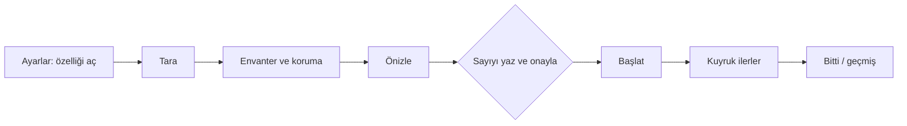
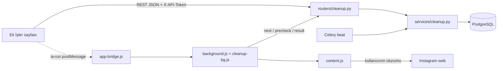
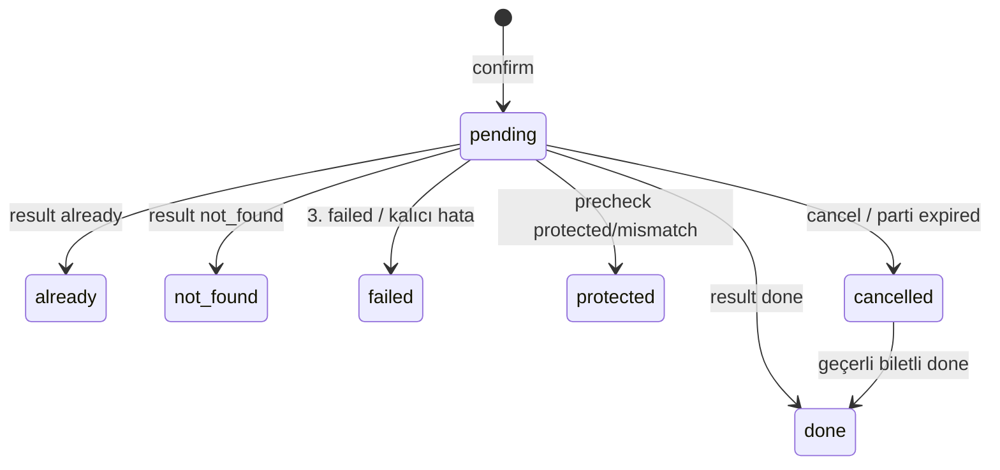
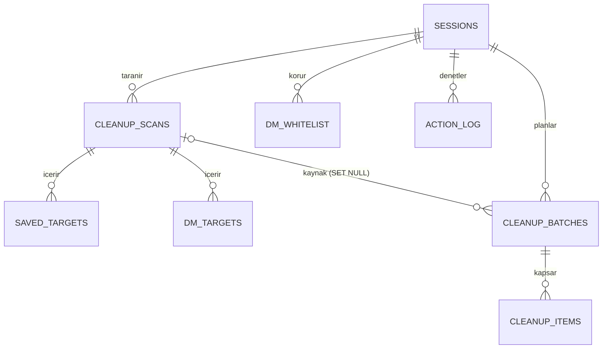
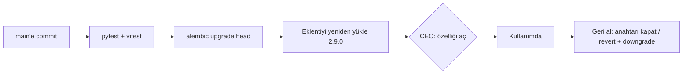

# Spec 001 — Kaydedilenleri temizleme ve DM silme (whitelist ile)

- Status: Draft
- Version: v1.1 (2026-11-08)
- Tier: full
- Previous spec: none
- Self-critique: done (bkz. §14.4)
- Budget ceiling: Faz 0+1 için 21 agent iş günü; Faz 2 için 12 g (T-0b sonrasında yeniden tahmin edilir). Tavanlar teslim zincirini ve %20 düzeltme payını kapsar (§12.4). Kota payını CEO belirler (öneri: haftalık abonelik kotasının en fazla %30'u). Tavan aşılırsa iş durur, main session'a dönülür. **CEO onayı bekliyor (CK-13).**
- Sensitive area: kişisel veri (üçüncü kişilerin DM meta verisi), geri alınamaz silme, Instagram hesap oturumu (hesap kısıtlama riski)

> Dil: içerik Türkçe, teknik terimler İngilizce. Başlık alanları ve `Status:` değerleri protokol gereği İngilizce.
> **CEO kararı bekleyen her madde, önerilen varsayılanla spec'e işlendi ve "CEO onayı bekliyor" diye işaretlendi.** Tümü §14.1 tablosunda. CEO farklı karar verirse yalnız o satırın gösterdiği bölümler değişir.
> Teslim: tek imza, üç faz. **Faz 0** test ortamı, ADR ve spike. **Faz 1** ortak altyapı + Kaydedilenler. **Faz 2** DM + whitelist. Faz 2, T-0b spike sonucu "go" olmadan başlamaz; DM'e özgü hiçbir backend kodu da ondan önce yazılmaz.

### Sürüm notu

| Sürüm | Tarih | Değişiklik |
|---|---|---|
| v1.0 | 2026-11-08 | İlk taslak. |
| v1.1 | 2026-11-08 | İmza öncesi dört kapının bulguları işlendi (izleme: §14.2). Başlıcaları: aktif partiyi silen cascade kaldırıldı (`scan_id` SET NULL); tarama, parti ve öğe için durum makineleri eklendi; ayrı `cleanup_gate` ve silinemez `cleanup_paused_until` getirildi; `plan_refs`, `whitelist_rev`, sunucuda yeniden hesaplanan `plan_hash` eklendi; serbest `note` yerine `note_code` geldi; lease ve bilet bütçe yarışı çözüldü; viewer ve IDOR denetimleri tüm uçlara yayıldı; CSRF için JSON gövde zorunlu oldu; eklentide `JOB_API` + `cleanup-bg.js` ve iş başına ölü döngü eşiği tanımlandı; saklama Celery beat'e taşındı; migration iki revizyona bölündü; ADR-0001 yazıldı; görev listesi bölündü, tahmin satır toplamıyla hizalandı, teslim zinciri ve düzeltme payı eklendi; devops-sre test ortamı görevi eklendi; faz başına AC listesi eklendi; CEO kararları tek tabloda toplandı; açma diyaloğu metni TR/EN tam yazıldı. |

---

## 1. Intent

**CEO'nun cümlesi (kelimesi kelimesine):** "ek iş olarak kaydedilen silme ve dm silme özelliği istiyorum. dm silme için whitelist olsun."

**Yorum (BA):** Eklentinin kullanıcının kendi Instagram sekmesinde, insan hızında yaptığı kuyruk işlerine iki yeni "ek iş" eklenir:

1. **Kaydedilenleri temizleme (unsave):** Kullanıcının Instagram'da kaydettiği gönderiler kaydedilenlerden çıkarılır. Gönderinin kendisi silinmez, sahibine hiçbir şey olmaz.
2. **DM silme:** Sohbetler (direct thread) yalnızca kullanıcının kendi gelen kutusundan silinir ("Sohbeti sil", yalnızca kendi tarafında). Karşı tarafın kopyası durur. **Whitelist:** korunacak kişiler ve sohbetler hiçbir koşulda silinmez.

Başarı: Kullanıcı neyin silineceğini önceden tam liste olarak görür, sayıyı yazarak açıkça onaylar, iş insan hızında ve risk bütçesi içinde ilerler, whitelist'teki hiçbir sohbet silinmez, uygulama hiçbir DM mesaj metnini görmez ve saklamaz.

**Bilerek yapılmayanlar:** mesaj geri alma (unsend), karşı tarafta silme, gönderi silme, mesaj içeriği okuma/arama/yedekleme, zamanlanmış temizlik. Ayrıntı §13.

## 2. Market summary (Product)

Product birimi bu iş için çalıştırılmadı; ağ erişimim yok, kaynak URL veremiyorum. Bilinen durum: "unsave all" ve "delete all DMs" yapan tarayıcı eklentileri piyasada yaygın (doğrulanmadı). Fark yaratan taraf bizde **önizleme + sayı yazarak onay + pk tabanlı whitelist + işlem öncesi taze kontrol + mesaj içeriğini hiç görmeme**. Karar önerisi: **farklı yap** (güvenlik ve gizlilik öncelikli). Yeni bağımlılık yok (kurul K9'da doğruladı). İsteğe bağlı: Scout'a tek soru, "Instagram web saved/DM iç uç noktaları için doğrulanmış açık kaynak referans var mı" (T-0s).

## 3. Requirements (EARS)

Ortak
- REQ-1 — Sistem, her iki ek işi her profil için (tarayıcı ve ZIP) varsayılan kapalı başlatacak.
- REQ-2 — Kullanıcı bir ek işi açtığında, sistem açmadan önce §4.3'teki uyarı metnini gösterecek ve açık onay isteyecek.
- REQ-3 — Bir ek iş kapalıyken, sistem o tür için tarama, önizleme ve onay yapmayacak; yürütme isteklerine "kapalı" yanıtı verecek. Okuma, iptal ve whitelist düzenleme kapalıyken de mümkün olacak (§7.5).
- REQ-3a — Ek işlerin açık/kapalı durumu takip işlemleri anahtarından (`allow_actions`) bağımsız olacak. **CEO onayı bekliyor (CK-12).**
- REQ-4 — Sistem, Instagram'a yazma yapmadan önce silinecek öğelerin tam listesini (önizleme, dry-run) gösterecek.
- REQ-5 — Sistem, kullanıcı önizlemedeki öğe sayısını tam olarak yazmadan hiçbir öğeyi kuyruğa almayacak.
- REQ-6 — Sistem, onay anında silinecek kümeyi sunucuda yeniden hesaplayacak. Küme önizlemedekinden farklıysa onayı reddedecek ve yeni önizleme isteyecek. Onay yalnız sunucuda saklanan önizleme listesini kuyruğa alacak; istemcinin gönderdiği bir listeyi kabul etmeyecek.
- REQ-7 — Sistem, bir türde aynı anda en fazla bir onaylı ve bitmemiş partiye izin verecek.
- REQ-8 — Sistem, tek partide en fazla 500 öğe kabul edecek, kalanı kullanıcıya "kalan" olarak bildirecek ve öğeleri §6.7'deki sırayla seçecek.
- REQ-9 — Sistem, her yazma işleminden hemen önce şunları yeniden denetleyecek: özellik açık mı, profil duraklatılmış mı, sessiz saat mi, öğe hâlâ bekliyor ve bu işe kiralanmış mı, tür bütçesi ve hesap toplam bütçesi uygun mu.
- REQ-10 — Instagram bir engel/kısıtlama sinyali verdiğinde, sistem işi durduracak ve profilin tüm yazma işlemlerini (takip işlemleri dahil) 24 saat duraklatacak. Ek işlerin duraklatması takip anahtarı değiştirilerek ya da başka bir yolla erkenden kaldırılamayacak.
- REQ-11 — Ardışık 5 öğe başarısız olduğunda, sistem işi durduracak ve kullanıcıyı bilgilendirecek.
- REQ-12 — Her ek iş türü takip işlemlerinden ayrı saatlik ve günlük bütçe kullanacak. Tür sert tavanları ve hesap düzeyindeki toplam yazma tavanı hiçbir profil seçiminde aşılmayacak. **CEO onayı bekliyor (CK-4, CK-11).**
- REQ-13 — Sistem, Instagram sekmesinde açık hesap profilin hesabı değilse hiçbir tarama veya yazma yapmayacak ve hiçbir sonucu kabul etmeyecek.
- REQ-14 — Sistem her sonucu (yapıldı, zaten, bulunamadı, korundu, başarısız, iptal) ve ek iş ayarlarındaki, kurallardaki ve whitelist'teki her değişikliği denetim kaydına yazacak.
- REQ-15 — Kullanıcı bekleyen öğeleri her an iptal edebilecek; yapılmış öğeler değişmeyecek. İptal anında zaten yürütülmekte olan öğe bittiyse sonucu kaydedilecek.
- REQ-16 — Bir ek iş (tarama ya da yürütme) ilk kez yalnızca kullanıcının açık "Başlat" ya da "Tara" eylemiyle başlayacak. Sayfa açılışı, sekme değişimi, sayfa yenilemesi ve kuyruğa ekleme hiçbir zaman başlatmayacak.
- REQ-16a — Kullanıcı onaylı bir partiyi başlattıktan sonra iş yalnız saatlik/günlük sınır ya da sessiz saat yüzünden durduysa, Ek İşler sayfası açık kaldıkça sistem aynı partiyi sınır kalkınca kendiliğinden sürdürecek. Engel, kapatma, kullanıcının durdurması, devre kesici ya da hesap uyuşmazlığından sonra kendiliğinden sürdürmeyecek. **CEO onayı bekliyor (CK-8).**
- REQ-17 — Sistem Instagram oturum anahtarlarını (csrftoken, LSD, DTSG, claim) uygulamaya ya da kayda hiçbir zaman göndermeyecek.
- REQ-18 — Sistem bir profilin öğesine, partisine, taramasına ya da whitelist kaydına başka bir profilin adresiyle erişime izin vermeyecek.
- REQ-19 — Sistem yürütme sonuçlarında ve tarama notlarında serbest metin kabul etmeyecek; yalnız tanımlı kod, HTTP durumu ve alan adları kabul edecek.
- REQ-20 — Sistem yeni ek işlerin iş raporlarında, bildirimlerinde ve eklentinin kalıcı depolamasında kişi adı ve kimlik saklamayacak; yalnız sayı saklayacak.
- REQ-21 — Sistem saklama sürelerini (§7.4) yürütme isteklerinden bağımsız, günlük bir temizlik göreviyle uygulayacak.

Kaydedilenler
- REQ-22 — Sistem kullanıcının kaydedilen gönderilerini sayfa sayfa, insan hızında listeleyecek.
- REQ-23 — Sistem kaydedilen her gönderi için yalnızca şunları saklayacak: gönderi kimliği, kısa kod, sahibinin kullanıcı adı, tür, küçük resim adresi, koleksiyon kimlikleri ve listedeki sırası. Açıklama metnini ve yorumları saklamayacak.
- REQ-24 — Kullanıcı önizlemeye girecek gönderileri üç yolla belirleyebilecek: tümü, koleksiyon ya da tek tek seçim. **CEO onayı bekliyor (CK-6).**
- REQ-25 — Gönderi zaten kaydedilmemişse, sistem yazma yapmadan "zaten" olarak işaretleyecek.
- REQ-26 — Sistem kullanıcının kendi Kaydedilenler sayfasındaki yanıtları pasif gözleme (gönderi aracı) iletmeyecek.

DM
- REQ-27 — Sistem gelen kutusundaki sohbetleri sayfa sayfa, insan hızında listeleyecek. **Kapsam CEO onayı bekliyor (CK-5).**
- REQ-28 — Sistem sohbet başına yalnızca şunları alacak: sohbet kimliği, karşı taraf(lar)ın pozitif Instagram kimliği ve kullanıcı adı, varsa karşı tarafla takip durumunun iki doğru/yanlış değeri, grup olup olmadığı ve son etkinlik zamanı. Mesaj metnini, medyayı, grup adını ve okundu bilgisini uygulamaya hiç göndermeyecek, saklamayacak ve göstermeyecek.
- REQ-29 — Sistem whitelist'teki bir kişinin bulunduğu hiçbir sohbeti silmeyecek.
- REQ-30 — Sistem whitelist eşleşmesini Instagram kimliğine ve kullanıcı adına göre yapacak; ikisinden biri eşleşirse sohbet korunacak.
- REQ-31 — Grup sohbeti koruması açıkken (varsayılan) sistem hiçbir grup sohbetini silmeyecek. Grup silmenin yan etkileri spike'ta doğrulanmadıkça grup koruması kapatılamayacak. **CEO onayı bekliyor (CK-2, CK-9).**
- REQ-32 — Sistem kullanıcının açtığı dinamik kurallara (karşılıklı takip, takip ettiklerim, son N gün yazışılanlar) uyan sohbetleri koruyacak. **Varsayılanlar CEO onayı bekliyor (CK-3).**
- REQ-33 — Kullanıcı whitelist'e üç yolla kişi ekleyebilecek: elle, önizleme listesinden ve kurallardan toplu kopyalama. Kişi çıkarabilecek de. Kimliği bilinmeyen kayıtlar için sistem uyaracak ve kimliği ilk fırsatta tamamlayacak.
- REQ-34 — Sistem her silmeden hemen önce sohbetin güncel katılımcılarını ve son etkinlik zamanını Instagram'dan taze okuyacak. Whitelist'i ve kuralları bu taze veriyle önizlemedeki katılımcıların birleşimine göre yeniden değerlendirecek.
- REQ-35 — Yeniden değerlendirme herhangi bir nedenle yapılamazsa sistem o sohbeti silmeyecek (fail-closed). Bu nedenler: uygulamaya ulaşılamaması, geçersiz yanıt, okunamayan katılımcı, farklı sohbet kimliği, eksik son etkinlik zamanı (son N gün kuralı açıkken).
- REQ-36 — Sistem tarama yaşı 6 saati geçen bir DM envanteriyle önizleme yapmayacak.

## 4. User experience

Yeni sayfa: **Ek İşler** (`/extras`, nav: "Ek İşler" / "Extra jobs"), iki sekme: **Kaydedilenler** ve **Mesajlar** (Mesajlar sekmesi Faz 2'de gelir). Mevcut `/cleanup` yönlendirmesi (`frontend/src/App.tsx:30`, `/users`'a) değişmez. Ayarlar sayfasına iki anahtar eklenir. Yeni eklenti izni gerekmez: kendiliğinden sürdürme sayfa tarafından tetiklenir.

### 4.1 Kullanıcı bir temizliği nasıl yapar?

Açıklama: kullanıcı özelliği açar, taratır, korumaları ayarlar, tam listeyi görür, sayıyı yazarak onaylar, işi kendisi başlatır. Eşkenar dörtgen (E) kullanıcının geri alınamaz kararıdır. Metin eşdeğeri:

| Adım | Ekran | Instagram'a yazma |
|---|---|---|
| 1 | Ayarlar: "Kaydedilen temizleme" / "DM silme" anahtarı + uyarı diyaloğu (§4.3) | yok |
| 2 | Ek İşler > sekme: "Tara" (eklenti listeyi okur) | yok (yalnız okuma) |
| 3 | Envanter listesi; DM'de koruma rozetleri ve whitelist paneli | yok |
| 4 | Önizleme diyaloğu: silinecek N, korunan M + sebepler, tahmini süre | yok |
| 5 | "Onaylamak için N yaz" alanı; sayı tam eşleşince "Onayla" etkin | yok |
| 6 | "Başlat" (açık eylem) | var |
| 7 | İlerleme paneli; Durdur / Kalanları iptal et; sınır kalkınca kendiliğinden devam (CK-8) | var |
| 8 | Özet + geçmiş | yok |

### 4.2 Ekran durumları (her biri bir kabul kriterine bağlı)

| Durum | Kaydedilenler sekmesi | Mesajlar sekmesi | AC |
|---|---|---|---|
| Kapalı (yetkisiz) | "Bu ek iş kapalı. Ayarlar'dan açabilirsin." + Ayarlar bağlantısı; Tara düğmesi yok | aynı; whitelist paneli düzenlenebilir | AC-U1 |
| Eklenti yok / eski | "Bu iş için eklenti 2.9.0 veya üstü gerekli." + kılavuz bağlantısı; Tara pasif | aynı | AC-U2 |
| Hesap uyuşmazlığı / kimlik bilinmiyor | "Instagram'da başka bir hesap açık; bu profil @y. Doğru hesaba geç." / "Bu profilin Instagram kimliği henüz bilinmiyor; eklenti açıkken Instagram'da kendi profilini bir kez aç." | aynı | AC-C4 |
| Hiç taranmadı (empty) | "Henüz taranmadı." + "Kaydedilenleri tara" | "Henüz taranmadı." + "Gelen kutusunu tara" | AC-U3 |
| Taranıyor (loading) | "Sayfa 3 · 63 gönderi görüldü" + Durdur; `aria-live="polite"` | "Sayfa 2 · 40 sohbet görüldü" + Durdur | AC-U4 |
| Tarama hatası | engel / oturum kapalı / ağ / tanınmayan yanıt / hesap uyuşmazlığı: her biri ayrı ileti + "Tekrar dene" | aynı | AC-U5 |
| Yarım tarama | Sarı şerit: "Tarama yarım kaldı: yalnız görülen 240 gönderi listelendi." | aynı | AC-U14 |
| Eski tarama | — (24 sa üstü: "Tarama eski, önizlemeden önce yeniden tara") | 6 sa üstü: aynı ileti; Önizle pasif | AC-U14 |
| Envanter boş | "Kaydedilen gönderin yok." Önizle yok | "Gelen kutun boş." Önizle yok | AC-U3 |
| Envanter (success) | küçük resim (yüklenemezse gri yer tutucu + kısa kod), @sahip, tür, koleksiyon; filtre; tümünü seç / kaldır | @katılımcı(lar), "Grup (3 kişi)", son etkinlik ("4 gün önce"), koruma rozeti (kilit simgesi + "Korunuyor: <sebep>") | AC-U6, AC-S7 |
| Aktif parti var | Önizle pasif + "Önce mevcut partiyi bitir ya da iptal et." | aynı | AC-U17 |
| Önizleme yükleniyor / hata | iskelet / "Önizleme hazırlanamadı" + Tekrar dene | aynı | AC-U13 |
| Önizleme (dry-run) | "N gönderi kaydedilenlerden çıkarılacak. Gönderiler silinmez." + tam liste (sayfalı) + tahmini süre (§6.4) + "Bu işlem geri alınamaz." + (CK-8) "Sınır dolunca bu sayfa açık kaldıkça kendiliğinden devam eder." | "N sohbet senin gelen kutundan silinecek, M sohbet korunuyor." + korunanlar sebepleriyle + "Karşı tarafın kopyası durur. Geri alınamaz." | AC-U7 |
| Onay | "Onaylamak için **N** yaz" alanı; eşleşmezse "Onayla" pasif | aynı | AC-C6 |
| Onay hatası | `plan_changed`: "Liste önizlemeden sonra değişti, yeniden önizle"; `expired`: "Önizleme süresi doldu, yenile"; `batch_active`; `count_mismatch` | aynı | AC-U13 |
| Kuyruk ilerleyişi | "120 / 500 · 3 zaten · 1 bulunamadı · 1 başarısız · sıradaki ~30 sn" + ilerleme çubuğu + Durdur + Kalanları iptal et + "Durdur, o an yapılan işlemi kesmez; o işlem biter, sonrakine geçilmez." | aynı + "korundu" sayacı | AC-U8, AC-U18 |
| Duraklatma / bekleme | Kırmızı şerit: "Instagram işlemi engelledi; tüm işlemler 24 saat duraklatıldı (yarın 14:05'e kadar)." Sessiz saat / bütçe: gri şerit + "08:00'de kendiliğinden devam eder (bu sayfa açıksa)." | aynı | AC-U9 |
| Bağlantı kaybı | Son bilinen durum + "Uygulamaya ulaşılamıyor; yeniden deneniyor." | aynı | AC-U15 |
| Bitti | Özet: yapıldı / zaten / bulunamadı / başarısız / iptal; geçmiş bağlantısı | + korundu | AC-U10 |
| Geçmiş | sayfalı liste, durum filtresi; boş: "Henüz geçmiş yok"; hata: "Geçmiş yüklenemedi" + Tekrar dene | aynı | AC-U16 |
| Ayarlar anahtarı | kaydediliyor (anahtar pasif + dönen gösterge) / kaydedilemedi (anahtar eski konumuna döner + ileti) | aynı | AC-U12 |
| Whitelist paneli | — | boş: "Koruma listesi boş. Açık kurallar yine uygulanır."; yükleniyor: iskelet; hata: "Liste yüklenemedi" + Tekrar dene; geçersiz adlar ayrı listelenir; kimliği bilinmeyen kayıtlarda "kimlik bekleniyor" uyarısı | AC-U11, AC-D16 |

Erişilebilirlik: onay alanı `<label>` ile bağlı; ilerleme `aria-live`; koruma bilgisi yalnız renkle verilmez (simge + metin); tüm eylemler klavyeyle yapılabilir. Hata iletilerinin sahibi: eklenti kaynaklı iletiler `background.js` / `cleanup-bg.js` (Türkçe, mevcut desen), uygulama kaynaklı iletiler i18n TR/EN (`frontend/src/i18n/tr.ts`, `en.ts`). Sunucu yalnız hata **kodu** döner, metni arayüz üretir.

Onay alanı doğrulaması: alan `inputMode="numeric"`, değer kırpılır (trim). Kırpılmış değer `String(N)` ile birebir eşit olmalıdır: `050`, `50.0`, `٥٠` ve boşluklu değerler eşleşmez. Yapıştırma serbesttir. Backend `confirm_count` alanını katı tamsayı (`StrictInt`, 1..500) olarak alır; `"50"` string olarak gelirse 422 döner.

### 4.3 Açma diyaloğu metni (TR/EN) — **CEO onayı bekliyor (CK-10)**

Kaydedilenler, TR
> **Kaydedilenleri temizlemeyi aç**
> Bu ek iş açıkken eklenti, senin onayladığın gönderileri Instagram'daki Kaydedilenler listenden çıkarır.
> - Gönderilerin kendisi silinmez; yalnız senin Kaydedilenler listenden ve tüm koleksiyonlarından çıkar.
> - Bu işlem geri alınamaz. Uygulama çıkarılan gönderileri listene geri ekleyemez.
> - Sen önizlemeyi görüp sayıyı yazarak onaylamadan hiçbir şey yapılmaz.
> - İşlemler senin Instagram oturumunla, insan hızında ve günlük sınırlarla yapılır. Yine de Instagram, kullanım koşullarında otomatik işlemleri yasaklar ve hesabına geçici kısıtlama ya da daha ağır bir yaptırım uygulayabilir. Hiçbir ayar bunun olmayacağını garanti etmez.
>
> ☐ Bu işlemin geri alınamayacağını ve hesabım için risk taşıdığını anlıyorum.
> [Vazgeç] [Aç]

Kaydedilenler, EN
> **Turn on saved posts cleanup**
> While this extra job is on, the extension removes the posts you approve from your Saved list on Instagram.
> - The posts themselves are not deleted; they are only removed from your Saved list and all your collections.
> - This cannot be undone. The app cannot add removed posts back to your list.
> - Nothing happens until you see the preview and confirm by typing the number.
> - Actions run in your own Instagram session, at human pace and within daily limits. Even so, Instagram's terms prohibit automated actions, and Instagram may temporarily restrict your account or take stronger action. No setting can guarantee this will not happen.
>
> ☐ I understand this cannot be undone and carries a risk for my account.
> [Cancel] [Turn on]

DM, TR
> **DM silmeyi aç**
> Bu ek iş açıkken eklenti, senin onayladığın sohbetleri yalnızca kendi gelen kutundan siler.
> - Karşı tarafın sohbeti ve mesajları olduğu gibi kalır; onlara hiçbir şey gönderilmez.
> - Grup sohbetleri silinmez. *(CK-9 "go" olursa bu satır şöyle olur: "Grup sohbetleri varsayılan olarak silinmez; bunu Koruma ayarlarından değiştirebilirsin.")*
> - Silinen bir sohbet senin tarafında geri getirilemez.
> - Koruma listendeki kişilerin sohbetleri ve açık kurallara uyan sohbetler hiçbir zaman silinmez. Her silmeden hemen önce bu yeniden kontrol edilir.
> - Uygulama mesajlarının içeriğini okumaz, saklamaz, göstermez. Yalnız kullanıcı adını ve son etkinlik zamanını kullanır.
> - Sen önizlemeyi görüp sayıyı yazarak onaylamadan hiçbir şey yapılmaz.
> - Instagram, kullanım koşullarında otomatik işlemleri yasaklar ve hesabına kısıtlama ya da daha ağır bir yaptırım uygulayabilir. Hiçbir ayar bunun olmayacağını garanti etmez.
>
> ☐ Silinen sohbetlerin geri gelmeyeceğini ve bu işlemin hesabım için risk taşıdığını anlıyorum.
> [Vazgeç] [Aç]

DM, EN
> **Turn on DM deletion**
> While this extra job is on, the extension deletes the conversations you approve from your own inbox only.
> - The other person's conversation and messages stay as they are; nothing is sent to them.
> - Group chats are not deleted. *(If CK-9 is "go", this line becomes: "Group chats are not deleted by default; you can change this in Protection settings.")*
> - A deleted conversation cannot be restored on your side.
> - Conversations with people on your protection list, and conversations that match the rules you turned on, are never deleted. This is checked again right before each deletion.
> - The app does not read, store or show the content of your messages. It only uses usernames and the time of last activity.
> - Nothing happens until you see the preview and confirm by typing the number.
> - Instagram's terms prohibit automated actions, and Instagram may restrict your account or take stronger action. No setting can guarantee this will not happen.
>
> ☐ I understand deleted conversations will not come back and this carries a risk for my account.
> [Cancel] [Turn on]

Eklenti açıklaması (`manifest.json:6`), değiştirilmesi önerilen metin (CK-10 kapsamında): TR "InstaAnalytic köprüsü: gönderi listeni, beğenenleri ve yorum yapanları kaydeder; senin onayladığın takip, kaydedilen temizleme ve DM silme işlerini kendi Instagram oturumunda, insan hızında yapar." Mevcut "Instagram'a kendisi hiçbir istek göndermez" ifadesi artık doğru değil (kurul gözlemi, IA D-01).

## 5. Acceptance criteria

Kimlikler kararlıdır; v1.1'de eklenenler `(v1.1)` diye işaretlidir. Faz eşlemesi §5.5'te.

### 5.1 Ortak (C)
- [ ] AC-C1 — Yeni oluşturulan tarayıcı ve ZIP profilinde `GET /cleanup/settings` → `saved.enabled=false`, `dm.enabled=false`.
- [ ] AC-C2 — Özellik kapalıyken `scan/start`, `scan/{id}/page`, `preview` ve `confirm` 403 `feature_off` döner ve hiçbir kayıt oluşturmaz. `next` 200 `reason=off` döner, `precheck` 200 `allow=false, reason=off` döner. `result`, `cancel`, `settings`, `status`, `inventory`, `history` ve whitelist uçları kapalıyken de çalışır (§7.5).
- [ ] AC-C3 — `PUT /cleanup/settings` ile açma isteği `ack_irreversible=true` olmadan → 422 `ack_required`. Ayarlar diyaloğunda onay kutusu işaretlenmeden "Aç" pasif; diyalog §4.3 metnini gösterir.
- [ ] AC-C4 — `viewer_id` profilin `ig_user_id`'sinden farklıysa `scan/start`, `scan/page`, `scan/finish`, `next`, `precheck` ve `result` → 409 `account_mismatch`. Profil `ig_user_id ≤ 0` ise (ZIP, gerçek kimlik henüz öğrenilmemiş) → 409 `viewer_unknown`. Eklenti işi durdurur, kullanıcı dili iletisi gösterir; `result` reddedilirse öğe `pending` kalır ve `cleanup_anomaly` bildirimi yazılır.
- [ ] AC-C5 — `preview` yalnızca `draft` parti ve `plan_refs` oluşturur. Hiçbir `cleanup_items` satırı oluşmaz, `next` bu parti için öğe vermez.
- [ ] AC-C6 — `confirm_count` ≠ `item_count` (N−1 ve N+1 sınırları dahil) → 422 `count_mismatch`, hiçbir öğe `pending` olmaz. String `"N"` → 422. Arayüzde §4.2'deki eşleşme kuralı geçerli: `050`, boşluk içeren ya da harfli değer "Onayla"yı etkinleştirmez.
- [ ] AC-C7 — Önizleme ile onay arasında şunlardan biri değiştiyse `confirm` → 409 `plan_changed`: whitelist (`whitelist_rev`), koruma kuralları, `relationships` (R3/R4 sonucu), seçim sonucu ya da istemcinin gönderdiği `plan_hash`. 30 dakikası dolmuş taslak → 410 `expired`. Onay yalnız sunucudaki `plan_refs`'i kuyruğa alır.
- [ ] AC-C8 — Aynı türde `confirmed` parti varken yeni `confirm` → 409 `batch_active`.
- [ ] AC-C9 — 1200 öğelik seçimle `preview` → `item_count=500`, `truncated=true`, `remaining=700`; 500 öğe kesilmeden kabul edilir; 0 öğe → `batch_id=null`, `item_count=0`.
- [ ] AC-C10 — Bütçeler ayrıdır: 40 `unsave` yapılmışken takip kuyruğunun `next`'i `limit` dönmez; takip bütçesi doluyken `unsave` `next`'i öğe verir. Tür bütçesi dolunca `reason=limit`. Eklenti aynı anda tek iş çalıştırır; ayrı bütçe yalnız backend sayımıdır.
- [ ] AC-C11 — Hangi risk profili seçilirse seçilsin tür sert tavanları (§6.4) aşılmaz. Isınma: `enabled_at`'ten sonraki ilk 72 saatte günlük tavan `max(1, floor(daily/3))`, 168. saate kadar `max(1, floor(2·daily/3))`; saatlik tavan `min(hourly, günlük tavan)`. Sınamalar 71:59 ve 72:00, 167:59 ve 168:00 sınırlarında yapılır.
- [ ] AC-C12 — Europe/Istanbul saatine göre 00:59:59'da `precheck` izin verir. 01:00:00, 04:00 ve 07:59:59'da `next` → `reason=quiet_hours`, `precheck` → `allow=false, reason=quiet_hours`. 08:00:00'da yine izin verilir. Saatlik ve günlük pencereler kayan pencerelerdir (son 60 dk, son 24 sa).
- [ ] AC-C13 — Herhangi bir ek iş öğesinde ya da taramada `blocked` → `cleanup_paused_until=now+24 sa` ve `paused_until=now+24 sa` ayarlanır. Takip kuyruğu dahil tüm `next` çağrıları `reason=paused` döner, `actions_blocked` bildirimi yazılır, öğe `pending` kalır, eklenti işi durdurur ve partinin `auto_continue` değeri `false` olur.
- [ ] AC-C14 — Çalışan işte özellik kapatılırsa sıradaki öğenin `precheck`'i `allow=false, reason=off` döner. Eklenti o öğe için Instagram'a hiçbir yazma isteği göndermez (eklenti testi: POST sayısı 0).
- [ ] AC-C15 — `cancel` yalnızca `pending` öğeleri `cancelled` yapar; `done` öğeler değişmez; iptal edilmiş öğenin `precheck`'i `allow=false, reason=not_pending` döner.
- [ ] AC-C16 — Bir işte ardışık 5 `failed` → eklenti işi durdurur, `halt(reason=circuit_breaker)` çağrılır, `job_stopped` bildirimi yazılır, kalan öğeler `pending` kalır.
- [ ] AC-C17 — Her sonuç (`done`, `already`, `not_found`, `failed`, `protected`, `cancelled`) `action_log`'a `action_type`, `target_ref`, `target_label` ile yazılır. Aksiyon Geçmişi sayfası `ig_user_id=null` kayıtları hatasız listeler.
- [ ] AC-C18 — Eklenti testlerinde uygulamaya giden hiçbir istekte `csrftoken`, LSD, DTSG ya da `www-claim` değeri bulunmaz.
- [ ] AC-C19 — `failed` en fazla 3 kez denenir; `not_found` tekrar denenmez; aynı öğe için ikinci sonuç bildirimi durumu değiştirmez (istisna: AC-C23).
- [ ] AC-C20 — `DELETE /sessions/{id}/purge` sonrası profile ait `cleanup_*` ve `dm_whitelist` satırı kalmaz.
- [ ] AC-C21 — Ek İşler sayfası açılışında, sekme değişiminde, sayfa yenilemesinde (`PENDING_KEY` yeniden oynatma, `extensionBridge.ts:85-91`) ya da onaydan sonra eklentiye dört yeni türün (`saved_scan`, `saved_unsave`, `dm_scan`, `dm_delete`) hiçbiri için `ia-run` kendiliğinden gönderilmez. Tek istisna AC-C34'tür.
- [ ] AC-C22 (v1.1) — Onaylı bir parti çalışırken yeniden tarama biterse eski tarama ve envanter silinir. Parti, öğeleri ve geçmişi silinmez, partinin `scan_id` değeri `null` olur. `scan_id=null` olan taslağın `confirm`'ü 409 `plan_changed` döner.
- [ ] AC-C23 (v1.1) — Durum makinesi (§6.8) dışındaki geçişler reddedilir. `cancelled` öğeye geçerli ve süresi dolmamış biletle `done` gelirse öğe `done` olur, `action_log`'a yazılır ve bütçeye sayılır. `pending` olmayan öğeye biletsiz ya da süresi dolmuş biletle `done` gelirse durum değişmez ve `cleanup_anomaly` bildirimi yazılır (`note_code=ticket_missing` ya da `ticket_expired`). 7 gün ilerleme olmayan onaylı parti `expired` olur, bekleyen öğeleri `cancelled` olur.
- [ ] AC-C24 (v1.1) — `cleanup_gate` takip anahtarından bağımsızdır: `allow_actions=false` ek işleri durdurmaz. `allow_actions`'ı kapatıp açmak (`sessions.py:276-278`), `expire_stale_sessions` (`action_tasks.py:429`) ve köprü uyarı dönüşümü (`services/bridge.py:417-421`) `cleanup_paused_until`'ı temizlemez. Takip kuyruğunun engelinden doğan `paused_until`, ek iş kapısının ilk okumasında `cleanup_paused_until`'a kopyalanır.
- [ ] AC-C25 (v1.1) — Hesap toplam tavanı (CK-11 varsayılanı): son 60 dakikada takip + unsave + DM `done` toplamı 80'e ya da son 24 saatte 400'e ulaşınca ek iş `next` → `reason=limit` döner, `precheck` → `allow=false, reason=limit` döner.
- [ ] AC-C26 (v1.1) — `next` öğeleri iş kimliğine 15 dakikalığına kiralar. Başka bir iş kimliği kiralı öğeyi alamaz; o işin `precheck`'i `allow=false, reason=leased` döner. Aynı anda iki `precheck` bütçenin son boş yerini paylaşamaz: süresi dolmamış biletler bütçeye sayılır, profil satırı kilitlenir.
- [ ] AC-C27 (v1.1) — Başka bir profilin `item_id`, `batch_id`, `scan_id` ya da whitelist `entry_id`'si ile yapılan her istek 404 döner ve hiçbir satır değişmez.
- [ ] AC-C28 (v1.1) — `result`, `scan/page` ve `scan/finish`'te serbest metin alanı (`note`) 422 ile reddedilir. Yalnız `note_code` (§7.3 listesi), `http_status` ve `fields[]` kabul edilir. content.js'in istisna ve bozuk JSON yollarında da yalnız `note_code` gönderilir (V8 hata iletisi girdiyi yansıtır; `content.js:472` deseni yeni türlerde kullanılmaz).
- [ ] AC-C29 (v1.1) — Yeni türlerin `POST /bridge/jobs` raporunda `message` yalnız sayılardan oluşur ve `results=[]` olur. Bildirim `params` değerlerinde yalnız sayı bulunur. `chrome.storage.local.jobView` hiçbir `ref`, `label` ya da kullanıcı adı taşımaz.
- [ ] AC-C30 (v1.1) — DM safe gecikmesinde (60 sn bekleme + 3 istek) çalışan bir iş, ikinci bir `startJob` ile "yanıt vermiyor" diye durdurulmaz. Eşik iş başına `2 × delay_max + 60 sn`'dir ve bekleme sırasında 15 sn'de bir kalp atışı gelir.
- [ ] AC-C31 (v1.1) — Mevcut `extension-actions.test.ts`, `extension-api.test.ts`, `extension-update.test.ts`, `test_bridge.py` ve `test_risk_profiles.py` testleri **değiştirilmeden** yeşil kalır.
- [ ] AC-C32 (v1.1) — Günlük Celery beat görevi saklama sürelerini uygular: 1 günden eski `expired` taslaklar silinir, 7 günden eski `dm_targets` silinir, 30 günden eski tamamlanmış DM öğelerinin `label` / `participants` değerleri ve `action_log.target_label` `null` yapılır. `next`, `precheck` ve `result` hiçbir silme sorgusu çalıştırmaz.
- [ ] AC-C33 (v1.1) — Yıkıcı türler için `ia-run` komutu `session_id` ve `batch_id` taşır. `session_id` eklentideki seçili profilin kimliğinden farklıysa ya da parti `confirmed` değilse background işi başlatmaz.
- [ ] AC-C34 (v1.1, CK-8) — Onaylı partide iş `limit` ya da `quiet_hours` ile bittiyse, Ek İşler sayfası açık kaldıkça ve `status.run_state` `ready`'ye döndüğünde sayfa `ia-run`'ı aynı `batch_id` ile en fazla dakikada bir kez gönderir. Partide `auto_continue=false` ise (kullanıcı durdurdu, engel, kapatma, devre kesici, hesap uyuşmazlığı) göndermez.
- [ ] AC-C35 (v1.1) — Ek iş ayarı, koruma kuralı ve whitelist ekleme/çıkarma işlemlerinin her biri `action_log`'a yazılır (`cleanup_setting`, `whitelist_add`, `whitelist_remove`). Bir koruma kuralı kapatılınca `cleanup_protection_off` bildirimi yazılır.
- [ ] AC-C36 (v1.1) — Her migration revizyonu test veritabanında (`instaanalytic_pytest`) `upgrade → downgrade → upgrade` sırasıyla hatasız çalışır; çıktı kanıt olarak gösterilir.
- [ ] AC-C37 (v1.1) — `ext_version` eksik ya da `< 2.9.0` olan `scan/start`, `next` ve `precheck` çağrıları 409 `extension_outdated` döner.
- [ ] AC-C38 (v1.1) — Durum değiştiren tüm `/cleanup` uçları (`POST`, `PUT`, `DELETE`) `Content-Type: application/json` dışını 415 ile reddeder. Böylece başka bir sitenin form gönderimi Vite proxy'nin eklediği token'la çalışamaz.
- [ ] AC-C39 (v1.1) — Seçim sırası ve yeniden seçim: Kaydedilenlerde ilk 500 öğe envanter sırasıyla alınır. DM'de ilk 500, en eski `last_activity_at`'ten başlayarak alınır, `null` değerler sona konur. Aynı envanterden ikinci önizleme, tarama başlangıcından sonra `pending`, `done`, `already` ya da `not_found` olmuş ref'leri dışarıda bırakır.

### 5.2 Kaydedilenler (S)
- [ ] AC-S1 — Tarama sayfaları sırayla alır, sayfalar arası 3-6 sn rastgele bekler, en fazla 100 sayfada durur. Aynı tür için kayan bir saatte 2'den fazla tarama → 429 `scan_too_soon`.
- [ ] AC-S2 — Eklenti tarama sayfasında yalnızca §7.2'deki `Saved` alanlarını gönderir; fixture'daki `caption.text` değeri hiçbir istekte bulunmaz. Backend bilinmeyen alanı 422 ile reddeder.
- [ ] AC-S3 — Unsave: öğe → kayıt durumu okunur → zaten kaydedilmemişse `already` (yazma isteği 0) → değilse unsave isteği → durum yeniden okunur → kaydedilmemiş ise `done`, değilse `failed`.
- [ ] AC-S4 — Gönderi silinmiş ya da erişilemezse (Instagram 404) sonuç `not_found` olur ve tekrar denenmez.
- [ ] AC-S5 — Seçimden çıkarılan gönderiler partiye girmez. Koleksiyon filtresi seçiliyse yalnız o koleksiyondakiler girer (koleksiyon desteği T-0a sonucuna bağlı).
- [ ] AC-S6 (v1.1) — Kullanıcının `/<kendi adı>/saved/` sayfasında gözlenen yanıtlar `/bridge/observe`'a iletilmez (`pageAllowed`, `content.js:43-48`).
- [ ] AC-S7 (v1.1) — Küçük resim yüklenemezse (süresi dolmuş CDN adresi) gri yer tutucu ve kısa kod gösterilir; Instagram'a yeniden istek gönderilmez.
- [ ] AC-S8 (v1.1) — Tarama durumları: `ok` ve `partial` biten tarama önceki envanterin yerini atomik olarak alır, `partial` işaretlidir. `failed` ve `blocked` almaz. 10 dakika sayfa almayan `running` tarama `failed` sayılır, yeni taramaya izin verilir. 24 saatten eski kaydedilenler taramasıyla `preview` → 409 `scan_stale`.

### 5.3 DM (D)
- [ ] AC-D1 — DM taraması uygulamaya yalnızca `thread_id`, `participants[{pk, username, following?, followed_by?}]`, `is_group` ve `last_activity_at` gönderir. Fixture'daki mesaj metni (`GIZLI_MESAJ_123`), grup adı ve medya adresi uygulamaya giden hiçbir istekte, `chrome.storage`'da ve `jobView`'da yer almaz. Bozuk JSON ve istisna yolları da bu sınamaya dahildir.
- [ ] AC-D2 — Veritabanı şemasında DM metni, grup adı ya da medya için hiçbir kolon yoktur (şema testi); API yanıtlarında da yoktur.
- [ ] AC-D3 — Whitelist elle ekleme: `@Ali , veli\n` → `ali`, `veli`; `ali!` gibi geçersizler `invalid` listesinde döner; tekrar edenler `duplicate` sayılır; tek istekte en fazla 200 ad.
- [ ] AC-D4 — Kural kopyalama (`following` / `mutual` / `recent`) eklenen kişi sayısını döner; kişiler `source` etiketiyle saklanır.
- [ ] AC-D5 — Koruma değerlendirmesi §6.3'teki R1-R6 kurallarının her biri için doğru `protected` ve `reasons` döner (tablo güdümlü birim testi: her kural için korunan ve korunmayan örnek).
- [ ] AC-D6 — Grup koruması varsayılan açıktır. Kapatılabildiği durumda (CK-9 "go") kapalıyken bile whitelist'teki biri gruptaysa grup korunur. Grup tanımı: `is_group || participants.length > 1`.
- [ ] AC-D7 — Önizleme korunan sohbetleri partiye koymaz; `protected_count` ve sebep özetini döner.
- [ ] AC-D8 — Eklenti her silmeden önce sohbet meta verisini Instagram'dan taze okur ve `precheck` ister. Silme isteği yalnızca `precheck` 200, `allow===true`, `item_id` eşit ve bilet var ise gönderilir. Diğer tüm yanıtlar §6.6'daki tabloya göre eşlenir (eklenti testi: allow=false, zaman aşımı, HTTP 500, bozuk JSON, farklı `item_id` ve bilet yok durumlarında silme POST sayısı 0).
- [ ] AC-D9 — İş sürerken whitelist'e eklenen kişinin sohbeti, sıradaki işlemde `precheck` tarafından reddedilir ve `protected` olur.
- [ ] AC-D10 — Kullanıcı adı değişmiş kişi pk eşleşmesiyle korunur (whitelist'te eski ad + pk, Instagram'da yeni ad).
- [ ] AC-D11 — Katılımcısı okunamayan, boş dönen ya da yalnız kullanıcının kendisinden oluşan sohbet `unknown_participants` sebebiyle korunur.
- [ ] AC-D12 — Instagram'da artık bulunmayan sohbet → `not_found`.
- [ ] AC-D13 — `precheck` bileti olmadan bildirilen `done` kaydedilir; `action_log.error_msg="ticket_missing"` yazılır ve `cleanup_anomaly` bildirimi oluşur.
- [ ] AC-D14 — Son başarılı DM taraması 6 saatten eskiyse `preview` → 409 `scan_stale`.
- [ ] AC-D15 (v1.1) — `precheck`'te taze meta yoksa ya da `fresh.thread_id ≠ item.ref` ise → `allow=false, reason=mismatch`. Değerlendirme taze ve önizleme anındaki katılımcıların **birleşimiyle** yapılır. Son N gün kuralı açıkken `last_activity_at=null` → korunur (`recent_unknown`).
- [ ] AC-D16 (v1.1) — Whitelist'e yalnız pozitif pk yazılır. pk'si `null` olan kayıt, adı eşleşen bir katılımcı taramada görülünce pk'sini alır (backfill). Arayüz pk'siz kayıtlarda "kimlik bekleniyor: ad değişirse koruma kaybolabilir" uyarısı gösterir. ZIP kaynaklı negatif kimlikli ilişkiler R3/R4'te kullanıcı adıyla eşlenir.
- [ ] AC-D17 (v1.1) — R3 ve R4, `relationships` ile taze `following` / `followed_by` değerlerinin birleşimini kullanır; ikisinden biri korumayı gerektiriyorsa sohbet korunur.
- [ ] AC-D18 (v1.1, CK-9) — T-0b grup silmenin yan etkisiz olduğunu (gruptan ayrılma yok, üyelere bildirim yok) doğrulamadıkça `dm_protect_groups` API'de `true` dışında bir değer almaz (422 `groups_locked`); arayüzde anahtar kilitli görünür ve sebebi yazılıdır.

### 5.4 Arayüz (U)
- [ ] AC-U1 — Özellik kapalıyken sekme "Kapalı" durumunu ve Ayarlar bağlantısını gösterir; Tara düğmesi DOM'da yoktur.
- [ ] AC-U2 — Eklenti yoksa ya da sürüm < 2.9.0 ise sekme "eklenti gerekli" durumunu gösterir; Tara pasiftir.
- [ ] AC-U3 — Hiç taranmamış ve envanteri boş durumlar ayrı metinlerle gösterilir; ikisinde de Önizle yoktur.
- [ ] AC-U4 — Tarama sürerken sayfa ve öğe sayacı `aria-live` bölgede güncellenir; Durdur görünür.
- [ ] AC-U5 — Tarama hatalarının her biri (`blocked`, `login`, `network`, `unrecognised`, `account_mismatch`) ayrı iletiyle ve "Tekrar dene" ile gösterilir; ekran boş kalmaz.
- [ ] AC-U6 — DM envanterinde mesaj metni gösterilmez; korunan satırda kilit simgesi ve "Korunuyor: <sebep>" metni vardır.
- [ ] AC-U7 — Önizleme diyaloğu N'yi, M'yi (DM), tahmini süreyi (§6.4 formülü), geri alınamazlık metnini ve kendiliğinden devam notunu (CK-8) gösterir; tüm liste sayfalı gezilebilir.
- [ ] AC-U8 — İlerleme paneli yapıldı / zaten / bulunamadı / korundu / başarısız / iptal sayılarını ve sıradaki işlem süresini gösterir; 5 sn'de bir yenilenir.
- [ ] AC-U9 — `paused`, `quiet_hours`, `limit` ve `off` nedenlerinin her biri ayrı şerit metniyle gösterilir; `paused` kırmızıdır ve bitiş saatini gösterir.
- [ ] AC-U10 — İş bitince özet ve geçmiş bağlantısı görünür.
- [ ] AC-U11 — Whitelist paneli boş, yükleniyor, hata ve geçersiz giriş durumlarını gösterir; i18n TR ve EN anahtarları eşittir.
- [ ] AC-U12 (v1.1) — Ayarlar anahtarı kaydedilirken pasiftir; kayıt başarısız olursa eski konumuna döner ve ileti gösterir.
- [ ] AC-U13 (v1.1) — Önizleme yükleniyor ve hata durumları ile her `confirm` hata kodu (`plan_changed`, `expired`, `batch_active`, `count_mismatch`, `feature_off`) ayrı iletiyle gösterilir.
- [ ] AC-U14 (v1.1) — Yarım tarama sarı şeritle, eski tarama (Kaydedilenler 24 sa, DM 6 sa) "yeniden tara" iletisiyle gösterilir; eski taramada Önizle pasiftir.
- [ ] AC-U15 (v1.1) — Durum yoklaması başarısız olursa son bilinen durum ve "Uygulamaya ulaşılamıyor" şeridi gösterilir; ekran boşalmaz.
- [ ] AC-U16 (v1.1) — Geçmiş, durum filtresiyle sayfalı listelenir; boş ve hata durumları vardır.
- [ ] AC-U17 (v1.1) — Aktif parti varken Önizle pasiftir ve sebebi yazılıdır.
- [ ] AC-U18 (v1.1) — İlerleme panelinde "Durdur o an yapılan işlemi kesmez" metni bulunur.

### 5.5 Faz eşlemesi

| Faz | Kabul kriterleri |
|---|---|
| Faz 0 | AC-C36 (test ortamında koşturulabilirlik), T-0a/T-0b raporları (§6.5) |
| Faz 1 | AC-C1..C39 (DM'e özgü parçalar hariç: AC-C7'nin whitelist/ilişki kısmı ve AC-C39'un DM sırası Faz 2'de sınanır), AC-S1..S8, AC-U1..U10, AC-U12..U18 (Kaydedilenler sekmesi) |
| Faz 2 | AC-D1..D18, AC-U11, AC-U1..U10 ve U12..U18'in Mesajlar sekmesi sınamaları, AC-C7 (whitelist/ilişki), AC-C39 (DM sırası), AC-C36 (ikinci migration) |

## 6. Architecture and technology decision

### 6.1 Bileşenler nasıl bağlanır?

Açıklama: uygulama Instagram'a hiç istek göndermez. Eklenti uygulamadan aldığı onaylı öğeleri kullanıcının açık Instagram sekmesinde yapar ve her silmeden önce uygulamaya taze kontrol sorar. Saklama temizliği Celery beat'tedir. Kesikli çizgi sayfa içi mesajlaşmadır. Metin eşdeğeri: UI → API → servis → DB; Celery beat → servis; UI → app-bridge → background (+cleanup-bg) → API ve content.js; content.js → Instagram.

### 6.2 Veri modeli seçenekleri

| | A: `BridgeAction`'ı genelleştir | B: Yeni tablolar (karar) |
|---|---|---|
| Yaklaşım | `bridge_actions`'a `kind`, `target_ref` eklenir, `ig_user_id` nullable olur | Faz 1: `cleanup_scans`, `saved_targets`, `cleanup_batches`, `cleanup_items`; Faz 2: `dm_targets`, `dm_whitelist` |
| Artı | Kuyruk / geçmiş / iptal kodu ve arayüzü tekrar kullanılır | Takip kuyruğuna dokunulmaz; parti, önizleme ve onay doğal yerini bulur; DM meta tipli kolonlarda; bütçeler ayrı |
| Eksi | `enqueue` (`bridge_actions.py:86`) ve `report` (`:167-174`) takip ilişkisine bağlı; `_done_since` (`:40-42`) tüm türleri sayar; parti/onay kavramı yok | `next`/`result`/`history` mantığının bir kısmı yeniden yazılır (~300 satır) |
| Risk | Takip akışında sessiz regresyon; yanlış türde öğenin yanlış uç noktaya gitmesi | Kod tekrarı |

**Karar: B** (kurul K1 onayı; gerekçe ve reddedilen seçenek `docs/architecture/adr/ADR-0001-ek-isler-ayri-kuyruk.md`). **Ortak kapı yeniden kullanılmaz:** `bridge_actions.gate()` (`bridge_actions.py:45-51`) `allow_actions`'a bağlı olduğu için ek işler yeni `cleanup_gate(session, kind, now)` fonksiyonunu kullanır. `bridge_actions.py` değişmez. Yalnız sabitler (`BLOCK_PAUSE`) ve `in_quiet_hours` içe aktarılır.

`cleanup_gate` sırası (ilk tutan sebep döner):
1. `off`: tür anahtarı kapalı (`allow_unsave` / `allow_dm_delete`).
2. `paused`: `max(cleanup_paused_until, paused_until) > now`. `paused_until` doluysa `cleanup_paused_until`'a kopyalanır (AC-C24).
3. `quiet_hours`: `in_quiet_hours(now)`.
4. `limit`: tür bütçesi ya da hesap toplam bütçesi dolu (süresi dolmamış biletler dahil).

Neden ayrı duraklatma kolonu: paylaşılan `paused_until` üç mevcut yolda temizleniyor: takip anahtarını kapatma (`sessions.py:276-278`), eski oturum dönüşümü (`action_tasks.py:429`) ve köprü uyarı dönüşümü (`services/bridge.py:417-421`). Ek iş engelinin bu yollarla erkenden kalkmaması gerekir (REQ-10). Kalan risk: takip engelinden hemen sonra, ek iş kapısı hiç okunmadan kullanıcı takip anahtarını kapatırsa kopyalama kaçar. Arayüz durum yoklaması 5 sn'de bir yapıldığı için bu pencere küçüktür ve kabul edildi.

### 6.3 DM koruma kuralları (whitelist değerlendirmesi)

Değerlendirme, taze katılımcılar ile önizleme anındaki katılımcıların **birleşimi** üzerinde yapılır. Aşağıdakilerden **herhangi biri** doğruysa sohbet korunur (`protected=true`, `reasons` listesi):

| Kural | Koşul | Varsayılan | Veri kaynağı |
|---|---|---|---|
| R1 `group` | `is_group || participants.length > 1` ve `dm_protect_groups=true` | **açık, CK-9 "go" olmadan kapatılamaz** (CK-2, CK-9) | taze meta ∪ anlık görüntü |
| R2 `whitelist` | herhangi bir katılımcının pozitif `pk`'si whitelist'te `ig_pk` olarak ya da küçük harfli `username`'i whitelist'te varsa (grup dahil, R1 kapalı olsa bile) | her zaman | taze meta ∪ anlık görüntü + `dm_whitelist` |
| R3 `mutual` | `dm_protect_mutual=true` ve herhangi bir katılımcıyla karşılıklı takip | **açık** (CK-3) | `relationships` (`we_follow ∧ they_follow`; ZIP negatif kimliklerde kullanıcı adıyla) ∪ taze `following ∧ followed_by` |
| R4 `following` | `dm_protect_following=true` ve kullanıcı katılımcıyı takip ediyor | kapalı (CK-3) | R3 ile aynı, birleşim |
| R5 `recent` | `dm_protect_recent_days=N` ve `last_activity_at ≥ now − N gün`; `last_activity_at=null` ise korunur (`recent_unknown`) | **açık, N=30** (CK-3) | taze meta |
| R6 `unknown_participants` | katılımcı listesi boş, okunamadı, geçersiz biçimde ya da yalnız kullanıcının kendisi | her zaman | taze meta |

Önce `mismatch` denetlenir: taze meta yoksa ya da `thread_id` öğenin ref'inden farklıysa `allow=false` döner ve değerlendirme yapılmaz.

Belirsizlik yönü: her belirsizlik **korumak** yönünde çözülür. Örnekler: iki veri kaynağının birleşimi, eşleşmeyen pk ama eşleşen ad, okunamayan katılımcı, eksik zaman.

Whitelist'e ekleme yolları:
1. **Elle:** virgül ya da satırla ayrılmış kullanıcı adları. `@`, büyük harf ve boşluk temizlenir; `^[a-z0-9._]{1,30}$` dışı reddedilir. `ig_pk`, kişi `ig_users`'ta pozitif kimlikle ya da son DM envanterinde varsa doldurulur; yoksa `null` kalır ve tarama bitince tamamlanır (AC-D16).
2. **Önizleme / envanter satırından "Koru":** katılımcıların pk'si ve adı eklenir (`source=preview`).
3. **Kurallardan kopyala:** "Karşılıklı takip ettiklerimi ekle (N)", "Takip ettiklerimi ekle (N)", "Son N gün yazıştıklarımı ekle (N)" (`source=mutual|following|recent`). Kurallar dinamik olarak da çalışır. Kopyalama, ilişki sonradan değişse bile korumanın kalmasını sağlar.

Her ekleme, çıkarma ve kural değişikliği `sessions.dm_whitelist_rev` sayacını 1 artırır ve `action_log`'a yazılır.

Yeniden kontrol (REQ-34) üç kez yapılır: önizlemede (envantere göre), onayda (sunucuda yeniden hesap, §7.6) ve **her silmeden hemen önce** `precheck` ile (taze meta ∪ anlık görüntü + güncel whitelist, önbellek yok). Bağlayıcı olan yalnızca üçüncüsüdür.

### 6.4 Bütçe ve risk profili entegrasyonu

Ek işler ayrı bütçe kullanır (kurul K3 onayı). Takip bütçesiyle (safe: 30/gün, `risk_profiles.py:49`) 1000 kaydedilen gönderi 33 gün sürerdi ve takip işlerini aylarca kilitlerdi. Engel durumu ise ortaktır: kısıtlama hesap düzeyindedir (kurul K4).

`RiskProfile`'a tür başına `ActionBudget(hourly, daily, delay_min, delay_max)` eklenir. Yeni `effective_budget(kind, profile, enabled_at, now)` fonksiyonu yazılır. Mevcut `effective_action_limits` ve testleri değişmez (kurul koşul 1). Sayılar **tahmindir**: Instagram eşik yayınlamaz, spike da eşik doğrulamaz. **CEO onayı bekliyor (CK-4, CK-11).**

| Tür | safe | balanced | aggressive | Tür sert tavanı |
|---|---|---|---|---|
| unsave | 40/sa, 200/gün, 20-45 sn | 60/sa, 300/gün, 15-35 sn | 80/sa, 400/gün, 10-25 sn | 80/sa, 400/gün, en az 10 sn |
| dm_delete | 25/sa, 100/gün, 30-60 sn | 40/sa, 150/gün, 20-45 sn | 50/sa, 200/gün, 15-30 sn | 50/sa, 200/gün, en az 15 sn |
| **hesap toplamı** (takip + unsave + DM `done`) | | | | **80/sa, 400/gün** (CK-11) |
| tarama (okuma) | sayfalar arası 3-6 sn; Kaydedilenler en fazla 100 sayfa, gelen kutusu en fazla 50 sayfa; aynı tür için kayan saatte en fazla 2 tarama | | | |

- Isınma (AC-C11): ilk 72 saat `max(1, floor(daily/3))`, 168. saate kadar `max(1, floor(2·daily/3))`; `hourly_eff = min(hourly, daily_eff)`. Başlangıç türün `*_enabled_at` değeridir; tür kapatılınca sıfırlanır, açılınca ısınma yeniden başlar.
- Sessiz saatler: mevcut `QUIET_HOURS` (01:00 ≤ yerel saat < 08:00, Europe/Istanbul) aynen geçerlidir. Bilet almış, yürütülmekte olan öğe sınırı geçse de tamamlanır.
- Bütçe sayımı: kayan pencereler (son 60 dk, son 24 sa). Yalnız türün `done` öğeleri ve süresi dolmamış biletler sayılır; `already` ve `not_found` sayılmaz. Hesap toplamı `bridge_actions` `done` sayısını da okur ama o tabloyu değiştirmez; takip kuyruğu kendi kapısıyla çalışmaya devam eder.
- Mevcut doğrudan istek modundaki 3-5 sn (`API_DELAY`, `bridge_actions.py:25`) bu türlere **uygulanmaz**.
- Tahmini süre formülü (AC-U7): `throughput_h = min(hourly_eff, floor(3600 / ((delay_min+delay_max)/2 + 5)))`; `per_day(d) = min(daily_eff(d), throughput_h × 17)` (17 = sessiz saat dışındaki saatler). Süre, kalan öğe tükenene kadar gün gün ısınma uygulanarak hesaplanır: `days = en küçük D, Σ_{d<D} per_day(d) ≥ item_count`. Yanıtta `{hourly, daily, days}` döner. Örnek: safe unsave, ısınma bitmiş, 500 öğe → `throughput_h = min(40, floor(3600/37,5)) = 40`, `per_day = min(200, 680) = 200` → 3 gün.

### 6.5 Instagram web uç noktaları (spike)

Hiçbiri bu repoda doğrulanmadı. Aşağıdakiler kamuya açık bilgiden **aday** uç noktalardır. Spike iki parçadır: **T-0a** (Kaydedilenler) Faz 1'den, **T-0b** (DM) Faz 2'den önce yapılır. Her satır gerçek bir oturumda, test hesaplarıyla doğrulanır. Rapora yalnız alan adları yazılır (değer yazılmaz): `docs/specs/SPEC-001-spike.md`. Spike'tan önce o fazın kodu yazılmaz.

| İş | Aday | Durum | Spike'ın doğrulayacağı |
|---|---|---|---|
| Kaydedilenleri listeleme (T-0a) | `GET /api/v1/feed/saved/posts/?max_id=<cursor>` | doğrulanacak | `items[].media.{pk,id,code,media_type,user.username,image_versions2}`, `more_available`, `next_max_id`, sayfa boyutu, sıra. Alternatif: Saved sekmesinin GraphQL sorgusu. |
| Koleksiyon listesi (T-0a) | `GET /api/v1/collections/list/` | doğrulanacak | Yoksa AC-S5'in koleksiyon kısmı kapsam dışına alınır. |
| Unsave (T-0a) | `POST /api/v1/web/save/{media_pk}/unsave/` | doğrulanacak | Alternatif: `POST /api/v1/media/{media_id}/unsave/` ya da GraphQL mutation (takipten çıkma GraphQL'e taşındı, `content.js:269-276`). |
| Unsave doğrulama (T-0a) | `GET /api/v1/media/{pk}/info/` → `items[0].has_viewer_saved` | doğrulanacak | Yoksa yanıt gövdesine dayanılır, `note_code=verify_unavailable`. |
| Gelen kutusu listeleme (T-0b) | `GET /api/v1/direct_v2/inbox/?cursor=<c>&limit=20&thread_message_limit=1` | doğrulanacak, **yüksek risk** | REST web'den çalışıyor mu; `inbox.threads[].{thread_id,users[].{pk,username,friendship_status.{following,followed_by}},is_group,last_activity_at}`, `inbox.has_older`, `inbox.oldest_cursor`, `viewer.pk`. Mesaj öğeleri okunmadan atılır. |
| Sohbet meta, taze (T-0b) | `GET /api/v1/direct_v2/threads/{thread_id}/?limit=1` | doğrulanacak | Yalnız katılımcılar, grup bilgisi, son etkinlik. |
| Sohbeti sil, yalnız kendi tarafında (T-0b) | `POST /api/v1/direct_v2/threads/{thread_id}/hide/` | doğrulanacak | İkinci test hesabında sohbet ve mesajlar duruyor mu. **Grupta:** silen kişi gruptan ayrılıyor mu, üyelere sistem iletisi ya da bildirim gidiyor mu, gruba yeni mesaj gelince sohbet geri geliyor mu (CK-9). |
| Silme doğrulama (T-0b) | sohbet meta tekrar okunur ya da gelen kutusunun ilk sayfasında yokluk | doğrulanacak | |
| E2EE (T-0b) | — | doğrulanacak | Şifreli sohbetler listede görünüyor mu; görünmüyorsa kapsam dışı (§13). |
| Engel sinyalleri (T-0a/b) | — | kayıt | Spike sırasında görülen tüm engel/uyarı yanıtlarının alan adları ve HTTP durumları (S-11). |
| DOM yedeği (T-0b) | `/direct/t/{thread_id}/` → bilgi → "Sohbeti sil" → onay | yalnız REST çalışmazsa | |

Spike kuralları:
- "No-go": T-0b'de DM için ne REST ne DOM yolu güvenilir doğrulanabiliyorsa Faz 2 başlamaz, karar CEO'ya gider.
- **DOM-only kapısı (S-08):** T-0b yalnız DOM yolunu doğrularsa Faz 2 için üç şey yapılmadan kod yazılmaz: AppSec tehdit modeli yeniden incelemesi, spec revizyonu ve T-8b/T-9b için yeniden tahmin.
- Alan şekli §7.2'den farklı çıkarsa spec revizyonu (v1.2) yapılır, sonra kod yazılır.

### 6.6 Eklenti tasarımı (kurul koşul 6, 7)

- **Adaptör ve ayrı dosya:** `background.js`'te türden bağımsız `JOB_API` tablosu tutulur: `{ actions: {...mevcut...}, saved_unsave: {...}, dm_delete: {...} }`. Her satırda next/result URL'si, öğe doğrulayıcı ve gecikme bilgisi bulunur. Yeni türlerin kodu `frontend/extension/cleanup-bg.js`'tedir ve `background.js` başında `importScripts('cleanup-bg.js')` ile yüklenir. Bu klasik service worker'da çalışır, paketleyici gerekmez. Takip yolundaki `recordActionResult`, `pullNewItems`, `actionStepDone` ve `ia-job-tick` **değişmez** (AC-C31).
- **Yeni türler:** `saved_scan`, `saved_unsave`, `dm_scan`, `dm_delete` (`app-bridge.js:10`, `background.js:306`, `extensionBridge.ts:7`). Yalnız doğrudan istek modu kullanılır (`findIgTab`/`openOwnIgTab`). Eklenti aynı anda tek iş çalıştırır: takip ve ek işler sırayla çalışır.
- **Komut:** yıkıcı türlerde `cmd = {kind, session_id, batch_id}`. `app-bridge.js` `cleanCmd` bu iki alanı UUID ve tamsayı olarak doğrular. Background bunları seçili profil ve `next?batch_id=` ile eşleştirir (AC-C33). Yıkıcı türler `PENDING_KEY` ile yeniden oynatılmaz (`extensionBridge.ts:74-91`; AC-C21).
- **Döngü:** mevcut `runApiJob` / `ia-api-next` deseni (`content.js:404-420`, `background.js:758-779`) kullanılır; content.js `ia-api-run` mesajındaki `kind` alanına göre dallanır. Öğe başında:
  1. DM'de taze meta okunur.
  2. `ia-precheck` gönderilir → `cleanup-bg.js` → `POST .../precheck` (`job_id`, `viewer_id`, `ext_version`, DM'de `fresh`).
  3. Yalnız `allow===true && item_id===item.id && ticket` ise yazma yapılır.
  4. Doğrulama okuması yapılır.
  5. `result` gönderilir (bilet ile).
- **precheck yanıt eşlemesi (AC-D8):**

| precheck yanıtı | Yazma | Sonuç bildirimi | İş |
|---|---|---|---|
| 200, `allow=true`, `item_id` eşit, bilet var | yapılır | gerçek sonuç | devam |
| 200, `allow=false`, `reason=protected` / `mismatch` | yok | yok (backend öğeyi `protected` yaptı) | sonraki öğe |
| 200, `allow=false`, `reason=not_pending` / `leased` | yok | yok | sonraki öğe |
| 200, `allow=false`, `reason=limit` / `quiet_hours` | yok | yok | iş biter, öğe `pending` (kendiliğinden devam adayı) |
| 200, `allow=false`, `reason=off` / `paused` | yok | yok | iş durur + `halt` |
| 409 `account_mismatch` / `viewer_unknown` / `extension_outdated` | yok | yok | iş durur + `halt` |
| 404 | yok | yok | sonraki öğe |
| zaman aşımı (10 sn), 5xx, bozuk JSON, farklı `item_id`, bilet yok | yok | `failed`, `note_code=precheck_unavailable` | ardışık hata sayacına girer; `result` de iletilemezse iş durur |

- **İstekler:** `igFetch` + `apiHeaders` + gerekiyorsa `pageTokens`; engel tespiti `blockedResponse`; teşhis yalnız `note_code` + `http_status` + alan adları (`shape()` deseni). İstisnalarda `e.message` gönderilmez (AC-C28). Tüm ref'ler URL'ye `encodeURIComponent` ile ve regex doğrulamasından sonra konur (S-12).
- **Alan beyaz listesi:** content.js, Instagram yanıtından §7.2'deki alanları açıkça seçen saf kurucu fonksiyonlarla (`toSavedItem`, `toDmThread`) yeni nesne kurar. Ham gövde `sendMessage`'a hiç verilmez. Bu çağrılar content script'in izole dünyasından yapılır, bu yüzden sayfa içi gözlemciye (`listener.js`) görünmez. `/direct/` yolu `pageAllowed` dışındadır; `/<ad>/saved/` de dışarı alınır (AC-S6).
- **Viewer:** yalnız `ds_user_id` çerezi kullanılır. DM taramasında `viewer.pk` ile karşılaştırılır; fark varsa tarama `failed`, `note_code=account_mismatch`. Her yürütme çağrısına `viewer_id` eklenir.
- **Devre kesici:** `cleanup-bg.js` ardışık `failed` sayar; 5'te `finishJob(job,'stopped',…)` ve `POST /batches/{id}/halt {reason:'circuit_breaker'}` çağrılır.
- **Ölü döngü eşiği (AC-C30):** iş nesnesine `deadAfterMs = 2 × delay_max × 1000 + 60000` yazılır. `startJob`'daki denetim `running.deadAfterMs || API_DEAD_AFTER_MS` olur (`background.js:13`, `:438`); takip işi için değer değişmez. content.js bekleme sırasında 15 sn'de bir `ia-job-beat` gönderir, background `job.beat`'i günceller.
- **Gizlilik:** `jobView` ve iş raporu yalnız sayı taşır (AC-C29). Öğe listesi (`ref`, `label`) yalnız `chrome.storage.session`'daki iş nesnesinde durur; tarayıcı kapanınca silinir.
- **Sürüm:** 2.9.0 (`manifest.json`), `LATEST_EXTENSION_VERSION` güncellenir.

Gözlem (kapsam dışı, ayrı iş): mevcut takip işinde `allow_actions` kapatılması, `apiNext` öğe başında kapıları denetlemediği için çalışan partinin sonuna kadar (en fazla 10 öğe) etkisizdir (`background.js:758-779`). `docs/09-guvenlik-ve-gizlilik.md:9` 6 saatlik devre kesiciden söz ediyor, köprü kuyruğu ise 24 saat uyguluyor (`bridge_actions.py:29`). `bridge_actions.py:25-26`'da `API_DELAY` iki kez tanımlı.

### 6.7 Seçim sırası (REQ-8, AC-C39)
- Kaydedilenler: envanterdeki `position` sırası (Instagram'ın döndürdüğü sıra; T-0a doğrular, beklenen: en son kaydedilen önce).
- DM: `last_activity_at` artan (en eski önce), `null` sona.
- Dışlama: tarama başlangıcından (`scan.started_at`) sonra oluşmuş ve durumu `pending`, `done`, `already` ya da `not_found` olan ref'ler. `protected`, `failed` ve `cancelled` ref'ler yeniden aday olabilir; korunanlar yine değerlendirilir.

### 6.8 Durum makineleri (critic #2, kurul koşul 4)

#### Bir öğe hangi durumlardan geçer?

Açıklama: her öğe `pending` başlar; tek geri dönüşlü istisna, iptal anında yürütülmekte olan ve geçerli biletle `done` bildirilen öğedir. Metin eşdeğeri:

| Kaynak | Olay | Hedef | Yan etki |
|---|---|---|---|
| — | `confirm` | `pending` | `plan_refs`'ten oluşur |
| `pending` | `result done` | `done` | `action_log` success; bütçeye sayılır; bilet yoksa ya da süresi dolmuşsa `cleanup_anomaly` |
| `pending` | `result already` | `already` | `action_log` skipped |
| `pending` | `result not_found` | `not_found` | `action_log` skipped; tekrar yok |
| `pending` | `result failed`, `attempts < 3` | `pending` | `attempts+1`, `note_code` |
| `pending` | `result failed`, `attempts = 3` | `failed` | `action_log` failed |
| `pending` | `result blocked` | `pending` | duraklatma (AC-C13) |
| `pending` | `precheck protected` / `mismatch` ya da `result protected` | `protected` | `action_log` skipped, sebep |
| `pending` | `cancel` / parti `expired` | `cancelled` | `action_log` cancelled |
| `cancelled` | `result done`, geçerli bilet | `done` | AC-C23 |
| terminal | diğer her `result` | değişmez | biletsiz `done` → `cleanup_anomaly` |

Durum kümesi: `pending | done | already | not_found | failed | protected | cancelled` (en uzun 9 karakter, `varchar(10)`'a sığar). Ayrı `already` ve `not_found` durumlarının sebebi şu: bütçe yalnız `done` sayar ve geçmiş filtresi durumla çalışır (kurul koşul 4).

#### Parti
| Kaynak | Olay | Hedef |
|---|---|---|
| — | `preview` (öğe > 0) | `draft` (`expires_at = +30 dk`) |
| `draft` | `confirm` geçerli | `confirmed` (`auto_continue = CK-8 varsayılanı`) |
| `draft` | süre dolar | `expired` (Celery beat ya da sonraki `confirm` denemesi) |
| `draft` | `cancel` | `cancelled` |
| `confirmed` | son `pending` öğe terminale geçer | `done` |
| `confirmed` | `cancel` | `cancelled` (bekleyenler `cancelled`) |
| `confirmed` | 7 gün `last_progress_at` yok | `expired` (bekleyenler `cancelled`) |
| `confirmed` | `halt(reason)` | `confirmed`, `auto_continue=false`, `halted_reason=reason` |
| `confirmed` | `resume` (kullanıcı Başlat) | `confirmed`, `auto_continue=true`, `halted_reason=null` |

#### Tarama
| Kaynak | Olay | Hedef | Envanter |
|---|---|---|---|
| — | `scan/start` | `running` | — |
| `running` | `finish ok` | `ok` | önceki envanterin yerini alır |
| `running` | `finish partial` (kullanıcı durdurdu, sayfa sınırı, ≥1 sayfadan sonra hata) | `partial` | yerini alır, `partial` işaretli |
| `running` | `finish failed` / 10 dk sayfa yok | `failed` | değişmez |
| `running` | `finish blocked` | `blocked` | değişmez; duraklatma |

## 7. Data and API contract

### 7.1 Varlıklar nasıl ilişkili?

Açıklama: bir tarama envanter oluşturur, önizleme envanterden parti oluşturur, onaylı partinin öğeleri kuyruktur; whitelist ve denetim kaydı profile bağlıdır. Metin eşdeğeri ve silme kuralları:

| İlişki | FK davranışı |
|---|---|
| `sessions` → `cleanup_scans`, `cleanup_batches`, `cleanup_items`, `dm_whitelist`, `saved_targets`, `dm_targets` (`session_id`) | `ON DELETE CASCADE` (purge) |
| `cleanup_scans` → `saved_targets`, `dm_targets` (`scan_id`) | `ON DELETE CASCADE` (envanter taramayla gider) |
| `cleanup_scans` → `cleanup_batches` (`scan_id`) | **nullable, `ON DELETE SET NULL`** (critic #1, kurul koşul 2) |
| `cleanup_batches` → `cleanup_items` (`batch_id`) | `ON DELETE CASCADE` (partiler yalnız purge'de ve taslak temizliğinde silinir; taslağın öğesi yoktur) |

Öğeler `ref`, `label` ve (DM'de) `participants` anlık görüntüsünü kendileri taşır; envantere bağlı değildir.

### 7.2 Tablolar ve kolonlar

Tüm kimlik ve ref'ler veritabanında CHECK kısıtlarıyla (adlandırılmış: `ck_<tablo>_<kolon>`), API'de regex ile doğrulanır (S-12). Kısmi benzersiz indeksler hem migration'da hem modelde `postgresql_where` ile tanımlanır.

`sessions`, yeni kolonlar
| Kolon | Tip | Kısıt / varsayılan | Faz |
|---|---|---|---|
| allow_unsave | boolean | not null, `false` | 1 |
| unsave_enabled_at | timestamptz | null | 1 |
| cleanup_paused_until | timestamptz | null | 1 |
| cleanup_paused_reason | varchar(200) | null; sabit kod (`blocked`, `follow_blocked`) | 1 |
| allow_dm_delete | boolean | not null, `false` | 2 |
| dm_delete_enabled_at | timestamptz | null | 2 |
| dm_protect_groups | boolean | not null, `true` | 2 |
| dm_protect_mutual | boolean | not null, `true` | 2 |
| dm_protect_following | boolean | not null, `false` | 2 |
| dm_protect_recent_days | smallint | null = kapalı; varsayılan `30`; CHECK 1..365 | 2 |
| dm_whitelist_rev | integer | not null, `0` | 2 |

`cleanup_scans` (Faz 1)
| Kolon | Tip | Kısıt |
|---|---|---|
| id | bigint PK | |
| session_id | uuid FK | cascade |
| kind | varchar(5) | CHECK `saved` \| `dm` |
| status | varchar(10) | CHECK `running` \| `ok` \| `partial` \| `failed` \| `blocked` |
| pages, items | integer | ≥ 0 |
| started_at, last_page_at, finished_at | timestamptz | |
| note_code | varchar(30) | null; §7.3 listesi |

`saved_targets` (Faz 1; yalnız son başarılı tarama)
| Kolon | Tip | Kısıt |
|---|---|---|
| id | bigint PK | |
| session_id, scan_id | FK | cascade |
| position | integer | ≥ 0; tarama sırası |
| media_id | varchar(64) | CHECK `^\d{1,25}(_\d{1,25})?$`; UNIQUE(scan_id, media_id) |
| shortcode | varchar(40) | CHECK `^[\w-]{5,40}$` |
| owner_username | varchar(30) | `^[a-z0-9._]{1,30}$`, null olabilir |
| media_type | varchar(20) | null |
| thumbnail_url | text | null; yalnız `https://*.cdninstagram.com` / `*.fbcdn.net` |
| collection_ids | jsonb | string dizisi, ≤ 20, her biri `^\d{1,25}$` |

`dm_targets` (Faz 2; yalnız son başarılı tarama; en fazla 7 gün)
| Kolon | Tip | Kısıt |
|---|---|---|
| id | bigint PK | |
| session_id, scan_id | FK | cascade |
| position | integer | ≥ 0 |
| thread_id | varchar(40) | CHECK `^\d{1,40}$`; UNIQUE(scan_id, thread_id) |
| participants | jsonb | `[{pk: "^[1-9]\d{0,19}$", username, following?: bool, followed_by?: bool}]`, ≤ 32; kullanıcının kendisi hariç |
| is_group | boolean | not null |
| last_activity_at | timestamptz | null |

Metin, grup adı, medya ve okundu bilgisi için kolon **yoktur** (AC-D2).

`cleanup_batches` (Faz 1)
| Kolon | Tip | Kısıt |
|---|---|---|
| id | bigint PK | |
| session_id | FK | cascade |
| kind | varchar(5) | `saved` \| `dm` |
| scan_id | FK cleanup_scans | **nullable, ON DELETE SET NULL** |
| status | varchar(10) | `draft` \| `confirmed` \| `done` \| `cancelled` \| `expired` |
| selection | jsonb | önizleme isteğinin kendisi (`select`, `refs`, `exclude_refs`, `collection_id`) |
| plan_refs | jsonb | sıralı ref dizisi, ≤ 500 (S-01) |
| item_count, protected_count | integer | 0..500, ≥ 0 |
| plan_hash | char(64) | §7.6 |
| auto_continue | boolean | not null; onayda CK-8 varsayılanı (`true`) |
| halted_reason | varchar(20) | null; `user_stop` \| `circuit_breaker` \| `blocked` \| `off` \| `account_mismatch` |
| created_at, expires_at, confirmed_at, last_progress_at, finished_at | timestamptz | `expires_at = created_at + 30 dk` |

Kısmi benzersiz indeks: (session_id, kind) WHERE status='confirmed' (REQ-7).

`cleanup_items` (Faz 1)
| Kolon | Tip | Kısıt |
|---|---|---|
| id | bigint PK | |
| session_id, batch_id | FK | cascade |
| action | varchar(10) | `unsave` \| `dm_delete` |
| ref | varchar(64) | media_id ya da thread_id (CHECK, türüne göre) |
| label | varchar(200) | `@sahip · shortcode` / `@ali` / `Grup (3 kişi)`; saklama sonrası null |
| participants | jsonb | yalnız DM; onay anındaki anlık görüntü; saklama sonrası null |
| status | varchar(10) | §6.8 kümesi |
| attempts | integer | 0..3 |
| note_code | varchar(30) | null |
| http_status | smallint | null |
| fields | jsonb | null; ≤ 10 alan adı, her biri `^[a-z_][a-z0-9_]{0,39}$` |
| lease_job | varchar(20) | null; `^\d{10,16}$` |
| leased_until | timestamptz | null |
| ticket_hash | char(64) | null; sha256(bilet) |
| ticket_expires_at | timestamptz | null; precheck + 120 sn |
| created_at, done_at | timestamptz | |

İndeksler: (session_id, action, status); kısmi benzersiz (session_id, action, ref) WHERE status='pending'.

`dm_whitelist` (Faz 2)
| Kolon | Tip | Kısıt |
|---|---|---|
| id | bigint PK | |
| session_id | FK | cascade |
| username | varchar(30) | küçük harf, CHECK `^[a-z0-9._]{1,30}$`; UNIQUE(session_id, username) |
| ig_pk | bigint | null; CHECK `ig_pk > 0` (S-03) |
| source | varchar(10) | `manual` \| `preview` \| `mutual` \| `following` \| `recent` |
| created_at | timestamptz | |

`action_log` (Faz 1 değişikliği)
- `ig_user_id` nullable olur.
- Yeni kolonlar: `target_ref varchar(64) null`, `target_label varchar(200) null`.
- Yeni `action_type` değerleri: `unsave`, `dm_delete`, `cleanup_setting`, `whitelist_add`, `whitelist_remove`.
- `error_msg` yeni türlerde yalnız `note_code` taşır.
- `ActionLogEntry.ig_user_id: int | None` (`schemas/actions.py:30`); `privacy.py:71` değişmez.

### 7.3 `note_code` listesi (S-04)
`already`, `not_found`, `http_error`, `not_json`, `unrecognised_shape`, `login_required`, `tokens_missing`, `verify_failed`, `verify_unavailable`, `network`, `blocked`, `precheck_unavailable`, `mismatch`, `account_mismatch`, `ticket_missing`, `ticket_expired`, `user_stop`, `page_cap`, `exception`. Listede olmayan değer 422 ile reddedilir. Kullanıcı dili metni arayüzde bu koddan üretilir.

### 7.4 Saklama (REQ-21, AC-C32; kurul koşul 8, S-05)
Yeni Celery beat görevi `cleanup_retention`, günde bir kez çalışır (`celery_app.py:22-25`'e eklenir):

| Veri | Süre | İşlem |
|---|---|---|
| `draft` parti, süresi dolmuş | 30 dk sonra `expired`, 1 gün sonra silinir | durum / silme |
| `confirmed` parti, ilerleme yok | 7 gün | `expired`, bekleyenler `cancelled` |
| `saved_targets` | yeni tarama bitince | eski tarama ile birlikte silinir |
| `dm_targets` | yeni tarama bitince ya da 7 gün | silinir |
| tamamlanmış DM öğesinin `label` / `participants` değerleri, `action_log.target_label` (`dm_delete`) | 30 gün (CK-7) | `null` yapılır, sayılar kalır |
| `running` tarama, 10 dk sayfa yok | 10 dk | `failed` (ayrıca bir sonraki `scan/start`'ta da yapılır) |

`next`, `precheck` ve `result` silme sorgusu çalıştırmaz.

### 7.5 Özellik kapalıyken uçların davranışı (critic #10, #21)
| Uç grubu | Kapalıyken |
|---|---|
| `scan/start`, `scan/{id}/page`, `preview`, `confirm` | 403 `feature_off` |
| `scan/{id}/finish` | kabul edilir (açık taramayı kapatmak için) |
| `next` | 200 `reason=off` |
| `precheck` | 200 `allow=false, reason=off` |
| `result`, `halt` | kabul edilir (yürütülmekte olan öğenin sonucu kaybolmasın) |
| `resume` | 403 `feature_off` |
| `settings`, `status`, `inventory`, `history`, `batches/{id}/items`, `cancel` | çalışır |
| whitelist `GET/POST/DELETE/import` | çalışır (kullanıcı korumaları özelliği açmadan hazırlayabilir) |

### 7.6 `plan_hash` ve onayda yeniden hesap (S-01, critic #11, kurul koşul 3)
- `plan_hash = sha256(canonical_json({"v":1, "kind", "scan_id", "refs": sorted(plan_refs), "whitelist_rev", "rules": {protect_groups, protect_mutual, protect_following, protect_recent_days}}))`. Kaydedilenlerde `whitelist_rev` ve `rules` `null`'dır. `canonical_json` sıralı anahtarlı ve boşluksuzdur.
- `confirm` adımları:
  1. Parti bu profile ait, `draft` ve süresi dolmamış mı; `scan_id` boş değil mi.
  2. `confirm_count == item_count` mı.
  3. `selection` envantere, güncel whitelist'e, kurallara, `relationships`'e ve §6.7 dışlamalarına uygulanarak plan **yeniden hesaplanır**.
  4. Yeni ref listesi ve hash, saklanan `plan_refs` ve `plan_hash` ile, ayrıca istemcinin gönderdiği `plan_hash` ile karşılaştırılır. Herhangi biri farklıysa 409 `plan_changed`.
  5. Öğeler yalnız `plan_refs`'ten oluşturulur.
- İşlem tek veritabanı işleminde, profil satırı `FOR UPDATE` ile kilitlenerek yapılır.

### 7.7 Alembic migration (kurul koşul 5)
- **Faz 1:** `backend/alembic/versions/o5e7a9c1d3f5_cleanup_saved.py`, `down_revision='n4d6f8b0c2e4'`. İçerik: `allow_unsave`, `unsave_enabled_at`, `cleanup_paused_until`, `cleanup_paused_reason`, `cleanup_scans`, `saved_targets`, `cleanup_batches`, `cleanup_items` ve `action_log` değişiklikleri.
- **Faz 2 (T-0b "go" ile):** `p6f8b0d2e4a6_cleanup_dm.py`, `down_revision='o5e7a9c1d3f5'`. İçerik: `dm_targets`, `dm_whitelist`, `allow_dm_delete`, `dm_delete_enabled_at`, `dm_protect_*`, `dm_whitelist_rev`.
- `downgrade`: yeni tablolar ve kolonlar düşürülür. `action_log.ig_user_id` **nullable kalır** (ADR-0001 b). Bu asimetri docstring'de yazılıdır.
- Kanıt: her revizyon `upgrade → downgrade → upgrade` sırasıyla `instaanalytic_pytest` üzerinde koşturulur (AC-C36).
- Uygulama: `docker compose exec backend alembic upgrade head` (otomatik değil, mevcut düzen).

### 7.8 API sözleşmesi

Tüm uçlar `/api` altındadır ve `X-API-Token` ister (`require_api_token`). Yeni router `backend/app/routers/cleanup.py`'dir. `{kind}` değeri `saved` ya da `dm` olur (`dm` uçları Faz 2'de gelir). Tüm büyük kimlikler JSON'da **string** taşınır (ZIP kimliği dersi, `routers/bridge.py:155`). Pydantic modelleri `extra='forbid'` kullanır. Durum değiştiren uçlar JSON gövde ister, aksi 415 (AC-C38). Her sorgu `id AND session_id` ile süzülür; başka profilin kaydı 404 döner (AC-C27). Yürütme uçları (`scan/*`, `next`, `precheck`, `result`, `halt`) `viewer_id` alır, `scan/start`, `next` ve `precheck` ayrıca `ext_version` alır (AC-C4, AC-C37).

Ayarlar
| Uç | İstek | Yanıt | Hatalar |
|---|---|---|---|
| `GET /sessions/{id}/cleanup/settings` | — | `{saved:{enabled,enabled_at}, dm:{enabled,enabled_at,groups_locked,rules:{protect_groups,protect_mutual,protect_following,protect_recent_days}}, budgets:{unsave:{hourly,daily,delay:[a,b]}, dm_delete:{…}, account:{hourly,daily}}}` | 404 |
| `PUT /sessions/{id}/cleanup/settings` | `{saved_enabled?, dm_enabled?, ack_irreversible?: bool, rules?: {…}}` | ayarlar nesnesi | 422 `ack_required`, 422 `invalid_rule`, 422 `groups_locked` |

Kapatma anında etkilidir: bekleyen öğeler kalır ama verilmez; aktif partide `auto_continue=false`, `halted_reason=off` olur. Açma `*_enabled_at` değerini ayarlar (ısınma başlar), kapatma sıfırlar. Kapatma `cleanup_paused_until`'ı temizlemez.

Whitelist (Faz 2)
| Uç | İstek | Yanıt | Hatalar |
|---|---|---|---|
| `GET /sessions/{id}/cleanup/dm/whitelist?q=&limit=50&offset=0` | — | `{total, items:[{id, username, ig_pk: string\|null, source, created_at}]}` | — |
| `POST /sessions/{id}/cleanup/dm/whitelist` | `{usernames: string[≤200], pks?: string[≤200], source: 'manual'\|'preview'}` | `{added, duplicate, invalid: string[]}` | 422 `too_many` |
| `POST /sessions/{id}/cleanup/dm/whitelist/import` | `{rule: 'mutual'\|'following'\|'recent', days?: 1..365}` | `{added, duplicate}` | 422 `invalid_rule` |
| `DELETE /sessions/{id}/cleanup/dm/whitelist/{entry_id}` | `{}` | `{removed: 1}` | 404 |

Tarama (eklenti → uygulama)
| Uç | İstek | Yanıt | Hatalar |
|---|---|---|---|
| `POST /sessions/{id}/cleanup/{kind}/scan/start` | `{viewer_id, ext_version}` | `{scan_id, max_pages, page_delay:[3,6]}` | 403 `feature_off`, 409 `account_mismatch` / `viewer_unknown` / `extension_outdated` / `scan_running`, 429 `scan_too_soon` |
| `POST /sessions/{id}/cleanup/{kind}/scan/{scan_id}/page` | `{viewer_id, items: Saved[≤50] \| Dm[≤50]}` | `{accepted, total, continue: bool}` | 403, 404, 409 `scan_closed` / `account_mismatch`, 422 şema |
| `POST /sessions/{id}/cleanup/{kind}/scan/{scan_id}/finish` | `{viewer_id, outcome: 'ok'\|'partial'\|'failed'\|'blocked', note_code?, http_status?, fields?}` | `{status, items}` | `blocked` → 24 sa duraklatma + bildirim |

`Saved = {media_id, shortcode, owner_username?, media_type?, thumbnail_url?, collection_ids?: string[≤20]}`
`Dm = {thread_id, participants: [{pk, username, following?: bool, followed_by?: bool}] (≤32), is_group, last_activity_at?: ISO-8601}`

Envanter ve önizleme (uygulama sayfası)
| Uç | İstek | Yanıt | Hatalar |
|---|---|---|---|
| `GET /sessions/{id}/cleanup/{kind}/inventory?q=&collection_id=&protected=&limit=50&offset=0` | — | `{scan:{id,status,started_at,finished_at,items,partial,stale}\|null, total, items:[…, (dm) protected, reasons[]]}` | — |
| `POST /sessions/{id}/cleanup/{kind}/preview` | `{select: 'all'\|'refs', refs?: string[≤500], exclude_refs?: string[≤5000], collection_id?: string}` | `{batch_id\|null, item_count, protected_count, protected_by_reason:{group,whitelist,mutual,following,recent,recent_unknown,unknown_participants}, truncated, remaining, plan_hash, expires_at, estimate:{hourly,daily,days}}` | 403 `feature_off`, 409 `no_scan` / `scan_stale` / `batch_active` |
| `GET /sessions/{id}/cleanup/batches/{batch_id}/items?limit=50&offset=0` | — | `{total, items:[{ref,label,status,(dm) participants}]}` | 404 |
| `POST /sessions/{id}/cleanup/batches/{batch_id}/confirm` | `{confirm_count: StrictInt 1..500, plan_hash: string}` | `{batch_id, status:'confirmed', queued}` | 404, 410 `expired`, 422 `count_mismatch`, 409 `plan_changed` / `batch_active`, 403 `feature_off` |
| `POST /sessions/{id}/cleanup/batches/{batch_id}/cancel` | `{}` | `{cancelled}` | 404 |
| `POST /sessions/{id}/cleanup/batches/{batch_id}/resume` | `{}` | `{auto_continue: true}` | 404, 403 `feature_off`, 409 `not_confirmed` |
| `POST /sessions/{id}/cleanup/batches/{batch_id}/halt` | `{viewer_id, reason}` | `{auto_continue: false}` | 404 |
| `GET /sessions/{id}/cleanup/status` | — | tür başına `{enabled, run_state:'ready'\|'off'\|'paused'\|'quiet_hours'\|'limit'\|'empty', quiet_hours, pending_count, done_hour, done_day, hourly_limit, daily_limit, account_done_hour, account_done_day, delay, active_batch:{id,total,done,already,not_found,protected,failed,cancelled,auto_continue,halted_reason}\|null, paused_until, paused_reason, last_scan}` | — |
| `GET /sessions/{id}/cleanup/history?kind=&state=&limit=50&offset=0` | — | `{counts:{…}, items:[{id,action,label,status,attempts,note_code,created_at,done_at}]}` | — |

Yürütme (eklenti → uygulama)
| Uç | İstek | Yanıt | Hatalar |
|---|---|---|---|
| `GET /sessions/{id}/cleanup/{kind}/next?batch_id=&job_id=&limit=10&viewer_id=&ext_version=` | — | `{items:[{id, ref, label}], delay:[a,b], dead_after_ms, reason: null\|'off'\|'paused'\|'quiet_hours'\|'limit'\|'empty'}`; verilen öğeler `job_id`'ye 15 dk kiralanır | 409 `account_mismatch` / `viewer_unknown` / `extension_outdated`, 404 (parti bu profilin değil) |
| `POST /sessions/{id}/cleanup/items/{item_id}/precheck` | `{job_id, viewer_id, ext_version, fresh?: Dm}` (DM'de `fresh` zorunlu) | `{allow:true, item_id, ticket}` ya da `{allow:false, item_id, reason:'off'\|'paused'\|'quiet_hours'\|'limit'\|'not_pending'\|'leased'\|'protected'\|'mismatch', reasons?: string[]}` | 409 `account_mismatch` / `extension_outdated`, 404 |
| `POST /sessions/{id}/cleanup/items/{item_id}/result` | `{viewer_id, outcome:'done'\|'already'\|'not_found'\|'failed'\|'blocked'\|'protected', note_code?, http_status?, fields?, ticket?}` | `{ok, status, retry?, paused_until?}` | 404, 409 `account_mismatch`, 422 (serbest metin) |

`precheck` `allow=false` ile `protected` ya da `mismatch` döndürürse öğeyi hemen `protected` yapar. Bilet 128 bit rastgele değerdir; yalnız sha256'sı saklanır, ömrü 120 sn, tek kullanımlıktır. `JobReport.kind` (`routers/bridge.py:119`) dört yeni türü kabul eder; bu türlerde `results` boş ve `message` yalnız sayıdır (AC-C29). Bildirim etiketleri (`tr.ts:37`) güncellenir. Yeni bildirim türleri: `cleanup_anomaly`, `cleanup_protection_off`.

## 8. Threat model and security

Sensitive area: kişisel veri (üçüncü kişilerin DM meta verisi), geri alınamaz silme, Instagram hesap oturumu.

Güven sınırları:
1. Uygulama sayfası (`localhost:3002`) ↔ Vite proxy (token ekler) ↔ backend. Bu makinede `localhost:3002`'ye ulaşabilen her süreç API'yi çağırabilir. Bu mevcut ve kabul edilmiş bir risktir (`docs/09`: "internete açmayın"). Başka bir web sitesinin tarayıcıdan gönderdiği basit form isteği ise JSON zorunluluğuyla kapanır (AC-C38).
2. Uygulama sayfası ↔ `app-bridge.js` (window.postMessage; aynı origin'deki her betik `ia-run` gönderebilir).
3. `background.js` / `cleanup-bg.js` ↔ backend (`callApp`, host_permissions).
4. `content.js` (izole dünya) ↔ Instagram sayfasının ana dünyası (güvenilmez: Instagram JS'i, diğer eklentiler).
5. `content.js` ↔ Instagram sunucuları (kullanıcının çerezleri).

| STRIDE | Tehdit | Önlem | AC |
|---|---|---|---|
| S | **Eklenti mesaj sahteciliği:** Instagram sayfasındaki bir betik window mesajıyla silme tetikler | Yazma döngüsü yalnız `chrome.runtime.onMessage` + `sender.id === chrome.runtime.id` ile başlar (`content.js:422-427`); window mesajından yazma yolu yoktur; öğeler yalnız backend'den gelir | AC-D8, eklenti testi "window mesajı silme tetiklemez" |
| S | Uygulama sayfasında sahte `ia-run` (XSS / kötü eklenti) | `ia-run` yalnız **onaylı** ve bu profile ait partiyi başlatır (`session_id` + `batch_id`); onay sayı + sunucu tarafı hash ister; yenilemede yeniden oynatma yok. Kalan risk: API'ye erişen yerel saldırgan onayı da yapabilir (sınır 1) | AC-C5, C6, C21, C33 |
| S | Sekmede başka Instagram hesabı açık | `viewer_id` tüm yürütme uçlarında denetlenir; DM taramasında `viewer.pk` ile ayrıca karşılaştırılır | AC-C4 |
| S | Eski eklenti yeni sözleşmeyi bilmeden çalışır | `ext_version < 2.9.0` → 409 (fail-closed) | AC-C37 |
| T | **Whitelist atlatma** (sahte envanter sayfasıyla korunan kişinin sohbetini "grup değil, @x" diye göstermek) | Bağlayıcı kontrol `precheck`'te taze meta ∪ anlık görüntüyle yapılır; `thread_id` eşleşmesi zorunludur | AC-D8, D9, D15 |
| T | Whitelist atlatma (ad değişikliği, büyük harf, boşluk, `@`, pk'siz kayıt) | pk + küçük harfli ad; normalizasyon; ASCII dışı ad reddi; pk backfill; pk'siz kayıt uyarısı; yalnız pozitif pk | AC-D3, D10, D16 |
| T | Whitelist atlatma (grup içindeki korunan kişi; `is_group=false` ama 2+ katılımcı) | R2 grupta da geçerli; grup = `is_group \|\| participants>1` | AC-D6 |
| T | Whitelist atlatma (yarış: iş sürerken eklenen kişi; aynı anda iki iş) | `precheck` önbelleksiz okur; lease; profil satırı kilidi | AC-D9, C26 |
| T | Whitelist atlatma (precheck hatası, eksik zaman) | fail-closed eşleme tablosu (§6.6); `last_activity_at=null` → korunur | AC-D8, D15 |
| T | Önizleme ile onay arasında küme değişimi (TOCTOU) | `plan_refs` sunucuda; yeniden hesap + `plan_hash` (`whitelist_rev`, kurallar, ilişkiler); 30 dk TTL | AC-C7 |
| T | Yeniden tarama aktif partiyi siler | `scan_id` SET NULL | AC-C22 |
| T | Ek iş duraklatmasının takip anahtarıyla kaldırılması | ayrı `cleanup_paused_until`; kopyalama | AC-C24 |
| R | "Bunu ben silmedim" / "korumayı ben kapatmadım" | Her sonuç ve her ayar/kural/whitelist değişikliği `action_log`'da; parti `confirmed_at` + `confirm_count`; bilet; biletsiz `done` → anomali | AC-C17, C23, C35, D13 |
| I | **DM içeriği sızıntısı** | content.js saf alan kurucuları (ham gövde yok); `note_code` dışında serbest metin yok (V8 hata iletisi girdiyi yansıtır); backend `extra='forbid'`, metin kolonu yok; `/direct/` ve `/saved/` pasif gözlem dışında; ZIP içe aktarma DM'leri zaten yok sayıyor (`zipExtract.test.ts:18-29`) | AC-D1, D2, C28, S6, U6 |
| I | Oturum anahtarlarının sızması | Anahtarlar yalnız content.js'te okunur, hiçbir mesaja konmaz (`content.js:269-272`) | AC-C18 |
| I | Kişi adlarının raporlarda, bildirimlerde, `chrome.storage`'da süresiz kalması | Yeni türlerde rapor ve bildirim yalnız sayı; `jobView` sayı; öğe listesi yalnız `chrome.storage.session` | AC-C29 |
| I | Silinen kişilerin listesi (kiminle konuştuğun) kalıcı meta olur | `dm_targets` 7 gün; etiket ve katılımcılar 30 gün sonra null (CK-7); günlük beat; purge her şeyi siler | AC-C20, C32 |
| I | Profiller arası erişim (IDOR) | Her sorgu `id AND session_id`; eklenti yalnız `job.profileId` kullanır | AC-C27 |
| D | **Hesap kısıtlama riski** (action block, checkpoint, 429) | Ayrı ve muhafazakâr tür bütçesi, tür sert tavanı, hesap toplam tavanı (CK-11), ısınma, sessiz saat, `blockedResponse` → 24 sa silinemez duraklatma, 5 ardışık hatada durma, tarama sayfa sınırı, saatte 2 tarama, engel sonrası kendiliğinden devam yok | AC-C10..C13, C16, C25, C34, S1 |
| D | Toplu kuyruk şişirme | Parti ≤ 500, tür başına tek aktif parti | AC-C8, C9 |
| D | Uzun bekleme yüzünden işin "ölü" sayılıp sonucun kaybolması | iş başına eşik + kalp atışı; iptal sonrası biletli `done` kaydedilir | AC-C23, C30 |
| E | Özelliğin farkında olmadan açık olması | Varsayılan kapalı (ZIP dahil; mevcut `allow_actions` ZIP'te açık, `sessions.py:258`, bundan bağımsız); açarken onay kutusu ve §4.3 metni | AC-C1, C3 |
| — | **Yanlışlıkla toplu silme** | Önizleme zorunlu, sayıyı yazma, varsayılan koruyucu kurallar, grup kilidi, ilk başlatma yalnız elle, öğe başında kill switch, iptal, 500 sınırı, taze tarama zorunluluğu (DM 6 sa, Kaydedilenler 24 sa) | AC-C5..C9, C14, C15, C21, D14, D18, S8 |
| — | **DOM yedeği yolu** | Tehdit modeli yok; yalnız DOM yolu çıkarsa Faz 2, AppSec yeniden incelemesi + spec revizyonu olmadan başlamaz | §6.5 (S-08) |
| — | **Instagram kullanım koşulları riski** | Instagram koşulları otomatik yollarla izinsiz erişimi ve işlemi yasaklar (bu bir hukuki görüş değildir). Hesap kısıtlama ya da kapatma riski kullanıcıdadır. Açma diyaloğu bunu açıkça yazar (§4.3) ve "ban yemez" garantisi verilmez (`risk_profiles.py:4-5`). Herkese dağıtım ayrı hukuki inceleme ister (CK-1). | AC-C3 |

AppSec durak A: PASS-koşullu. S-01..S-08 bu sürümde REQ/AC ve test satırı olarak işlendi (§14.2). Durak B (kod incelemesi) teslim zincirinde yapılır.

## 9. Test and evidence plan

Katmanlar: backend `pytest` (Postgres'li entegrasyon, `backend/tests/conftest.py`); eklenti `vitest` (content.js ve `cleanup-bg.js` sahte Chrome + sahte Instagram ile, `extension-api.test.ts` / `extension-actions.test.ts` deseni; `importScripts` boş saplamayla); arayüz `vitest` + Testing Library. Koşturma ortamı T-pre ile hazırlanır: sabit Node sürümü, pytest'li test komutu, zaman aşımı ayarları.

| Criterion | Test | Layer | Profile |
|---|---|---|---|
| AC-C1 | `test_cleanup.py::test_features_off_by_default_for_browser_and_zip` | integration | quick |
| AC-C2 | `test_cleanup.py::test_endpoint_behaviour_while_off` (§7.5 tablosu parametrik) | integration | quick |
| AC-C3 | `test_cleanup.py::test_enabling_requires_ack`; `extras.test.tsx::enable dialog shows text and needs checkbox` | integration / component | quick |
| AC-C4 | `test_cleanup.py::test_viewer_checked_on_every_execution_endpoint`; `extension-cleanup.test.ts::stops on account_mismatch` | integration / extension | quick |
| AC-C5 | `test_cleanup.py::test_preview_is_dry_run` | integration | quick |
| AC-C6 | `test_cleanup.py::test_confirm_count_boundaries_and_strict_int`; `extras.test.tsx::confirm enabled only on exact count` | integration / component | quick |
| AC-C7 | `test_cleanup.py::test_plan_changed_on_whitelist_rule_relationship_change`, `::test_draft_expired`, `::test_confirm_ignores_client_list` | integration | quick |
| AC-C8 | `test_cleanup.py::test_one_active_batch_per_kind` | integration | quick |
| AC-C9 | `test_cleanup.py::test_batch_cap_500_and_empty` | integration | quick |
| AC-C10 | `test_cleanup.py::test_budgets_are_separate_from_follow_queue` | integration | quick |
| AC-C11 | `test_risk_profiles.py::test_cleanup_hard_caps_and_ramp_boundaries` (yeni test; mevcutlar değişmez) | unit | quick |
| AC-C12 | `test_cleanup.py::test_quiet_hours_boundaries_and_sliding_windows` | integration | quick |
| AC-C13 | `test_cleanup.py::test_block_pauses_all_write_kinds_and_stops_auto_continue` | integration | quick |
| AC-C14 | `extension-cleanup.test.ts::kill switch: no write after precheck off`; `test_cleanup.py::test_precheck_off` | extension / integration | quick |
| AC-C15 | `test_cleanup.py::test_cancel_only_pending` | integration | quick |
| AC-C16 | `extension-cleanup.test.ts::stops and halts after 5 consecutive failures` | extension | quick |
| AC-C17 | `test_cleanup.py::test_every_outcome_is_audited`; `action-log.test.tsx::renders rows without ig_user_id` | integration / component | quick |
| AC-C18 | `extension-cleanup.test.ts::no session token in any app request` | extension | quick |
| AC-C19 | `test_cleanup.py::test_retry_rules_and_double_report` | integration | quick |
| AC-C20 | `test_privacy_insights.py::test_purge_removes_cleanup_data` | integration | quick |
| AC-C21 | `extras.test.tsx::never auto-runs destructive or scan jobs`; `extension-recover.test.tsx::destructive kinds are not replayed after reload` | component | quick |
| AC-C22 | `test_cleanup.py::test_rescan_keeps_active_batch_and_items` | integration | quick |
| AC-C23 | `test_cleanup_state.py::test_item_transitions_table` (parametrik), `::test_cancelled_with_valid_ticket_becomes_done`, `::test_confirmed_batch_expires_after_7_days` | unit / integration | quick |
| AC-C24 | `test_cleanup.py::test_cleanup_pause_survives_allow_actions_toggle_expiry_and_warning`, `::test_follow_pause_is_mirrored` | integration | quick |
| AC-C25 | `test_cleanup.py::test_account_total_cap` | integration | quick |
| AC-C26 | `test_cleanup.py::test_lease_and_ticket_budget_race` | integration | quick |
| AC-C27 | `test_cleanup.py::test_cross_profile_ids_are_404` (öğe, parti, tarama, whitelist) | integration | quick |
| AC-C28 | `test_cleanup.py::test_free_text_note_rejected`; `extension-cleanup.test.ts::exception and bad JSON paths send only note_code` | integration / extension | quick |
| AC-C29 | `extension-cleanup.test.ts::job report and jobView carry counts only`; `test_cleanup.py::test_notifications_have_counts_only` | extension / integration | quick |
| AC-C30 | `extension-cleanup.test.ts::long-delay job is not killed by second startJob; beats during wait` | extension | quick |
| AC-C31 | mevcut test dosyaları, **değiştirilmeden**: `extension-actions.test.ts`, `extension-api.test.ts`, `extension-update.test.ts`, `test_bridge.py`, `test_risk_profiles.py` (git diff boş + yeşil çıktı) | regression | full |
| AC-C32 | `test_cleanup_retention.py::test_retention_task`, `::test_hot_paths_do_not_delete` | integration | quick |
| AC-C33 | `extension-cleanup.test.ts::run rejected for other profile or unconfirmed batch` | extension | quick |
| AC-C34 | `extras.test.tsx::auto-continues after limit and quiet hours only, at most once a minute` | component | quick |
| AC-C35 | `test_cleanup.py::test_settings_rules_whitelist_changes_audited` | integration | quick |
| AC-C36 | `test_migrations.py::test_upgrade_downgrade_upgrade` (T-pre komutu) | integration | full |
| AC-C37 | `test_cleanup.py::test_old_extension_refused` | integration | quick |
| AC-C38 | `test_cleanup.py::test_state_changing_endpoints_require_json` | integration | quick |
| AC-C39 | `test_cleanup.py::test_selection_order_and_reselection` | integration | quick |
| AC-S1 | `extension-cleanup.test.ts::saved scan pages, delay, cap`; `test_cleanup.py::test_scan_too_soon` | extension / integration | quick |
| AC-S2 | `extension-cleanup.test.ts::saved scan sends whitelisted fields only`; `test_cleanup.py::test_scan_rejects_extra_fields` | extension / integration | quick |
| AC-S3 | `extension-cleanup.test.ts::unsave: already / done / failed paths` | extension | quick |
| AC-S4 | `extension-cleanup.test.ts::unsave 404 is not_found`; `test_cleanup.py::test_not_found_not_retried` | extension / integration | quick |
| AC-S5 | `test_cleanup.py::test_preview_selection_and_collection` | integration | quick |
| AC-S6 | `extension-cleanup.test.ts::own saved page is not observed` | extension | quick |
| AC-S7 | `extras.test.tsx::broken thumbnail shows placeholder` | component | quick |
| AC-S8 | `test_cleanup.py::test_scan_state_machine_partial_stuck_stale` | integration | quick |
| AC-D1 | `extension-cleanup.test.ts::dm scan never forwards message text, title or media (incl. bad JSON, exceptions)` | extension | quick |
| AC-D2 | `test_cleanup.py::test_dm_schema_has_no_content_columns` | unit (metadata) | quick |
| AC-D3 | `test_cleanup.py::test_whitelist_manual_normalization` | integration | quick |
| AC-D4 | `test_cleanup.py::test_whitelist_import_rules` | integration | quick |
| AC-D5 | `test_cleanup_rules.py::test_protection_rules_table` (R1-R6 parametrik) | unit | quick |
| AC-D6 | `test_cleanup_rules.py::test_whitelisted_member_protects_group`, `::test_two_participants_is_group` | unit | quick |
| AC-D7 | `test_cleanup.py::test_preview_excludes_protected` | integration | quick |
| AC-D8 | `extension-cleanup.test.ts::no delete unless precheck allows` (§6.6 tablosunun her satırı) | extension | quick |
| AC-D9 | `test_cleanup.py::test_whitelist_added_mid_job_is_refused_at_precheck` | integration | quick |
| AC-D10 | `test_cleanup_rules.py::test_renamed_user_matched_by_pk` | unit | quick |
| AC-D11 | `test_cleanup_rules.py::test_unknown_participants_protected` | unit | quick |
| AC-D12 | `extension-cleanup.test.ts::missing thread is not_found` | extension | quick |
| AC-D13 | `test_cleanup.py::test_done_without_ticket_is_flagged` | integration | quick |
| AC-D14 | `test_cleanup.py::test_stale_dm_scan_refused` | integration | quick |
| AC-D15 | `test_cleanup.py::test_precheck_mismatch_union_and_null_activity` | integration | quick |
| AC-D16 | `test_cleanup.py::test_whitelist_pk_positive_and_backfill`; `test_cleanup_rules.py::test_zip_negative_ids_match_by_username`; `extras.test.tsx::pk-less entry warning` | integration / unit / component | quick |
| AC-D17 | `test_cleanup_rules.py::test_fresh_friendship_union` | unit | quick |
| AC-D18 | `test_cleanup.py::test_groups_locked_until_spike_go`; `extras.test.tsx::group toggle locked` | integration / component | quick |
| AC-U1 | `extras.test.tsx::off state has settings link and no scan button` | component | quick |
| AC-U2 | `extras.test.tsx::extension missing or old` | component | quick |
| AC-U3 | `extras.test.tsx::never scanned vs empty inventory` | component | quick |
| AC-U4 | `extras.test.tsx::scan progress is announced` | component | quick |
| AC-U5 | `extras.test.tsx::each scan error has its own message and retry` | component | quick |
| AC-U6 | `extras.test.tsx::dm inventory shows no message text, lock + reason` | component | quick |
| AC-U7 | `extras.test.tsx::preview shows N, M, estimate, irreversible and auto-continue notes` | component | quick |
| AC-U8 | `extras.test.tsx::progress counts and polling` | component | quick |
| AC-U9 | `extras.test.tsx::pause reasons have distinct banners` | component | quick |
| AC-U10 | `extras.test.tsx::finished summary and history link` | component | quick |
| AC-U11 | `extras.test.tsx::whitelist panel states`; `i18n.test.ts` (TR/EN anahtar eşitliği) | component / unit | quick |
| AC-U12 | `extras.test.tsx::settings toggle saving and failure` | component | quick |
| AC-U13 | `extras.test.tsx::preview loading/error and every confirm error code` | component | quick |
| AC-U14 | `extras.test.tsx::partial and stale scan banners` | component | quick |
| AC-U15 | `extras.test.tsx::status poll failure keeps last state` | component | quick |
| AC-U16 | `extras.test.tsx::history paging, filter, empty, error` | component | quick |
| AC-U17 | `extras.test.tsx::active batch disables preview` | component | quick |
| AC-U18 | `extras.test.tsx::stop note is shown` | component | quick |

Kanıt: "bitti" demek için `pytest` ve `vitest` çıktısı taze gösterilir (T-pre ortamında). Gerçek Instagram'a karşı uçtan uca test otomatik yapılmaz; T-0a/b spike'ları ve T-13b/T-13d elle duman testleri test hesaplarıyla yapılır, sonuç yalnız alan adları ve sayılarla yazılır.

## 10. Deployment and disaster recovery

Hedef: kullanıcının kendi makinesinde Docker Compose (`127.0.0.1`); internal server, Plesk ya da Cloudflare yok. Eklenti: repodaki paketlenmemiş eklenti, sürüm 2.9.0.

### Kod nasıl canlıya geçer ve nasıl geri alınır?

Açıklama: kod testlerden geçer, migration elle uygulanır, eklenti yeniden yüklenir. Özellik varsayılan kapalı olduğu için kullanım ancak kullanıcı anahtarı açınca başlar. Metin eşdeğeri: commit → test → migration → eklenti yükleme → CEO açar → kullanım; geri alma kesikli yoldur.

Geri alma (en hızlıdan en köklüye):
1. Ayarlar'da anahtarları kapat: sıradaki öğenin `precheck`'i reddeder, yazma durur, kendiliğinden devam kapanır (deploy gerekmez).
2. Bekleyen partileri iptal et.
3. `git revert` + `alembic downgrade` (Faz 2 için `o5e7a9c1d3f5`'e, tümü için `n4d6f8b0c2e4`'e) + eklentiyi önceki sürümle yeniden yükle. `action_log.ig_user_id` nullable kalır (ADR-0001). Eski eklenti `/cleanup/*` çağırmaz; yeni eklenti eski backend'de 404 alır ve iş başlatmaz.

Yedek: migration öncesi `pg_dump` önerilir (kullanıcı yapar). İzleme: bildirimler (`actions_blocked`, `job_*`, `cleanup_anomaly`, `cleanup_protection_off`) ve Kuyruk Monitörü. Repo kuralı: doğrudan `main` (feature branch yok); push CEO onayıyla.

Silinen sohbet ve kaydedilenlerden çıkarılan gönderi için **felaket kurtarma yoktur**: Instagram tarafında geri alınamaz. Tek koruma §8'deki önlemlerdir.

## 11. Legal and compliance

- [ ] Instagram Kullanım Koşulları ve Platform Politikası: otomatik işlem riski açma diyaloğunda açıkça yazılı (§4.3; hukuki görüş değil).
- [ ] KVKK / GDPR veri minimizasyonu: üçüncü kişilerin yalnız kullanıcı adı, pk, iki takip değeri ve son etkinlik zamanı işlenir; mesaj içeriği hiç işlenmez; saklama süreleri §7.4'te.
- [ ] Silme hakkı: mevcut `purge` yeni tabloları kapsar (AC-C20).
- [ ] Dağıtım: yalnız yerel/kişisel kullanım varsayıldı (CK-1). Chrome Web Store'da yayın ya da başka kullanıcılara dağıtım olursa mağaza politikası (tek amaç, açıklama) ve ayrı hukuki inceleme gerekir.
- [ ] `manifest.json` açıklaması gerçeğe uygun hale getirilir (§4.3, CK-10).
- [ ] `docs/09-guvenlik-ve-gizlilik.md` güncellenir: yeni yazma işleri, saklama, kurallar, ortak engel duraklatması.
- [ ] Yeni üçüncü taraf bağımlılık yok, lisans etkisi yok.

## 12. Task list (atomic)

Sahiplik: backend Python → `polyglot-engineer`; arayüz + eklenti (React/TS ve düz JS) → `react-engineer`; test ortamı → `devops-sre`; doküman → `tech-comms`; elle duman testi → `qa-engineer` + CEO. Aynı dosyaya aynı anda iki görev dokunmaz; eklenti dosyaları tek sahipte sıralı. Faz 2'nin her görevi T-0b "go"ya bağlıdır.

### 12.1 Faz 0
| ID | Task | AC | Owning unit | Dependency | Dosyalar | Tahmin |
|---|---|---|---|---|---|---|
| T-pre | Test ortamı: Node sürümünü sabitle (`.nvmrc` + `engines`, Node 22 LTS; Node 25 vitest'i kırıyor), vitest `testTimeout`/`hookTimeout` ayarı, pytest'li test komutu/imajı (backend imajında pytest yok: `requirements-dev.txt` + `docker compose run --rm` test servisi ya da profil), migration upgrade/downgrade komutu; README'de tek komut | AC-C31, C36 (koşturulabilirlik) | devops-sre | imza | `.nvmrc`, `frontend/package.json` (engines, scripts), `frontend/vitest.config.*`, `backend/requirements-dev.txt`, `docker-compose.yml` (test profili), `CONTRIBUTING.md` | 1 g |
| T-ADR | ADR-0001 (yazıldı, kurul incelemesi bekliyor) | — | business-analyst | — | `docs/architecture/adr/ADR-0001-ek-isler-ayri-kuyruk.md` | 0,25 g (yapıldı) |
| T-0s | İsteğe bağlı Scout sorusu: doğrulanmış açık kaynak referans var mı | §6.5 | scout | imza | — | 0,25 g |
| T-0a | Kaydedilenler spike'ı (§6.5 T-0a satırları), engel sinyali kaydı | §6.5 | polyglot-engineer hazırlar, CEO tarayıcıda yürütür (test hesabı) | imza | `docs/specs/SPEC-001-spike.md` | 0,5 g |
| T-0b | DM spike'ı (§6.5 T-0b satırları; iki test hesabı; grup yan etkileri; E2EE); go / no-go / DOM-only kararı | §6.5, CK-9 | polyglot-engineer hazırlar, CEO yürütür | imza (Faz 1 ile paralel olabilir) | `docs/specs/SPEC-001-spike.md` | 1 g |

### 12.2 Faz 1 (ortak + Kaydedilenler; T-0a ve T-pre sonrası)
| ID | Task | AC | Owning unit | Dependency | Dosyalar | Tahmin |
|---|---|---|---|---|---|---|
| T-1 | Migration `o5e7…` + modeller (Faz 1 kısmı) | C1, C20, C22, C36 | polyglot-engineer | T-pre, T-0a, T-ADR | `alembic/versions/o5e7…py`, `models/cleanup.py`, `models/session.py`, `models/action_log.py`, `models/__init__.py` | 0,75 g |
| T-2 | `cleanup_gate`, `effective_budget`, hesap toplam tavanı, duraklatma kopyalama | C10..C13, C24, C25 | polyglot-engineer | T-1 | `services/risk_profiles.py` (yalnız ekleme), `services/cleanup_gate.py` | 0,5 g |
| T-4a | Servis: tarama alımı, envanter, tarama durum makinesi, saklama görevi (Celery beat) | S1, S2, S8, C32 | polyglot-engineer | T-2 | `services/cleanup_scan.py`, `tasks/cleanup_tasks.py`, `tasks/celery_app.py` | 0,75 g |
| T-4b | Servis: önizleme, seçim sırası, plan_refs/hash, onayda yeniden hesap, iptal, parti durum makinesi, resume/halt | C5..C9, C22, C23, C39, S5 | polyglot-engineer | T-4a | `services/cleanup_batch.py` | 1 g |
| T-4c | Servis: next + lease, precheck + bilet + kilit, result + öğe durum makinesi, geçmiş, denetim, bildirimler | C2, C14..C19, C23, C26, C28, C29, C35 | polyglot-engineer | T-4b | `services/cleanup_exec.py` | 1 g |
| T-5 | Router + şemalar (ortak + saved), JSON/415, viewer/ext_version, IDOR süzgeci, `main.py`, `JobReport.kind` | C2..C4, C27, C37, C38 | polyglot-engineer | T-4c | `routers/cleanup.py`, `schemas/cleanup.py`, `main.py`, `routers/bridge.py` (yalnız `JobReport`) | 1 g |
| T-6 | Backend testleri (Faz 1) | §9 backend satırları (Faz 1) | polyglot-engineer | T-5 | `tests/test_cleanup.py`, `tests/test_cleanup_state.py`, `tests/test_cleanup_retention.py`, `tests/test_migrations.py`, `tests/test_risk_profiles.py` (yalnız yeni test), `tests/test_privacy_insights.py` | 1 g |
| T-7a | Aksiyon Geçmişi API: nullable `ig_user_id`, hedef alanları | C17 | polyglot-engineer | T-1 | `routers/actions.py`, `schemas/actions.py` | 0,25 g |
| T-7b | Aksiyon Geçmişi sayfası | C17 | react-engineer | T-7a | `pages/ActionLogPage.tsx` | 0,25 g |
| T-8a | content.js: kaydedilenler taraması, unsave, precheck, alan kurucuları, `note_code`, kalp atışı, `/saved/` dışlama | S1..S4, S6, C18, C28 | react-engineer | T-0a, T-5 | `extension/content.js` | 0,75 g |
| T-9 | `JOB_API` adaptörü, `cleanup-bg.js`, iş başına ölü döngü eşiği, devre kesici, komut doğrulama, sürüm 2.9.0 | C4, C13, C14, C16, C29, C30, C33 | react-engineer | T-8a | `extension/background.js`, `extension/cleanup-bg.js`, `extension/app-bridge.js`, `extension/manifest.json` | 1,25 g |
| T-10a | Eklenti testleri (Faz 1) + mevcut testlerin değişmeden geçtiğinin kanıtı | §9 eklenti satırları (Faz 1), C31 | react-engineer | T-9 | `src/test/extension-cleanup.test.ts` | 0,75 g |
| T-11a | Arayüz ortak: API istemcisi, Ayarlar anahtarları + diyalog (§4.3), sayfa iskeleti, önizleme/onay diyaloğu, ilerleme paneli, kendiliğinden devam, nav, i18n, `JobKind`, `PENDING_KEY` istisnası, `LATEST_EXTENSION_VERSION` | C3, C6, C21, C34, U1, U2, U7..U10, U12, U13, U15..U18 | react-engineer | T-5 | `src/api/cleanup.ts`, `src/pages/ExtrasPage.tsx`, `src/components/cleanup/{ConfirmDialog,ProgressPanel,EnableDialog}.tsx`, `src/pages/SettingsPage.tsx`, `src/App.tsx`, nav, `src/i18n/tr.ts`, `en.ts`, `src/lib/extensionBridge.ts`, `src/lib/extension.ts` | 1,25 g |
| T-11b | Arayüz: Kaydedilenler sekmesi | U3..U6, U14, S7 | react-engineer | T-11a | `src/components/cleanup/SavedTab.tsx` | 0,75 g |
| T-12a | Arayüz testleri (Faz 1) | §9 arayüz satırları (Faz 1) | react-engineer | T-11b | `src/test/extras.test.tsx`, `src/test/action-log.test.tsx`, `src/test/extension-recover.test.tsx` (yalnız yeni test) | 0,75 g |
| T-13a | Doküman (Faz 1): `docs/09`, `docs/04`, `docs/05`, kılavuz, `manifest.json` açıklama metni (CK-10 onayından sonra) | §11 | tech-comms | T-12a | `docs/09-…`, `docs/04-…`, `docs/05-…`, `src/guide/content.ts` | 0,5 g |
| T-13b | Elle duman testi (Kaydedilenler, test hesabı) | S3, S4, C13 | qa-engineer + CEO | T-10a, T-12a | — | 0,5 g |

### 12.3 Faz 2 (DM + whitelist; T-0b "go" sonrası)
| ID | Task | AC | Owning unit | Dependency | Dosyalar | Tahmin |
|---|---|---|---|---|---|---|
| T-1b | Migration `p6f8…` + DM modelleri | D2, C36 | polyglot-engineer | T-0b go, Faz 1 | `alembic/versions/p6f8…py`, `models/cleanup.py`, `models/session.py` | 0,5 g |
| T-3 | Koruma kuralları (saf fonksiyon) | D5, D6, D10, D11, D15, D17 | polyglot-engineer | T-1b | `services/cleanup_rules.py`, `tests/test_cleanup_rules.py` | 0,5 g |
| T-4d | Servis DM: envanter koruması, whitelist CRUD/import/backfill/rev, precheck taze değerlendirme, grup kilidi | D3, D4, D7, D9, D14, D16, D18, C7 (ilişki) | polyglot-engineer | T-3 | `services/cleanup_dm.py`, `services/cleanup_exec.py` (yalnız DM dalı) | 1,25 g |
| T-5b | Router DM uçları + şemalar | D3, D4 | polyglot-engineer | T-4d | `routers/cleanup.py`, `schemas/cleanup.py` | 0,5 g |
| T-6b | Backend testleri (Faz 2) | §9 D satırları | polyglot-engineer | T-5b | `tests/test_cleanup.py`, `tests/test_migrations.py` | 1 g |
| T-8b | content.js: DM taraması, taze meta, precheck eşlemesi, silme, doğrulama, viewer.pk denetimi | D1, D8, D12, D15 | react-engineer | T-5b | `extension/content.js` | 1 g |
| T-9b | `cleanup-bg.js` DM eklemeleri | D8 | react-engineer | T-8b | `extension/cleanup-bg.js` | 0,5 g |
| T-10b | Eklenti testleri (Faz 2) | §9 D satırları (eklenti) | react-engineer | T-9b | `src/test/extension-cleanup.test.ts` | 0,75 g |
| T-11c | Mesajlar sekmesi + whitelist paneli + grup kilidi | U11, D16, D18, U1..U10 ve U12..U18 (Mesajlar) | react-engineer | T-5b | `src/components/cleanup/{DmTab,WhitelistPanel}.tsx`, i18n | 1,25 g |
| T-12b | Arayüz testleri (Faz 2) | §9 U/D satırları (Mesajlar) | react-engineer | T-11c | `src/test/extras.test.tsx` | 0,5 g |
| T-13c | Doküman (Faz 2) | §11 | tech-comms | T-12b | `docs/09-…`, kılavuz | 0,25 g |
| T-13d | Elle duman testi (DM, iki test hesabı) | D8, D9, D12 | qa-engineer + CEO | T-10b, T-12b | — | 0,5 g |

Yeniden tahmin tetikleyicileri: (1) T-0b yalnız DOM yolunu doğrularsa T-8b/T-9b/T-10b yeniden tahmin edilir ve S-08 kapısı uygulanır. (2) T-0a/T-0b alan şekli §7.2'den farklıysa spec v1.2 yapılır.

### 12.4 Tahmin ve tavan (kapasite görüşüyle hizalı)
Toplamlar satırlardan hesaplandı.

| Kalem | Faz 0 | Faz 1 | Faz 2 | Toplam |
|---|---|---|---|---|
| Yapım (satır toplamı) | 3,0 g (T-pre 1 + T-ADR 0,25 + T-0s 0,25 + T-0a 0,5 + T-0b 1) | 13,0 g | 8,5 g | 24,5 g |
| Teslim zinciri (qa-engineer, appsec durak B, internal-auditor, quality-office) | — | 1,5 g | 1,5 g | 3 g |
| Düzeltme payı (%20 × Faz 1/2 yapımı; varsayım, scorecard verisi yok n=0) | — | 2,6 g | 1,7 g | 4,3 g |
| **Faz toplamı** | **3,0 g** | **17,1 g** | **11,7 g** | **31,8 g** |

Faz 1 satır toplamı: T-1 0,75 + T-2 0,5 + T-4a 0,75 + T-4b 1 + T-4c 1 + T-5 1 + T-6 1 + T-7a 0,25 + T-7b 0,25 + T-8a 0,75 + T-9 1,25 + T-10a 0,75 + T-11a 1,25 + T-11b 0,75 + T-12a 0,75 + T-13a 0,5 + T-13b 0,5 = 13,0 g. Faz 2: 0,5 + 0,5 + 1,25 + 0,5 + 1 + 1 + 0,5 + 0,75 + 1,25 + 0,5 + 0,25 + 0,5 = 8,5 g.

Önerilen tavan (CK-13): Faz 0+1 = **21 g** (3,0 + 17,1 = 20,1); Faz 2 = **12 g**, T-0b sonrasında yeniden onaylanır. v1.0'daki 13,5 g ve 15 g yalnız yapımı sayıyordu ve satır toplamıyla uyuşmuyordu (kapasite bulgusu 1).

Yük dağılımı (yapım): polyglot-engineer Faz 1'de 6,25 g, Faz 2'de 3,75 g. react-engineer Faz 1'de 5,75 g, Faz 2'de 4 g. Takvimde ikisi paralel çalışabilir; bu kotayı azaltmaz. Darboğaz adayları: T-0a/T-0b, T-13b/T-13d (CEO'nun zamanı ve test hesapları) ve T-pre.

Kritik yol (Faz 1): T-pre → T-0a → T-1 → T-2 → T-4a → T-4b → T-4c → T-5 → T-8a → T-9 → T-10a → T-13b ≈ 9,75 g. T-11a..T-12a, T-5'ten sonra paralel yürür.

## 13. Out of scope

- Mesaj geri alma (unsend), karşı tarafta silme, tek mesaj silme.
- Mesaj içeriği okuma, arama, yedekleme, dışa aktarma.
- Mesaj istekleri (requests) klasörü ve gizli istekler (CK-5).
- Uçtan uca şifreli (E2EE) sohbetler, Instagram uç noktalarında görünmüyorsa.
- Kaydedilen ses, yer ve ürünler; koleksiyonların kendisini silme. Gönderiler yalnız kaydedilenlerden çıkar, bu da onları tüm koleksiyonlardan çıkarır.
- Zamanlanmış temizlik. CK-8'deki sayfa açıkken devam bunun kapsamında değildir.
- Takip kuyruğunun (`bridge_actions`) değiştirilmesi; §6.6'daki gözlemler ayrı iş.
- Sunucu tarafı (Playwright) yürütme; yalnız eklenti kullanılır.
- Yalnız DOM yolu çıkarsa DM: ayrı spec revizyonu (S-08).

## 14. Open questions and Spec critic findings

### 14.1 CEO kararları (önerilen varsayılan spec'e işlendi; hepsi **CEO onayı bekliyor**)

| # | Karar | Önerilen varsayılan (spec'te uygulanan) | Gerekçe | Etkilenen yer | Kaynak | Durum |
|---|---|---|---|---|---|---|
| CK-1 | Risk kabulü, dağıtım kapsamı, spike hesabı | Yalnız yerel/kişisel kullanım; spike iki **test** hesabıyla | Instagram koşulları otomatik işlemi yasaklıyor, hesap kısıtlama riski gerçek; dağıtım hukuki inceleme ister; DM'in karşı tarafta durduğunu görmek için iki hesap gerekir | §8, §11, T-0a/b | BA Soru 1 | CEO onayı bekliyor |
| CK-2 | Grup sohbetleri varsayılan korunsun mu | Evet; whitelist'teki biri gruptaysa her durumda korunur | Ortak geçmiş; "sil" ile "ayrıl" karışabilir | §6.3 R1, AC-D6 | BA Soru 2 | CEO onayı bekliyor |
| CK-3 | Varsayılan koruma kuralları | karşılıklı takip **açık**, son 30 gün **açık**, takip ettiklerim **kapalı** | Geri alınamaz işte varsayılan koruyucu olmalı; "takip ettiklerim" açık başlarsa silinecek küme çok küçülür | §6.3, §7.2 | BA Soru 3 | CEO onayı bekliyor |
| CK-4 | Tür bütçeleri | Ayrı bütçe, §6.4 sayıları (safe: unsave 40/sa 200/gün 20-45 sn; DM 25/sa 100/gün 30-60 sn); 3-5 sn uygulanmaz | Toplu silme olağandışı bir desen | §6.4, AC-C10, C11 | BA Soru 4 | CEO onayı bekliyor |
| CK-5 | DM kapsamı | v1'de yalnız ana gelen kutusu (Birincil + Genel); istekler ve E2EE dışarıda | Ayrı uç nokta ve ayrı risk; önce çekirdek doğrulansın | REQ-27, §13 | BA Soru 5 | CEO onayı bekliyor |
| CK-6 | Kaydedilenlerde seçim | Tümü + tek tek çıkarma + koleksiyon filtresi (T-0a doğrularsa); tarih filtresi yok | Kaydetme tarihi Instagram'dan gelmeyebilir | REQ-24, AC-S5 | BA Soru 6 | CEO onayı bekliyor |
| CK-7 | Silinen DM geçmişinin saklanması | 30 gün sonra kişi adı ve katılımcılar silinir, sayılar kalır | Kiminle sohbetin silindiği de hassas veri | §7.4, AC-C32 | BA Soru 7, S-05 | CEO onayı bekliyor |
| CK-8 | Sınır, sessiz saat ya da duraklatmadan sonra: otomatik devam mı, elle "Başlat" mı | Onaylı parti içinde, yalnız `limit` ve `quiet_hours` sonrasında, Ek İşler sayfası açıkken kendiliğinden devam; engel, kapatma, durdurma, devre kesici ve hesap uyuşmazlığından sonra hiçbir zaman; ilk başlatma her zaman elle | Bütçe tavanları hızı zaten sınırlıyor, devam riski artırmıyor; safe profilde 500 öğe ~13 elle başlatma isterdi (kurul sorusu 2); engelden sonra insan kararı şart | REQ-16, REQ-16a, AC-C21, C34, §4.2 | critic #3, kurul sorusu 2 | CEO onayı bekliyor |
| CK-9 | Grup silmenin yan etkileri ve grup silmeye izin | v1'de gruplar silinmez, anahtar kilitli. T-0b gruptan ayrılma ve üyelere bildirim olmadığını doğrularsa anahtar açılır (varsayılan yine "koru") | Yan etkiler bilinmiyor; yanlış olursa sosyal sonuç geri alınamaz | REQ-31, AC-D18, §4.3, §6.5 | critic #9, AppSec INFO | CEO onayı bekliyor |
| CK-10 | Açma diyaloğu metni (TR/EN) ve eklenti açıklaması | §4.3'teki metinler | Kullanıcı rızası açık ve dürüst olmalı; "ban yemez" garantisi yok | §4.3, AC-C3, T-13a | critic #22, kurul gözlemi (IA D-01) | CEO onayı bekliyor |
| CK-11 | Hesap düzeyinde türler arası toplam yazma tavanı | 80/sa, 400/gün (takip + unsave + DM `done`) | Kısıtlama hesap düzeyinde; aggressive profilde aksi halde saatte 145 yazma mümkündü | §6.4, REQ-12, AC-C25 | kurul sorusu 1, S-11 | CEO onayı bekliyor |
| CK-12 | Takip anahtarı kapalıyken ek işler çalışsın mı | Evet, bağımsız; ortak olan yalnız engel duraklatması | Özellikler ayrı rıza konusudur | REQ-3a, AC-C24 | kurul sorusu 3 | CEO onayı bekliyor |
| CK-13 | Bütçe tavanı | Faz 0+1: 21 g, Faz 2: 12 g (T-0b sonrası yeniden onay); kota payı öneri %30 | Satır toplamı + teslim zinciri + %20 düzeltme payı | Başlık, §12.4 | kapasite bulgusu 1 | CEO onayı bekliyor |

### 14.2 Kapı bulguları izleme tablosu

Durum değerleri: **İşlendi** (spec'e girdi), **CEO** (öneri işlendi, CK satırında onay bekliyor), **Ertelendi** (gerekçeli), **Kayıt** (bilgi; spec dışı ayrı iş).

Spec-critic R1 (`docs/specs/SPEC-001-elestiri-r1.md`)
| # | Bulgu | Spec yeri / AC | Durum |
|---|---|---|---|
| 1 (Critical) | Cascade, yeniden taramada aktif partiyi ve geçmişi siler | §7.1 FK tablosu, §7.2 `scan_id` SET NULL, AC-C22 | İşlendi |
| 2 (Critical) | Durum makinesi tanımsız | §6.8 (öğe, parti, tarama), AC-C23, AC-S8 | İşlendi |
| 3 | Limit / sessiz saat / duraklatmada otomatik devam mı | CK-8, REQ-16a, AC-C34 | CEO |
| 4 | Paylaşılan `paused_until`'i temizleyen mevcut yollar | §6.2 `cleanup_paused_until`, AC-C24 | İşlendi |
| 5 | `gate()` `allow_actions`'a bağlı; ayrı `cleanup_gate` | §6.2, REQ-3a, AC-C24 | İşlendi |
| 6 | `partial` tarama ve takılı `running` | §6.8 tarama tablosu, §7.4, AC-S8 | İşlendi |
| 7 | 500'lük seçimde sıralama ve tekrar seçim | §6.7, AC-C39 | İşlendi |
| 8 | `pending` olmayan öğeye `done`; süresi dolmuş bilet | §6.8, AC-C23 | İşlendi |
| 9 | Grup silmenin yan etkileri, grup silme kararı | CK-9, §6.5, AC-D18 | CEO |
| 10 | AC-C2 ↔ AC-C14 çelişkisi (403 / `reason=off`) | §7.5, AC-C2 yeniden yazıldı | İşlendi |
| 11 | `plan_hash` tanımı | §7.6 | İşlendi |
| 12 | R3 için taze takip alanı şemada yok | §7.2 `Dm.participants.following/followed_by`, AC-D17 | İşlendi |
| 13 | precheck'te `thread_id` uyuşmazlığı, null `last_activity_at` | §6.3, AC-D15 | İşlendi |
| 14 | pk'siz whitelist kaydı ad değişikliğinde korumayı kaybeder | §6.3, AC-D16 | İşlendi |
| 15 | Eşzamanlılık / lease | §7.2 `lease_job`, §7.8 `next`, AC-C26 | İşlendi |
| 16 | `page`/`finish`/`result`'ta `viewer_id` | §7.8, AC-C4 | İşlendi |
| 17 | T-1..T-7'nin spike'a bağlanması, faz AC listesi | §12 fazlar, §5.5 | İşlendi |
| 18 | Saklama için Celery beat | §7.4, AC-C32 | İşlendi |
| 19 | Eksik ekran durumları | §4.2 yeni satırlar, AC-U12..U18 | İşlendi |
| 20 | AC-C21 tarama işlerini kapsamıyor | AC-C21 dört türü sayıyor | İşlendi |
| 21 | Özellik kapalıyken izinli uçlar | §7.5 | İşlendi |
| 22 | Açma diyaloğu TR/EN metni | §4.3, CK-10 | CEO |
| 23 | precheck hata eşlemesi | §6.6 eşleme tablosu, AC-D8 | İşlendi |
| 24 | Isınma formülü | §6.4, AC-C11 | İşlendi |
| 25 | Sessiz saat sınırları, kayan pencere | §6.4, AC-C12 | İşlendi |
| 26 | AC-D9 test adı, AC-U eşlemesi | §9 (`test_whitelist_added_mid_job_is_refused_at_precheck`; AC-U başına ayrı satır) | İşlendi |
| 27 | Sayı girdisi doğrulaması | §4.2 doğrulama paragrafı, AC-C6 | İşlendi |
| 28 | Tahmini süre formülü | §6.4, AC-U7 | İşlendi |
| 29 | Süresi dolan CDN küçük resimleri | AC-S7, §4.2 | İşlendi |

AppSec durak A (`docs/specs/SPEC-001-appsec-2026-11-08.md`)
| # | Önem | Bulgu | Spec yeri / AC | Durum |
|---|---|---|---|---|
| S-01 | MEDIUM | Taslağın öğe listesi yok; plan_hash girdileri | §7.2 `plan_refs`, §7.6, REQ-6, AC-C7 | İşlendi |
| S-02 | MEDIUM | precheck taze meta öğeye bağlı değil; null zaman | §6.3, REQ-34/35, AC-D15 | İşlendi |
| S-03 | MEDIUM | pk'siz whitelist; ZIP negatif kimlikleri | §6.3, §7.2 `ck ig_pk>0`, AC-D16 | İşlendi |
| S-04 | MEDIUM | Serbest `note` ile içerik sızıntısı | §7.3, REQ-19, AC-C28, AC-D1 | İşlendi |
| S-05 | MEDIUM | Kişi adları raporda, bildirimde, `chrome.storage`'da; tembel temizlik | REQ-20, §7.4, AC-C29, AC-C32 | İşlendi |
| S-06 | MEDIUM | Sonuç kaybı: 60 sn eşik; iptal sonrası `done` | §6.6, AC-C23, AC-C30 | İşlendi |
| S-07 | MEDIUM | Profiller arası IDOR | REQ-18, §7.8, AC-C27 | İşlendi |
| S-08 | MEDIUM | DOM yedeği tehdit modeli yok | §6.5 DOM-only kapısı, §8, §13 | İşlendi |
| S-09 | LOW | "Başlat" profile/partiye bağlı değil; `PENDING_KEY` | §6.6 komut, AC-C21, AC-C33; 7 gün `expired` (§6.8) | İşlendi |
| S-10 | LOW | Ayar, kural ve whitelist değişiklikleri denetlenmiyor | REQ-14, AC-C35 | İşlendi |
| S-11 | LOW | Hesap toplam tavanı yok | CK-11, AC-C25; tek yazma işi (AC-C10); T-0 engel sinyali kaydı (§6.5) | CEO (sayı) / İşlendi (mekanizma) |
| S-12 | LOW | ref ve viewer doğrulaması | §7.2 CHECK, §6.6 `encodeURIComponent`, viewer kaynağı | İşlendi |
| INFO | — | Durum değiştiren uçlar JSON gövde (CSRF) | AC-C38 | İşlendi |
| INFO | — | `/saved/` pasif gözlemden çıksın | REQ-26, AC-S6 | İşlendi |
| INFO | — | "Durdur" o anki öğeyi kesmez (metin) | §4.2, AC-U18 | İşlendi |
| INFO | — | Grup + `hide` davranışı T-0'a | §6.5 T-0b | İşlendi |

Mimari kurul (`docs/architecture/gorus-SPEC-001-2026-11-08.md`)
| # | Koşul / soru | Spec yeri / AC | Durum |
|---|---|---|---|
| Koşul 1 | Ayrı `cleanup_gate`; `bridge_actions.py` değişmez; `effective_budget` | §6.2, §6.4, AC-C24, C31 | İşlendi |
| Koşul 2 | `scan_id` SET NULL + AC | §7.1, §7.2, AC-C22 | İşlendi |
| Koşul 3 | `whitelist_rev` / `plan_hash`; onayda yeniden hesap | §7.2 `dm_whitelist_rev`, §7.6, AC-C7 | İşlendi |
| Koşul 4 | Öğe durumları sonuçlarla eşleşsin | §6.8, §7.2 | İşlendi |
| Koşul 5 | Migration iki revizyon; `postgresql_where`; adlandırılmış CHECK; upgrade/downgrade/upgrade | §7.7, §7.2 giriş, AC-C36 | İşlendi |
| Koşul 6 | `JOB_API` + `cleanup-bg.js` (`importScripts`); mevcut testler değişmez | §6.6, AC-C31 | İşlendi |
| Koşul 7 | `API_DEAD_AFTER_MS` iş başına + kalp atışı | §6.6, AC-C30 | İşlendi |
| Koşul 8 | Saklama Celery beat'te, sıcak yolda değil | §7.4, AC-C32 | İşlendi |
| Koşul 9 | ADR-0001 | `docs/architecture/adr/ADR-0001-ek-isler-ayri-kuyruk.md`; ext_version kuralı AC-C37 | İşlendi (kurul incelemesi bekliyor) |
| Soru 1 | Hesap toplam tavanı | CK-11 | CEO |
| Soru 2 | Bütçe dolunca iş nasıl sürer | CK-8, tahmini süre §6.4 | CEO |
| Soru 3 | Takip anahtarı kapalıyken ek işler | CK-12 | CEO |
| Gözlem | `API_DELAY` iki kez tanımlı | §6.6 gözlem | Kayıt |
| Gözlem | `manifest.json:6` açıklaması yanlış olacak | §4.3, CK-10, T-13a | CEO |
| Gözlem | Celery yolu da `paused_until`'a bakıyor | §6.2 (tutarlı) | Kayıt |
| Gözlem | `sync_jobs.job_type` String(50) yeni türlere yeter | §7.8 | Kayıt |

Kapasite görüşü (`docs/talent/SPEC-001-kapasite-gorusu.md`)
| # | Öneri / bulgu | Spec yeri | Durum |
|---|---|---|---|
| 1 | Tahmini satır toplamıyla hizala; teslim zinciri ve düzeltme payı | §12.4, başlık, CK-13 | İşlendi (tavan CEO) |
| 2 | DM backend işini T-0 go'ya bağla | §12.3 (tüm Faz 2 görevleri T-0b go'ya bağlı), T-1 bölündü | İşlendi |
| 3 | devops-sre test ortamı görevi (Node 25, zaman aşımı, pytest yok) | T-pre | İşlendi |
| 4 | Scout sorusu; DOM yedeği için yeniden tahmin tetikleyicisi | T-0s, §12.3 tetikleyiciler, §6.5 | İşlendi |
| 5 | T-4 / T-11 / T-13'ü böl; faz kırılımı | T-4a..d, T-11a..c, T-13a..d, §5.5, §12.4 | İşlendi |
| Gözlem | T-3 faz çelişkisi | T-3 Faz 2'ye taşındı | İşlendi |
| Gözlem | T-0 sahibi / CEO darboğazı | T-0a/b "polyglot hazırlar, CEO yürütür"; §12.4 darboğaz notu | İşlendi |
| Gözlem | Eksik uzmanlık (IG iç API, anti-abuse eşikleri, hukuk) | T-0s; eşikler CK-4/CK-11 kabul edilen risk; hukuk CK-1'e bağlı | İşlendi |

### 14.3 Kalan açık maddeler
1. CK-1..CK-13 için CEO kararı (tamamı varsayılanla işlendi).
2. Kurulun spec v1.1'i ve ADR-0001'i yeniden incelemesi (kurul "imzadan önce tekrar bakar" dedi).
3. Spec-critic R2 turu (v1.1 üzerinde).
4. T-0a/T-0b sonuçları imzadan sonra gelir; alan şekli farklıysa v1.2 yapılır (imzayı bozmaz, revizyon kaydı olur).

Bu maddeler kapanmadan `Status: Awaiting approval` yapılmaz.

### 14.4 Öz eleştiri (rakip gözüyle okuma)
- "Precheck bileti gerçek güvenlik sağlamıyor, eklenti zaten yazıyor" → doğru. Bilet koruma değil, **denetim** ve bütçe yarışı aracıdır (AC-C23, C26, D13). Koruma, content.js'in fail-closed eşlemesi ve taze okumadır; ikisi de eklenti testleriyle bağlanır.
- "Taze meta Instagram'a fazladan okuma isteği" → DM öğesi başına +1 GET; DM gecikmesi 30-60 sn ve ölü döngü eşiği buna göre ayarlandı.
- "Katılımcısı okunamayan sohbetler (silinmiş hesaplar) hiç silinemez" → bilinçli; fail-closed tercih edildi. İstisna akışı sonraki iş.
- "Takip engeli hemen ardından anahtarı kapatmak kopyalamayı kaçırabilir" → kabul edilen dar pencere (§6.2), 5 sn yoklama.
- "Sayfa açıkken devam, sayfa kapanınca durur" → bilinçli: yeni eklenti izni (`alarms`) yok, devam görünür kalır (CK-8).
- "Tahmin iki katına çıktı" → v1.0 yalnız yapımı ve eksik satır toplamını sayıyordu; v1.1'de teslim zinciri, düzeltme payı, test ortamı ve spike ayrı satırlarda.
- "15 kriter sınırı aşıldı (83 AC: C 39, S 8, D 18, U 18)" → üç faz ve §5.5 faz eşlemesiyle yönetiliyor; her faz kendi kapısından geçer.

---
## Signature record (CEO only)
Approved by / on:

## Assumptions (for the end-of-job report)
- Dağıtım hedefi kullanıcının kendi makinesi (Docker Compose, 127.0.0.1); kaynak: mevcut `docs/09` ve `docker-compose.yml` düzeni.
- "Ek iş", eklentinin kuyruk işi demektir; uygulama Instagram'a istek göndermez. Bu, CEO cümlesinin BA yorumudur.
- Sayfa adı "Ek İşler", yolu `/extras`; çünkü `/cleanup` zaten `/users`'a yönleniyor.
- Onay yöntemi öğe sayısını yazmaktır. Bu bir frontend kararıdır, CEO'ya sorulmadı; "SİL" yazmaktan daha bilinçli bir eylemdir çünkü sayıyı okumayı zorlar.
- Muhafazakâr eşikler: parti sınırı 500, taslak ömrü 30 dk, bilet 120 sn, lease 15 dk, DM tarama tazeliği 6 sa, Kaydedilenler 24 sa, ardışık hata eşiği 5, takılı tarama 10 dk, onaylı parti ömrü 7 gün.
- Katılımcısı okunamayan ve `last_activity_at`'i olmayan sohbet korunur (fail-closed).
- Thread ve medya kimlikleri JSON'da string taşınır (2^53 sınırı).
- `action_log.ig_user_id` downgrade'de nullable kalır; amaç denetim kaydı kaybını önlemek (ADR-0001).
- Düzeltme payı %20'dir. Bu bir varsayımdır; scorecard verisi yok (n=0).
- Node 22 LTS sabitlenir. Bildirilen sorun Node 25'te; yerinde doğrulanmadı, T-pre doğrular.

## Scorecard (end of job)
| Measure | Value |
|---|---|
| Spec revisions | 2 (v1.0, v1.1) |
| Fix rounds | |
| Findings: real / noise / deferred | R1 29 + AppSec 16 + kurul 16 + kapasite 8 = 69 kayıt; 0 ertelendi; 13 CEO kararı (CK) |
| Regressions | |
| Escaped defects | |
| Estimated / actual time and quota | 31,8 g (Faz 0: 3,0 / Faz 1: 17,1 / Faz 2: 11,7) / |
