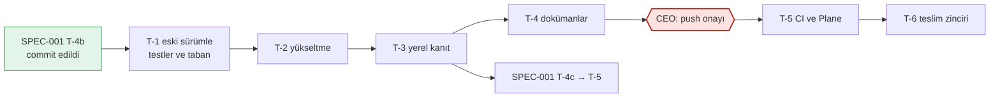
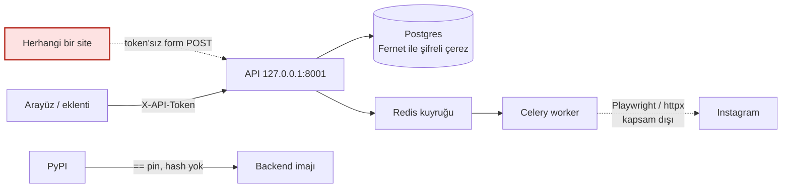

# Spec 002: Backend bağımlılık güvenlik yükseltmesi (quick)

- Status: Approved (CEO, 2026-11-09, "İmzalıyorum"; K-26)
- Version: v0.2 (2026-11-09)
- Tier: quick + threat model + görev listesi (CEO onayladı, 2026-11-09; §13 S6).
- Source: CI run `42491093608` (main, backend işi, "Dependency audit" adımı kırmızı). Ham liste: pip-audit çıktısı, 5 paket, 30 kayıt (§2.1).
- Previous spec: none. İlgili: SPEC-001 v1.6 (Approved, Faz 1 sürüyor; çakışma §8).
- Gates folded in: `SPEC-002-elestiri-r1.md` (16 bulgu), `SPEC-002-appsec-2026-11-09.md` (S-01..S-06, I-01..I-03), `../architecture/gorus-SPEC-002-2026-11-09.md` (K-1..K-4), `../talent/SPEC-002-kapasite.md`. İz tablosu §16.
- Budget ceiling: **2,5 agent iş günü** (tahmin 2,2 g, §9). SPEC-001 bütçesinden borç alınmaz. Ara kontrol: 1,25 g harcandığında (T-2 sonu) uygulayıcı main session'a gerçekleşen/kalan raporu verir. Tavan aşılacaksa iş durur, main session'a dönülür.
- Sensitive area: Instagram oturum çerezleri (Fernet ile şifreli, kimlik bilgisi niteliğinde); tedarik zinciri (PyPI paketleri).
- Deploy target: yalnız yerel, self-hosted `docker compose` yığını (portlar 127.0.0.1). Sunucu/Plesk/Cloudflare yok.

> Dil: içerik Türkçe, teknik terimler İngilizce. Başlık alanları ve `Status:` değerleri İngilizce.

## 1. Intent

**CEO'nun isteği (main session'ın aktardığı biçimde):** main'deki CI'ın backend işi "Dependency audit" (pip-audit) adımında kırmızı; 5 pakette açık var (cryptography, python-multipart, starlette, python-dotenv, instagrapi). Her paket için hedef sürüm, uyumluluk riski, Fernet geriye uyumu (eski token'lar çözülmeli), instagrapi'nin kodda nerede kullanıldığı ve kullanılmıyorsa kaldırma seçeneği isteniyor.

**Yorumum:** İş, uygulamanın davranışını değiştirmeden bağımlılıkları açıksız sürümlere taşımak ve CI'ın backend işini yeşile döndürmek. Kullanıcının göreceği hiçbir şey değişmez. En büyük risk iki noktada: (1) Starlette'in 0.37'den 1.x'e atlaması FastAPI'yi de sürükler, istek işleme davranışı değişebilir; (2) cryptography'nin 42'den 49'a atlamasından sonra veritabanındaki eski şifreli oturumlar çözülemezse kullanıcı tüm profillerini yeniden bağlamak zorunda kalır. Bu yüzden davranışı yükseltmeden **önce** testlerle sabitliyoruz, sonra yükseltiyoruz.

## 2. Mevcut durum (kanıt)

### 2.1 Audit bulguları ve hedef sürümler

Kilit dosyası yok. Doğrudan bağımlılıklar `backend/requirements.txt` içinde `==` ile sabit (tek istisna `Pillow>=10.0.0`, §10); geçişli olanlar (starlette dahil) her kurulumda çözümleyiciye bırakılıyor. `backend/requirements-dev.txt` yalnız pytest, pytest-asyncio, fakeredis ekliyor ve `-r requirements.txt` içeriyor. CI `pip-audit -r backend/requirements.txt` çalıştırıyor (`.github/workflows/ci.yml:38-39`); bu adım "Tests" adımından sonra geliyor ve testler kırılırsa hiç koşmuyor.

**Sürüm seçme kuralı (tek kural, tekrarlanabilir):**
- **Güvenlik kaydı olan paket** (cryptography, python-multipart, starlette, python-dotenv): alt sınırın major sürümündeki **en son yama**, `==` ile. Gerekçe: güvenlik paketinde son yama, yeni kayıtlara karşı en geniş payı bırakır; major değiştirmemek uyumluluk riskini sınırlar.
- **Kaydı olmayan ama zorunlu yükselen paket** (fastapi; gerekirse pydantic, pydantic-settings): ihtiyacı karşılayan **en düşük** sürüm, `==` ile. Gerekçe: en az davranış değişikliği; SPEC-001 T-5'in hata metinleri ve şemaları oynamaz.
- Kesin numaralar T-2'de çözümleyiciyle (`pip install --dry-run -r backend/requirements.txt`) seçilir ve uygulama notuna yazılır (§11). İmzanın kapsamı bu kural ve alt sınırlardır; numaralar değil.

| Paket | Şimdi | Kayıt | Alt sınır (audit'teki en yüksek düzeltme) | Hedef (kurala göre) | Gerekçe |
|---|---|---|---|---|---|
| cryptography | 42.0.7 (`requirements.txt:15`) | 7 | **49.0.0** (PYSEC-2026-3553, -3554) | `==` en son 49.x yaması | Alt sınırın altında kalan her sürüm en az bir kaydı açık bırakır. Kullandığımız yüzey yalnız `Fernet` ve `MultiFernet` (`app/core/security.py:5`); anahtar türetme stdlib `hashlib.pbkdf2_hmac` (`security.py:15`). |
| python-multipart | 0.0.9 (`requirements.txt:18`) | 7 | **0.0.31** (PYSEC-2026-3040) | `==` en son 0.0.x yaması (≥ 0.0.31) | Ham listede 0.0.27, 0.0.30, 0.0.31 düzeltmeleri var; 0.0.26'da durmak 4 kaydı açık bırakır. Tek kullanıcı ZIP/JSON yükleme ucu (`routers/imports.py:59-60`). |
| starlette | 0.37.2 (geçişli, FastAPI 0.111 üzerinden) | 7 | **1.3.1** (PYSEC-2026-249) | `requirements.txt`'e **açık `==` pin**: seçilen FastAPI'nin izin verdiği aralıkta, ≥ 1.3.1 olan en son 1.x yaması. Satırın üstünde tek satırlık yorum (aşağıda) | Geçişli bırakılırsa alt sınırı hiçbir şey garanti etmez. `>=` değil `==` (mevcut düzen, tekrarlanabilirlik). |
| fastapi | 0.111.0 (`requirements.txt:1`) | 0 | yok | `==` starlette ≥ 1.3.1'e izin veren **en düşük** sürüm | Kendi kaydı yok; FastAPI 0.111 starlette'i 0.37.x'e kilitlediği için zorunlu olarak yükselir. |
| python-dotenv | 1.0.1 (`requirements.txt:16`) | 1 | **1.2.2** (PYSEC-2026-2270) | `==` en son 1.x yaması (≥ 1.2.2) | Kodda doğrudan import yok; `pydantic-settings` `.env` dosyasını bununla okur (`core/config.py:23-25`). |
| instagrapi | 2.1.2 (`requirements.txt:12`) | 1 | 2.6.9 (GHSA-ggxf-37hm-9wqf) | **Kaldırılır** (CEO kararı, §13 S1) | Ölü kod; gerekçe §2.2. |
| pydantic | 2.7.1 | 0 | yok | Değişmez; **yalnız** çözümleyici seçilen FastAPI için isterse en düşük uyumlu 2.x | En az değişiklik. Tazeleme ayrı iş. |
| pydantic-settings | 2.2.1 | 0 | yok | Değişmez; yalnız çözümleyici isterse en düşük uyumlu sürüm | python-dotenv ≥ 1.2.2 ile uyumlu olması beklenir (Varsayım A-4). |

**Starlette satırının biçimi (K-2):**
```
# Geçişli (fastapi üzerinden); güvenlik tabanı PYSEC-2026-249 için açık pin (SPEC-002). FastAPI yükseltilirken birlikte ele alınır; kilit dosyası (SPEC-003) gelene kadar kalır.
starlette==<T-2'de seçilen>
```

### 2.2 instagrapi nerede kullanılıyor?

Grep sonucu (`backend/` içinde tek kod dosyası; mimari kurul ve appsec ayrıca doğruladı, I-01):

- `app/services/instagram.py:7-12` → `Client` ve üç exception import ediliyor.
- `instagram.py:16` → `PLAN_B_EXCEPTIONS`: **hiçbir yerde kullanılmıyor.**
- `instagram.py:69-71` → "instagrapi client kullanımı için" yorumu ve altındaki `_WEB_HEADERS`, `_MOBILE_HEADERS` aliasları: **repo genelinde tüketicisi yok** (import anında rastgele UA seçen ölü değerler).
- `instagram.py:191-198` `login_by_sessionid()` ve `instagram.py:201-204` `build_client()`: `Client` kullanan iki fonksiyon, **hiçbir çağıranı yok** (repo genelinde grep; tek eşleşme doküman örneği `docs/06-instagram-api-strategy.md:22`).
- Router'ın kullandığı fonksiyonlar `_web_account_info()` (`routers/sessions.py:104, 200, 287`) ve `verify_client()` (`sessions.py:351`) yalnız `httpx` kullanıyor, instagrapi'ye dokunmuyor.
- Saklanan oturum biçimi kendi JSON'umuz: `{"cookies": {...}}` (`sessions.py:89, 256`); instagrapi'nin `get_settings()` biçimine bağımlı değil.
- `tasks/sync_tasks.py:30, 33` yorumda "instagrapi UserInfo object" diyor ama import yok, `hasattr` ile duck typing; dokunulmaz (§10).
- Dinamik import (`importlib`, `__import__`) yok.

Sonuç: instagrapi çalışma zamanında hiçbir yolda kullanılmıyor; yalnız modül yüklenirken import ediliyor. Kaldırınca `instagram.py`'deki ölü kod da silinir (T-2 listesi). Uygulama davranışı değişmez. `json` ve `random` importları başka fonksiyonlarca kullanıldığı için kalır.

## 3. Alternatifler ve seçim

### 3.1 instagrapi

| Seçenek | Artı | Eksi | Karar |
|---|---|---|---|
| **A. Kaldır** + ölü kodu sil | Açık ve saldırı yüzeyi tamamen gider; geçişli bağımlılıklar da gider (Varsayım A-3); FastAPI/pydantic çözümü serbestleşir | Eski "Plan A" dokümanları güncellenmeli (T-4) | **Seçildi (CEO, 2026-11-09)** |
| B. 2.6.9'a yükselt | Kod değişmez | Kullanılmayan kod için 2.1 → 2.6 atlaması; kendi pydantic pini FastAPI zinciriyle çakışabilir; ilkeye aykırı kütüphane imajda kalır | Hayır |
| C. İstisna ile 2.1.2'de bırak | Sıfır iş | Açık bilinçli olarak kalır, gerekçesi yok | Hayır |

### 3.2 FastAPI / Starlette zinciri

| Seçenek | Artı | Eksi | Karar |
|---|---|---|---|
| **A. FastAPI'yi starlette ≥ 1.3.1'e izin veren en düşük sürüme yükselt, starlette'i açık `==` pinle** | 7 kaydın hepsi kapanır; FastAPI tarafında en az değişiklik | En büyük sürüm atlaması (0.37 → 1.x); davranış değişikliği riski; T-1 karakterizasyon testleri bunu yakalar | **Seçildi** |
| B. FastAPI'nin desteklediği en yüksek starlette'te dur, kalanları istisna yap | Daha küçük atlama | Açık kayıt kalır | **Otomatik yedek değil.** A çözümlenemezse iş durur; istisna yalnız CEO kararıyla (§4 CB-1, §13 S2) |
| C. FastAPI'siz starlette yamalamak (fork/vendor) | — | Bakım yükü, desteklenmez | Hayır |

### 3.3 Sürüm sabitleme yöntemi

| Seçenek | Artı | Eksi | Karar |
|---|---|---|---|
| **A. Mevcut düzen: doğrudan bağımlılıklar `==`, starlette açık `==` pin** | En az değişiklik, iş küçük kalır | Geçişli bağımlılıklar kayabilir (R-8); CI'ın denetlediği küme ile imajdaki küme ayrışabilir | **Seçildi.** Ayrışma bu işin anında imaj içi audit ile kapatılır (CB-1 b) |
| B. Kilit dosyası (hash'li) | Tekrarlanabilir kurulum, hash doğrulaması | Dockerfile, `scripts/test.sh`, CI ve geliştirici akışı değişir | **Ayrı iş: SPEC-003 adayı** (CEO, §13 S4). Araç seçimi o spec'te gerekçe tablosuyla kurula gelir; kurul hiçbir aracı şimdiden onaylamadı (K-4). Plane görevi CB-3 kapanmadan açılır (T-5). |

## 4. Changed behavior

Kriterler, push edilen aralıktaki **SPEC-002'nin son commit'i** (C4, §9 commit planı) üzerinde değerlendirilir.

- [ ] **CB-1: Audit temiz.**
  - (a) **Kaynak kümesi:** `pip-audit -r backend/requirements.txt` `No known vulnerabilities found` yazar ve 0 ile çıkar. Yerel komut (host'ta pip-audit kurmadan, tek kullanımlık konteyner):
    `docker run --rm -v "$PWD/backend:/src:ro" python:3.12-slim sh -c 'pip install -q --disable-pip-version-check pip-audit && pip-audit -r /src/requirements.txt'`
  - (b) **İmaj kümesi:** rebuild edilmiş `backend` imajında kurulu paketlerin tamamı denetlenir ve sonuç aynıdır. Komut (pip-audit'in kendi bağımlılıkları denetime girmesin diye liste kurulumdan önce alınır):
    `docker compose run --rm --no-deps -T backend sh -c 'pip freeze --exclude-editable > /tmp/f.txt && pip install -q --disable-pip-version-check pip-audit && pip-audit --no-deps --disable-pip -r /tmp/f.txt'`
  - (c) Aynı imajda `docker compose run --rm --no-deps -T backend pip check` `No broken requirements found` yazar.
  - (d) `requirements.txt`'teki her pin §2.1 tablosundaki alt sınıra eşit ya da daha yüksektir; starlette satırı ve yorumu §2.1'deki biçimdedir.
  - (e) CI'daki "Dependency audit" adımı `if: always()` taşır (testler kırılsa da audit koşar ve sonucu görünür).
  - **İstisna yolu (yalnız CEO kararıyla; otomatik değil):** Bir kayıt kapatılamazsa iş durur ve main session'a döner. İstisna ancak şu koşulların hepsiyle konur: (1) CEO'nun **her kayıt ID'si için ayrı** onayı, BookStack Karar Kaydı'nda; (2) appsec'in o kayıt için yazılı erişilebilirlik analizi; (3) `ci.yml`'de `--ignore-vuln <ID>` ve aynı satırda yorum `# bitiş YYYY-MM-DD, Karar Kaydı <ref>, Plane IA-<n>`; (4) bitiş en fazla 30 gün; (5) Plane'de bitiş tarihini son tarih olarak taşıyan bir görev. Toptan istisna yoktur. **Appsec görüşü (S-06), CEO'nun önüne konur:** python-multipart ve starlette kayıtları siteden token'sız erişilebilir olduğu için (§12) bu iki paketin kayıtlarına, form-ayrıştırma sertleştirmesi (§10) planlanmadan istisna verilmemesi önerilir. İstisnalı durumda CB-1 (a) ve (b) "yalnız istisna listesindeki ID'ler kalır" olarak okunur.
- [ ] **CB-2: instagrapi kaldırıldı.**
  - `backend/requirements.txt`'te `instagrapi` satırı yoktur.
  - Rebuild edilmiş imajda `docker compose run --rm --no-deps -T backend pip show instagrapi` `Package(s) not found` uyarısı verir.
  - `grep -rnE "from instagrapi|import instagrapi" backend/` boş döner.
  - `grep -rn "instagrapi" backend/app` yalnız `app/tasks/sync_tasks.py`'deki yorum satırlarını (şu an `:30` ve `:33`) döndürür.
  - `grep -rnE "PLAN_B_EXCEPTIONS|login_by_sessionid|build_client|_WEB_HEADERS|_MOBILE_HEADERS" backend/` boş döner.
  - PB-2 takımı import hatası vermeden koşar.
- [ ] **CB-3: CI.** SPEC-002 commit'lerini içeren push'un (CEO onayıyla) CI run'ında:
  - `backend` işi yeşildir ("Tests" ve "Dependency audit" adımları dahil).
  - `frontend` ve `secrets` işlerinin sonucu taban run `42491093608`'deki sonuçlarından kötü değildir (taban sonuçlar T-1 raporuna run sayfasından yazılır). `frontend` işindeki `npm audit` bu işin kapsamında değildir (§10).
  - Push aralığı SPEC-001 commit'leri de içerirse ve `backend` kırmızıysa, kırmızı adım ve test dosyası rapora yazılır: SPEC-002'nin test dosyaları (§6) ve "Dependency audit" yeşilse CB-3 karşılanmış sayılır, diğer kırık kendi sahibine gider. Öneri: SPEC-002 commit'leri SPEC-001 T-4c commit'lerinden önce push edilir.

## 5. Preserved behavior

### 5.1 Karakterizasyon kuralları

1. PB-1 a–b, PB-4, PB-5 ve PB-6 testleri **yükseltmeden önce**, eski sürümlerle yazılır ve yeşil koşar (T-1). Aynı testler yükseltmeden sonra **değiştirilmeden** yeniden yeşil koşar (T-3).
2. **Çelişki kuralı:** T-1'de mevcut davranış bu spec'te yazılan beklentiden farklı çıkarsa test **mevcut davranışı** sabitler. Fark T-1 raporunda (beklenen / gözlenen / dosya:satır) main session'a bildirilir. Bu işte uygulama kodu, beklentiye uydurmak için **değiştirilmez** (davranış değişikliği bu işin kapsamı dışı).
3. **Yükseltme sonrası değişiklik kuralı:** Yükseltmeden sonra bir karakterizasyon testinin değişmesi gerekirse uygulayıcı durur. Değişiklik ancak (a) main session'ın yazılı onayıyla, (b) önce/sonra diff'i uygulama notuna (§11) eklenerek yapılır; (c) T-6'da qa-engineer bu değişikliği ayrı bir satır olarak denetler.
4. **SPEC-001 testleri kırılırsa** (T-4a/T-4b'nin DB'li testleri dahil): düzeltme SPEC-002 bütçesinden, T-2 içinde yapılır. Önce uygulama kodunda en küçük düzeltme aranır (`main.py` hariç, §8). Mevcut bir testi değiştirmek kural 3'e tabidir.

### 5.2 Kriterler

- [ ] **PB-1: Fernet geriye uyumu.** Bütün token'lar **sentetik** anahtarla üretilir: `"golden-key-A"`, `"golden-key-B"`; düz metin `'{"cookies": {"sessionid": "synthetic-not-a-session"}}'` (gerçek bir sessionid'ye benzemez). Testler anahtarı açıkça verir (`monkeypatch.setattr(settings, "encryption_key", "golden-key-A")` ve gerekirse `encryption_key_old`); konteynerdeki gerçek `ENCRYPTION_KEY`'e (S-04) hiçbir test dayanmaz ve onunla üretilmiş hiçbir değer repoya girmez.
  - (a) cryptography **42.0.7** ile `golden-key-A`'yla üretilmiş, teste sabit olarak gömülmüş bir token yeni sürümde `security.decrypt` ile çözülür ve aynı düz metni verir. Yol tam olarak çalışır: PBKDF2 → `MultiFernet`.
  - (b) 42.0.7 ile `golden-key-A`'yla üretilmiş ikinci sabit token, `encryption_key="golden-key-B"` ve `encryption_key_old="golden-key-A"` ayarıyla çözülür ve `needs_rotation` `True` döner.
  - (c) **Geri dönüş yönü.** (c1, birim) Yeni sürümün ürettiği token'ın base64 çözülmüş ilk baytı `0x80`'dir. (c2, komut, T-3) Yeni imajda `golden-key-A` ile üretilen bir token, yükseltme öncesi etiketlenmiş eski imajda (`:pre-spec002`, T-1) çözülür ve aynı düz metni verir. Komut §6.2.
  - (d) Yanlış anahtarla çözme `InvalidToken` verir. Bu mevcut `test_wrong_key_cannot_decrypt` testidir ve değişmeden geçer.
- [ ] **PB-2: Tam backend test takımı.** `scripts/test.sh backend` 0 failed, 0 error ile biter. Ölçümler önce (T-1 sonu) ve sonra (T-3) rapora yazılır: `passed`, `skipped`, `warnings`.
  - `passed_sonra ≥ passed_önce` (önce = T-1'de eklenen testler dahil sayı).
  - `skipped_sonra ≤ skipped_önce`.
  - Yeni çıkan `DeprecationWarning`'ler listelenir; bunlar kapı değildir.
- [ ] **PB-3: Migration.** Backend imajı yeni bağımlılıklarla yeniden build edildikten sonra `scripts/migrate-check.sh` `SONUC: up/down/up TAMAM` yazar.
- [ ] **PB-4: Yükleme sözleşmesi** (`POST /api/sessions/{id}/import/zip`, geçerli token ile, aksi yazmadıkça):
  - (a) Bir ZIP ve iki JSON dosyası tek istekte → 202, iş `done`.
  - (b) Dosyasız istek → 422.
  - (c) 51 dosya → 422.
  - (d) `MAX_UPLOAD_BYTES` testte küçültülünce sınırı aşan yükleme → 413, geçici `igimp_*` dosyaları silinmiş.
  - (e) Dosya adı `../../x.json` → işe yalnız `x.json` adıyla girer.
  - (f) Token'sız yükleme (1 dosya) → 401.
  - Mevcut iki yükleme testi (`test_sessions_api.py:139, 166`) de değişmeden geçer.
- [ ] **PB-5: Kimlik doğrulama, CORS ve ayrıştırma sırası (HTTP düzeyi).**
  - (a) Token'sız ve yanlış token'lı istek en az üç farklı router'da (`/api/sessions`, `/api/actions/...`, `/api/bridge/...`) 401 alır. `settings.api_token` boşken (monkeypatch) aynı istek 503 alır.
  - (b) Preflight, izinli kaynak: `OPTIONS` isteği, başlıklar `Origin: http://localhost:3002`, `Access-Control-Request-Method: POST`, `Access-Control-Request-Headers: x-api-token`. Yanıtın durum kodu T-1'de gözlenen değere sabitlenir (beklenen 200). `access-control-allow-origin` değeri `http://localhost:3002`'dir. `access-control-allow-headers` içinde `x-api-token` vardır. Başlık adı ve değer karşılaştırmaları harfe duyarsızdır.
  - (c) Preflight, izinsiz kaynak: aynı istek `Origin: http://evil.example` ile. Yanıtta `access-control-allow-origin` başlığı yoktur; durum kodu T-1'de gözlenen değere sabitlenir (beklenen 400).
  - (d) **Ayrıştırma yetkiden önce (S-01, bugünkü davranışın kaydı):** token'sız, `Origin: http://evil.example` başlıklı, 1001 küçük dosya parçalı `multipart/form-data` yükleme → T-1'de gözlenen durum kodu sabitlenir (beklenen 400, "Too many files"); aynı istek 1 dosyayla → 401. Bu test bir güvenlik garantisi değildir; kalan yüzeyi görünür tutar ve sertleştirme işinde (§10) bilinçli olarak değişecek ilk testtir.
- [ ] **PB-6: `.env` okuma.** Test önce ortam değişkenlerini temizler: `monkeypatch.delenv` ile `ENCRYPTION_KEY`, `ENCRYPTION_KEY_OLD`, `API_TOKEN`, `DATABASE_URL`, `REDIS_URL` (`raising=False`). (Gerekçe: CI `ENCRYPTION_KEY` verir, `test.sh` konteyneri gerçek `.env`'i ortam olarak yükler; ortam değişkeni `.env`'i ezer.) Sonra geçici bir `.env` dosyasından (`Settings(_env_file=<tmp>)`) `database_url`, `redis_url`, `encryption_key`, `api_token` ve `encryption_key_old` değerleri dosyadaki sentetik değerlerle aynı okunur. Dosyada tanımsız bir anahtar varsa hata vermez (`extra="ignore"`).
- [ ] **PB-7: Çalışan yığın (elle duman testi; kanıt komut çıktısı).**
  - (a) `docker compose build backend worker flower && docker compose up -d` sonrasında `curl -s -o /dev/null -w '%{http_code}' http://127.0.0.1:8001/api/health` `200` yazar.
  - (b) `docker compose exec worker celery -A app.tasks.celery_app inspect ping` `pong` içerir.
  - (c) **Gerçek veride salt okuma çözme denetimi** (CEO izni, §13 S5). Komut §6.3, aynen. T-1'de eski yığınla **taban**, T-3'te yeni yığınla **son** ölçüm alınır. Çıktı yalnız `toplam=N cozulen=N cozulemeyen=N` biçimindedir. Geçme koşulu: `cozulemeyen_son ≤ cozulemeyen_taban` (beklenen ikisi de 0).
  - (d) **Başarısızlık davranışı:** `cozulemeyen_son > cozulemeyen_taban` ya da komut `HATA=` yazarsa T-3 durur. Push yapılmaz. Hiçbir kayıt onarılmaz, yeniden şifrelenmez, silinmez. Hızlı geri dönüş (§11) uygulanır, main session'a yalnız sayılar ve hata türü bildirilir.

**Kullanıcı arayüzü durumları:** yok. Bu iş arayüze, eklentiye ve API sözleşmesine yeni davranış eklemez; ekran durumu yoktur.

## 6. Test and evidence

### 6.1 Kriter ↔ test

| Kriter | Test | Katman / Profil | Ne zaman |
|---|---|---|---|
| CB-1 a | §4 CB-1 (a) komutu | komut çıktısı | T-3 |
| CB-1 b, c | §4 CB-1 (b), (c) komutları | imaj içi, komut çıktısı | T-3 |
| CB-1 d, e | `requirements.txt` ve `ci.yml` diff'i | gözden geçirme (qa) | T-2, T-6 |
| CB-2 | §4 CB-2 komutları; PB-2 takımı import hatası vermez | komut çıktısı | T-3 |
| CB-3 | Push'un CI run bağlantısı, 3 işin sonucu, taban run ile karşılaştırma | CI | T-5 |
| PB-1 a, b, c1 | Yeni `backend/tests/test_security_compat.py` (sabit token'lar dosyanın içinde; `tests/fixtures/` kullanılmaz, §8) | birim | T-1 (eski), T-3 (yeni) |
| PB-1 c2 | §6.2 komutu | iki imaj, `--network none` | T-3 |
| PB-1 d | Mevcut `tests/test_security.py` | birim | T-1, T-3 |
| PB-2 | `scripts/test.sh backend` özet satırı (`passed`, `skipped`, `warnings`) | entegrasyon (izole `instaanalytic_pytest`) | T-1 taban, T-3 |
| PB-3 | `scripts/migrate-check.sh` çıktısı | geçici `instaanalytic_migcheck` DB | T-3 |
| PB-4 | Yeni `backend/tests/test_upload_contract.py` | API (httpx ASGITransport) | T-1, T-3 |
| PB-5 | Yeni `backend/tests/test_http_contract.py` | API (httpx ASGITransport) | T-1, T-3 |
| PB-6 | Yeni `backend/tests/test_settings_env.py` | birim | T-1, T-3 |
| PB-7 a, b | §5 PB-7 komutları | elle duman testi, yerel yığın | T-3 |
| PB-7 c | §6.3 komutu (taban + son) | gerçek DB, salt okuma | T-1 taban, T-3 son |

### 6.2 Sabit token üretimi ve geri dönüş yönü (S-04, PB-1 c2)

- **Eski imajın etiketlenmesi (T-1, rebuild'den önce; I-02):** `docker compose images` ile imaj adları doğrulanır (beklenen `instaanalytic-backend`, `instaanalytic-worker`, `instaanalytic-flower`), sonra her biri için `docker tag <ad>:latest <ad>:pre-spec002`.
- **Sabit token'ların üretimi (T-1):** `.env`'siz, ağsız, sentetik değerlerle:
  ```
  docker run --rm --network none \
    -e ENCRYPTION_KEY=golden-key-A -e DATABASE_URL=postgresql+asyncpg://u:p@none/db -e REDIS_URL=redis://none:6379/0 \
    instaanalytic-backend:pre-spec002 python -c 'import cryptography; from app.core.security import encrypt; print("cryptography", cryptography.__version__); print(encrypt("{\"cookies\": {\"sessionid\": \"synthetic-not-a-session\"}}"))'
  ```
  Çıktıda `cryptography 42.0.7` görünmelidir; görünmezse T-1 durur. Komut ve sürüm satırı C1 commit mesajına ve T-1 raporuna yazılır. `# gitleaks:allow` yalnız token sabitlerinin satırlarına eklenir; `.gitleaks*` yapılandırması değiştirilmez.
- **PB-1 c2 (T-3):** yeni imajda aynı komutla (`instaanalytic-backend:latest`) token üretilir; bu token eski imajda çözülür:
  ```
  docker run --rm --network none \
    -e ENCRYPTION_KEY=golden-key-A -e DATABASE_URL=postgresql+asyncpg://u:p@none/db -e REDIS_URL=redis://none:6379/0 \
    -e TOKEN='<yeni imajın ürettiği token>' \
    instaanalytic-backend:pre-spec002 python -c 'import os, cryptography; from app.core.security import decrypt; print("cryptography", cryptography.__version__); print(decrypt(os.environ["TOKEN"]))'
  ```
  Beklenen: `cryptography 42.0.7` ve sentetik düz metin.

### 6.3 Gerçek veride salt okuma çözme denetimi (S-05, PB-7 c)

Kurallar: betik repoya girmez (stdin heredoc); `rotate_keys.py` kullanılmaz (`rotate_keys.py:25` yazar); bağlantı veritabanı düzeyinde salt okumadır ve bu, sorgudan önce doğrulanır; çözülen değer, kimlik, kullanıcı adı, çerez ya da hata metni yazdırılmaz; hata yalnız türüyle sayılır. Komut aynen:

```
docker compose exec -T backend python - <<'EOF'
import asyncio
from sqlalchemy import text
from sqlalchemy.ext.asyncio import create_async_engine
from app.core.config import settings
from app.core.security import decrypt

async def main():
    eng = create_async_engine(settings.database_url,
        connect_args={"server_settings": {"default_transaction_read_only": "on"}})
    try:
        async with eng.connect() as c:
            if (await c.execute(text("SHOW transaction_read_only"))).scalar() != "on":
                raise RuntimeError("readonly")
            rows = (await c.execute(text("SELECT session_data FROM sessions"))).scalars().all()
    finally:
        await eng.dispose()
    ok = bad = 0
    for v in rows:
        try:
            decrypt(v)
            ok += 1
        except Exception:
            bad += 1
    print(f"toplam={len(rows)} cozulen={ok} cozulemeyen={bad}")

try:
    asyncio.run(main())
except Exception as e:
    print(f"HATA={type(e).__name__}")
EOF
```

Rapora yalnız son satır girer. `toplam`, iki ölçüm arasında kullanıcı yeni profil eklerse değişebilir; kriter `cozulemeyen` üzerindendir.

## 7. Uyumluluk riskleri

| # | Risk | Olasılık | Etki | Önlem |
|---|---|---|---|---|
| R-1 | Starlette 1.x, 0.x'te kullanımdan kalkmış API'leri kaldırmış olabilir | Orta | Uygulama açılmaz ya da bir uç bozulur | Kodda bu yüzeyler yok: `on_event`, `on_startup`, `lifespan`, `BaseHTTPMiddleware`, `TemplateResponse`, `StaticFiles`, `TestClient`, doğrudan `from starlette` (grep, `backend/app`; kurul doğruladı). Kullanılan yüzey `FastAPI`, `APIRouter`, `Depends`, `Header`, `Query`, `File`, `UploadFile`, `HTTPException`, `Response`, `StreamingResponse`, `CORSMiddleware`. T-2 başında ön keşif (sürüm notları); PB-2, PB-4, PB-5 bunları yakalar. |
| R-2 | Yeni FastAPI'de JSON gövdeli isteklerde Content-Type denetimi sıkılaşmış olabilir (A-5) | Düşük | Arayüz/eklenti istekleri 415/422 alır | İstemciler zaten `application/json` gönderiyor (`frontend/src/api/client.ts:5`, `frontend/extension/background.js:147`); testler `json=` kullanıyor. PB-2 kapsar. |
| R-3 | Starlette/python-multipart yeni sürümlerinde parça başına boyut ve sayı sınırları (`max_files`, `max_fields`, `max_part_size`) | Düşük | Büyük yükleme reddedilir | Bizim sınırımız 50 dosya (`imports.py:28`), dosya parçaları diske akıtılır. PB-4 a, c, d ve PB-5 d kapsar. 4 GB'a yakın tam ZIP elle denenmez (§10). |
| R-4 | python-multipart 0.0.13+ import adını `python_multipart` yaptı, eski `multipart` adı uyarıyla çalışıyor | Orta | Uyarı gürültüsü; eski FastAPI'yle birlikte kurulursa uyumsuzluk | FastAPI ile birlikte yükseltilir; PB-2 uyarı listesi. |
| R-5 | pydantic zorunlu yükselirse doğrulama hata metinleri ya da serileştirme değişebilir | Düşük–Orta | API yanıt biçimi değişir | Yalnız çözümleyici isterse, en düşük uyumlu sürüm; PB-2. Değişirse sürüm uygulama notuna yazılır ve SPEC-001 T-5'in sahibine (delivery-manager üzerinden) bildirilir; T-5'teki olası etki SPEC-001'in işidir, bu işin maliyeti değil. |
| R-6 | cryptography 49'da Fernet token biçimi ya da API'si değişmiş olabilir | Çok düşük (Fernet biçimi sürüm baytıyla sabit bir spesifikasyon) | Eski oturumlar çözülemez, tüm profiller yeniden bağlanır | PB-1 a–c (iki yönde), PB-7 c–d (gerçek veride salt okuma, başarısızlıkta dur ve geri dön). Veri yeniden şifrelenmez. |
| R-7 | cryptography 49 Python 3.12 / Debian slim / arm64 (yerel Mac) için hazır wheel sunmuyor olabilir | Düşük | Derleme için Rust gerekir, build kırılır | T-3'te `docker compose build` çıktısı; kırılırsa durur, bildirir. Dockerfile bu işte değişmez. |
| R-8 | Geçişli bağımlılıklar kilitsiz; yeni bir açık CI'ı tekrar kırmızıya çevirebilir | Orta (zamanla) | CI yeniden kırmızı | Bugün için CB-1 b (imaj içi audit); kalıcı çözüm SPEC-003 (kilit dosyası), Plane görevi T-5'te açılır (K-4). |
| R-9 | Hiçbir FastAPI sürümü starlette ≥ 1.3.1'e izin vermiyor olabilir | Bilinmiyor | CB-1 karşılanamaz | T-2 durur, main session'a döner. İstisna yalnız CB-1'deki koşullarla (CEO kararı). |
| R-10 | Kaldırılan geçişli paketler (instagrapi'nin çektikleri) başka bir modülce örtük kullanılıyor olabilir | Düşük | Import hatası | A-3 grep'i; CB-1 c (`pip check`) ve PB-2 doğrular. |

## 8. SPEC-001 ile çakışma ve sıralama

**Durum (git, 2026-11-09):** SPEC-001'den T-2b, T-2, T-7a, T-4a, T-7b ve **T-4b commit edildi** (`a525cb0`); çalışma ağacı temiz. Sırada T-4c, T-5, T-6 var. Hepsi tek branch'te (`main`), tek çalışma ağacında yürüyor.

**Dosya çakışması:**

| SPEC-002 dosyası | SPEC-001'de aynı dosya | Değerlendirme |
|---|---|---|
| `backend/requirements.txt` | Yok (T-pre yalnız `requirements-dev.txt`'e dokundu, yapıldı) | Çakışma yok |
| `backend/app/services/instagram.py` | Yok | Çakışma yok |
| Yeni test dosyaları (4 adet, §6) | T-6'nın listesinde yok | Çakışma yok |
| `backend/tests/fixtures/` | T-4b (commit'li) | SPEC-002 bu dizine **dokunmaz** |
| `backend/app/main.py` | **T-5** (hata zarfı işleyicisi) | SPEC-002 `main.py`'ye dokunmaz. Yükseltme `main.py`'de değişiklik gerektirirse T-2 durur, delivery-manager'a bildirir. |
| `.github/workflows/ci.yml` | Yok | Tek satır: audit adımına `if: always()` (CB-1 e); istisna yolunda `--ignore-vuln` satırları |

**Davranış çakışması:** SPEC-001 T-5 router, şemalar, hata zarfı ve 415 davranışını yazacak; T-6 da bunların testlerini. İkisi doğrudan FastAPI/Starlette/pydantic davranışına bağlı. Bu yüzden SPEC-002 T-5'ten önce gelir.

**Sıralama (CEO kararı, §13 S3):** SPEC-001 T-4b → SPEC-002 T-1..T-3 → SPEC-001 T-4c. **T-4c, SPEC-002 T-3'ün yerel yeşil kanıtından sonra başlar; push ve CI beklenmez.** SPEC-002 T-4 (tech-comms) ve T-6 (teslim zinciri) başka birimlerde, T-4c ile paralel koşabilir. Kurallar:
- Uygulayıcı yalnız kendi dosyalarını tek tek `git add` eder (`git add -A` yok).
- Aynı anda yalnız bir DB'li pytest/migrate-check koşar (SPEC-001 plan §3). T-6'daki test tekrarı, T-4c'nin commit'lenmemiş test değişikliği bulunmayan bir anda koşulur; sırayı delivery-manager verir.
- Öneri: SPEC-002 commit'leri (C1–C4) T-4c commit'lerinden önce push edilir (CB-3).

### Hangi sırayla ilerliyoruz?

Açıklama: SPEC-002 T-1..T-3 seri yürür; T-3'ün yerel yeşilinden sonra SPEC-001 T-4c beklemeden başlar; tek CEO kapısı push onayıdır (altıgen şekil, kırmızı); tamamlanmış adım yeşil ve "commit edildi" etiketli. Metin karşılığı:

| Sıra | Adım | Sahibi | Ön koşul |
|---|---|---|---|
| 1 | SPEC-001 T-4b (commit edildi, `a525cb0`) | polyglot-engineer | — |
| 2 | SPEC-002 T-1: taban ölçümler, eski imaj etiketi, karakterizasyon testleri, sabit token'lar | polyglot-engineer | SPEC-002 imzası |
| 3 | T-2: bağımlılık yükseltmesi, instagrapi ve ölü kod kaldırma | polyglot-engineer | T-1 yeşil |
| 4 | T-3: rebuild, testler, migrate-check, audit, duman testi, uygulama notu | polyglot-engineer | T-2 |
| 5a | SPEC-001 T-4c (sonra T-5) | polyglot-engineer | T-3 yerel yeşil |
| 5b | T-4: dokümanlar ve Karar Kaydı | tech-comms | T-2 |
| 6 | Push | CEO | **CEO onayı**, T-3, T-4 |
| 7 | T-5: CI kanıtı (CB-3), Plane görevleri | main session | push |
| 8 | T-6: teslim zinciri | qa → appsec → internal-auditor → quality-office | T-5 |

Takvim etkisi: SPEC-001'in kritik yolu yaklaşık polyglot T-1 + T-2 + T-3 kadar (≈ 1,3 g) kayar; push/CI beklemesi artık kritik yolda değil. SPEC-001'in bütçesinden harcanmaz.

## 9. Görev listesi, commit planı ve tahmin

| ID | Görev | Kriter | Sahibi | Bağımlılık | Dosyalar | Tahmin |
|---|---|---|---|---|---|---|
| T-1 | **Eski sürümlerle:** (1) taban CI run `42491093608`'in üç işinin sonucunu rapora yaz; (2) `docker compose images` + `:pre-spec002` etiketleri (§6.2); (3) PB-7 c taban ölçümü (§6.3); (4) sabit token'ları `.env`'siz konteynerde üret (§6.2); (5) PB-1 a–b, c1, PB-4, PB-5, PB-6 testlerini yaz; (6) `scripts/test.sh backend` taban sayıları (`passed`, `skipped`, `warnings`); çelişki varsa §5.1 kural 2. Commit **C1**. | PB-1, PB-2 (taban), PB-4..PB-6, PB-7 c (taban) | polyglot-engineer | İmza | `backend/tests/test_security_compat.py`, `test_upload_contract.py`, `test_http_contract.py`, `test_settings_env.py` (hepsi yeni) | 0,5 g |
| T-2 | **Ön keşif (~0,1 g):** seçilen FastAPI ve Starlette 1.x sürüm notlarından kodu etkileyen maddeleri çıkar; T-2 tahmini 0,5 g'yi aşacaksa main session'a bildir. **Sonra:** `requirements.txt` pinleri (§2.1 kuralı; starlette açık pin ve yorumu); `instagrapi` satırını sil; `instagram.py`'den sil: `from instagrapi ...` importları (`:7-12`), `PLAN_B_EXCEPTIONS` (`:16`), yorum ve `_WEB_HEADERS`, `_MOBILE_HEADERS` (`:69-71`), `login_by_sessionid` (`:191-198`), `build_client` (`:201-204`); `ci.yml` audit adımına `if: always()`; uyumluluk kırığı varsa en küçük düzeltme (`main.py` hariç, §5.1 kural 4). Paket adları diff'te tek tek okunur (typosquat). Commit **C2**. Bitişte 1,25 g ara kontrol raporu. | CB-1 d–e, CB-2 | polyglot-engineer | T-1 | `backend/requirements.txt`, `backend/app/services/instagram.py`, `.github/workflows/ci.yml`, gerekirse kırılan uygulama dosyası (rapora yazılır) | 0,5 g |
| T-3 | `docker compose build backend worker flower && docker compose up -d`; `scripts/test.sh backend`; `scripts/migrate-check.sh`; CB-1 a–c ve CB-2 komutları; PB-1 c2 (§6.2); PB-7 a–d; önce/sonra karşılaştırması; uygulama notu (§11). Commit **C3**. | CB-1 a–c, CB-2, PB-1..PB-7 | polyglot-engineer | T-2 | `docs/raporlar/SPEC-002-uygulama-notu.md` (yeni) | 0,3 g |
| T-4 | instagrapi / "Plan A" anlatımını güncelle (aşağıdaki liste); değişen `docs/` dosyaları için `python3 ~/Desktop/Projects/proje-masasi/bin/bs_sync_ia.py <anahtar>`; BookStack Karar Kaydı'na §13'teki 6 karar ve form-ayrıştırma ertelemesinin kabulü (§12); Sorular sayfasına S-02 ve S-03 gözlemleri (CEO bilgisi). Commit **C4**. | — | tech-comms | T-2 | aşağıdaki liste | 0,25 g |
| T-5 | Push (CEO onayı) ve CI run kanıtı; Plane'de (`IA`) dört görev: SPEC-003 kilit dosyası (K-4; CB-3 kapanmadan), form-ayrıştırma sertleştirmesi (S-01, SPEC-001 T-5 sonrası), sunucu tarafı Instagram trafiği kaydı (S-02), Playwright/Chromium güncellemesi + sandbox + non-root (S-03) | CB-3 | main session + CEO | T-3, T-4 | — | 0,1 g |
| T-6 | Teslim zinciri: qa-engineer (§5.1 kural 3'e göre değişen karakterizasyon testleri ayrı satır) → appsec → internal-auditor → quality-office. Yapan denetlemez. | hepsi | ilgili birimler | T-5 | — | 0,5 g |
| T-7 | Gerçekleşen süreleri ilk scorecard olarak yaz | — | delivery-manager | T-6 | `docs/scorecards/SPEC-002.md` (yeni) | 0,05 g |

**T-4 doküman listesi** (satırlar 2026-11-09 grep'inden; uygulayıcı yeniden grep eder): `README.md:90-91, 154, 244`; `CONTRIBUTING.md:38`; `TOPOLOGY.md:67-74, 125` (yalnız bu satırlar; D-05 ayrı iş); `docs/00-index.md:15, 19, 37`; `docs/02-tech-stack.md:17-18, 28-30, 45, 56`; `docs/03-architecture.md:50, 75, 93, 120-131`; `docs/06-instagram-api-strategy.md` (başa tarihsel not: "Plan A (instagrapi), SPEC-002 ile kaldırıldı"; içerik silinmez); `docs/07-development-phases.md:33, 132-141`. `docs/architecture/STACK.md:15`'teki `retire` satırındaki "Kesinleşmesi Soru 1 = A'ya bağlı" ifadesi "kesinleşti (CEO, 2026-11-09)" olarak güncellenir.

**Commit planı:**

| Commit | Görev | İçerik | Mesaj başı |
|---|---|---|---|
| C1 | T-1 | 4 yeni test dosyası; mesajda token üretim komutu ve `cryptography 42.0.7` satırı | `test(SPEC-002 T-1): ...` |
| C2 | T-2 | `requirements.txt`, `instagram.py`, `ci.yml`, varsa düzeltilen uygulama dosyası | `fix(SPEC-002 T-2): ...` |
| C3 | T-3 | uygulama notu | `docs(SPEC-002 T-3): ...` |
| C4 | T-4 | dokümanlar | `docs(SPEC-002 T-4): ...` |

Kriterler C4 üzerinde değerlendirilir (§4). Geri dönüşün birimi **C2'dir**: C1'in testleri eski sürümlerle yazıldığı için C2 geri alınınca da yeşil kalır.

**Tahmin:** 0,5 + 0,5 + 0,3 + 0,25 + 0,1 + 0,5 + 0,05 = **2,2 agent iş günü**. **Tavan:** 2,5 g (tampon 0,3 g, büyük kısmı T-2'nin belirsizliğine ayrılmış). Ara kontrol 1,25 g'de. Kota payı: abonelik kotasının en fazla %5'i (doğrulanmadı; SPEC-001'in %30'uyla birlikte toplam %35).

Graph notu: projede `graphify-out/` yok; etki analizi Grep ile yapıldı. `instagram.py`'nin tek tüketicisi `routers/sessions.py` (import satırı `sessions.py:23`) ve test `test_sessions_api.py:96` (`_web_account_info` monkeypatch). Bu tüketicilerin kullandığı fonksiyonlar değişmiyor.

## 10. Out of scope

- **Kilit dosyası ve hash ile sabitleme** → SPEC-003 adayı (CEO kararı); Plane görevi T-5'te. CI'da sabitlenmemiş `pip-audit` (`ci.yml:30`) ve digest'siz taban imaj (`Dockerfile:1`) da o işin konusu.
- **Form-ayrıştırma sertleştirmesi** (ayrıştırmadan önce token denetleyen ASGI middleware, `Content-Length` ve stream üst sınırı, isteğe bağlı TrustedHost; S-01) → ayrı iş, SPEC-001 T-5 sonrası (CEO kararı). Kabul edilen kalan risk §12'de.
- `requirements-dev.txt`'teki sabitlenmemiş test bağımlılıklarının audit'i (CI yalnız `requirements.txt`'i denetliyor).
- `Pillow>=10.0.0`: `backend/` içinde `PIL` importu yok; instagrapi gidince bilinen tek tüketicisi de kalkıyor; repodaki tek sabitlenmemiş doğrudan bağımlılık (A-01, kurul). Bu işte dokunulmaz; kaldırma ya da sabitleme SPEC-003'te değerlendirilir.
- **`playwright==1.44.0` ve Chromium (S-03).** pip-audit tarayıcı ikililerini taramaz; "audit temiz" playwright için hiçbir şey kanıtlamaz. Bilinen durum: Chromium `chromium-1117` (Chromium 125 dönemi), `--no-sandbox` (`playwright_instagram.py:87-89`), `backend/Dockerfile`'da `USER` yok (konteyner root). Renderer ele geçirilirse worker'daki `ENCRYPTION_KEY` ve çözülmüş çerezler açığa çıkar (etki yüksek, olasılık düşük). Ayrı iş: playwright güncellemesi, sandbox açık, non-root kullanıcı. SPEC-002'yi bloklamaz.
- `sync_tasks.py:30-50`'deki ulaşılamayan "instagrapi object" dalı ve `plan_b_active` alanı ile `toggle-plan-b` ucu. Davranış değişmesin diye olduğu gibi kalır.
- Frontend `npm audit` ve eklenti.
- 4 GB'a yakın gerçek ZIP yükleme denemesi (PB-4 d küçültülmüş sınırla aynı yolu sınar).
- **Gözlem (CEO bilgisi, ayrı kayıt; S-02).** instagrapi gitse de backend Instagram'a doğrudan istek atmaya devam ediyor; bu, "uygulama Instagram'a kendisi istek göndermez" ilkesiyle ve kullanıcıya verilen bilgiyle çelişiyor ve D-01'in (yalnız eklenti) kapsamında değil. Zafiyet değil; ürün, uyum ve hesap engeli riski. Bilinen yollar:
  - `instagram.py:_web_account_info` ← `sessions.py:104, 200, 287` (önizleme, tarayıcı tarama, profil ekleme) ve `instagram.py:207` `verify_client` ← `sessions.py:351` (doğrulama). Sabit URL, `follow_redirects=False`; SSRF yok.
  - `instagram.py:_fetch_current_user`, `_fetch_user_info_by_id`: `i.instagram.com` mobil API'si, sahte Android Instagram UA'sı (`:27-31`, `:58-66`).
  - Headless Playwright (API'den tetikleniyor): tarama `analysis.py:59, 70` → `sync_tasks.py:192`; gönderi/etkileşim `posts.py:39, 54, 71` → `sync_tasks.py:338, 511`; takip/takipten çıkma/takipçi çıkarma `actions.py:116` → `action_tasks.py:252, 284-290`. ZIP dışındaki (çerezli) her profilde; kapılar yalnız governor ve `allow_actions`.

## 11. Deploy ve geri dönüş

- **Deploy:** yerel yığın. `docker compose build backend worker flower && docker compose up -d`. Veritabanı migration'ı yok. Veri yeniden şifrelenmez.
- **Hızlı geri dönüş (yerel, push gerektirmez):** her imaj için `docker tag <ad>:pre-spec002 <ad>:latest`, sonra `docker compose up -d --no-build`. Kod bind-mount ile geldiği için C2'nin kodu eski imajda da çalışır (instagrapi'yi import etmiyor; eski imajda paket var ama çağrılmıyor). Ardından §6.3 komutu yeniden koşar; `cozulemeyen` tabana dönmelidir.
- **Kalıcı geri dönüş:** `git revert <C2>` → aynı build/up komutu. C2 push edildiyse revert'in push'u ayrıca CEO onayı ister. Yeni sürümün yazdığı Fernet token'ları eski sürümce okunur (PB-1 c2 bunu doğrudan kanıtlar).
- **Uygulama notu:** imzadan sonra bu spec değişmez. T-2/T-3'ün bulguları `docs/raporlar/SPEC-002-uygulama-notu.md`'ye yazılır:
  - seçilen kesin sürümler (her paket);
  - seçilen FastAPI'nin `Requires-Dist` aralıkları (starlette, pydantic) (K-3);
  - Starlette 1.x / FastAPI sürüm notlarından kodu etkileyen maddelerin özeti (K-3, ön keşif);
  - taban/son test sayıları (`passed`, `skipped`, `warnings`), yeni `DeprecationWarning` listesi;
  - PB-7 c taban ve son satırları; PB-1 c2 çıktısı;
  - §5.1 kural 2 ve 3 kapsamındaki farklar ve diff'ler (varsa);
  - CI run bağlantısı (T-5 ekler).

## 12. Threat model (kısa)

### Güven sınırları nerede, hangi yol korumasız?

Açıklama: kırmızı ve kesik çizgili yol, kimliği doğrulanmamış bir sitenin isteğinin token denetiminden önce ayrıştırıcıya ulaşmasıdır; worker → Instagram yolu kesik çizgiyle ve "kapsam dışı" etiketiyle gösterildi. Metin karşılığı:

| Sınır | Kimden → kime | Koruma | Bu işte |
|---|---|---|---|
| 1 | PyPI → imaj build | `==` pin, hash yok | Sürümler yükselir; hash SPEC-003 |
| 2 | Arayüz/eklenti → API | `X-API-Token` (fail-closed) | Değişmez; PB-5 a sabitler |
| 3 | Herhangi bir site → API (token'sız form POST) | CORS engellemez; gövde token'dan önce ayrıştırılır | Bilinen kayıtlar kapanır; sınıf açık kalır (aşağıda) |
| 4 | API → Postgres (şifreli çerez) | Fernet, PBKDF2 türetilmiş anahtar | PB-1, PB-7 |
| 5 | Worker → Instagram | governor, `allow_actions` | Kapsam dışı (S-02, S-03) |

**Kötüye kullanım ve erişilebilirlik:**
- **Multipart ayrıştırıcı (python-multipart, Starlette): erişilebilir, öncelikli.** `multipart/form-data` ve `text/plain` CORS'ta "basit istek"tir; CORSMiddleware isteği engellemez. Kullanıcının ziyaret ettiği herhangi bir sayfa, preflight olmadan `127.0.0.1:8001/api/...`'ye form POST edebilir. FastAPI gövdeyi bağımlılıklardan önce okur (FastAPI `routing.py:224-228` gövde okuma, `:269` `solve_dependencies`); token denetimi (`core/auth.py:11`, router bağımlılığı `main.py:17-31`) ayrıştırıcıyı korumaz. AppSec PoC'si (sentetik, ağsız): token'sız 1 dosya → 401, 1001 dosya → 400 "Too many files" (ayrıştırıcı yetkiden önce).
  - **Bu iş:** bilinen kayıtları kapatır. **Ayrıştırma-öncesi-yetki yüzeyi kalır:** (a) token'sız multipart parçaları 1 MB sonrası diske yazılır, toplam sınır yok (`MAX_UPLOAD_BYTES` yetkiden sonra) → başka siteden tetiklenebilen disk doldurma; (b) `text/plain` gövde sınırsız belleğe okunabilir; (c) gelecekteki ayrıştırıcı açıkları token'sız erişilebilir. Etki yalnız erişilebilirlik (yerel servise DoS).
  - **Kabul:** CEO bu kalan riski form-ayrıştırma sertleştirmesine (§10, SPEC-001 T-5 sonrası) kadar kabul etti (2026-11-09). T-4 Karar Kaydı'na işler; T-5 Plane görevini açar. PB-5 d bugünkü davranışı kayıt altında tutar.
- **cryptography:** Kullandığımız yol Fernet (AES-128-CBC + HMAC-SHA256). Kayıtların alt bileşeni (ör. X.509, gömülü OpenSSL) ağsız görülemedi; erişilebilirlik bilinmiyor; yine de yükseltilir. Asıl risk uyumluluk (R-6).
- **python-dotenv:** Yalnız başlangıçta yerel `.env` okunurken çalışır. Saldırganın `.env`'yi yazabilmesi gerekir; düşük.
- **instagrapi:** Çağrılmıyor; kaldırma saldırı yüzeyini sıfırlar (I-01).
- **Tedarik zinciri:** Yeni sürümler PyPI'dan `==` pinle gelir, hash yok (R-8). Paket adları C2 diff'inde tek tek okunur (typosquat). İmaj içi audit (CB-1 b) CI'ın denetlediği küme ile imajdaki kümenin farkını bu işin anında kapatır.
- **Test ortamı (S-04):** `test.sh` konteyneri gerçek `.env`'i ortam olarak yükler (`docker-compose.yml:35`, `conftest.py:14` `setdefault` gerçek değeri ezmez). Bu yüzden sabit token'lar `.env`'siz konteynerde sentetik anahtarla üretilir ve testler anahtarı açıkça verir (PB-1, §6.2).

**Hassas veri:** Oturum çerezleri. Testlerde yalnız sentetik değerler kullanılır. PB-7 c bağlantı düzeyinde salt okumadır (doğrulanır) ve yalnız sayı yazdırır. Loglara, rapora ve commit mesajlarına çerez, düz metin, kimlik ya da kullanıcı adı girmez.

## 13. Open questions (cevaplandı, CEO, 2026-11-09)

Açık soru yok. Hepsi önerilen yönde cevaplandı; T-4 Karar Kaydı'na işler.

1. **instagrapi kaldırılsın mı, yükseltilsin mi?** → **Cevaplandı: kaldır.** (§3.1 A, CB-2.)
2. **Hiçbir FastAPI sürümü starlette ≥ 1.3.1'e izin vermezse?** → **Cevaplandı: iş durur.** İstisna yalnız CEO onaylı, kayıt başına, en fazla 30 gün, bitiş tarihli (CB-1 istisna yolu; appsec görüşü orada).
3. **Sıralama?** → **Cevaplandı: SPEC-001 T-4b → SPEC-002 → SPEC-001 T-4c; T-4c için push/CI beklenmez.** (§8.)
4. **Hash'li kilit dosyası şimdi mi?** → **Cevaplandı: ayrı iş (SPEC-003 adayı).** (§3.3 B, §10, T-5.)
5. **Gerçek veritabanında salt okuma çözme denetimi?** → **Cevaplandı: izinli; yalnız sayılar.** (PB-7 c–d, §6.3.)
6. **Kademe?** → **Cevaplandı: hızlı spec** (+ threat model + görev listesi).
7. **Form-ayrıştırma sertleştirmesi (spec-critic #9, Tür 1)?** → **Cevaplandı: ayrı iş, SPEC-001 T-5 sonrası;** kalan risk o zamana kadar kabul (§12).

## 14. Assumptions

- **A-1:** instagrapi'nin tek kullanımı `instagram.py` (Grep: `backend/` ve repo geneli, 2026-11-09; kurul ve appsec doğruladı). Dinamik import yok.
- **A-2:** cryptography 49'da `Fernet` / `MultiFernet` API'si ve token biçimi (sürüm baytı `0x80`) değişmedi. PB-1 doğrular.
- **A-3:** instagrapi 2.1.2 `requests`, `PySocks`, `pycryptodomex` ve sabit bir `pydantic` sürümü çekiyor. `backend/app`'te `requests`, `Crypto`, `socks` importu yok (Grep). CB-1 c ve PB-2 doğrular.
- **A-4:** pydantic-settings 2.2.1, python-dotenv ≥ 1.2.2 ile çalışır. Çalışmazsa çözümleyici gösterir, en düşük uyumlu sürüme yükseltilir.
- **A-5:** Yeni FastAPI sürümleri JSON Content-Type denetimini sıkılaştırmış olabilir. Doğrulanmadı; istemciler zaten doğru başlığı gönderiyor (R-2).
- **A-6:** Audit kayıtlarının içerikleri bu birimce görülmedi (ağ yok). Hedefler düzeltme sürümlerine göre seçildi.
- **A-7:** CI'daki "Tests" adımı şu an yeşil, kırmızı olan yalnız "Dependency audit". T-1 taban CI sonuçlarını run sayfasından, test sayılarını yerelde doğrular.
- **A-8:** Compose imaj adları `instaanalytic-backend`, `instaanalytic-worker`, `instaanalytic-flower`. T-1'de `docker compose images` ile doğrulanır; farklıysa gerçek adlar kullanılır ve rapora yazılır.
- **A-9:** `.env`'deki `DATABASE_URL` asyncpg sürücülüdür (`.env.example:8`; `db/base.py:5` `create_async_engine`). §6.3 komutu buna dayanır.

## 15. Öz eleştiri (rakip gözüyle)

- "Son yama" ifadesi zamanla değişir; tekrarlanabilirlik için kural tektir (§2.1) ve seçilen numaralar uygulama notuna yazılır. İmza kapsamı kural ve alt sınırlardır.
- Karakterizasyon testleri sonradan "uyarlanırsa" kanıt değeri kaybolur. §5.1 kural 3: main session onayı, diff ve qa'da ayrı satır.
- PB-5 b–d'deki durum kodları T-1'de gözlenene sabitleniyor; yani test, bugünkü davranışı "doğru" saymaz, yalnız korur. PB-5 d özellikle istenmeyen bir davranışı kaydeder; sertleştirme işi onu bilinçli olarak değiştirecektir.
- PB-7 c'nin tabanı ile sonu arasında kullanıcı yığını kullanırsa `toplam` değişebilir; kriter bu yüzden `cozulemeyen` üzerinden kurulu.
- Hızlı geri dönüş bind-mount'a dayanıyor; mount kaldırılırsa (ileride) bu yol geçersizleşir ve kalıcı geri dönüş (revert) kalır.
- Starlette 1.x'in kırıcı değişikliklerini bu birim ağsız göremedi. Koruma: kullanılan yüzeyin dar olması (R-1), T-2 ön keşfi ve testler.
- Tampon 0,3 g'ye indi (quality-office, ön keşif ve ek kanıt adımları eklendi). T-2 kırığı büyük çıkarsa tavan zorlanır; 1,25 g ara kontrolü bunu erken gösterir.

## 16. Kapı bulguları iz tablosu

| Bulgu | Nerede işlendi |
|---|---|
| Eleştiri #1 (PB-7 başarısızlık, taban, komut) | PB-7 c–d, §6.3, §11 hızlı geri dönüş |
| Eleştiri #2 (çelişki kuralı, preflight kodu) | §5.1 kural 2, PB-5 b–c |
| Eleştiri #3 / K-1 (`:69-71`, CB-2 ifadesi) | §2.2, CB-2, T-2 |
| Eleştiri #4 / I-02 (eski sürüm yeni token'ı okur) | PB-1 c2, §6.2, §11 |
| Eleştiri #5 (PB-6 ortam değişkenleri) | PB-6 |
| Eleştiri #6 (CB-3 frontend/secrets) | CB-3 |
| Eleştiri #7 (çoklu commit) | §9 commit planı, §4 giriş, §11 |
| Eleştiri #8 (sonradan test değişikliği) | §5.1 kural 3, T-6 |
| Eleştiri #9 / S-01 (ayrıştırma yetkiden önce) | §12, PB-5 d, §10, §13 S7, T-4, T-5 |
| Eleştiri #10 (FastAPI en son / en az) | §2.1 sürüm kuralı, §3.2 A |
| Eleştiri #11 (audit komutu) | CB-1 a–b |
| Eleştiri #12 (preflight başlıkları) | PB-5 b–c |
| Eleştiri #13 (`skipped`) | PB-2 |
| Eleştiri #14 (doküman listesi) | T-4 doküman listesi |
| Eleştiri #15 (diyagram) | §8 diyagram ve tablo |
| Eleştiri #16 (quality-office) | T-6 |
| S-02 | §10 gözlem, T-4, T-5 |
| S-03 | §10, T-4, T-5 |
| S-04 | PB-1, §6.2, §12 |
| S-05 | PB-7 c–d, §6.3 |
| S-06 | CB-1 b, e ve istisna yolu |
| I-01 | §2.2, §12 |
| I-03 | §12 diyagram |
| K-2 | §2.1 starlette satırı |
| K-3 | §11 uygulama notu, T-2 |
| K-4 | §3.3 B, T-5 |
| A-01 (Pillow) | §10 |
| Kapasite 1–5 | §8 (T-4c), başlık ve §9 (ara kontrol, borç yok), §5.1 kural 4, T-2 ön keşif, T-7 |

## İmza kaydı
Approved by / on: CEO (Göktuğ OKTAY), 2026-11-09, sohbette "İmzalıyorum". Kapsam: SPEC-002 v0.2 (tavan 2,5 g). Karar Kaydı K-26.
