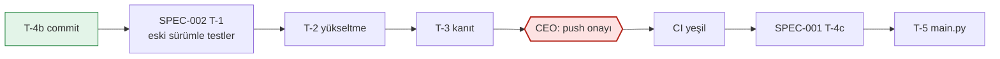

# Spec 002: Backend bağımlılık güvenlik yükseltmesi (quick)

- Status: Draft
- Version: v0.1 (2026-11-09)
- Tier: quick (öneri; CEO onaylar, bkz. Soru 6). Hassas alan içerdiği için hızlı şablona threat model ve görev listesi eklendi.
- Source: CI run `42491093608` (main, backend işi, "Dependency audit" adımı kırmızı). Ham liste: pip-audit çıktısı, 5 paket, 30 kayıt (§2.1).
- Previous spec: none. İlgili: SPEC-001 v1.6 (Approved, Faz 1 sürüyor; çakışma §8).
- Budget ceiling: **2,5 agent iş günü** (tahmin 2,1 g, §9). Tavan aşılırsa iş durur, main session'a dönülür.
- Sensitive area: Instagram oturum çerezleri (Fernet ile şifreli, kimlik bilgisi niteliğinde); tedarik zinciri (PyPI paketleri).
- Deploy target: yalnız yerel, self-hosted `docker compose` yığını (portlar 127.0.0.1). Sunucu/Plesk/Cloudflare yok.

> Dil: içerik Türkçe, teknik terimler İngilizce. Başlık alanları ve `Status:` değerleri İngilizce.

## 1. Intent

**CEO'nun isteği (main session'ın aktardığı biçimde):** main'deki CI'ın backend işi "Dependency audit" (pip-audit) adımında kırmızı; 5 pakette açık var (cryptography, python-multipart, starlette, python-dotenv, instagrapi). Her paket için hedef sürüm, uyumluluk riski, Fernet geriye uyumu (eski token'lar çözülmeli), instagrapi'nin kodda nerede kullanıldığı ve kullanılmıyorsa kaldırma seçeneği isteniyor.

**Yorumum:** İş, uygulamanın davranışını değiştirmeden bağımlılıkları açıksız sürümlere taşımak ve CI'ı yeşile döndürmek. Kullanıcının göreceği hiçbir şey değişmez. En büyük risk iki noktada: (1) Starlette'in 0.37'den 1.3'e atlaması FastAPI'yi de sürükler, istek işleme davranışı değişebilir; (2) cryptography'nin 42'den 49'a atlamasından sonra veritabanındaki eski şifreli oturumlar çözülemezse kullanıcı tüm profillerini yeniden bağlamak zorunda kalır. Bu yüzden davranışı yükseltmeden **önce** testlerle sabitliyoruz, sonra yükseltiyoruz.

## 2. Mevcut durum (kanıt)

### 2.1 Audit bulguları ve hedef sürümler

Kilit dosyası yok. Doğrudan bağımlılıklar `backend/requirements.txt` içinde `==` ile sabit; geçişli olanlar (starlette dahil) her kurulumda çözümleyiciye bırakılıyor. `backend/requirements-dev.txt` yalnız pytest, pytest-asyncio, fakeredis ekliyor ve `-r requirements.txt` içeriyor. CI `pip-audit -r backend/requirements.txt` çalıştırıyor (`.github/workflows/ci.yml:38-39`).

| Paket | Şimdi | Kayıt | Alt sınır (audit'teki en yüksek düzeltme) | Hedef | Gerekçe |
|---|---|---|---|---|---|
| cryptography | 42.0.7 (`requirements.txt:15`) | 7 | **49.0.0** (PYSEC-2026-3553, -3554) | `==` PyPI'daki en son 49.x yaması | Alt sınırın altında kalan her sürüm en az bir kaydı açık bırakır. Kullandığımız yüzey yalnız `Fernet` ve `MultiFernet` (`app/core/security.py:5`); anahtar türetme stdlib `hashlib.pbkdf2_hmac` (`security.py:15`), cryptography'den bağımsız. |
| python-multipart | 0.0.9 (`requirements.txt:18`) | 7 | **0.0.31** (PYSEC-2026-3040) | `==` en son 0.0.x (≥ 0.0.31) | Görevde "en yüksek 0.0.26" yazıyordu; ham listede 0.0.27, 0.0.30 ve 0.0.31 düzeltmeleri de var. 0.0.26'da durmak 4 kaydı açık bırakır. Tek kullanıcı ZIP/JSON yükleme ucu (`routers/imports.py:59-60`). |
| starlette | 0.37.2 (geçişli, FastAPI 0.111 üzerinden) | 7 | **1.3.1** (PYSEC-2026-249) | `requirements.txt`'e **açık pin** olarak eklenir: `==` seçilen FastAPI'nin izin verdiği, ≥ 1.3.1 olan en son sürüm | Geçişli bırakılırsa alt sınırı hiçbir şey garanti etmez; açık pin, FastAPI aralığı genişlediğinde bile tabanı korur. |
| fastapi | 0.111.0 (`requirements.txt:1`) | 0 | yok | `==` starlette ≥ 1.3.1'e izin veren en son sürüm | Kendi kaydı yok; FastAPI 0.111 starlette'i 0.37.x'e kilitlediği için zorunlu olarak yükselir. |
| python-dotenv | 1.0.1 (`requirements.txt:16`) | 1 | **1.2.2** (PYSEC-2026-2270) | `==` en son 1.x (≥ 1.2.2) | Kodda doğrudan import yok; `pydantic-settings` `.env` dosyasını bununla okur (`core/config.py:23-25`). |
| instagrapi | 2.1.2 (`requirements.txt:12`) | 1 | 2.6.9 (GHSA-ggxf-37hm-9wqf) | **Kaldırılır** (öneri, Soru 1) | Ölü kod; gerekçe §2.2. |
| pydantic | 2.7.1 | 0 | yok | Değişmez; **yalnız** çözümleyici FastAPI için daha yenisini isterse en düşük uyumlu 2.x | En az değişiklik. |
| pydantic-settings | 2.2.1 | 0 | yok | Değişmez; yalnız çözümleyici isterse yükselir | python-dotenv ≥ 1.2.2 ile uyumlu olması beklenir (Varsayım A-4). |

Kesin sürüm numaraları T-2'de çözümleyiciyle (`pip install --dry-run`) seçilir ve commit mesajına, ayrıca bu spec'in §11 "Uygulama notu"na yazılır. Bu birimin ağ erişimi yok; PyPI'daki güncel son sürümleri ben doğrulayamadım.

### 2.2 instagrapi nerede kullanılıyor?

Grep sonucu (`backend/` içinde tek kod dosyası):

- `app/services/instagram.py:7-12` → `Client` ve üç exception import ediliyor.
- `instagram.py:16` → `PLAN_B_EXCEPTIONS`: **hiçbir yerde kullanılmıyor.**
- `instagram.py:191-198` `login_by_sessionid()` ve `instagram.py:201-204` `build_client()`: `Client` kullanan iki fonksiyon, **hiçbir çağıranı yok** (repo genelinde grep).
- Router'ın kullandığı fonksiyonlar `_web_account_info()` (`routers/sessions.py:104, 200, 287`) ve `verify_client()` (`sessions.py:351`) yalnız `httpx` kullanıyor, instagrapi'ye dokunmuyor.
- Saklanan oturum biçimi kendi JSON'umuz: `{"cookies": {...}}` (`sessions.py:89, 256`); instagrapi'nin `get_settings()` biçimine bağımlı değil.
- `tasks/sync_tasks.py:30-34` yorumda "instagrapi UserInfo object" diyor ama import yok, `hasattr` ile duck typing; dokunulmaz (§10).
- Dinamik import (`importlib`, `__import__`) yok.

Sonuç: instagrapi çalışma zamanında hiçbir yolda kullanılmıyor; yalnız modül yüklenirken import ediliyor. Kaldırınca `instagram.py`'deki iki ölü fonksiyon ve `PLAN_B_EXCEPTIONS` da silinir. Uygulama davranışı değişmez. Kaldırma, temel ilkeyle de uyumlu: uygulama Instagram'ın mobil API'sine istek atan bir kütüphane taşımamalı.

## 3. Alternatifler ve seçim

### 3.1 instagrapi

| Seçenek | Artı | Eksi | Karar |
|---|---|---|---|
| **A. Kaldır** + ölü kodu sil | Açık ve saldırı yüzeyi tamamen gider; geçişli bağımlılıklar da gider (Varsayım A-3: `requests`, `PySocks`, `pycryptodomex`, sabit `pydantic` pini); FastAPI/pydantic çözümü serbestleşir | Eski "Plan A" dokümanları güncellenmeli (T-4) | **Seçilen (öneri)** |
| B. 2.6.9'a yükselt | Kod değişmez | Kullanılmayan kod için 2.1 → 2.6 atlaması; kendi pydantic pini FastAPI zinciriyle çakışabilir; ilkeye aykırı kütüphane imajda kalır | Hayır |
| C. İstisna ile 2.1.2'de bırak | Sıfır iş | Açık bilinçli olarak kalır, gerekçesi yok | Hayır |

### 3.2 FastAPI / Starlette zinciri

| Seçenek | Artı | Eksi | Karar |
|---|---|---|---|
| **A. FastAPI'yi starlette ≥ 1.3.1'e izin veren sürüme yükselt, starlette'i açık pinle** | 7 kaydın hepsi kapanır | En büyük sürüm atlaması (0.37 → 1.x); davranış değişikliği riski; T-1 karakterizasyon testleri bunu yakalar | **Seçilen** |
| B. FastAPI'nin desteklediği en yüksek starlette'te dur, kalanları istisna yap | Daha küçük atlama | Açık kayıt kalır; istisna CEO kararı ister | Yalnız A çözümlenemezse yedek (Soru 2) |
| C. FastAPI'siz starlette yamalamak (fork/vendor) | — | Bakım yükü, desteklenmez | Hayır |

### 3.3 Sürüm sabitleme yöntemi

| Seçenek | Artı | Eksi | Karar |
|---|---|---|---|
| **A. Mevcut düzen: doğrudan bağımlılıklar `==`, starlette açık pin** | En az değişiklik, iş küçük kalır | Geçişli bağımlılıklar kayabilir; CI ileride geçişli bir paket yüzünden yeniden kırmızı olabilir | **Seçilen** |
| B. Kilit dosyası (`pip-compile --generate-hashes` → `requirements.lock`) | Tekrarlanabilir kurulum, hash doğrulaması | Dockerfile, `scripts/test.sh`, CI ve geliştirici akışı değişir; ayrı iş | Sonraki iş olarak öneri (Soru 4) |

## 4. Changed behavior

- [ ] **CB-1:** `pip-audit -r backend/requirements.txt` bu spec'in commit'inde `No known vulnerabilities found` yazar ve 0 ile çıkar. Rebuild edilmiş `backend` imajında `pip check` `No broken requirements found` yazar. `requirements.txt`'teki her pin §2.1 tablosundaki alt sınıra eşit ya da daha yüksektir. **İstisna yolu:** kalan bir kayıt yalnız CEO'nun Karar Kaydı'na işlediği onayla, `ci.yml`'de `--ignore-vuln <ID>` olarak, bu spec'in §7'sinde gerekçe (erişilebilirlik analizi) ve bitiş tarihiyle (en fazla 30 gün) kalabilir.
- [ ] **CB-2:** instagrapi kaldırılmıştır. `requirements.txt`'te yoktur. Rebuild edilmiş imajda `pip show instagrapi` "not found" uyarısı verir. `grep -rn "instagrapi" backend/app` yalnız `sync_tasks.py`'deki yorum satırlarını döndürür. `instagram.py`'de `Client`, `login_by_sessionid`, `build_client` ve `PLAN_B_EXCEPTIONS` yoktur. (Soru 1'in cevabı B olursa bu kriter "instagrapi ≥ 2.6.9" olarak değişir.)
- [ ] **CB-3:** Bu spec'in commit'i main'e push edildiğinde (CEO onayıyla) CI'daki `backend`, `frontend` ve `secrets` işlerinin üçü de yeşildir.

## 5. Preserved behavior

Karakterizasyon testleri (PB-1, PB-4, PB-5, PB-6) **yükseltmeden önce**, eski sürümlerle yazılır ve yeşil koşar. Aynı testler yükseltmeden sonra **değiştirilmeden** yeniden yeşil koşar. Yükseltme sonrası bir testi değiştirmek ancak main session'a gerekçeyle bildirilerek yapılabilir.

- [ ] **PB-1: Fernet geriye uyumu.**
  - (a) cryptography **42.0.7** ile, sentetik bir anahtar ve sentetik bir düz metinle üretilmiş, teste sabit olarak gömülmüş bir token yeni sürümde `security.decrypt` ile çözülür ve aynı düz metni verir. Yol tam olarak çalışır: PBKDF2 → `MultiFernet`.
  - (b) 42.0.7 ile anahtar A'yla üretilmiş ikinci sabit token, `encryption_key=B` ve `encryption_key_old=A` ayarıyla çözülür ve `needs_rotation` `True` döner.
  - (c) Yeni sürümün ürettiği token'ın base64 çözülmüş ilk baytı `0x80`'dir (Fernet sürüm baytı). Bu, geri dönüşte eski sürümün yeni token'ları okuyabileceğinin göstergesidir.
  - (d) Yanlış anahtarla çözme `InvalidToken` verir. Bu mevcut `test_wrong_key_cannot_decrypt` testidir ve değişmeden geçer.
- [ ] **PB-2: Tam backend test takımı.** `scripts/test.sh backend` 0 failed, 0 error ile biter. Geçen test sayısı en az şu toplamdır: yükseltmeden önceki taban sayısı (T-1'in sonunda ölçülüp rapora yazılır) + T-1'de eklenen testler. Uyarı sayısı önce/sonra rapora yazılır. Yeni çıkan `DeprecationWarning`'ler listelenir; bunlar kapı değildir.
- [ ] **PB-3: Migration.** Backend imajı yeni bağımlılıklarla yeniden build edildikten sonra `scripts/migrate-check.sh` `SONUC: up/down/up TAMAM` yazar.
- [ ] **PB-4: Yükleme sözleşmesi** (`POST /api/sessions/{id}/import/zip`):
  - (a) Bir ZIP ve iki JSON dosyası tek istekte → 202, iş `done`.
  - (b) Dosyasız istek → 422.
  - (c) 51 dosya → 422.
  - (d) `MAX_UPLOAD_BYTES` testte küçültülünce sınırı aşan yükleme → 413, geçici `igimp_*` dosyaları silinmiş.
  - (e) Dosya adı `../../x.json` → işe yalnız `x.json` adıyla girer.
  - (f) Token'sız yükleme → 401.
  - Mevcut iki yükleme testi (`test_sessions_api.py:139, 166`) de değişmeden geçer.
- [ ] **PB-5: Kimlik doğrulama ve CORS (HTTP düzeyi).**
  - Token'sız ve yanlış token'lı istek en az üç farklı router'da (`/api/sessions`, `/api/actions/...`, `/api/bridge/...`) 401 alır. `api_token` boşsa 503 alır.
  - `Origin: http://localhost:3002` ile `OPTIONS` preflight isteğinin yanıtında `access-control-allow-origin: http://localhost:3002` vardır ve `X-API-Token` izinli başlıklar arasındadır.
  - `Origin: http://evil.example` ile aynı istekte `access-control-allow-origin` başlığı yoktur.
- [ ] **PB-6: `.env` okuma.** Geçici bir `.env` dosyasından (`Settings(_env_file=<tmp>)`) `encryption_key`, `api_token` ve `encryption_key_old` değerleri okunur. Dosyada tanımsız bir anahtar varsa hata vermez (`extra="ignore"`).
- [ ] **PB-7: Çalışan yığın (elle duman testi; kanıt komut çıktısı).**
  - `docker compose build backend worker flower && docker compose up -d` sonrasında `curl -s -H "X-API-Token: $API_TOKEN" http://127.0.0.1:8001/api/health` 200 döner.
  - `docker compose exec worker celery -A app.tasks.celery_app inspect ping` `pong` döner.
  - Yerel gerçek veritabanında **salt okuma** çözme denetimi (Soru 5): her `sessions.session_data` kaydı `decrypt` ile çözülür. Çıktıda yalnız `toplam=N cozulen=N cozulemeyen=0` sayıları yer alır. Hiçbir değer yazdırılmaz, hiçbir satır yazılmaz.

**Kullanıcı arayüzü durumları:** yok. Bu iş arayüze, eklentiye ve API sözleşmesine yeni davranış eklemez; ekran durumu yoktur.

## 6. Test and evidence

| Kriter | Test | Katman / Profil | Ne zaman |
|---|---|---|---|
| CB-1 | `pip-audit -r backend/requirements.txt` çıktısı; imaj içinde `pip check` | CI + T-3 komut çıktısı | T-3, CI |
| CB-2 | `grep -rn instagrapi backend/app`; imajda `pip show instagrapi`; PB-2 takımı import hatası vermez | komut çıktısı | T-3 |
| CB-3 | Commit'in CI run bağlantısı ve 3 işin sonucu | CI | T-5 |
| PB-1 a–c | Yeni `backend/tests/test_security_compat.py` (sabit token'lar dosyanın içinde; `tests/fixtures/` kullanılmaz, §8) | birim | T-1 (eski), T-3 (yeni) |
| PB-1 d | Mevcut `tests/test_security.py` | birim | T-1, T-3 |
| PB-2 | `scripts/test.sh backend` tam çıktı özeti (`N passed, M warnings`) | entegrasyon (izole `instaanalytic_pytest`) | T-1 taban, T-3 |
| PB-3 | `scripts/migrate-check.sh` çıktısı | geçici `instaanalytic_migcheck` DB | T-3 |
| PB-4 | Yeni `backend/tests/test_upload_contract.py` | API (httpx ASGITransport) | T-1, T-3 |
| PB-5 | Yeni `backend/tests/test_http_contract.py` | API | T-1, T-3 |
| PB-6 | Yeni `backend/tests/test_settings_env.py` | birim | T-1, T-3 |
| PB-7 | Komut çıktıları (sayılar dahil) | elle duman testi, yerel yığın | T-3 |

Sabit token'ların üretim kanıtı: T-1'de çalıştırılan komut ve onun `cryptography.__version__ == "42.0.7"` çıktısı commit mesajına ve rapora yazılır. Anahtar ve düz metin sentetiktir (ör. `"golden-key-A"`, `'{"cookies": {"sessionid": "synthetic"}}'`); gerçek veri kullanılmaz. Gitleaks bunları sır olarak işaretlerse dosyaya `# gitleaks:allow` yorumu eklenir. Bu kod tarafı bir tercihtir; `.gitleaks*` yapılandırması değiştirilmez.

## 7. Uyumluluk riskleri

| # | Risk | Olasılık | Etki | Önlem |
|---|---|---|---|---|
| R-1 | Starlette 1.x, 0.x'te kullanımdan kalkmış API'leri kaldırmış olabilir | Orta | Uygulama açılmaz ya da bir uç bozulur | Kodda bu yüzeyler yok: `on_event`, `on_startup`, `lifespan`, `BaseHTTPMiddleware`, `TemplateResponse`, `StaticFiles`, doğrudan `from starlette` (grep, `backend/app`). Kullanılan yüzey `FastAPI`, `APIRouter`, `Depends`, `Header`, `Query`, `File`, `UploadFile`, `HTTPException`, `Response`, `StreamingResponse`, `CORSMiddleware`. PB-2, PB-4, PB-5 bunları yakalar. |
| R-2 | Yeni FastAPI'de JSON gövdeli isteklerde Content-Type denetimi sıkılaşmış olabilir (Varsayım A-5) | Düşük | Arayüz/eklenti istekleri 415/422 alır | İstemciler zaten `application/json` gönderiyor (`frontend/src/api/client.ts:5`, `frontend/extension/background.js:147`); testler `json=` kullanıyor. PB-2 kapsar. |
| R-3 | Starlette/python-multipart yeni sürümlerinde parça başına boyut ve sayı sınırları (`max_files`, `max_fields`, `max_part_size`) | Düşük | Büyük yükleme reddedilir | Bizim sınırımız 50 dosya (`imports.py:28`), dosya parçaları diske akıtılır. PB-4 a, c, d kapsar. 4 GB'a yakın tam ZIP elle denenmez (§10). |
| R-4 | python-multipart 0.0.13+ paketin import adını `python_multipart` yaptı, eski `multipart` adı uyarıyla çalışıyor | Orta | Uyarı gürültüsü; eski FastAPI'yle birlikte kurulursa uyumsuzluk | FastAPI ile birlikte yükseltilir; PB-2 uyarı listesi. |
| R-5 | pydantic zorunlu yükselirse doğrulama hata metinleri ya da serileştirme değişebilir | Düşük–Orta | API yanıt biçimi değişir | Yalnız çözümleyici isterse yükselir; PB-2. Değişirse pydantic sürümü rapora yazılır, SPEC-001 T-5'e bildirilir. |
| R-6 | cryptography 49'da Fernet token biçimi ya da API'si değişmiş olabilir | Çok düşük (Fernet biçimi sürüm baytıyla sabit bir spesifikasyon) | Eski oturumlar çözülemez, tüm profiller yeniden bağlanır | PB-1 a–c (eski sürümle üretilmiş sabit token), PB-7 (gerçek veride salt okuma denetimi). Veri yeniden şifrelenmez; geri dönüş güvenli. |
| R-7 | cryptography 49 Python 3.12 / Debian slim / arm64 (yerel Mac) için hazır wheel sunmuyor olabilir | Düşük | Derleme için Rust gerekir, build kırılır | T-3'te `docker compose build` çıktısı; kırılırsa durur, bildirir. |
| R-8 | Geçişli bağımlılıklar kilitsiz; yeni bir açık CI'ı tekrar kırmızıya çevirebilir | Orta (zamanla) | CI yeniden kırmızı | §3.3, Soru 4 |
| R-9 | Hiçbir FastAPI sürümü starlette ≥ 1.3.1'e izin vermiyor olabilir | Bilinmiyor | CB-1 karşılanamaz | T-2 durur ve main session'a döner. Yedek yol Soru 2'de. |

## 8. SPEC-001 ile çakışma ve sıralama

**Durum (git, 2026-11-09):** SPEC-001'den T-2b, T-2, T-7a, T-4a ve T-7b commit edildi. T-4b çalışma ağacında yarım duruyor: commit'lenmemiş `backend/app/services/cleanup_batch.py`, `backend/tests/test_cleanup_state.py` ve `backend/tests/fixtures/`. Sırada T-4c, T-5, T-6 var. Hepsi tek branch'te (`main`), tek çalışma ağacında yürüyor.

**Dosya çakışması:**

| SPEC-002 dosyası | SPEC-001'de aynı dosya | Değerlendirme |
|---|---|---|
| `backend/requirements.txt` | Yok (T-pre yalnız `requirements-dev.txt`'e dokundu, yapıldı) | Çakışma yok |
| `backend/app/services/instagram.py` | Yok | Çakışma yok |
| Yeni test dosyaları (4 adet, §6) | T-6'nın listesinde yok | Çakışma yok |
| `backend/tests/fixtures/` | T-4b (commit'lenmemiş) | SPEC-002 bu dizine **dokunmaz** |
| `backend/app/main.py` | **T-5** (hata zarfı işleyicisi) | SPEC-002 `main.py`'ye dokunmaz. Yükseltme `main.py`'de değişiklik gerektirirse T-2 durur, delivery-manager'a bildirir. |
| `.github/workflows/ci.yml` | Yok | Yalnız istisna yolunda değişir (CB-1) |

**Davranış çakışması (dosya çakışmasından daha önemli):** T-5 router, şemalar, hata zarfı ve 415 davranışını yazacak; T-6 da bunların testlerini. İkisi doğrudan FastAPI/Starlette/pydantic davranışına bağlı. SPEC-002 T-5'ten sonra gelirse T-5/T-6'nın doğrulaması yeni sürümlerle tekrarlanmak zorunda kalır. Ayrıca CI kırmızı kaldıkça SPEC-001 görevleri "CI yeşil" kanıtını üretemez.

**Sıralama önerisi (Soru 3):** SPEC-002, T-4b'nin commit'inden **hemen sonra**, T-4c başlamadan uygulanır. Paralel çalışma önerilmez: tek çalışma ağacında yarım kalmış bir T-4b ya da T-4c testi, SPEC-002'nin "tam takım yeşil" kanıtını (PB-2) bozar; ayrıca yanlış dosyaların commit'e girme riski doğar. Uygulayıcı yalnız kendi dosyalarını tek tek `git add` eder (`git add -A` yok).

### Hangi sırayla ilerliyoruz?

Açıklama: SPEC-002, SPEC-001'in T-4b ile T-4c arasına girer; tek CEO kapısı push onayıdır (altıgen şekil, kırmızı). Metin karşılığı:

| Sıra | Adım | Sahibi | Kapı |
|---|---|---|---|
| 1 | SPEC-001 T-4b commit | polyglot-engineer | yok |
| 2 | SPEC-002 T-1: karakterizasyon testleri ve eski sürümle sabit token | polyglot-engineer | SPEC-002 imzası |
| 3 | T-2: bağımlılık yükseltmesi, instagrapi kaldırma | polyglot-engineer | T-1 yeşil |
| 4 | T-3: rebuild, testler, migrate-check, audit, duman testi | polyglot-engineer | — |
| 5 | Push | CEO | **CEO onayı** |
| 6 | CI yeşil (CB-3) | — | — |
| 7 | SPEC-001 T-4c, sonra T-5 | polyglot-engineer | — |

Takvim etkisi: SPEC-001'in bitişi yaklaşık 2 iş günü kayar. SPEC-001'in bütçesinden harcanmaz; SPEC-002'nin kendi tavanı var.

## 9. Görev listesi ve tahmin

| ID | Görev | Kriter | Sahibi | Bağımlılık | Dosyalar | Tahmin |
|---|---|---|---|---|---|---|
| T-1 | **Eski sürümlerle:** taban test sayısını ölç; PB-1, PB-4, PB-5, PB-6 testlerini yaz; sabit token'ları 42.0.7 ile üret; testler yeşil | PB-1, PB-2 (taban), PB-4..PB-6 | polyglot-engineer | İmza, SPEC-001 T-4b commit | `backend/tests/test_security_compat.py`, `test_upload_contract.py`, `test_http_contract.py`, `test_settings_env.py` (hepsi yeni) | 0,5 g |
| T-2 | `requirements.txt` pinleri (§2.1; starlette açık pin), instagrapi satırı ve `instagram.py`'deki ölü kod (`Client` importu, exception importları, `PLAN_B_EXCEPTIONS`, `login_by_sessionid`, `build_client`); uyumluluk kırığı varsa düzeltme (`main.py` hariç, §8) | CB-1, CB-2 | polyglot-engineer | T-1 | `backend/requirements.txt`, `backend/app/services/instagram.py`, gerekirse kırılan uygulama dosyası (rapora yazılır) | 0,5 g |
| T-3 | `docker compose build backend worker flower`; `scripts/test.sh backend`; `scripts/migrate-check.sh`; imaj içinde `pip check`, `pip show instagrapi`, `pip-audit`; PB-7 duman testi ve salt okuma çözme denetimi (Soru 5); uyarı karşılaştırması; rapor | CB-1, CB-2, PB-1..PB-7 | polyglot-engineer | T-2 | — | 0,25 g |
| T-4 | instagrapi / "Plan A" anlatımını güncelle: `README.md:91,154,244`, `CONTRIBUTING.md:38`, `docs/02-tech-stack.md:17-18,30`, `docs/06-instagram-api-strategy.md` (tarihsel not: "Plan A, SPEC-002 ile kaldırıldı"), `docs/00-index.md:19,37`, `docs/03-architecture.md:50,75,124-127`, `TOPOLOGY.md:69,125` (yalnız bu satırlar; D-05 ayrı); değişen `docs/` dosyaları için `bs_sync_ia.py`; Karar Kaydı'na Soru 1–5 kararları | — | tech-comms | T-2 (Soru 1 = A ise) | listelenen dosyalar | 0,25 g |
| T-5 | Push (CEO onayı) ve CI run kanıtı | CB-3 | main session + CEO | T-3, T-4 | — | 0,1 g |
| T-6 | Teslim zinciri: qa-engineer → appsec → internal-auditor (yapan denetlemez) | hepsi | ilgili birimler | T-5 | — | 0,5 g |

**Tahmin:** 2,1 agent iş günü. **Tavan:** 2,5 g (yaklaşık %20 tampon). Kota payı: abonelik kotasının en fazla %5'i (öneri).

Graph notu: projede `graphify-out/` yok; etki analizi Grep ile yapıldı. `instagram.py`'nin tek tüketicisi `routers/sessions.py` (import satırı `sessions.py:23`) ve test `test_sessions_api.py:96` (`_web_account_info` monkeypatch). Bu tüketicilerin kullandığı fonksiyonlar değişmiyor.

## 10. Out of scope

- Kilit dosyası ve hash ile sabitleme (§3.3; Soru 4 ile ayrı iş olabilir).
- `requirements-dev.txt`'teki sabitlenmemiş test bağımlılıklarının audit'i (CI yalnız `requirements.txt`'i denetliyor).
- `Pillow>=10.0.0` (sabitlenmemiş; `backend/app` içinde `PIL` importu bulunamadı; muhtemelen eskiden instagrapi içindi) ve `playwright==1.44.0`'ün gözden geçirilmesi. Audit temiz olduğu için dokunulmaz.
- `sync_tasks.py:30-50`'deki ulaşılamayan "instagrapi object" dalı ve `plan_b_active` alanı ile `toggle-plan-b` ucu. Davranış değişmesin diye olduğu gibi kalır.
- Frontend `npm audit` ve eklenti.
- 4 GB'a yakın gerçek ZIP yükleme denemesi (PB-4 d küçültülmüş sınırla aynı yolu sınar).
- **Gözlem, bu işin kapsamı dışında (CEO'ya bilgi):** `instagram.py:_web_account_info` (`/api/sessions/preview`, `scan-browser`, `POST /api/sessions`, `verify` uçlarından çağrılıyor) ve `playwright_instagram.py` sunucu tarafında doğrudan Instagram'a istek atıyor. Bu, "uygulama Instagram'a kendisi istek göndermez" ilkesiyle çelişiyor ve 2026-11-08 değerlendirmesindeki D-01'de (yalnız eklenti) yer almıyor. Ayrı bir bulgu olarak kaydedilmesi önerilir.

## 11. Deploy ve geri dönüş

- **Deploy:** yerel yığın. `docker compose build backend worker flower && docker compose up -d`. Veritabanı migration'ı yok. Veri yeniden şifrelenmez.
- **Geri dönüş:** `git revert <commit>` (push ayrıca CEO onayı ister) → aynı build/up komutu. Yeni sürümün yazdığı Fernet token'ları eski sürümce okunur (PB-1 c). instagrapi geri gelir ama hiçbir yol onu çağırmadığı için davranış değişmez.
- **Uygulama notu (T-2/T-3 doldurur):** seçilen kesin sürümler, CI run bağlantısı, taban/son test sayıları.

## 12. Threat model (kısa)

**Güven sınırları:**
1. PyPI → imaj build (tedarik zinciri).
2. Tarayıcı ya da eklenti → API (127.0.0.1:8001, `X-API-Token`).
3. Veritabanı → Fernet ile şifreli oturum çerezleri (bekleyen veri).

**Kötüye kullanım ve erişilebilirlik:**
- **Multipart ayrıştırıcı açıkları (python-multipart, Starlette): erişilebilir, öncelikli.** `multipart/form-data` CORS'ta "basit istek" sayılır; kullanıcının ziyaret ettiği herhangi bir web sayfası, preflight olmadan `127.0.0.1:8001/api/.../import/zip`'e form POST edebilir. FastAPI gövdeyi bağımlılıklardan önce ayrıştırır; dolayısıyla token denetimi (401) ayrıştırıcıyı korumaz. Bu, FastAPI'nin bilinen işleyiş sırasıdır; appsec kapısı doğrulasın. Sonuç: yerel servisi hedefleyen, siteden tetiklenen bir DoS. Bu iş bunu kapatır. Kalıcı bir sertleştirme (ör. `Content-Type` ya da `Origin` denetimini ayrıştırmadan önce yapan bir middleware) ayrı bir iştir; appsec'in değerlendirmesine bırakılır.
- **cryptography:** Kullandığımız yol Fernet (AES-128-CBC + HMAC-SHA256). Kayıtların ayrıntısını (hangi alt bileşen, ör. X.509 ya da gömülü OpenSSL) bu birim ağsız göremedi. Erişilebilirlik bilinmiyor; yine de yükseltilir. Asıl risk açık değil, uyumluluk: eski oturumların çözülememesi (R-6).
- **python-dotenv:** Yalnız başlangıçta yerel `.env` okunurken çalışır. Saldırganın `.env`'yi yazabilmesi gerekir; düşük.
- **instagrapi:** Çağrılmıyor; imajda ölü kod. Kaldırma saldırı yüzeyini ve ilke riskini sıfırlar.
- **Tedarik zinciri:** Yeni sürümler PyPI'dan `==` pinle gelir, hash yok (R-8). Paketlerin hepsi bilinen, bakımı süren projeler. Paket adı yazımı T-2'de commit diff'inde gözden geçirilir; yazım hatasıyla sahte paket (typosquat) kurulmamalı.

**Hassas veri:** Oturum çerezleri. Testlerde yalnız sentetik değerler kullanılır. PB-7'deki gerçek veri denetimi salt okumadır ve yalnız sayı yazdırır. Loglara ve rapora çerez ya da düz metin girmez.

## 13. Open questions (CEO'ya, main session üzerinden)

1. **instagrapi kaldırılsın mı, yükseltilsin mi?** Öneri: **kaldır.** Kodda hiçbir çalışan yol kullanmıyor (§2.2), ilkeyle çelişiyor, kaldırınca pydantic zinciri de serbestleşiyor. Yükseltme kullanılmayan kod için risk alır.
2. **Hiçbir FastAPI sürümü starlette ≥ 1.3.1'e izin vermezse ne yapalım?** Öneri: T-2 durur. Kalan starlette kayıtları için appsec bir erişilebilirlik analizi yapar. CEO her kayıt ID'si için ayrı onay verirse 30 gün süreli `--ignore-vuln` istisnası konur; süre dolunca yeniden bakılır. Toptan istisna olmaz. Gerekçe: multipart kayıtları dışarıdan erişilebilir (§12); onları sessizce bırakmamalıyız.
3. **Sıralama:** SPEC-002, T-4b'nin commit'inden hemen sonra ve T-4c'den önce mi uygulansın? Öneri: **evet.** T-5'in FastAPI davranışı yeni sürüm üzerine yazılsın; CI kırmızıyken SPEC-001 kanıt üretemiyor. Maliyeti SPEC-001 takviminde yaklaşık 2 gün kayma.
4. **Kilit dosyası (hash'li) şimdi mi, ayrı işte mi?** Öneri: **ayrı küçük iş** (SPEC-003 adayı). Bu işi küçük tutar; kilit dosyası Dockerfile, test betiği ve CI akışını değiştirir.
5. **PB-7'de yerel gerçek veritabanında salt okuma çözme denetimine izin var mı?** Öneri: **evet.** Asıl risk, gerçek oturumların yükseltmeden sonra çözülememesi; sabit token testi biçimi kanıtlar, bu denetim gerçek veriyi kanıtlar. Yalnız sayı yazdırır, yazma yapmaz.
6. **Kademe:** Bu iş hızlı spec mi kalsın? Öneri: **evet, hızlı + threat model.** Tek yetenek, kullanıcıya görünen değişiklik yok, yeni dış bağımlılık yok (biri kalkıyor), 10 kriter. Hassas alan (şifreli oturum) PB-1 ve PB-7 ile kapsanıyor.

## 14. Assumptions

- **A-1:** instagrapi'nin tek kullanımı `instagram.py` (Grep: `backend/` ve repo geneli, 2026-11-09). Dinamik import yok.
- **A-2:** cryptography 49'da `Fernet` / `MultiFernet` API'si ve token biçimi (sürüm baytı `0x80`) değişmedi. PB-1 doğrular.
- **A-3:** instagrapi 2.1.2 `requests`, `PySocks`, `pycryptodomex` ve sabit bir `pydantic` sürümü çekiyor. `backend/app`'te `requests`, `Crypto`, `socks` importu yok (Grep). T-3'teki `pip check` ve tam test takımı doğrular.
- **A-4:** pydantic-settings 2.2.1, python-dotenv ≥ 1.2.2 ile çalışır. Çalışmazsa çözümleyici gösterir, en düşük uyumlu sürüme yükseltilir.
- **A-5:** Yeni FastAPI sürümleri JSON Content-Type denetimini sıkılaştırmış olabilir. Bu doğrulanmadı; istemciler zaten doğru başlığı gönderdiği için risk düşük (R-2).
- **A-6:** Audit kayıtlarının içerikleri (hangi fonksiyon etkileniyor) bu birimce görülmedi. Hedefler yalnız düzeltme sürümlerine göre seçildi.
- **A-7:** CI'daki "Tests" adımı şu an yeşil, kırmızı olan yalnız "Dependency audit" (görev bağlamı). T-1'deki taban ölçümü bunu yerelde doğrular.

## 15. Öz eleştiri (rakip gözüyle)

- "Hedef = en son yama" ifadesi tekrarlanabilir değil. Bu yüzden kesin sürümler T-2'de seçilip §11'e ve commit'e yazılıyor; imza kapsamı alt sınırlar ve kurallardır.
- Karakterizasyon testleri yükseltmeden sonra "uyarlanırsa" kanıt değeri kaybolur. §5'teki kural gereği yalnız gerekçeyle ve main session'a bildirilerek değiştirilebilirler.
- PB-2'deki "en az taban sayısı" ölçütü, bir testin sessizce atlanmasını (`skip`) yakalamayabilir. Bu yüzden T-3 raporunda `skipped` sayısı da önce ve sonra olarak yazılır.
- Starlette 1.x'in kırıcı değişikliklerinin listesini bu birim ağsız göremedi. Koruma, kullanılan yüzeyin dar olması (R-1) ve testlerdir; sürüm notlarını T-2'de uygulayıcı okur ve rapora özet yazar.
