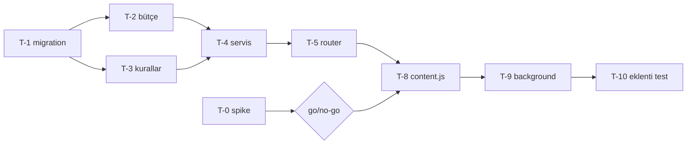

Capacity report: SPEC-001 Kaydedilenleri temizleme ve DM silme | Date: 2026-11-08 | Data: n=0 scorecard (docs/scorecards/ yok; Glob sonucu boş)

Not: Bu belge öneri niteliğindedir; birim, rol, araç veya playbook eklemez/değiştirmez. Karar CEO'nundur. Spec'e dokunulmadı.

## Kapasite görüşü

**OPTIMISTIC ESTIMATE (iyimser tahmin), ama "tahmin var ve gerekçeli" olduğu için MISSING değil.** Nedenler:

1. **Tahmin kendi görev listesiyle tutmuyor.** §12 görev satırlarının toplamı: 1 + 0,5 + 0,5 + 0,5 + 2 + 1 + 1 + 0,5 + 1,5 + 1,5 + 1 + 2,5 + 1 + 0,5 = **15,0 g** (T-0..T-13). Spec başlığı ve §12 sonu "13,5 g" diyor; tavan 15 g. Yani satır toplamı tavanın tam %100'ü, sıfır pay. 13,5 rakamı ya toplam hatası ya da yazılmamış bir indirim; kaynak: spec §12 tablosu, kendi hesabım.
2. **Geçmiş veri yok, oran hesaplanamaz.** Benzer işlerin gerçekleşen/tahmin oranı için scorecard bulunamadı: "insufficient data (n=0)". Skill kuralı (tahmin < 1,5 x gerçekleşen = iyimser) uygulanamıyor. İyimser kararı veriye değil yapısal gözleme dayanır (aşağıda) ve bir "trend" iddiası değildir.
3. **Teslim zinciri tahmine girmiyor.** §12 sonu: "Teslim zinciri sonra: qa-engineer, appsec, internal-auditor, quality-office". Bu dört birimin iş günü tahmini yok; 13,5 g (ya da 15 g) yalnız yapım. Tavan (15 g) bunları kapsıyorsa yeterli pay yok; kapsamıyorsa tavan tanımı belirsiz. CEO'ya netleştirme sorusu olarak iletilir.
4. **Düzeltme turu payı yok.** Geri alınamaz silme ve hesap oturumu içeren, appsec + internal-auditor zincirinden geçecek bir iş için fix round payı sıfır. Scorecard olmadığı için gerçek oran bilinmiyor; payın sıfır olması yapısal bir risk.

Önerilen düzeltme (karar CEO'nun): ya tahmini 15 g'ye çekmek ve tavanı en az 18-19 g'ye (yaklaşık %20-25 pay, bu yüzde benim varsayımımdır, veri değil) çıkarmak, ya da kapsamı Faz 1 ile sınırlayıp Faz 2'yi T-0 sonrası yeniden tahminlemek.

## Faz dağılımı kontrolü

Spec: Faz 1 ≈ 8 g, Faz 2 ≈ 5,5 g. Satırlardan yeniden hesap (kaydedilen/DM ayrımı satırlarda yapılmadığı için tahminidir):
- Faz 1 kesin: T-1 0,5 + T-2 0,5 + T-3 hariç (T-3 yalnız DM kuralı, Faz 2) ... T-3 (0,5) Faz 2'ye ait görünüyor ama §12 başlığı Faz 1'e "T-1..T-7" koyuyor. Çelişki: T-3 (DM koruma kuralları) T-1..T-7 aralığında olduğu için Faz 1'e sayılmış, oysa Faz 1 DM içermiyor. Ya T-3 Faz 2'ye kaymalı ya da Faz 1 "ortak altyapı" olarak T-3'ü bilerek içeriyor; spec netleştirmeli.
- T-4 (2 g), T-5, T-6, T-8, T-9, T-11 satırları iki türü birlikte kapsıyor; "kaydedilenler kısmı" payı satırda yok. Faz 1 = 8 g ve Faz 2 = 5,5 g bölünmesi doğrulanamaz: "insufficient data" (satır içi kırılım yok).
- Faz 2'nin T-0 go sonucuna bağlı olması doğru; ama T-8/T-9 aynı dosyaları (content.js, background.js) iki fazda yeniden açacak. Bu, faz başına tekrar bağlam yükleme ve regresyon testi maliyeti getirir; tahmine yansımamış.

## Görev listesi ve bağımlılık değerlendirmesi

Açıklama: kritik yol ve T-0 kapısı. Metin eşdeğeri: T-1 → T-2/T-3 → T-4 → T-5 → T-8 (T-0 go de gerekli) → T-9 → T-10 → T-13. T-11/T-12 (arayüz) T-5'ten sonra paralel yürüyebilir.

Kritik yol (T-1, T-2/T-3 en uzun, T-4, T-5, T-8, T-9, T-10, T-13): 0,5 + 0,5 + 2 + 1 + 1,5 + 1,5 + 1 + 0,5 = **8,5 g** (T-3 ile T-2 paralel varsayımıyla). Toplam iş 15 g; paralellik ancak backend (polyglot) ile eklenti/arayüz (react) arasında mümkün. Aynı zamanda her iki mühendis birimi aynı oturum kotasından çalışıyorsa paralellik takvim süresini kısaltır, **kota/token maliyetini kısaltmaz**.

Gözlemler:
- **T-0 yanlış başlangıç bağımlılığı taşıyor.** T-1..T-7 bağımlılığı "imza"; T-8 ise "T-0 (go), T-5". Backend (T-1..T-6) T-0'dan önce kodlanıyor, oysa §6.5 "Spike'tan önce kod yazılmaz" diyor ve alan şemaları (Dm, Saved), `participants` biçimi, `friendship_status` varlığı R3/R4 kuralları (T-3) ve şema (T-1) T-0 sonucuna bağlı. Bu iki ifade çelişir. Risk: T-0 "no-go" ya da şekil farkı çıkarsa T-1..T-6'daki DM kısmı (tahminen 3-4 g) boşa gider. Öneri: DM'e özgü backend görevlerini (T-3, T-4'ün DM kısmı, dm_targets, dm_whitelist) T-0 go sonrasına bağlamak ya da T-0'ı imzadan hemen sonra, T-1'den önce koşturmak.
- **T-0 sahibi sorunu.** "polyglot-engineer (CEO tarayıcıda yürütür)": birimin elinde Instagram oturumu/tarayıcı yok; CEO'nun gerçek zamanı, iki test hesabı ve elle işlem gerekir. Bu agent iş günü olarak 1 g yazılmış ama CEO beklemesi takvimde engeldir (bottleneck adayı, veri yok). İki test hesabı hazır mı: spec Soru 1 hâlâ açık.
- **T-0 süresi 1 g iyimser olabilir.** 9 uç nokta satırı, E2EE görünürlüğü, "yalnız kendi tarafında" doğrulaması (ikinci hesap), DOM yedek ihtimali var; DM listeleme "yüksek risk" olarak spec'te işaretli. REST başarısız olup DOM yedeğine düşülürse T-8 ve T-9 tahminleri geçersiz (DOM modu şu an kapsamda yok, §6.6 "DOM yedeği spike'a bağlı"). Bu durumda ek iş "insufficient data" ile tahminlenemez; yeniden tahmin tetikleyicisi olarak spec'e yazılmalı.
- **T-8 / T-9 / T-10 tek sahipte, sıralı, dosya başına tek yazar.** Doğru ayrım (çakışma yok), ama react-engineer yükü: T-8 1,5 + T-9 1,5 + T-10 1 + T-11 2,5 + T-12 1 = **7,5 g** (toplamın %50'si, tek birim). polyglot-engineer: T-0 1 + T-1 0,5 + T-2 0,5 + T-3 0,5 + T-4 2 + T-5 1 + T-6 1 + T-7 (kısmen) 0,5 = **7,0 g**. tech-comms + qa-engineer: 0,5 g.
- **T-13 kalem 0,5 g fazla küçük:** dört doküman dosyası, kılavuz içeriği ve iki test hesabıyla elle duman testi (gerçek Instagram'a karşı, CEO'nun hesap/oturum süresi gerekir) tek satırda; tech-comms ve qa-engineer ayrı birimler. Tahmin yetersiz görünüyor; veri yok, yapısal gözlem.
- **T-7 iki birime bölünmüş (polyglot sonra react)** ama tek 0,5 g satırı; sıralama bağımlılığı satırda yok ("T-1"), sayfa kısmı T-7'de T-11'in `ActionLogPage.tsx` değişikliği ile çakışmıyor mu: dosya listesi çakışmıyor, kabul.
- **T-4 (2 g) en riskli tek görev:** AC-C2..C9, C12..C15, C17, C19, S5, D7, D9, D13, D14 (yaklaşık 20 kriter), plan_hash, bilet, bütçe, saklama, parti kısmi benzersiz indeks, tembel temizlik. Tek dosya `services/cleanup.py`. 2 g bu kapsam için iyimser olabilir. Veri yok; yapısal gözlem.

## Riskli bölümler (kapasite açısından)

| # | Bölüm | Risk | Etki | Kanıt/kaynak |
|---|---|---|---|---|
| 1 | T-0 spike ve §6.5 uç noktaları | Hiçbiri doğrulanmamış; DM "yüksek risk"; no-go olasılığı | Faz 2 (5,5 g) ya da bir kısmı boşa/ertelenir; DOM yedeği tahminsiz | spec §6.5, §12 |
| 2 | T-4 servis | ~20 kriter tek görevde, 2 g | Düzeltme turu en olası yer | spec §12 |
| 3 | T-11 arayüz (2,5 g) | 11 U-kriteri, 13 durum, iki sekme, diyaloglar, whitelist paneli, i18n, Ayarlar, nav; ~12 dosya | 2,5 g iyimser; testler ayrıca T-12 | spec §4, §12 |
| 4 | Tek mühendis birimi yükü | react-engineer 7,5 g, eklenti düz JS + TS + React'i birlikte kapsıyor | Darboğaz adayı; veri yok | spec §12 |
| 5 | Yıkıcı iş için doğrulama zinciri | appsec + internal-auditor + quality-office tahminsiz | Tavan aşımı | spec §12 son satır |
| 6 | Gerçek Instagram'a karşı elle duman testi | CEO zamanı ve iki test hesabı gerekir; otomatikleştirilemez | Takvimde engel | spec §9, T-13 |

## Gerekli uzmanlık envanteri

Birim listesi `.claude/agents/` altında bulunamadı (Glob ~/.claude/agents boş döndü; proje içi `.claude/agents` ayrıca doğrulanmadı). Aşağıdaki eşleme spec'in kendi sahiplik tablosuna (§12) ve CEO yönlendirme kuralına dayanır; birim varlığı "not verified".

| Alan | Kapsayan birim/playbook | Durum |
|---|---|---|
| Python/FastAPI/SQLAlchemy/Alembic (backend) | polyglot-engineer (spec §12 atamış; yönlendirme kuralında polyglot = .NET/React dışı stack) | present (not verified: birim dosyası görülmedi) |
| React + TS arayüz, i18n, vitest | react-engineer | present |
| Chrome eklentisi (MV3, content script, service worker, düz JS) | react-engineer (atanmış); eklenti özel playbook'u bilinmiyor | partial |
| Instagram web iç API / DM protokolü (REST vs gerçek zamanlı) tersine mühendislik | atanmış birim yok; T-0'ı polyglot-engineer yapacak, CEO tarayıcıda yürütecek | **missing** |
| Hesap güvenliği / anti-abuse eşik bilgisi (action block davranışı) | yok; bütçe sayıları "tahmin" (§6.4) | **missing** |
| Tehdit modeli, gizlilik (KVKK/GDPR) | appsec, quality-office | present |
| Hukuk (Instagram ToS, mağaza politikası) | yok; spec "hukuki görüş değil" diyor | **missing** (yalnız dağıtım olursa) |
| Test altyapısı (pytest+Postgres, vitest) | qa-engineer | partial (ortam sorunları aşağıda) |
| Yıkıcı işlerde kanıt: gerçek hesapla elle test | qa-engineer + CEO | partial |
| Dağıtım (Docker Compose yerel) | devops-sre | present (basit kapsam) |

Eksik uzmanlık için yönlendirme önerisi (karar CEO'nun):
- **Instagram web DM/saved iç API bilgisi:** Scout'a ("hazır doğrulanmış uç nokta dokümantasyonu veya açık kaynak referans var mı") ve Architecture Board'a (T-0 yöntemi, DOM yedeği kararı) bir araştırma sorusu. Maliyet: yaklaşık 1 Scout çalıştırması (token maliyeti ölçülmemiş, "not verified").
- **Eşik/anti-abuse:** doğrulanabilir veri kaynağı yok; bütçe sayıları (§6.4) kabul edilen risk olarak CEO'ya (Soru 4) kalır. Ek uzman birim önerisi **yapmıyorum**: tek bir sayı seti için kalıcı rol gerekçesi yok.
- **Hukuk:** yalnız Soru 1 "dağıtım" sonucuna bağlı; yerel kullanımda gerekmez.

## Ortam notu: kanıt üretim maliyetine etkisi

Bildirilen durum (kaynak: görev açıklaması, CEO/çağıran; yerinde doğrulanmadı): (a) yerel makinede Node 25 vitest'i kırıyor, (b) testler yavaş makinede zaman aşımına düşüyor, (c) backend imajında pytest yok.

Spec'in kanıt kuralı §9: "bitti demek için pytest ve vitest çıktısı taze gösterilir". Spec'te tanımlı test sayısı: backend ~25 test fonksiyonu + eklenti ~15 + arayüz ~12 satır/durum (Tablodan sayım: backend `test_cleanup.py` + `test_cleanup_rules.py` + `test_risk_profiles.py` + `test_privacy_insights.py` satırları, kaba sayım, kesin değil).

| Sorun | Etkilenen kanıt | Maliyet etkisi (tahmin, veri yok) | Risk |
|---|---|---|---|
| Node 25 vitest'i kırıyor | Eklenti (T-10) ve arayüz (T-12) testleri; AC-C14, C16, C18, D1, D8 gibi **güvenlik açısından kritik** kriterlerin tamamı eklenti testiyle bağlı | Bu testler çalışmazsa 17+ kriter kanıtsız kalır, "bitti" denemez. Çözüm (ör. Node 20/22'ye sabitleme, `.nvmrc`/Docker'da vitest) bir kerelik ortam işi; süre ölçülmedi: "insufficient data" | Kırık ortamda yazılan yıkıcı iş testleri çalıştırılamadan teslim edilir; en tehlikeli kapsam (DM fail-closed) kanıtsız kalır |
| Yavaş makinede zaman aşımı | Postgres'li entegrasyon testleri, vitest component testleri | Zaman aşımı yeniden çalıştırma turu doğurur; her tam koşu uzar. Tekrar sayısı bilinmiyor. Yeşil sonuç "flaky" mi "gerçek" mi ayırmak ek inceleme | Zaman aşımı ile gerçek hata karışır; fix round sayısı şişer ve düzeltme turu payı (yukarıda sıfır) daha da yetersiz kalır |
| Backend imajında pytest yok | T-6 ve §9'daki ~25 backend kriteri; spec §10 komutları `docker compose exec backend ...` varsayıyor | Test için ya imaja dev bağımlılığı eklemek (imaj/Dockerfile değişikliği: bu yeni bir iş kalemi, spec'te yok) ya da ayrı test kapsayıcısı/yerel venv gerekir. Süre: 0,25-0,5 g tahminim, veri yok | Her koşuda kurulum tekrarı; `conftest.py`'ın Postgres'e erişimi doğrulanmadı |

Sonuç: Üç sorun tahmine **hiç yansımamış**. Ortam hazırlığı (Node sürümü sabitleme, pytest'li test imajı/komutu, zaman aşımı sınırlarının ayarlanması) için §12'de görev yok; devops-sre ile T-0 öncesi bir "T-pre ortam" görevi önerilir. Tahmini 0,5-1 g (kaynak: benim tahminim, ölçüm yok), tahmin toplamına eklenmeli. Bu yapılmadan "taze build/test çıktısı" şartı (yıkıcı iş için zorunlu kanıt) yerine getirilemez; bu CEO'nun belirtmesi gereken bir engel olabilir.

## Bottlenecks and trends

Insufficient data (n=0 scorecard). Trend iddiası yok. Yapısal darboğaz adayları (veriyle doğrulanmamış, tek vaka gözlemi):
1. T-0 ve T-13: CEO'nun fiziksel katılımı (tarayıcı, test hesapları).
2. react-engineer: toplam yükün yarısı (7,5 g / 15 g).
3. Test ortamı (yukarıdaki üç sorun).

## Playbook update proposals

Insufficient data (n=0). Öneri yok.

## Tool inventory

Insufficient data / not verified: araç kullanım verisi ve kota payı mevcut değil; kaldırılabilir araç önerisi yok.

## Recommendations (ordered, at most 5)

1. **Tahmini ve tavanı yeniden hizala: §12 satır toplamı 15,0 g; başlıktaki 13,5 g ve 15 g tavan bununla uyuşmuyor. Teslim zinciri (qa, appsec, auditor, quality-office) ve düzeltme payı için ayrı satır ekle, tavanı buna göre belirle.** | kanıt: spec §12 satırlarının toplamı 15,0 g; teslim zinciri tahminsiz | maliyet: BA'da yaklaşık yarım saatlik spec revizyonu | yapılmazsa: iş ilk fix round'da tavanı aşar, "kota aşımında dur" kuralı tetiklenir ve iş yarıda kalır.
2. **Backend DM-özgü görevleri (T-1'in DM tabloları, T-3, T-4'ün DM kısmı) T-0 go sonrasına bağla ya da T-0'ı T-1'den önce koştur; §6.5 "spike'tan önce kod yok" ifadesiyle §12'deki "T-1..T-7 bağımlılığı = imza" çelişkisini gider.** | kanıt: spec §6.5 ve §12 | maliyet: sıfır (sıralama değişikliği; T-0 beklerken kritik yol uzar) | yapılmazsa: no-go ya da farklı şekil durumunda tahminen 3-4 g (benim tahminim) boşa kod.
3. **Test ortamı için T-0 öncesi görev ekle: Node sürümünü sabitle (vitest çalışsın), backend için pytest'li test komutu/imajı, zaman aşımı sınırları. Sahibi devops-sre.** | kanıt: görev açıklamasındaki ortam notu; spec §9 kanıt kuralı | maliyet: yaklaşık 0,5-1 g (tahmin, ölçüm yok) | yapılmazsa: güvenlik açısından kritik AC'ler (C14, C16, C18, D1, D8) kanıtsız kalır, "bitti" denemez.
4. **Instagram iç API bilgisi eksikliği için Scout'a tek soru yönlendir (hazır doğrulanmış kaynak var mı), DOM yedeği kararını Architecture Board'a ver; DOM yedeği gerekirse T-8/T-9 için yeniden tahmin tetikleyicisini spec'e yaz.** | kanıt: §6.5, §6.6 | maliyet: ~1 Scout çalıştırması (token not verified) | yapılmazsa: T-0 sonrası yeniden tahmin gerekir, Faz 2 tavanı aşabilir.
5. **T-4, T-11 ve T-13'ü böl veya payını artır (T-4: tarama/envanter ile parti/onay/precheck; T-11: ortak + sekmeler; T-13: dokümantasyon ile elle duman testi ayrı satırlar), Faz 1/Faz 2 kırılımını satır başına yaz.** | kanıt: T-4 ~20 AC tek 2 g'de; T-11 ~12 dosya 2,5 g; faz kırılımı satırlarda yok (T-3 çelişkisi) | maliyet: BA'da spec düzenlemesi | yapılmazsa: faz toplamı (8 g + 5,5 g) doğrulanamaz, gerçekleşen/tahmin ölçümü anlamsız kalır.

## Not verified / insufficient data

- Scorecard: n=0, `docs/scorecards/` yok; gerçekleşen/tahmin oranı, trend, playbook ihlali, araç kullanımı hesaplanamadı ("insufficient data (n=0)").
- Birim listesi (`.claude/agents/`) görülemedi (Glob boş); uzmanlık eşlemesi spec'in sahiplik tablosuna dayanır.
- Kota ve token tavanı CEO tarafından belirlenecek (spec: "öneri: haftalık kotanın en fazla %30'u"); kota rakamı doğrulanmadı.
- Ortam sorunları (Node 25, zaman aşımı, pytest yok) yerinde yeniden üretilmedi; çağıranın bildirimine dayanır, Bash aracım yok.
- Önerilen %20-25 pay, 0,5-1 g ortam görevi, 3-4 g boşa kod tahmini benim varsayımlarımdır, veriye dayanmaz.
- Faz 1 / Faz 2 kırılımı satır düzeyinde yok, doğrulanamadı.
